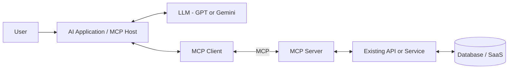
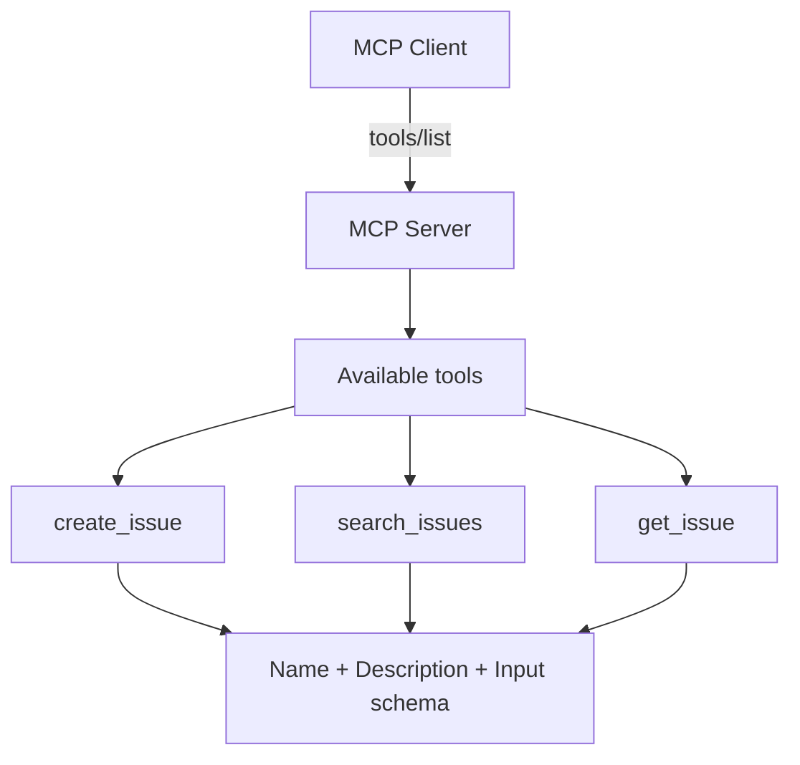
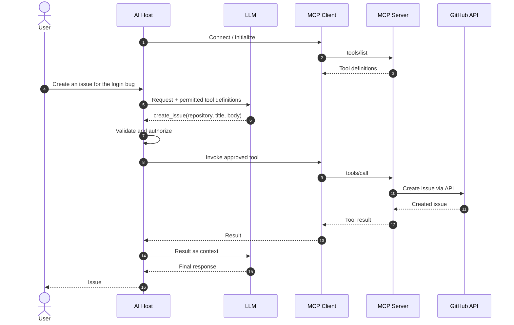
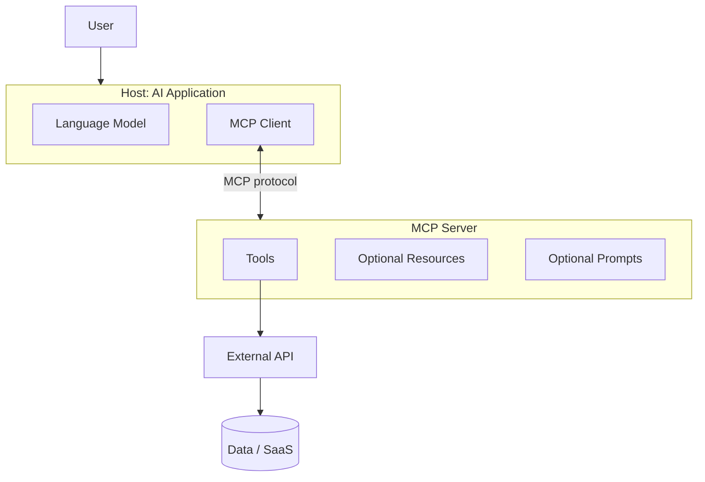
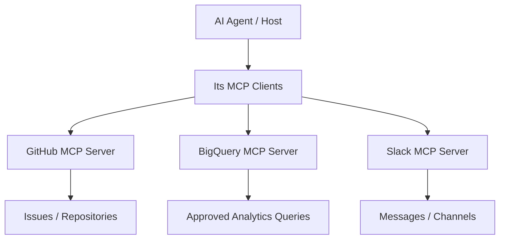
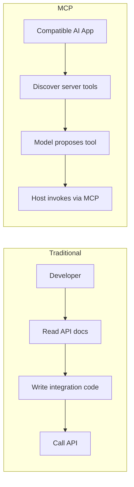
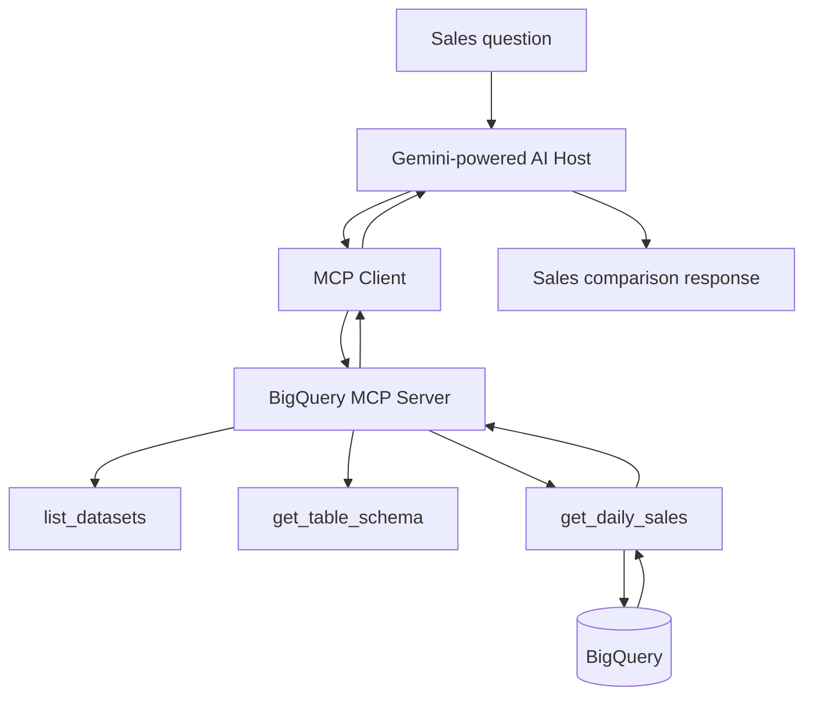
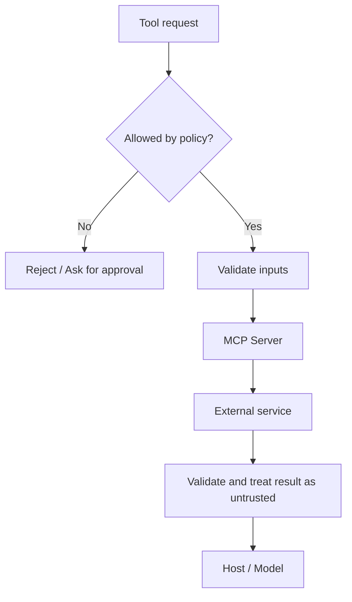
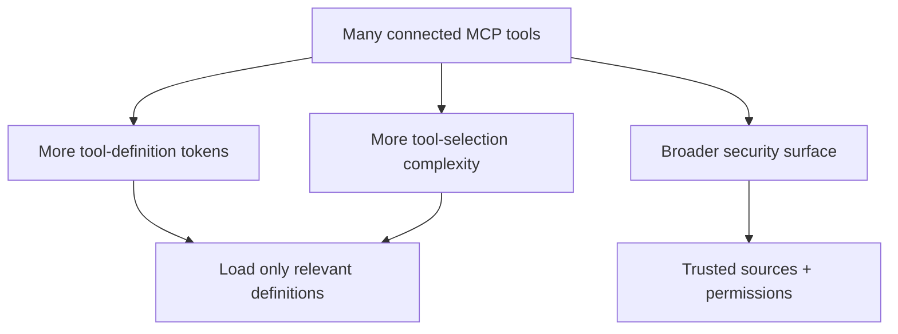

# What Is MCP? A Practical Guide to Model Context Protocol

*From tool discovery to real API calls: a visual, step-by-step explanation for AI engineers.*

Imagine asking an AI assistant to create a GitHub issue, query yesterday’s sales, or read a project document. A language model can decide which action is useful, but it does not automatically have access to GitHub, BigQuery, or your files. Something must connect the AI application to those systems, describe the available actions, and execute approved requests.

That is where **Model Context Protocol (MCP)** comes in.

MCP is an open protocol for connecting AI applications to external capabilities through a standard interface. An MCP server can expose **tools** (actions), **resources** (data/context), and **prompts** (reusable prompt templates). MCP often wraps existing APIs; it does not replace them.

> **Simple memory aid:** The model proposes a tool call; the AI application controls its execution; the MCP server connects that call to a real capability.

## 1. The big picture



The **host** is the AI application. It coordinates the model and permissions. An **MCP client** manages a connection to an MCP server. The **MCP server** publishes capabilities; it may call an existing service such as GitHub or BigQuery.

## 2. How an MCP server describes itself

Instead of requiring an agent developer to hardcode every endpoint, a compatible MCP client can ask a server which tools it has. Tool definitions include a name, a plain-English description, and a machine-readable input schema.



Here is a simplified example of a tool description (illustrative, not a full wire-protocol exchange):

```json
{
  "name": "create_issue",
  "description": "Create a new issue in an authorized GitHub repository",
  "inputSchema": {
    "type": "object",
    "properties": {
      "repository": {"type": "string"},
      "title": {"type": "string"},
      "body": {"type": "string"}
    },
    "required": ["repository", "title"]
  }
}
```

Tool descriptions matter. An LLM may use their wording to choose between similar tools, so clear descriptions are a kind of **prompt/interface design**. But descriptions and tool outputs are also **untrusted input** when they come from a third party.

## 3. An entire tool call, step by step

A user says: **“Create a GitHub issue for the login bug.”**



The key stages are **connect → discover → select → authorize → execute → return → respond**.

1. **Connect.** The host establishes an MCP client-server connection.
2. **Discover.** The client requests tools from the server, commonly through `tools/list`.
3. **Select.** The host supplies relevant tool definitions to the model; the model proposes `create_issue` and arguments.
4. **Authorize.** The host checks permission and obtains any required approval. Do not assume the model can execute the operation on its own.
5. **Execute.** The client calls the MCP server, commonly using `tools/call`; the server invokes GitHub’s API.
6. **Return.** The server returns a structured result. The host passes it back to the model.
7. **Respond.** The model reports the outcome to the user.

## 4. MCP architecture: the three roles



| Role | Responsibility | Example |
|---|---|---|
| Host | Orchestrates the AI application, model, permissions, and execution | AI coding or analytics assistant |
| Client | Manages protocol communications with one server | MCP client inside the host |
| Server | Exposes tools, resources, and prompts | GitHub or BigQuery MCP server |

One host may manage multiple client connections, and each server may expose multiple tools. **A server does not grant permission merely by listing a tool.** Permissions still need to be enforced.

## 5. One agent, several servers



Runtime discovery means capabilities can be added through compatible MCP servers rather than requiring a custom integration for every API endpoint. The application still needs to be configured to connect to a server, and its access controls must allow the operation.

## 6. MCP versus APIs, CLIs, function calling, and RAG

| Term | What it is | How it relates to MCP |
|---|---|---|
| **API** | Interface exposed by a service | Often sits underneath an MCP server |
| **CLI** | Terminal commands for people or automation | Can be useful to agents, but conventions vary |
| **Function calling** | A model produces structured tool-call requests | A host may execute those requests through MCP |
| **MCP** | Protocol for discovering and accessing external capabilities | Standardizes tool metadata and invocation |
| **RAG** | Retrieval of context to ground generated answers | Retrieval can be exposed as an MCP tool, but RAG and MCP solve different problems |

### Traditional API integration versus MCP



MCP simplifies standardized *discovery and invocation*. It does not eliminate the need for service-specific permissions, service behavior, operational testing, or API-level security.

## 7. A practical BigQuery analytics example

Suppose someone asks: **“What were yesterday’s sales, and which categories declined?”**



An example tool, `get_daily_sales(date)`, could retrieve approved aggregate sales metrics. For production, prefer restricted or parameterized operations, use read-only credentials where appropriate, enforce dataset-level authorization and query cost controls, and log all calls.

## 8. What about authentication and security?

Remote MCP deployments can use standardized authorization flows such as OAuth when supported. **Not every MCP server uses OAuth**, and MCP does not guarantee that a connected server or returned result is safe.



Security fundamentals include trusted server selection, least-privilege authorization, approval for sensitive actions, input validation, output handling, audit trails, and protection against prompt injection from malicious tool descriptions or results.

## 9. MCP trade-offs

MCP is not automatically the right answer for every integration. A server wrapper can introduce extra code, deployment and maintenance requirements, and network latency. Tool descriptions can consume context tokens if many are exposed to the model, and the larger tool set can make selection more difficult.



A production design should also include timeouts, monitoring, error handling, and **idempotency** or safeguards for retried write operations.

## 10. Questions an interviewer might ask

**What is MCP?** It is an open protocol that standardizes how AI applications discover and access tools, resources, and prompts.

**Who chooses a tool, and who executes it?** The model can propose a tool based on descriptions; the host validates permissions and executes the permitted call via the client.

**What does `tools/list` do?** It discovers the available tool definitions from an MCP server.

**What does `tools/call` do?** It invokes a particular exposed tool with arguments.

**Does MCP replace APIs?** No. An MCP server often wraps one or more existing APIs.

**Does MCP replace RAG?** No. MCP is an integration protocol; RAG is a retrieval-grounded generation approach.

**What could go wrong?** Network or server failures, bad tool selection, token and latency overhead, unexpected side effects, excessive privileges, and prompt injection.

## 11. A 60-second interview explanation

> “MCP, or Model Context Protocol, is an open standard for connecting AI applications to external tools and data sources. It uses a host-client-server architecture. The host runs the agent, the MCP client manages the connection, and the server exposes tools, resources, and prompts. Each tool has a name, description, and input schema, so the client can discover it at runtime and the model can select it based on the user’s request. The host checks permissions and invokes the selected tool through the MCP client. The server then communicates with the external API and returns the result. The major benefits are interoperability and reduced custom integration work. In production, I would manage authentication, least privilege, approval gates, token usage, latency, monitoring, and prompt-injection risks.”

## 12. How to teach this in a 15-minute Lark session

| Time | Topic | Diagram |
|---|---|---|
| 0–2 min | Why MCP exists | Big picture |
| 2–5 min | Host, client, server | Architecture |
| 5–8 min | Tool discovery and schemas | `tools/list` |
| 8–12 min | GitHub issue walk-through | Sequence diagram |
| 12–15 min | Trade-offs and audience questions | Security and token-cost flow |

You can screen-share this README in a Markdown preview (such as a compatible IDE or Markdown renderer). **Mermaid** diagrams render in viewers that support Mermaid, including GitHub's Markdown display. If your viewer does not support Mermaid, the code blocks will show the diagram source rather than a drawing.

---

*This is an original teaching guide based on the MCP explainer discussed in the conversation, expanded with illustrative architecture and interview scenarios. Examples and sample tool results are not live integrations.*
