# Six AI Engineering Concepts Explained — YouTube Video Package

> **Audience:** AI engineers, software engineers, product managers, and interview candidates  
> **Format:** A beginner-friendly educational video with redrawable diagrams  
> **Note:** This is an original teaching guide based on the concepts in the supplied transcript, not a verbatim transcription.

## Recommended video title

**6 AI Engineering Concepts You MUST Know Before Your Interview | RAG, Agents, MCP & Evals**

### Alternative titles
1. AI Engineering Explained: Tokens, Prompts, Embeddings, RAG, Agents & Evals
2. AI Engineer Interview Prep: 6 Core Concepts Explained with Simple Diagrams
3. How ChatGPT and AI Agents Work: 6 Concepts Every Engineer Should Know

## Thumbnail idea

Large headline: **6 AI CONCEPTS**  
Small supporting line: **INTERVIEW READY**  
Visual: six labeled nodes — Tokens, Prompts, Embeddings, RAG, Agents, Evals — feeding a central “AI App” box.

## Video description — copy and paste

Want to understand the building blocks behind ChatGPT-style applications, coding assistants, and AI agents? In this practical tutorial, we break down six core AI engineering concepts with simple diagrams and real examples: tokens and context windows, prompt engineering, embeddings, retrieval-augmented generation (RAG), AI agents and MCP, and evaluations (evals).

You will learn how an LLM processes context, why prompts matter, how semantic search works, how RAG grounds answers in company data, how agents use tools to take actions, and how to evaluate systems whose outputs are not always identical.

**What you will learn:**
- Tokens, context windows, and attention
- Prompts, system/developer instructions, and prompt engineering
- Embeddings, vectors, and semantic similarity
- RAG: indexing, retrieval, grounding, and citations
- AI agents, tool calls, and Model Context Protocol (MCP)
- Evals: golden datasets, retrieval metrics, answer quality, latency, and cost
- Common interview questions and production trade-offs

**Who is this for?** AI engineers, software developers, data engineers, product managers, solution architects, and anyone preparing for an AI engineering interview.

**Key takeaway:** Models generate; embeddings find; RAG grounds; agents act; MCP connects; evals measure.

Subscribe for more practical AI Engineering, RAG, MCP, Agentic AI, and system-design tutorials.

#AIEngineering #RAG #AIAgents #MCP #LLM

## YouTube tags — copy into YouTube Studio

AI engineering, AI engineer interview, AI engineering interview preparation, AI concepts explained, large language models, LLM explained, tokens, context window, attention mechanism, prompt engineering, system prompts, embeddings explained, vector embeddings, semantic search, vector database, RAG explained, retrieval augmented generation, AI agents, agentic AI, AI agent architecture, MCP, Model Context Protocol, MCP server, tool calling, function calling, LLM evaluations, AI evals, LLM as a judge, RAG evaluation, ChatGPT architecture, Claude AI, Cursor AI, generative AI tutorial

*YouTube tags are secondary metadata; put the main search phrase naturally in the title, opening lines of the description, and spoken introduction.*

## Suggested video chapters

These are **planning timestamps**, not timestamps verified against a recorded video. Adjust after recording.

| Time | Chapter | Teaching goal |
|---|---|---|
| 00:00 | Intro: The six AI building blocks | Set expectations |
| 00:45 | 1. Tokens and context windows | Explain model input limits |
| 03:00 | 2. Prompts and prompt engineering | Explain instructions and context |
| 05:10 | 3. Embeddings | Explain semantic similarity |
| 07:20 | 4. RAG | Show retrieval before generation |
| 10:15 | 5. Agents and MCP | Show tool-use loop and integration |
| 13:20 | 6. Evals | Show how to measure quality |
| 16:00 | Interview recap and closing | Connect the concepts |

## Diagram 1 — The complete map

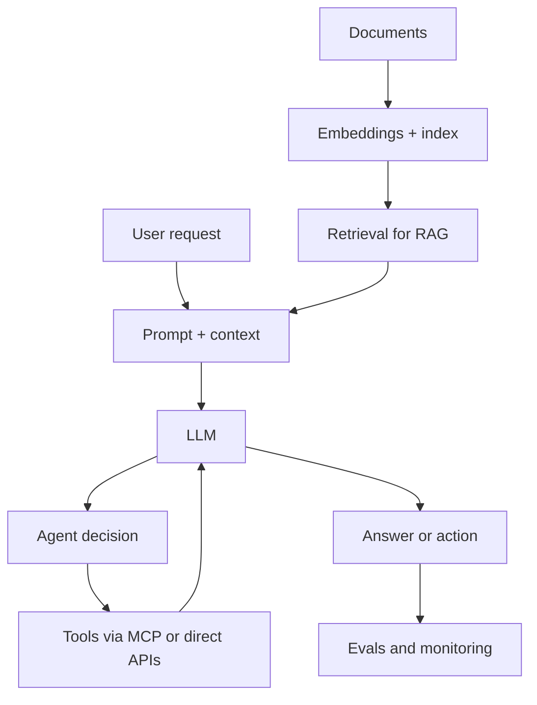

**Explain:** These are not six competing technologies. They work together in the same AI application.

## Concept 1 — Tokens, context windows, and attention

A **token** is a unit used by a model's tokenizer. It may be a word, part of a word, punctuation, or another text fragment. English averages are useful for rough estimates, but token counts vary with language and tokenizer.

The **context window** limits how much input and generated content a model can process in a given interaction. This may include instructions, messages, retrieved documents, tool definitions, and outputs. Applications typically resend or otherwise reconstruct relevant conversation context across requests; the model does not automatically possess an unlimited persistent transcript.

**Attention** helps a transformer model relate tokens to one another when computing representations. It is not the same thing as human attention or guaranteed perfect recall.

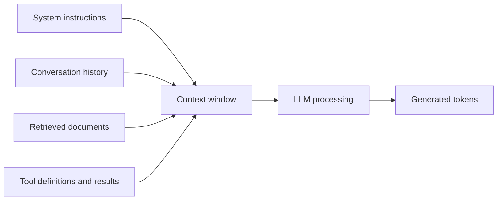

**Whiteboard line:** "Everything the model needs for this response has to be available in its effective context, and long contexts require deliberate management."

**Interview question:** What happens when a conversation exceeds the context window?  
**Answer:** The application may truncate, summarize, retrieve past messages, or use a model with a larger window. Each choice trades off cost, latency, and information loss.

## Concept 2 — Prompts and prompt engineering

A **prompt** is the input supplied to the model, including task instructions and context. Product applications commonly build it from multiple message roles and data sources. **Prompt engineering** means designing, testing, and refining instructions and context for reliable task performance.

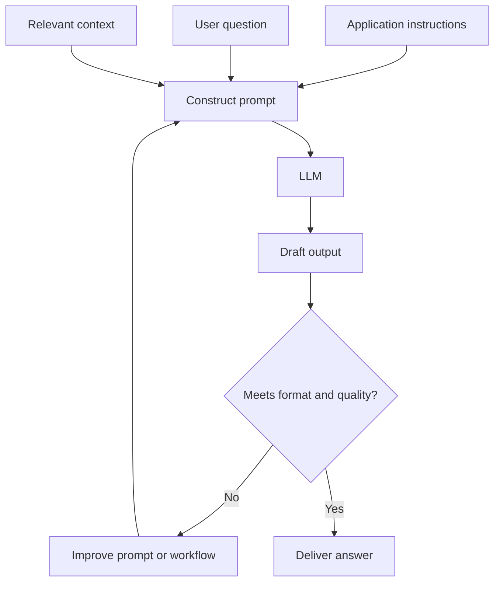

**Practical example:** “Summarize this incident in three bullets. Include impact, root cause, and next steps. If the root cause is unknown, say so.”

**Interview point:** Better prompts help, but authentication, data permissions, output validation, and deterministic business rules must live in application code or other trusted enforcement layers.

## Concept 3 — Embeddings and semantic search

An **embedding** converts text (or another supported input type) into a numerical vector in a learned representation space. Similar meanings often produce vectors that are near one another under a chosen similarity measure.

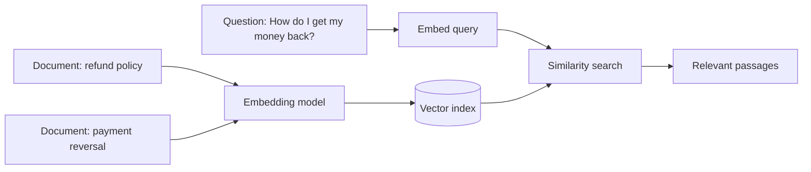

**Example:** A user searches for “How can I get my money back?” and finds a “Refund and cancellation policy” article even though the exact words differ.

**Interview point:** Embedding similarity is not truth. Metadata filters, hybrid keyword search, reranking, access controls, and evaluation can improve retrieval quality.

## Concept 4 — RAG (retrieval-augmented generation)

RAG is a workflow in which the application retrieves relevant information and provides it to the model as grounding context before or during answer generation.

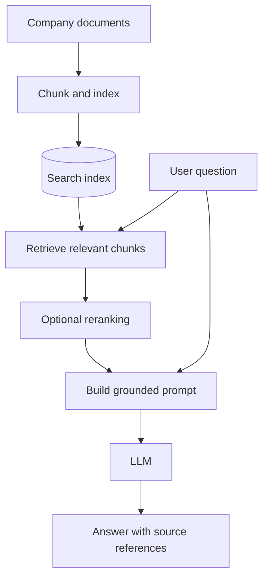

**Example:** “What is the latest internal travel reimbursement policy?” The assistant searches approved company policy documents rather than guessing based on model training.

**Interview point:** RAG quality depends on source freshness, access permissions, chunking, retrieval recall, ranking, context assembly, and whether the answer is actually supported by retrieved evidence.

## Concept 5 — Agents, tools, and MCP

An **AI agent** is an application that lets a model choose and sequence actions, often through a repeated observe–decide–act loop. Not every agent explicitly writes a plan, and some are limited to a single tool call.

**MCP (Model Context Protocol)** is a standard interface for discovering and invoking capabilities exposed by MCP servers. Agents can also use tools without MCP.

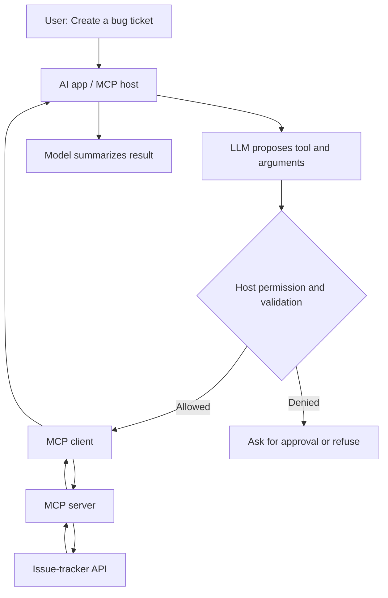

**Simple agent loop:**

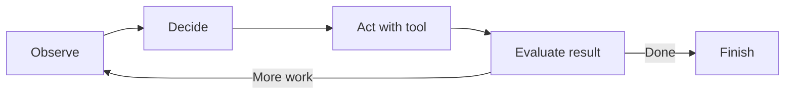

**Interview point:** The model proposes actions; the application and connected systems enforce authorization. Production systems need tool allowlists, least privilege, user approval for sensitive changes, timeouts, retries where safe, audit logs, and prompt-injection defenses.

## Concept 6 — Evals: measuring AI quality

Because model responses can be open-ended and variable, exact-string unit tests alone are not sufficient. Use a representative evaluation dataset and several complementary checks. Traditional unit tests still matter for deterministic code, parsers, and business rules.

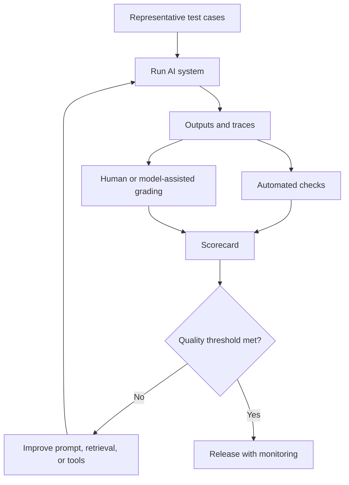

| What to evaluate | Example measure |
|---|---|
| Retrieval | Recall@k, precision@k, nDCG |
| Grounded answers | Faithfulness, citation support, factual correctness |
| Agent operations | Task completion, tool selection accuracy, invalid-call rate |
| Safety | Unauthorized action rate, injection resilience |
| User experience | p50/p95 latency, cost per successful task |

**Interview point:** Use human-reviewed examples to calibrate model-based judges. Avoid using one LLM judge as the sole source of truth.

## One example connecting all six concepts

**Scenario: An internal IT support assistant**

1. The employee asks, “Can I get a replacement laptop under our policy?”
2. The application builds a **prompt** containing the request and approved instructions.
3. The request and retrieved policy passages consume **tokens** in the **context window**.
4. **Embeddings** help find semantically relevant IT policy passages.
5. **RAG** supplies the source passages so the model can answer with evidence.
6. An **agent** may call an approved ticket-creation tool through **MCP**, after permission checks.
7. **Evals** measure policy correctness, appropriate tool behavior, latency, and user satisfaction.

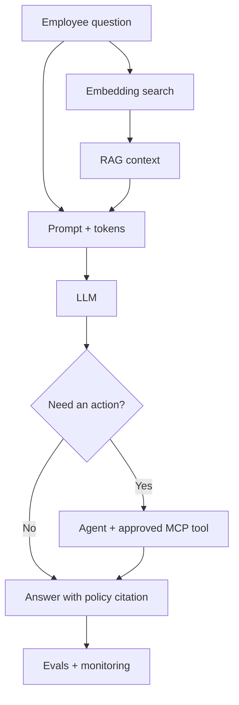

## Rapid-fire interview questions

**Q1. Are tokens the same as words?** No. A tokenizer may split words into multiple units, and punctuation also contributes.

**Q2. Does the LLM remember everything from previous chats?** Not inherently. Applications must supply or retrieve relevant context, and some products separately implement memory features.

**Q3. Are embeddings a database?** No. Embeddings are vectors; vector databases or indexes store and search them.

**Q4. Is RAG fine-tuning?** No. RAG supplies retrieved context at inference time; fine-tuning changes model parameters through training.

**Q5. Does MCP replace APIs?** No. MCP often exposes capabilities backed by existing APIs.

**Q6. How are agents different from chatbots?** Agents can coordinate tool calls and actions; a basic chatbot may only generate responses.

**Q7. Why can't we use only unit tests for AI?** Exact outputs vary. Combine unit tests with dataset-based quality evaluation, safety checks, and human review.

## Short video closing script

“Here is the easiest way to remember these concepts. Tokens are how models read and write. The context window is how much information they can process at one time. Prompts tell the model what to do. Embeddings help find related information. RAG brings that information into the answer. Agents take actions through tools, with MCP offering a standard way to connect to them. And evals tell us whether the whole system is working. If you can explain not only these definitions but also their failure modes, you are already thinking like an AI engineer.”

---

**Publishing note:** Record the video first, then update the chapter timestamps to match the actual export. Do not claim the draft timestamps correspond to the original source video.

---

# Medium Article

# Six AI Engineering Concepts You Should Understand Before Your Next Interview

*Tokens, prompts, embeddings, RAG, agents, MCP, and evals — explained through one practical system.*

If you have used ChatGPT, Claude, or an AI coding assistant, you have already seen how impressive a language model can be. But as soon as you try to build a useful AI product, you run into questions that a demo rarely answers.

How does the model handle a long conversation? Where does it get company-specific information? How can it perform an action rather than simply describe one? And how do you know the result is correct?

I find it helpful to think about AI engineering as a collection of small building blocks rather than one giant black box. Six ideas explain a large part of how modern applications are built: **tokens and context windows, prompts, embeddings, retrieval-augmented generation (RAG), agents and MCP, and evaluations.**

Let's walk through each one, then connect them in a realistic enterprise example.

## 1. Tokens and context windows: what the model can see

A language model processes text as **tokens**, not necessarily complete words. A token could be part of a word, a word, or a punctuation mark. The exact splitting depends on the tokenizer and the language.

The **context window** determines how much information the model can handle in one interaction. This may include application instructions, the user's question, earlier messages, retrieved documents, tool descriptions, and tool results. Output generation also consumes model capacity under model-specific limits.

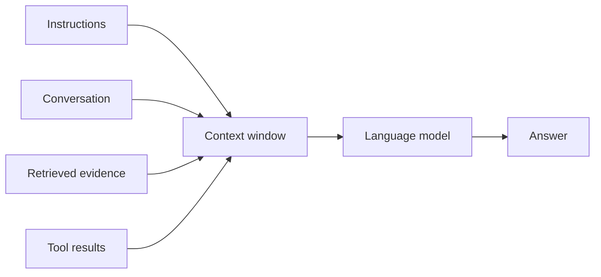

Transformer **attention** helps the model learn relationships among tokens. But a larger window does not guarantee that every detail will be used perfectly.

**An important nuance:** A model does not automatically have a complete, permanent memory of every earlier conversation. The application may resend messages, retrieve past information, or maintain a separate memory system. When context becomes too large, developers may summarize, select, or retrieve only what matters.

For interviews, the practical questions are about *context management*: how do you preserve relevant information, avoid unnecessary tokens, and prevent long-context failures?

## 2. Prompts: instructions that shape behavior

A **prompt** is the information an application sends to a model so it can perform a task. It may combine system or developer instructions, a user question, examples, and relevant source material.

**Prompt engineering** is not just writing clever sentences. It is designing the task, output format, evidence requirements, and failure behavior, then testing whether those instructions work across many examples.

Consider two instructions:

> “Summarize the incident.”

And:

> “Summarize the incident in three bullets: customer impact, confirmed cause, and next action. If the cause is not established, write ‘Cause not yet confirmed.’”

The second request is more useful because it specifies what a successful answer looks like and how to express uncertainty.

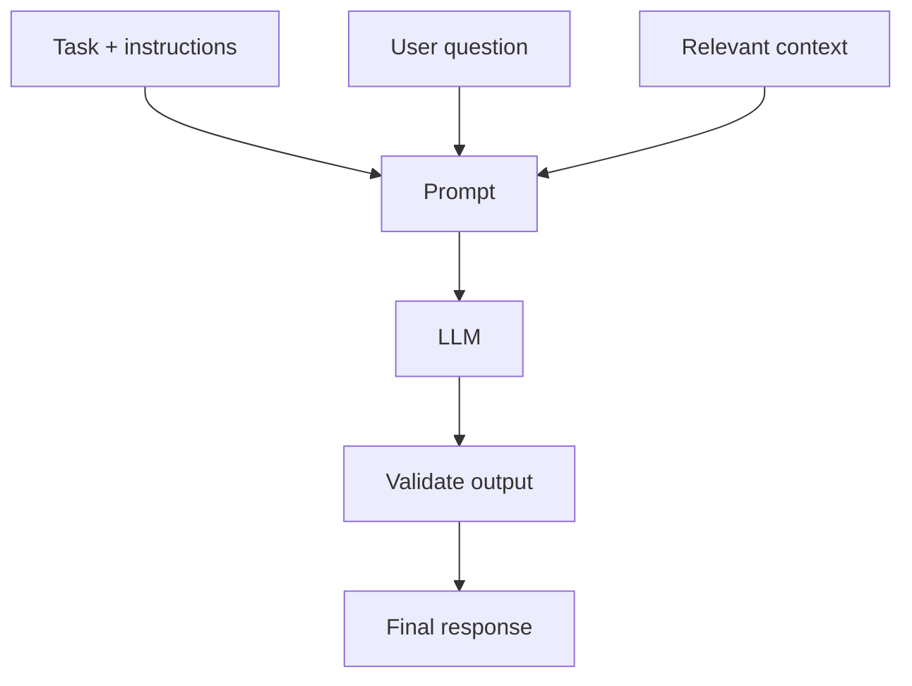

There is still an important boundary: prompts are not security controls. If a tool may change payroll records, the permission check must happen in trusted application or service logic, not merely in a sentence asking the model to be careful.

## 3. Embeddings: finding meaning without exact keywords

An **embedding** represents text as a vector — a list of numbers learned by a model. The goal is to place related meanings close together in a representation space.

Imagine an employee asks, “How do I get reimbursed for a trip?” The policy document might be titled “Travel Expense Claims.” A pure keyword match may struggle, while semantic search can recognize the relationship between *reimbursed* and *expense claims*.

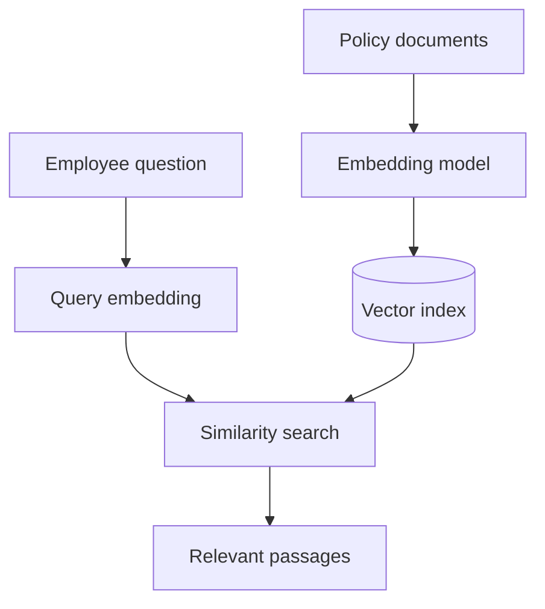

Embeddings are useful in knowledge search, recommendations, clustering, and duplicate detection. But nearest neighbors are not automatically correct answers. Good retrieval systems often combine vector search with keywords, metadata filters, reranking, and authorization checks.

This leads to the next building block.

## 4. RAG: bringing fresh, relevant evidence into the answer

**Retrieval-augmented generation**, or **RAG**, adds a retrieval step before or during text generation. Instead of expecting the model to know an internal HR policy, the application searches approved sources and supplies relevant passages as context.

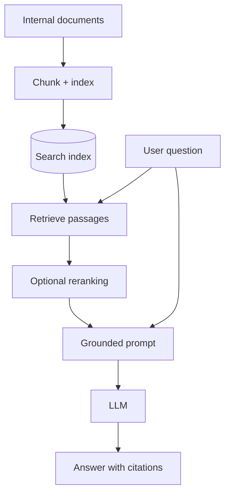

A typical RAG system has two sides. The **indexing pipeline** processes source documents and makes them searchable. The **query pipeline** retrieves relevant passages, optionally reranks them, and sends selected evidence to the model.

RAG is especially helpful for internal knowledge that changes frequently or should not be embedded into model weights. It can improve groundedness, but it does not magically eliminate hallucinations.

For an AI engineering interview, I would be ready to discuss retrieval recall, chunk size, hybrid search, reranking, permission-aware retrieval, source freshness, citation quality, and what happens when the search returns no useful evidence.

## 5. Agents and MCP: from answering to acting

A chat assistant can answer, “Here is how to submit a service ticket.” An **agent** can potentially submit that ticket, if its application gives it an approved tool and appropriate permissions.

An agent is usually an orchestration pattern in which a model decides what to do, invokes tools, observes the results, and either continues or finishes. Some agents run multi-step loops; others perform a short sequence.

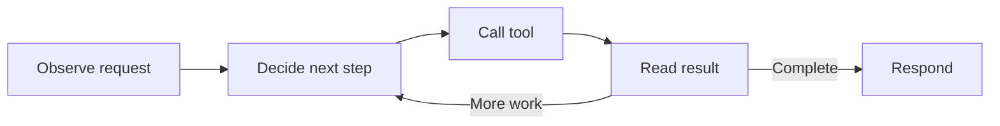

Where does **MCP**, the Model Context Protocol, fit in?

MCP provides a standard way for compatible applications to discover and invoke tools exposed by MCP servers, alongside other capabilities such as resources and prompts. The host application manages model interaction; an MCP client communicates with an MCP server; the server often connects to an existing API or data source.

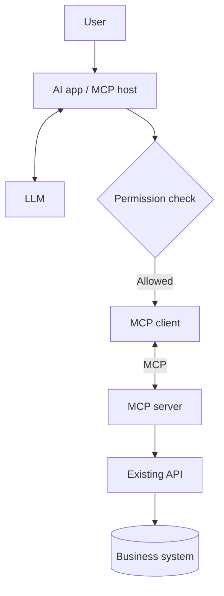

Each exposed tool can describe its name, purpose, and argument schema. The client can discover available tools at runtime. The model may propose a call, but **the application and downstream systems must control what is actually allowed**.

MCP does not replace REST APIs, and an agent does not have to use MCP. MCP is an interoperability layer that can make external capabilities easier for different AI applications to connect to.

The production trade-offs matter: more tools can consume context, remote calls can add latency, and untrusted descriptions or retrieved tool content can become prompt-injection vectors. Treat MCP servers as software dependencies with permissions, monitoring, and explicit trust boundaries.

## 6. Evals: proving that the system works

Traditional software often has tests like `expected == actual`. LLM answers can vary while still being correct, which makes AI testing more nuanced.

**Evals** use representative test cases and scoring methods to measure whether an AI system is meeting its goals. This does not mean abandoning unit tests. We still unit-test deterministic code, schemas, and API integrations. For model behavior, we add dataset-based evaluation and human review.

```mermaid
flowchart TD
    D[Evaluation dataset] --> R[Run AI workflow]
    R --> O[Answers + traces]
    O --> C[Programmatic checks]
    O --> J[Human or model-assisted judging]
    C --> S[Quality scorecard]
    J --> S
    S --> I[Improve and rerun]
```

For a RAG assistant, a useful evaluation plan may include:

| Layer | Example evaluation |
|---|---|
| Retrieval | Did the correct passage appear in the top-k results? |
| Answers | Is the answer correct and supported by sources? |
| Agents | Did the tool sequence complete the task safely? |
| Operations | What are p50/p95 latency, error rate, and cost? |
| Safety | Does the system resist injection and unauthorized actions? |

A model-based judge can help scale grading, but should be calibrated against human-reviewed examples. Watch for judge bias and false confidence.

The strongest evaluation approach starts with real user tasks and meaningful failure cases — not just a handful of polished demo prompts.

## Putting everything together: an internal support assistant

Suppose you are building an internal assistant for employees. Someone asks:

> “Can I replace my laptop under our IT policy, and can you create the request?”

Here is how the six concepts fit together:

1. **Tokens and context:** The user's question, rules, and retrieved evidence need to fit within the model's context budget.
2. **Prompt:** The application instructs the model to answer only from approved policy sources and be explicit about uncertainty.
3. **Embeddings:** Semantic search finds relevant sections of the IT equipment policy.
4. **RAG:** The assistant reads those sections and explains whether the employee qualifies, with a source reference.
5. **Agent + MCP:** If an action is needed, the application checks permissions and invokes an approved ticket-creation tool, potentially via MCP.
6. **Evals:** The team tests answer correctness, ticket creation behavior, security, speed, and cost.

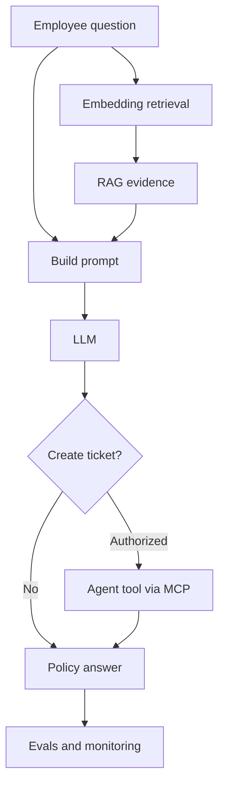

This is the important shift from experimentation to engineering: the model is only one component. Most of the reliability comes from the systems around it.

## What interviewers are really looking for

Definitions matter, but they are rarely the entire answer. Strong interview responses connect a concept to **architecture, trade-offs, failures, and measurement**.

If asked about RAG, explain not only what retrieval is but how you detect weak recall and unsupported answers. If asked about agents, discuss tool permissions, retries, and traces. If asked about context windows, explain what you truncate or summarize. If asked about evals, describe the dataset, scorecard, and release threshold.

My favorite way to remember the concepts is:

**Tokens represent input and output. Prompts guide behavior. Embeddings find related information. RAG grounds answers. Agents perform actions. MCP connects tools. Evals measure the result.**

Once these pieces become familiar, AI engineering stops looking like a collection of buzzwords and starts looking like a system you can design, test, and operate.

---

*Suggested Medium tags:* Artificial Intelligence, AI Engineering, Large Language Models, RAG, AI Agents

*Author's note: This article is an original expansion of the educational concepts in the supplied video transcript. The diagrams use Mermaid syntax; Medium may not render Mermaid directly, so export them as PNG or SVG images before publishing.*
