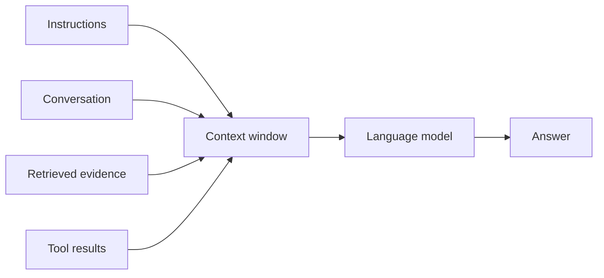
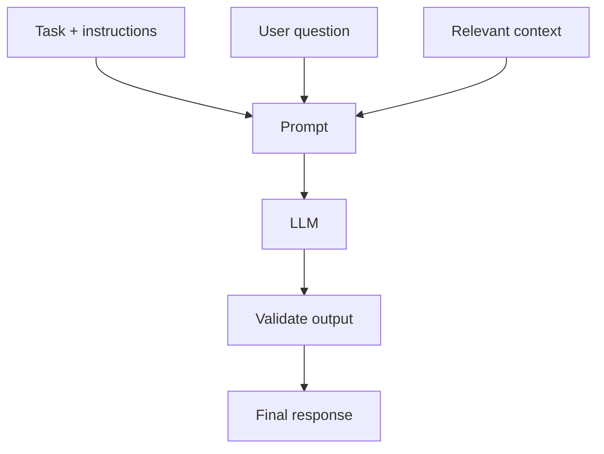
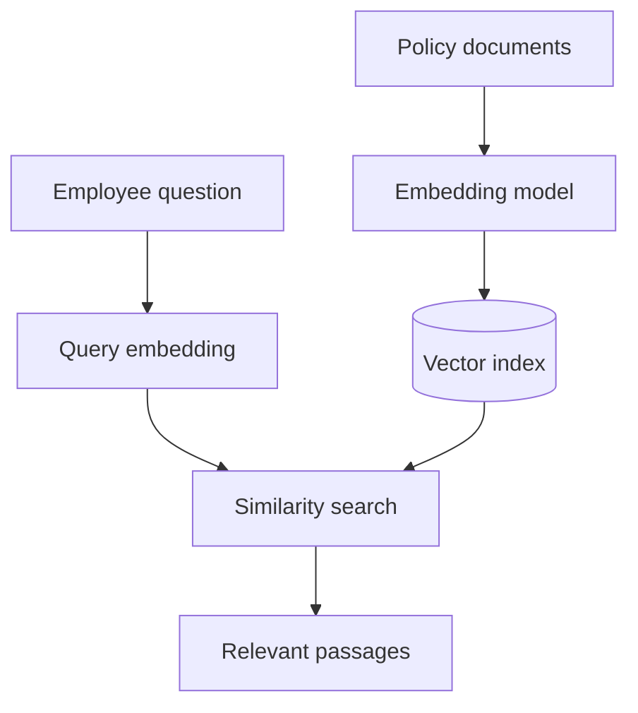
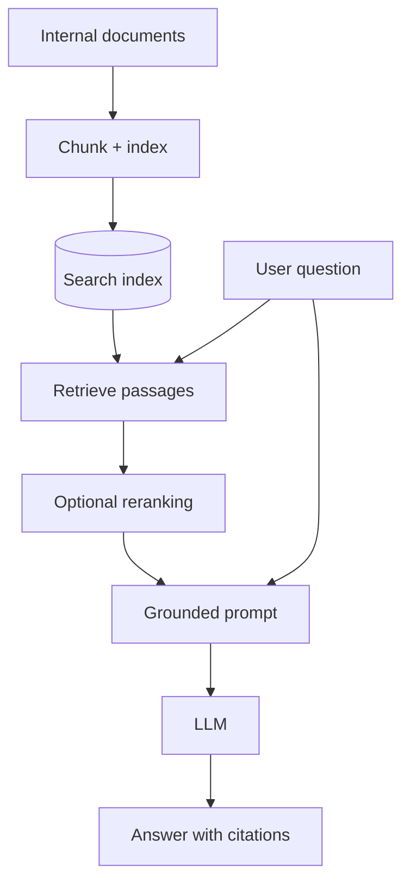
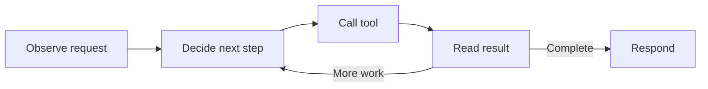
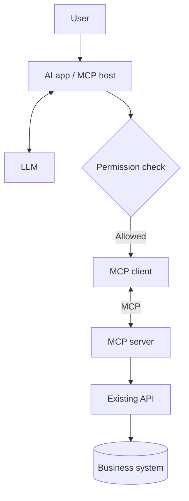
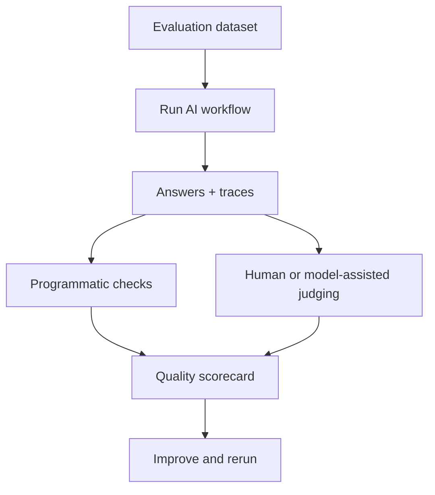
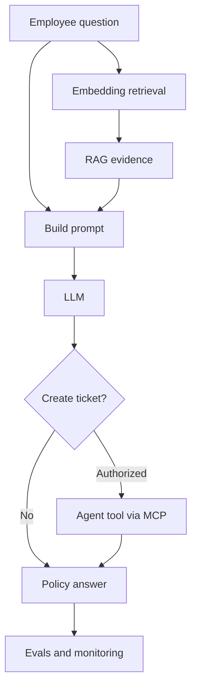

# Six AI Engineering Concepts You Should Understand Before Your Next Interview

*Tokens, prompts, embeddings, RAG, agents, MCP, and evals — explained through one practical system.*

If you have used ChatGPT, Claude, or an AI coding assistant, you have already seen how impressive a language model can be. But as soon as you try to build a useful AI product, you run into questions that a demo rarely answers.

How does the model handle a long conversation? Where does it get company-specific information? How can it perform an action rather than simply describe one? And how do you know the result is correct?

I find it helpful to think about AI engineering as a collection of small building blocks rather than one giant black box. Six ideas explain a large part of how modern applications are built: **tokens and context windows, prompts, embeddings, retrieval-augmented generation (RAG), agents and MCP, and evaluations.**

Let's walk through each one, then connect them in a realistic enterprise example.

## 1. Tokens and context windows: what the model can see

A language model processes text as **tokens**, not necessarily complete words. A token could be part of a word, a word, or a punctuation mark. The exact splitting depends on the tokenizer and the language.

The **context window** determines how much information the model can handle in one interaction. This may include application instructions, the user's question, earlier messages, retrieved documents, tool descriptions, and tool results. Output generation also consumes model capacity under model-specific limits.

Transformer **attention** helps the model learn relationships among tokens. But a larger window does not guarantee that every detail will be used perfectly.

**An important nuance:** A model does not automatically have a complete, permanent memory of every earlier conversation. The application may resend messages, retrieve past information, or maintain a separate memory system. When context becomes too large, developers may summarize, select, or retrieve only what matters.

For interviews, the practical questions are about *context management*: how do you preserve relevant information, avoid unnecessary tokens, and prevent long-context failures?

## 2. Prompts: instructions that shape behavior

A **prompt** is the information an application sends to a model so it can perform a task. It may combine system or developer instructions, a user question, examples, and relevant source material.

**Prompt engineering** is not just writing clever sentences. It is designing the task, output format, evidence requirements, and failure behavior, then testing whether those instructions work across many examples.

Consider two instructions:

> “Summarize the incident.”

And:

> “Summarize the incident in three bullets: customer impact, confirmed cause, and next action. If the cause is not established, write ‘Cause not yet confirmed.’”

The second request is more useful because it specifies what a successful answer looks like and how to express uncertainty.

There is still an important boundary: prompts are not security controls. If a tool may change payroll records, the permission check must happen in trusted application or service logic, not merely in a sentence asking the model to be careful.

## 3. Embeddings: finding meaning without exact keywords

An **embedding** represents text as a vector — a list of numbers learned by a model. The goal is to place related meanings close together in a representation space.

Imagine an employee asks, “How do I get reimbursed for a trip?” The policy document might be titled “Travel Expense Claims.” A pure keyword match may struggle, while semantic search can recognize the relationship between *reimbursed* and *expense claims*.

Embeddings are useful in knowledge search, recommendations, clustering, and duplicate detection. But nearest neighbors are not automatically correct answers. Good retrieval systems often combine vector search with keywords, metadata filters, reranking, and authorization checks.

This leads to the next building block.

## 4. RAG: bringing fresh, relevant evidence into the answer

**Retrieval-augmented generation**, or **RAG**, adds a retrieval step before or during text generation. Instead of expecting the model to know an internal HR policy, the application searches approved sources and supplies relevant passages as context.

A typical RAG system has two sides. The **indexing pipeline** processes source documents and makes them searchable. The **query pipeline** retrieves relevant passages, optionally reranks them, and sends selected evidence to the model.

RAG is especially helpful for internal knowledge that changes frequently or should not be embedded into model weights. It can improve groundedness, but it does not magically eliminate hallucinations.

For an AI engineering interview, I would be ready to discuss retrieval recall, chunk size, hybrid search, reranking, permission-aware retrieval, source freshness, citation quality, and what happens when the search returns no useful evidence.

## 5. Agents and MCP: from answering to acting

A chat assistant can answer, “Here is how to submit a service ticket.” An **agent** can potentially submit that ticket, if its application gives it an approved tool and appropriate permissions.

An agent is usually an orchestration pattern in which a model decides what to do, invokes tools, observes the results, and either continues or finishes. Some agents run multi-step loops; others perform a short sequence.

Where does **MCP**, the Model Context Protocol, fit in?

MCP provides a standard way for compatible applications to discover and invoke tools exposed by MCP servers, alongside other capabilities such as resources and prompts. The host application manages model interaction; an MCP client communicates with an MCP server; the server often connects to an existing API or data source.

Each exposed tool can describe its name, purpose, and argument schema. The client can discover available tools at runtime. The model may propose a call, but **the application and downstream systems must control what is actually allowed**.

MCP does not replace REST APIs, and an agent does not have to use MCP. MCP is an interoperability layer that can make external capabilities easier for different AI applications to connect to.

The production trade-offs matter: more tools can consume context, remote calls can add latency, and untrusted descriptions or retrieved tool content can become prompt-injection vectors. Treat MCP servers as software dependencies with permissions, monitoring, and explicit trust boundaries.

## 6. Evals: proving that the system works

Traditional software often has tests like `expected == actual`. LLM answers can vary while still being correct, which makes AI testing more nuanced.

**Evals** use representative test cases and scoring methods to measure whether an AI system is meeting its goals. This does not mean abandoning unit tests. We still unit-test deterministic code, schemas, and API integrations. For model behavior, we add dataset-based evaluation and human review.

For a RAG assistant, a useful evaluation plan may include:

| Layer | Example evaluation |
|---|---|
| Retrieval | Did the correct passage appear in the top-k results? |
| Answers | Is the answer correct and supported by sources? |
| Agents | Did the tool sequence complete the task safely? |
| Operations | What are p50/p95 latency, error rate, and cost? |
| Safety | Does the system resist injection and unauthorized actions? |

A model-based judge can help scale grading, but should be calibrated against human-reviewed examples. Watch for judge bias and false confidence.

The strongest evaluation approach starts with real user tasks and meaningful failure cases — not just a handful of polished demo prompts.

## Putting everything together: an internal support assistant

Suppose you are building an internal assistant for employees. Someone asks:

> “Can I replace my laptop under our IT policy, and can you create the request?”

Here is how the six concepts fit together:

1. **Tokens and context:** The user's question, rules, and retrieved evidence need to fit within the model's context budget.
2. **Prompt:** The application instructs the model to answer only from approved policy sources and be explicit about uncertainty.
3. **Embeddings:** Semantic search finds relevant sections of the IT equipment policy.
4. **RAG:** The assistant reads those sections and explains whether the employee qualifies, with a source reference.
5. **Agent + MCP:** If an action is needed, the application checks permissions and invokes an approved ticket-creation tool, potentially via MCP.
6. **Evals:** The team tests answer correctness, ticket creation behavior, security, speed, and cost.

This is the important shift from experimentation to engineering: the model is only one component. Most of the reliability comes from the systems around it.

## What interviewers are really looking for

Definitions matter, but they are rarely the entire answer. Strong interview responses connect a concept to **architecture, trade-offs, failures, and measurement**.

If asked about RAG, explain not only what retrieval is but how you detect weak recall and unsupported answers. If asked about agents, discuss tool permissions, retries, and traces. If asked about context windows, explain what you truncate or summarize. If asked about evals, describe the dataset, scorecard, and release threshold.

My favorite way to remember the concepts is:

**Tokens represent input and output. Prompts guide behavior. Embeddings find related information. RAG grounds answers. Agents perform actions. MCP connects tools. Evals measure the result.**

Once these pieces become familiar, AI engineering stops looking like a collection of buzzwords and starts looking like a system you can design, test, and operate.

---

*Suggested Medium tags:* Artificial Intelligence, AI Engineering, Large Language Models, RAG, AI Agents

*Author's note: This article is an original expansion of the educational concepts in the supplied video transcript. The diagrams use Mermaid syntax; Medium may not render Mermaid directly, so export them as PNG or SVG images before publishing.*
