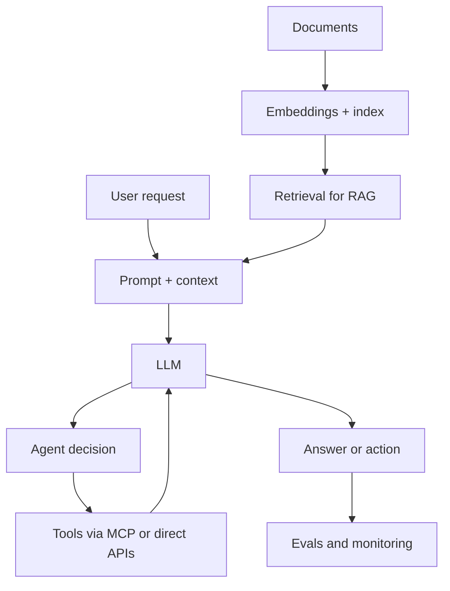
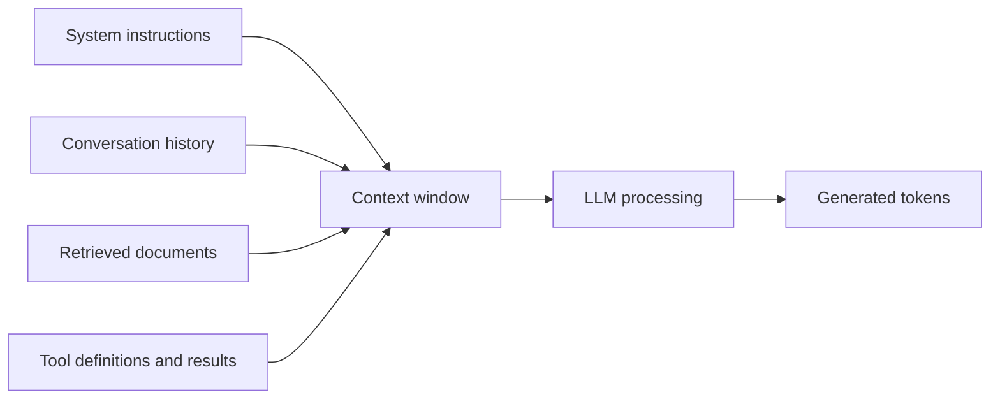
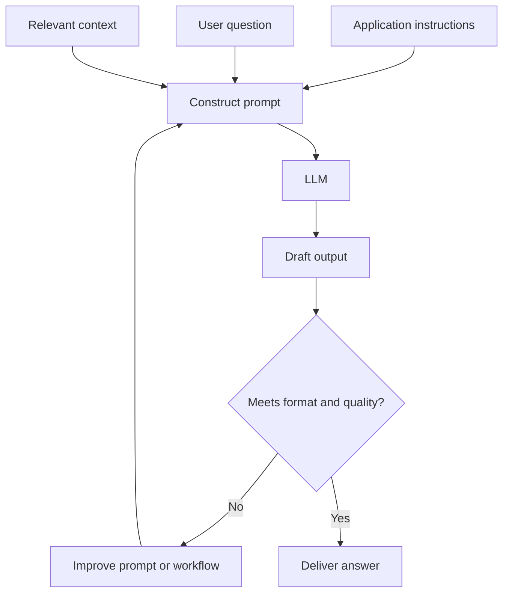
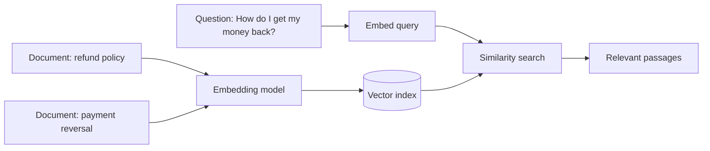
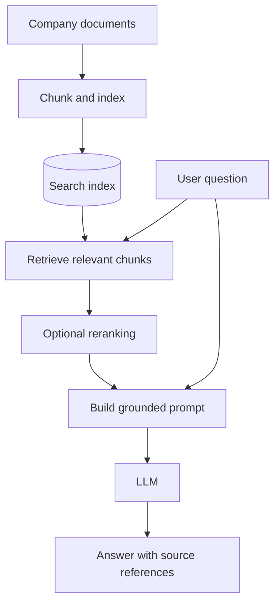
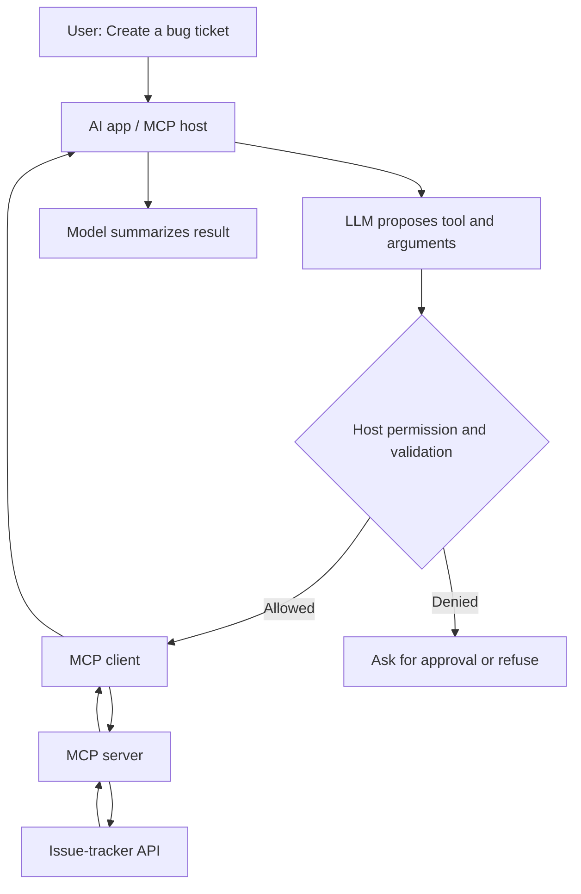
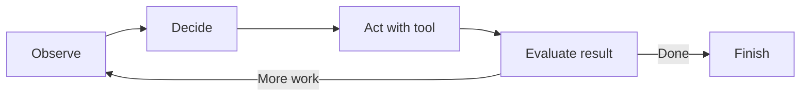
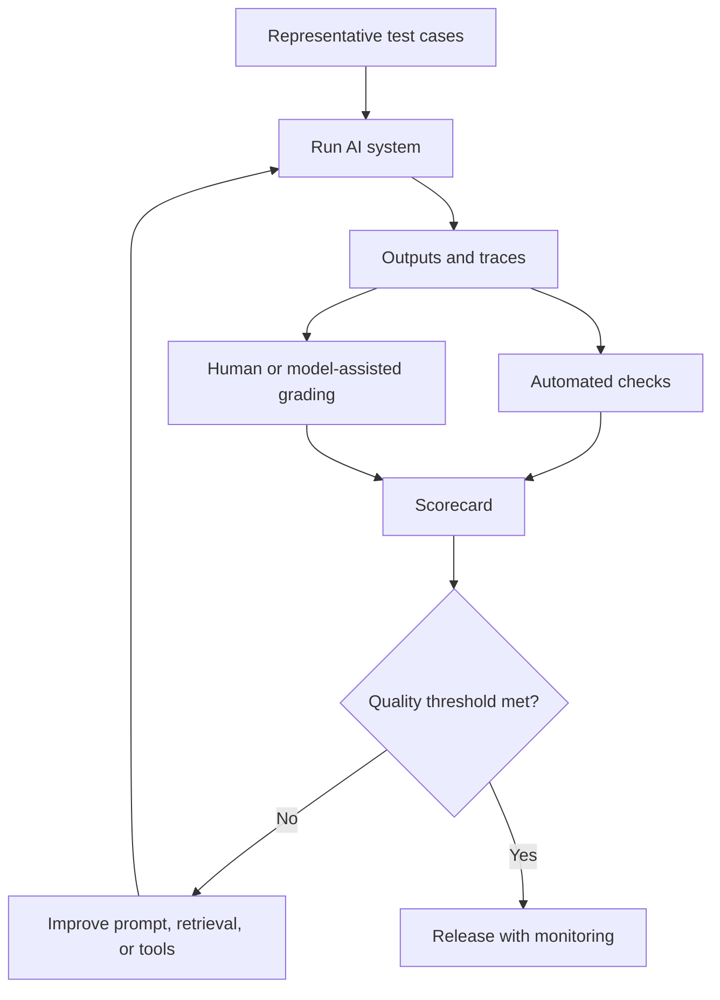
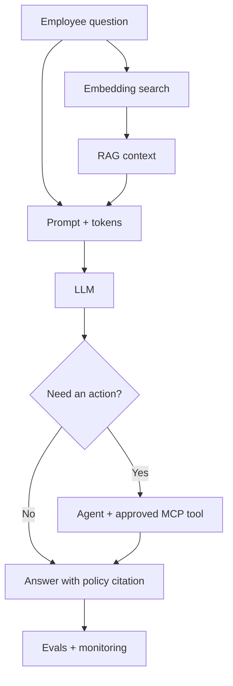

# Six AI Engineering Concepts Explained — YouTube Video Package

> **Audience:** AI engineers, software engineers, product managers, and interview candidates  
> **Format:** A beginner-friendly educational video with redrawable diagrams  
> **Note:** This is an original teaching guide based on the concepts in the supplied transcript, not a verbatim transcription.

## Recommended video title

**6 AI Engineering Concepts You MUST Know Before Your Interview | RAG, Agents, MCP & Evals**

### Alternative titles
1. AI Engineering Explained: Tokens, Prompts, Embeddings, RAG, Agents & Evals
2. AI Engineer Interview Prep: 6 Core Concepts Explained with Simple Diagrams
3. How ChatGPT and AI Agents Work: 6 Concepts Every Engineer Should Know

## Thumbnail idea

Large headline: **6 AI CONCEPTS**  
Small supporting line: **INTERVIEW READY**  
Visual: six labeled nodes — Tokens, Prompts, Embeddings, RAG, Agents, Evals — feeding a central “AI App” box.

## Video description — copy and paste

Want to understand the building blocks behind ChatGPT-style applications, coding assistants, and AI agents? In this practical tutorial, we break down six core AI engineering concepts with simple diagrams and real examples: tokens and context windows, prompt engineering, embeddings, retrieval-augmented generation (RAG), AI agents and MCP, and evaluations (evals).

You will learn how an LLM processes context, why prompts matter, how semantic search works, how RAG grounds answers in company data, how agents use tools to take actions, and how to evaluate systems whose outputs are not always identical.

**What you will learn:**
- Tokens, context windows, and attention
- Prompts, system/developer instructions, and prompt engineering
- Embeddings, vectors, and semantic similarity
- RAG: indexing, retrieval, grounding, and citations
- AI agents, tool calls, and Model Context Protocol (MCP)
- Evals: golden datasets, retrieval metrics, answer quality, latency, and cost
- Common interview questions and production trade-offs

**Who is this for?** AI engineers, software developers, data engineers, product managers, solution architects, and anyone preparing for an AI engineering interview.

**Key takeaway:** Models generate; embeddings find; RAG grounds; agents act; MCP connects; evals measure.

Subscribe for more practical AI Engineering, RAG, MCP, Agentic AI, and system-design tutorials.

#AIEngineering #RAG #AIAgents #MCP #LLM

## YouTube tags — copy into YouTube Studio

AI engineering, AI engineer interview, AI engineering interview preparation, AI concepts explained, large language models, LLM explained, tokens, context window, attention mechanism, prompt engineering, system prompts, embeddings explained, vector embeddings, semantic search, vector database, RAG explained, retrieval augmented generation, AI agents, agentic AI, AI agent architecture, MCP, Model Context Protocol, MCP server, tool calling, function calling, LLM evaluations, AI evals, LLM as a judge, RAG evaluation, ChatGPT architecture, Claude AI, Cursor AI, generative AI tutorial

*YouTube tags are secondary metadata; put the main search phrase naturally in the title, opening lines of the description, and spoken introduction.*

## Suggested video chapters

These are **planning timestamps**, not timestamps verified against a recorded video. Adjust after recording.

| Time | Chapter | Teaching goal |
|---|---|---|
| 00:00 | Intro: The six AI building blocks | Set expectations |
| 00:45 | 1. Tokens and context windows | Explain model input limits |
| 03:00 | 2. Prompts and prompt engineering | Explain instructions and context |
| 05:10 | 3. Embeddings | Explain semantic similarity |
| 07:20 | 4. RAG | Show retrieval before generation |
| 10:15 | 5. Agents and MCP | Show tool-use loop and integration |
| 13:20 | 6. Evals | Show how to measure quality |
| 16:00 | Interview recap and closing | Connect the concepts |

## Diagram 1 — The complete map

**Explain:** These are not six competing technologies. They work together in the same AI application.

## Concept 1 — Tokens, context windows, and attention

A **token** is a unit used by a model's tokenizer. It may be a word, part of a word, punctuation, or another text fragment. English averages are useful for rough estimates, but token counts vary with language and tokenizer.

The **context window** limits how much input and generated content a model can process in a given interaction. This may include instructions, messages, retrieved documents, tool definitions, and outputs. Applications typically resend or otherwise reconstruct relevant conversation context across requests; the model does not automatically possess an unlimited persistent transcript.

**Attention** helps a transformer model relate tokens to one another when computing representations. It is not the same thing as human attention or guaranteed perfect recall.

**Whiteboard line:** "Everything the model needs for this response has to be available in its effective context, and long contexts require deliberate management."

**Interview question:** What happens when a conversation exceeds the context window?  
**Answer:** The application may truncate, summarize, retrieve past messages, or use a model with a larger window. Each choice trades off cost, latency, and information loss.

## Concept 2 — Prompts and prompt engineering

A **prompt** is the input supplied to the model, including task instructions and context. Product applications commonly build it from multiple message roles and data sources. **Prompt engineering** means designing, testing, and refining instructions and context for reliable task performance.

**Practical example:** “Summarize this incident in three bullets. Include impact, root cause, and next steps. If the root cause is unknown, say so.”

**Interview point:** Better prompts help, but authentication, data permissions, output validation, and deterministic business rules must live in application code or other trusted enforcement layers.

## Concept 3 — Embeddings and semantic search

An **embedding** converts text (or another supported input type) into a numerical vector in a learned representation space. Similar meanings often produce vectors that are near one another under a chosen similarity measure.

**Example:** A user searches for “How can I get my money back?” and finds a “Refund and cancellation policy” article even though the exact words differ.

**Interview point:** Embedding similarity is not truth. Metadata filters, hybrid keyword search, reranking, access controls, and evaluation can improve retrieval quality.

## Concept 4 — RAG (retrieval-augmented generation)

RAG is a workflow in which the application retrieves relevant information and provides it to the model as grounding context before or during answer generation.

**Example:** “What is the latest internal travel reimbursement policy?” The assistant searches approved company policy documents rather than guessing based on model training.

**Interview point:** RAG quality depends on source freshness, access permissions, chunking, retrieval recall, ranking, context assembly, and whether the answer is actually supported by retrieved evidence.

## Concept 5 — Agents, tools, and MCP

An **AI agent** is an application that lets a model choose and sequence actions, often through a repeated observe–decide–act loop. Not every agent explicitly writes a plan, and some are limited to a single tool call.

**MCP (Model Context Protocol)** is a standard interface for discovering and invoking capabilities exposed by MCP servers. Agents can also use tools without MCP.

**Simple agent loop:**

**Interview point:** The model proposes actions; the application and connected systems enforce authorization. Production systems need tool allowlists, least privilege, user approval for sensitive changes, timeouts, retries where safe, audit logs, and prompt-injection defenses.

## Concept 6 — Evals: measuring AI quality

Because model responses can be open-ended and variable, exact-string unit tests alone are not sufficient. Use a representative evaluation dataset and several complementary checks. Traditional unit tests still matter for deterministic code, parsers, and business rules.

| What to evaluate | Example measure |
|---|---|
| Retrieval | Recall@k, precision@k, nDCG |
| Grounded answers | Faithfulness, citation support, factual correctness |
| Agent operations | Task completion, tool selection accuracy, invalid-call rate |
| Safety | Unauthorized action rate, injection resilience |
| User experience | p50/p95 latency, cost per successful task |

**Interview point:** Use human-reviewed examples to calibrate model-based judges. Avoid using one LLM judge as the sole source of truth.

## One example connecting all six concepts

**Scenario: An internal IT support assistant**

1. The employee asks, “Can I get a replacement laptop under our policy?”
2. The application builds a **prompt** containing the request and approved instructions.
3. The request and retrieved policy passages consume **tokens** in the **context window**.
4. **Embeddings** help find semantically relevant IT policy passages.
5. **RAG** supplies the source passages so the model can answer with evidence.
6. An **agent** may call an approved ticket-creation tool through **MCP**, after permission checks.
7. **Evals** measure policy correctness, appropriate tool behavior, latency, and user satisfaction.

## Rapid-fire interview questions

**Q1. Are tokens the same as words?** No. A tokenizer may split words into multiple units, and punctuation also contributes.

**Q2. Does the LLM remember everything from previous chats?** Not inherently. Applications must supply or retrieve relevant context, and some products separately implement memory features.

**Q3. Are embeddings a database?** No. Embeddings are vectors; vector databases or indexes store and search them.

**Q4. Is RAG fine-tuning?** No. RAG supplies retrieved context at inference time; fine-tuning changes model parameters through training.

**Q5. Does MCP replace APIs?** No. MCP often exposes capabilities backed by existing APIs.

**Q6. How are agents different from chatbots?** Agents can coordinate tool calls and actions; a basic chatbot may only generate responses.

**Q7. Why can't we use only unit tests for AI?** Exact outputs vary. Combine unit tests with dataset-based quality evaluation, safety checks, and human review.

## Short video closing script

“Here is the easiest way to remember these concepts. Tokens are how models read and write. The context window is how much information they can process at one time. Prompts tell the model what to do. Embeddings help find related information. RAG brings that information into the answer. Agents take actions through tools, with MCP offering a standard way to connect to them. And evals tell us whether the whole system is working. If you can explain not only these definitions but also their failure modes, you are already thinking like an AI engineer.”

---

**Publishing note:** Record the video first, then update the chapter timestamps to match the actual export. Do not claim the draft timestamps correspond to the original source video.
