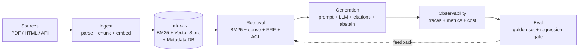

# M1 L1: AI-Native Data Engineering 101

> **Plain English:** A traditional data engineer moves and shapes data. An AI-native data engineer also owns the model — what version, what embeddings, what prompt, what it costs, what it gets right, and what it gets wrong.
> 60 min. Code: `python3 lessons/m01-foundations/L1-ai-native-de-101.py` (no API keys).

---

## 1. Concept (5 min)

**Traditional DE** owns: ingestion, transformation, schema, quality, lineage, and serving. The artifact is a clean table, a dashboard, or a feature.

**AI-native DE** owns all of the above **plus**:
- Which embedding model, which version, how to upgrade it
- How to chunk documents so retrieval works
- The prompt template, its version, the eval set it was tested against
- Cost per query (LLM $) and latency per query (P50/P95)
- Tracing every retrieval + generation as a first-class event
- ACLs at query time (not just at ingest)
- Permission revocation that propagates

**The 7 things AI-native DE owns that traditional DE doesn't:**

1. **Model identity** — every embedding has a `model_id` and a version
2. **Embedding drift** — measuring how much a model upgrade changes the space
3. **Prompt versioning** — the template that produced this answer
4. **Eval set lineage** — the golden set that scored this answer
5. **Content hash** — the dedupe key, not the URL
6. **ACL tags at ingest** — so query-time filter is fast
7. **Cost / latency budget** — per-token $, per-call P95

---

## 2. Architecture (Mermaid)



**Read this as:** Sources feed an ingestion pipeline that produces an index. Queries hit the index, get retrieved chunks, get filtered by ACL, get assembled into a prompt, get sent to an LLM, get observed, and get graded against a golden set — which then feeds back to tune retrieval.

---

## 3. Worked example (from the lesson code)

A 10-doc corpus is processed by both a traditional pipeline and an AI-native pipeline:

| | Traditional | AI-native |
|---|---:|---:|
| Records | 10 | 10 |
| Fields per record | 4 | 12 |
| Model identity | — | ✓ |
| Embedding | — | ✓ |
| Embedding norm | — | ✓ |
| Prompt version | — | ✓ |
| Eval set id | — | ✓ |
| Content hash | — | ✓ |
| ACL tags | — | ✓ |
| Cost / latency | — | ✓ |

**The AI-native record has 3× the metadata, all of it needed.**

### Embedding drift, single doc

`cosine(v1, v2) = 0.83` after a 0.5-amplitude perturbation. Rule of thumb (assumption): if cosine < 0.7 on a fixed eval set, the model upgrade is a meaningful shift — re-score the golden set before rolling out.

### One LLM call, cost + latency

| Input | Value |
|---|---:|
| Prompt tokens | 1,200 |
| Completion tokens | 250 |
| Cost | **$0.000218** per call |
| Latency (P50 est) | **11.0s** (prefill 6.0s + decode 5.0s) |
| 1,000 calls/day | $0.22/day = **$6.53/mo** |
| 100,000 calls/day | $21.75/day = **$652.50/mo** |

(Assumed: $0.15/M tokens, 200 tok/s prefill, 50 tok/s decode on Apple Silicon. Real numbers depend on model, quant, batch size.)

---

## 4. Formulas (defined, every symbol)

**Cosine similarity:**
```
cos(a, b) = (a · b) / (||a||₂ · ||b||₂)
```
- `a · b` = sum of element-wise products
- `||a||₂` = L2 norm = sqrt(sum(a_i²))
- Range: `[-1, +1]`. For embeddings, almost always in `[0, 1]`.

**L2 (Euclidean) distance:**
```
L2(a, b) = sqrt(sum((a_i - b_i)²))
```

**LLM cost (single price model, for back-of-envelope):**
```
cost_usd = (prompt_tokens + completion_tokens) / 1e6 * price_per_m_tokens
```

**LLM latency (two-phase model):**
```
latency_sec = prompt_tokens / prefill_tps + completion_tokens / decode_tps
```
- `prefill_tps` = prompt tokens processed per second (KV cache build)
- `decode_tps` = tokens generated per second (autoregressive)

**Drift threshold (heuristic, not measured):**
- `cosine(v1, v2) >= 0.9` on a fixed eval set → safe to roll out
- `0.7 <= cosine < 0.9` → re-rank the golden set; may need re-tuning
- `cosine < 0.7` → meaningful shift; full re-evaluation required

---

## 5. Code map (what's in `L1-ai-native-de-101.py`)

| Section | Function | What it does |
|---|---|---|
| 1 | `traditional_pipeline` | Schema-on-read, text + source + timestamp |
| 2 | `ai_native_pipeline` | Adds 7 metadata fields + a deterministic fake embedding |
| 3 | `SEVEN_EXTRA_THINGS` | The list above |
| 4 | `embedding_drift` | Cosine + L2 between two model versions |
| 5 | `llm_cost`, `llm_latency` | USD per call + seconds per call |
| 6 | `SAMPLE_DOCS` | 10 hand-written docs (HR / Finance / Suppliers / Legal / Ops) |
| 7 | `demo` | Runs all sections top to bottom |
| 8 | `test_*` | 10 pytest-compatible unit tests |

---

## 6. Edge cases, failure modes, debugging

| Edge case | What breaks | What to do |
|---|---|---|
| Two docs with identical text | Both get the same `content_hash` | Dedupe by hash at ingest; keep a `doc_id` map |
| Model upgrade mid-flight | Old and new embeddings in the same index | Dual-index: query both, merge with version metadata |
| Empty corpus | `l2_norm` returns 0 → `cosine` returns 0 by convention | Guard with `if norm == 0: return 0.0` (already done) |
| LLM API timeout | Generation step fails | Add retry with exponential backoff; budget P95 timeout |
| Eval set version drift | You think you got better; golden set changed | Pin `eval_set_id` in every report; diff set versions before declaring improvement |
| PII in logs | LLM prompt leaks user data to logs | Redact at the log handler; never log raw `text` field |
| Permission revoked after ingest | User sees a doc they shouldn't | Re-filter at query time; never trust stale ACL cache |

---

## 7. Scale-up: 100 → 1M → 100M → 1B records

| Scale | Storage | Ingest | Retrieval |
|---|---|---|---|
| 100 | Single SQLite | One script, minutes | Exact KNN in RAM |
| 1M | Postgres + FAISS | Cron job, hours | FAISS IVF, 10ms P50 |
| 100M | Postgres + sharded FAISS / Qdrant | Kafka + Flink, days | HNSW sharded, 20ms P50 |
| 1B | Object storage + Qdrant / Milvus cluster | Spark + Kafka, weeks | HNSW with PQ compression, 50ms P50, $X/mo infra |

(Back-of-envelope. Real numbers depend on embedding dim, hardware, and recall target.)

---

## 8. Alternatives and tradeoffs

| Choice | Latency | Quality | Cost | Reliability | Pick when |
|---|---|---|---|---|---|
| In-process FAISS (CPU) | 1-10ms P50 | High recall | $0 | Single point of failure | Prototyping, <10M vectors |
| Qdrant (single node) | 5-20ms P50 | High recall | $50/mo (small VM) | Replica possible | 1-50M vectors |
| Pinecone (managed) | 10-50ms P50 | High recall | $100+/mo | Multi-AZ | Don't want to operate infra |
| pgvector (in Postgres) | 20-100ms P50 | High recall (small) | $0 if you have Postgres | Inherits Postgres HA | You already use Postgres |
| OpenSearch k-NN | 20-100ms P50 | High recall | $0 if you have OpenSearch | Inherits OpenSearch HA | You already use OpenSearch |

---

## 9. Mock interview

### 5 Meta L6 questions (with natural spoken answers)

**Q1: "Walk me through how you'd add a RAG system to an existing data warehouse."**
> Start with the use case, not the tech. What's the user question, what's the source corpus, what's the freshness SLA, what's the ACL model. Then ingestion: parse + chunk + embed + index, with content hash + ACL tags from day one. Then retrieval: hybrid (BM25 + dense), RRF, ACL filter at query time. Then generation: prompt assembly, citations, abstain when retrieval is weak. Then observability: traces + cost. Don't promise the LLM is right — promise the system is observable. The data warehouse stays as the source of truth; the index is a derived view. Reindex is a job, not a script.

**Q2: "How do you decide between fine-tuning and RAG?"**
> Fine-tuning changes behavior; RAG changes knowledge. If the answer changes because the policy changed → RAG. If the answer changes because the model's tone or formatting is wrong → fine-tuning (or prompt engineering first). For an internal policy assistant, RAG wins almost every time because policy changes weekly and fine-tuning is expensive to retrain. For a brand-voice assistant, fine-tuning wins. The wrong choice is to fine-tune because you read a blog post.

**Q3: "How do you know your retrieval is good enough?"**
> Recall@K against a golden set of (query, relevant doc IDs). Build the golden set by sampling 50 real user queries, having a human label which docs are relevant, and computing recall@10. If recall@10 < 0.7, the LLM is hallucinating and no prompt will fix it. If recall@10 >= 0.8, the bottleneck moves to generation quality. The 0.7-0.8 band is where you spend engineering time.

**Q4: "How do you upgrade an embedding model without breaking production?"**
> Dual-index. Build the v2 index in the background. For a fraction of traffic (1% → 10% → 50% → 100%), query both indices and compare. Use the v2 answer if recall@K matches or beats v1 on a shadow eval. Roll forward. The wrong choice is a big-bang cutover; the right choice is dual-index for at least 2 weeks. Always keep the old index live for 30 days after a full cutover so you can roll back.

**Q5: "A user reports the assistant leaked a doc they shouldn't see. What's your first hour?"**
> Pull the trace for that query. Check the ACL filter. Check the cache. Check if the doc was tagged incorrectly at ingest. Check if a permission was revoked and the cache wasn't invalidated. The wrong move is to turn off the system; the right move is to add a tombstone for that doc + invalidate any cached answer that referenced it + write a regression test that fails if the same ACL violation can happen again. Then write the postmortem.

### 3 Google-oriented questions (architecture + business)

**G1: "Design an enterprise RAG system for 10M internal documents across HR, Finance, Legal, and Engineering. Walk me through the major decisions."**
> Storage: per-domain indexes (HR index, Finance index, etc.) plus a federated query layer. Why per-domain: ACLs are simpler, blast radius is smaller, eval sets are independent. Ingestion: one pipeline per domain with the same chunker + embedder; shared observability. Retrieval: per-domain top-K, then cross-domain RRF. Generation: per-domain prompt templates (different tone, different citation format). Cost: 10M docs × 500 tokens avg × $0.10/M embed = $500 one-time + $200/mo incremental as new docs arrive. The first decision is per-domain vs single index, and per-domain wins for almost every enterprise customer.

**G2: "Customer says the assistant gives wrong answers 20% of the time. How do you triage?"**
> Bucket the failures. Are they retrieval failures (right context not in top-K) or generation failures (right context in top-K, wrong answer)? The cheapest fix is usually retrieval: better chunking, hybrid search, reranker. The expensive fix is generation: fine-tune, bigger model, more context. Measure the bucket sizes first; don't guess. If 80% are retrieval, you don't need a bigger model. If 20% are retrieval and 80% are generation, you do. The answer changes the project by 10× in cost.

**G3: "You're the tech lead. The PM wants a feature that requires querying 5 different internal data sources through one chat interface. What do you push back on?"**
> Push back on the agent autonomy first. Querying 5 sources means 5 failure modes, 5 ACL models, 5 cost profiles. The right move is to ship a read-only agent with explicit tool calls (not autonomous planning) and an approval gate for write actions. The wrong move is to build an autonomous agent and hope the LLM picks the right tool. The pattern: human-in-the-loop on write, human-on-the-loop on read. Also push back on the timeline: shipping 5 sources in 2 weeks means each source gets 2 days, which means none of them get ACLs right.

---

## 10. One-minute explanation

> An AI-native data engineer does everything a traditional data engineer does — ingestion, transformation, schema, quality, lineage, serving — plus owns the model, the embeddings, the prompt, the cost, the latency, the ACLs, and the evaluation set. The 7 things that distinguish the role are: model identity, embedding drift, prompt versioning, eval set lineage, content hashing, ACL-at-ingest, and cost/latency budgets. Without those, you have a chatbot. With them, you have a system.

## 11. 90-second interview script

> "The difference between traditional DE and AI-native DE is ownership of the model. A traditional DE ships a clean table. An AI-native DE ships a clean table **plus** a model version, a prompt version, an eval set version, ACL tags, a cost number, and a P95 latency. Same skill set — ingestion, transformation, lineage, observability — but the artifacts have three times the metadata and twice the failure modes. The first thing I'd add to any existing DE pipeline is content hashing and ACL tagging at ingest, because if you don't have those, query-time filtering and dedupe will haunt you for the life of the system. The second thing is a versioned golden set, because without one, you can't tell a model upgrade from a model regression. The third thing is per-call cost and latency tracking, because an LLM call is the first DE operation where the cost is per-token, not per-row, and per-call latency is 1-10 seconds, not 100 milliseconds. Those three things — hash, golden set, per-call observability — turn a chatbot into a system."

## 12. Assignment

### Build
1. Run the lesson code end-to-end: `python3 lessons/m01-foundations/L1-ai-native-de-101.py`
2. Run the 10 unit tests: `python3 -m pytest lessons/m01-foundations/` (or run them inline)
3. Open the notebook and execute it top to bottom
4. Replace the `fake_embed` function with a real sentence-transformers call (`all-MiniLM-L6-v2`, 384 dim) and re-run section 6
5. Compute the actual retrieval rank@1 for a query of your choice

### Acceptance criteria
- [ ] All 10 unit tests pass
- [ ] Notebook executes in < 30 seconds
- [ ] `cosine` between two identical vectors is 1.0 ± 1e-5
- [ ] The 7 extra things are explained in your own words in the notebook's "Reflect" cell
- [ ] You can speak the 90-second script out loud without reading it

### Rubric (self-score 0-10 each)
- Correctness: code runs, tests pass
- RAG intuition: you can explain why a model version field is mandatory
- Cost intuition: you can estimate a monthly bill for 100K queries/day
- Tradeoff articulation: you can defend per-domain vs single index
- Communication: the 90-second script is under 90 seconds and has no filler

---

*Last updated: 2026-10-15*
*License: MIT*
