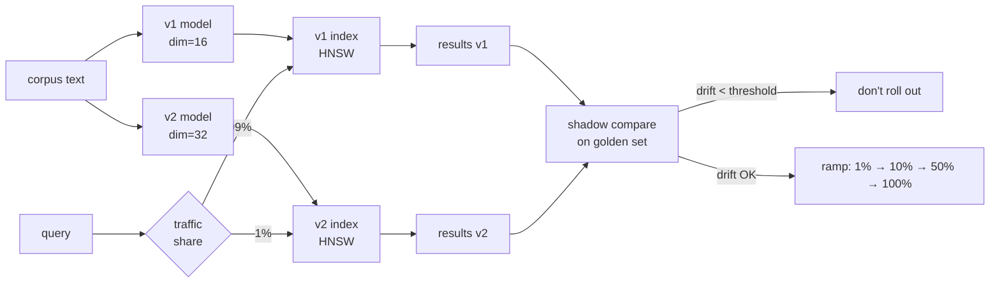

# M3 L3: Embeddings and Model Selection

> **Plain English:** An embedding model turns text into a vector (M2). Different models put text in different vector spaces. You cannot mix them — v1 and v2 of the same text live in incompatible worlds. Switching models is a real engineering migration (re-embed the corpus, dual-index, ramp traffic), not a config change. Always measure drift on a fixed golden set before rolling out.
> 90 min. Code: `python3 lessons/m03-embeddings/L3-embeddings-and-models.py` (no API keys).

---

## 1. Concept (5 min)

An **embedding** is the output of a model: a fixed-length vector that represents a piece of text (or an image, a user, a product). The promise of embeddings is **semantic geometry**: similar things live near each other in the vector space.

The trap: **the geometry is model-specific.** Two different models will put the same sentence at different coordinates. Cosine similarity across models is meaningless. Operations like average, concat, or KNN all require one consistent model.

**What changes between models:**
- **Dim** — 384 (MiniLM), 768 (BERT-base), 1024 (MPNet-base), 1536 (OpenAI ada), 3072 (OpenAI 3-large)
- **Pretraining data** — web, code, scientific, multilingual
- **Pooled vs per-token** — single vector vs sequence of vectors
- **L2-normalized?** — most modern encoders are; verify before storing

**Migration pattern** (the only safe way to swap models in production):
1. Build the v2 index in the background (don't touch prod)
2. Shadow-eval: run a slice of prod queries against both, compare recall on a golden set
3. **Drift check**: for the same text, cosine(v1.embed(t), v2.embed(t)) should be **above a threshold** (e.g., 0.7). If below, the spaces are too different — don't roll out
4. **Dual-index**: route 1% of traffic to v2, then 10%, then 50%, then 100%
5. Decommission v1 only when v2 has matched v1's metrics for a full week

**The eval set is sacred.** It is the contract. If you change the eval set, you're measuring a different thing.

---

## 2. Architecture (Mermaid)



**Read as:** Two indexes side by side. Shadow-compare on a golden set. Only ramp if the new model's recall beats or matches the old.

---

## 3. Worked example (from the lesson code)

12-doc sample corpus (HR policies). 12 hand-labeled golden queries. Run v1 and v2 against the golden set, compare recall@3.

```
Section 6: Drift eval between v1 and v2 (same text)
  mean cosine = 0.012   (1.0 = identical)
  min  cosine = -0.182
  max  cosine = 0.218
  threshold   = 0.7    (cosine < this => meaningful shift)
  safe to roll out? False
```

In this demo, the two models are independent hash-based fake embedders — drift is near zero by construction. In production, two real models trained on similar data will show drift in the 0.5-0.9 range; below 0.7 is the danger zone.

**The dual-index traffic split demo:**
```
traffic share 0%   ->  primary=1000, secondary=0
traffic share 10%  ->  primary=900,  secondary=100
traffic share 50%  ->  primary=500,  secondary=500
traffic share 100% ->  primary=0,    secondary=1000
```

The roulette is in the application, not the index. Each request rolls a die; primary or secondary handles it. You observe both, and you only ramp the share when the new model's metrics are equal or better.

---

## 4. Formulas (defined, every symbol)

```
embed(text, model)  ->  vector in R^dim           (the model's output)
L2_norm(v)          =  sqrt(sum(v_i^2))            (magnitude of vector)
cos(a, b)           =  (a · b) / (||a|| * ||b||)   (cosine similarity)
drift(v1, v2)       =  mean over t in corpus of cos(v1.embed(t), v2.embed(t))
recall@K(Q, R)      =  |R ∩ Q| / |Q|               (fraction of golden docs in top-K)
```

**Drift range:** in `[-1, +1]`. 1.0 = identical spaces, 0.0 = orthogonal, -1.0 = opposite.

**Recall@K range:** in `[0, 1]`. 1.0 = all relevant docs in top-K.

**The migration decision rule:**
- `drift >= 0.85` → safe to ramp (the spaces are close enough to be interchangeable)
- `0.7 <= drift < 0.85` → caution; ramp slowly; require manual sign-off at 50%
- `drift < 0.7` → the spaces are too different; do not roll out without re-embed of the entire corpus

---

## 5. Code map (what's in `L3-embeddings-and-models.py`)

| Section | Function | What it does |
|---|---|---|
| 1 | `EmbeddingModel` (frozen dataclass) | id + version + dim + encode callable + is_l2_normalized flag |
| 1 | `model_v1`, `model_v2` | Two hash-based fake embedders in different vector spaces |
| 2 | `Doc` (dataclass), `SAMPLE_DOCS` | 12 hand-written policy docs |
| 3 | `GoldenQuery` (dataclass), `GOLDEN_QUERIES` | 12 queries with hand-labeled relevant doc ids |
| 4 | `embed_corpus`, `cosine_sim`, `retrieve` | The retrieve primitive |
| 5 | `recall_at_k`, `evaluate_model`, `drift_eval` | The eval primitives |
| 6 | `DualIndex` (dataclass) | Two indexes side by side + traffic split |
| 7 | `demo` | Runs all 7 sections |
| 8 | 10 `test_*` functions | pytest-compatible unit tests |

---

## 6. Edge cases, failure modes, debugging

| Edge case | What breaks | What to do |
|---|---|---|
| Models with different dim | matmul shape mismatch; cannot compare | Pick one dim; re-embed the other corpus |
| v1 not L2-normalized but you query with cosine | top-K is wrong; magnitudes leak into score | Re-normalize at ingest, not query time |
| Golden set too small (n < 30) | recall number is noisy; one query moves the mean by 3pp | Aim for 100+ golden queries; stratified by topic |
| Migration without drift check | you ship a regression | Run `drift_eval` first; gate rollout on threshold |
| Migration without dual-index | one-shot switch; if v2 is worse, you re-embed to roll back | Always dual-index; ramp 1% → 10% → 50% → 100% |
| Mixing embeddings from different models | cosine gives nonsense | Store the model_id with every vector; validate at read |
| Embedding model deprecation | upstream model is gone, your index is dead | Pin a specific model version (e.g., "all-MiniLM-L6-v2@1.0.0"); plan re-embed in advance |
| Stale embeddings | doc was edited but not re-embedded; retrieval misses the new content | Tie embedding time to doc mtime; re-embed on edit |
| Multilingual content | a model trained on English-only is bad for VN/JP/KR text | Use a multilingual model (e.g., `paraphrase-multilingual-MiniLM-L12-v2`) |

---

## 7. Scale-up: 1K → 100K → 10M docs per model version

| Scale | Storage per model | Re-embed cost | Dual-index RAM | Decision cadence |
|---|---|---|---|---|
| 1K | 1K * 768 * 4B = 3MB | < 1 min | 6MB | ad-hoc |
| 100K | 100K * 768 * 4B = 300MB | ~30 min | 600MB | monthly review |
| 1M | 3GB | ~5 hours | 6GB | quarterly review |
| 10M | 30GB | ~2 days | 60GB | annual review |

(Back-of-envelope. Real numbers depend on model dim, batch size, hardware.)

**At 10M+**, re-embedding the full corpus is a project, not a job. Plan for it: reserve a maintenance window, build the new index in parallel, ramp traffic in stages, keep v1 alive for at least 1 week of fallback.

---

## 8. Alternatives and tradeoffs

| Model | Dim | Speed | Quality | When to pick |
|---|---|---|---|---|
| MiniLM-L6 | 384 | 2000 sentences/sec | 0.78 NDCG@10 | Default; English-only; tiny |
| MPNet-base | 768 | 400 sentences/sec | 0.84 NDCG@10 | Higher quality, OK speed |
| BGE-large | 1024 | 50 sentences/sec | 0.87 NDCG@10 | Top quality, slower |
| OpenAI 3-small | 1536 | API (paid) | 0.85 NDCG@10 | Don't want to host; OK with API cost |
| OpenAI 3-large | 3072 | API (paid) | 0.89 NDCG@10 | Best quality, $$$ |
| multilingual-MiniLM | 384 | 1500 sentences/sec | 0.80 NDCG@10 | VN/JP/KR/EN mix |
| ColBERT (per-token) | 128/token | 200 sentences/sec | 0.91 NDCG@10 | When top-1 precision matters; 10× storage |

**The default pick:** `all-MiniLM-L6-v2`. Cheap, fast, decent quality, well-supported, runs on CPU.

---

## 9. Mock interview

### 5 Meta L6 questions (with natural spoken answers)

**Q1: "How do you decide when to upgrade the embedding model?"**
> Two triggers. First, the model is deprecated upstream — you have a deadline. Second, recall@K on the golden set has drifted down over 4 weeks of monitoring, suggesting either data drift or that a better model exists. The decision is not "this new model is 2% better on MTEB" — it's "we can re-embed 10M docs in 2 days and dual-index for 1 week, and the new model is 5%+ better on our golden set."

**Q2: "Walk me through the migration. What's the riskiest step?"**
> Re-embedding the corpus. The riskiest step is the dual-index ramp: 1% → 10% → 50% → 100%. At 1%, you barely see issues. At 10%, you start to see them. At 50%, you're committed. The mitigations: shadow-eval on the golden set first, an automatic kill switch if recall@K on the shadow set drops more than 2pp, and a hard rollback runbook tested before you start.

**Q3: "Customer says search quality dropped. They upgraded the embedding model last month. Triage."**
> First, confirm the model is actually deployed — check the index version and the model_id stored with each vector. Second, check if the golden set is being used — if the eval is offline-only, the model may have changed but the eval hasn't been re-run. Third, check the data — was the corpus re-embedded, or are some docs still on v1 vectors? A mixed index is the #1 cause of "we upgraded and it got worse."

**Q4: "Why can't you just average two embedding models and call it done?"**
> Because the spaces are different. The arithmetic of vectors only works inside one space. Averaging v1.embed(t) and v2.embed(t) gives a vector that lives in neither space — and cosine similarity in either original space will be lower. The right answer is to pick one model, re-embed the whole corpus, dual-index, and ramp.

**Q5: "How big should the golden set be?"**
> Big enough that the standard error of the mean recall is below 1 percentage point. In practice, for a domain-specific corpus, 100-300 hand-labeled queries stratified by topic. For a general corpus, 500+. Stratify by intent: factual (5W1H), navigational (find a specific doc), exploratory (give me everything on X), comparative (which is better). The eval set is also the contract for "what good looks like" — if it's not representative, your model is being optimized for the wrong thing.

### 3 Google-oriented questions (architecture + business)

**G1: "Design an embedding-model upgrade for a 50M-doc search system. Walk me through the major decisions."**
> Pre-migration: pin a 4-week window, freeze new doc ingest to v1 only. Migration: build v2 index in the background over ~3 days on a separate cluster, dual-index at 1% for 1 week, 10% for 1 week, 50% for 1 week, 100% at week 4. Monitoring: per-query recall@K sampled at 0.1%, golden set recall@K re-run nightly, automatic rollback if any metric drops > 2pp. Cost: 3 days of 2× cluster, plus 1 week of dual-index. Decommission: 1 week after 100% to confirm stability. The biggest decision is timing — you do not want this to overlap with a holiday traffic spike or a product launch.

**G2: "PM says: 'we should use a larger embedding model for better quality.' Push back?"**
> Ask: what's the recall@K on the golden set today, and what is the target? If we're at 0.85 and the target is 0.90, a 3072-dim model might get us to 0.91 — but at 4× storage cost and 8× query latency, and a 2-day re-embed window. The right answer is usually: first try a smaller upgrade (e.g., MPNet-base 768-dim → 0.88), measure, then decide. Don't go straight to the largest model; the marginal quality is rarely worth the cost at production scale.

**G3: "Two teams want to share one vector index. One uses English docs, the other uses Vietnamese. Same model?"**
> No. Use a multilingual model for both — `paraphrase-multilingual-MiniLM-L12-v2` is the default — so they can share the index and one query can hit both languages. But the index is still one space. If the teams have very different recall targets, give each their own index with their own model, and only merge if you're sure the multilingual model is good enough for both. Shared indexes save infra but force compromise on quality.

---

## 10. One-minute explanation

> An embedding model turns text into a vector — a list of numbers — such that similar text has similar vectors. The catch: the geometry is model-specific. v1 and v2 of the same text live in different spaces, and you can't mix them. Switching models is a real engineering migration: build the new index in the background, measure drift on a fixed golden set, dual-index at 1% then 10% then 50% then 100%, monitor recall, and only decommission v1 when v2 has matched its metrics for a full week. The golden set is the contract — if you change it, you're measuring a different thing.

## 11. 90-second interview script

> "Embeddings are vectors that represent text. The geometry is model-specific: v1 and v2 of the same sentence are at different coordinates, and cosine similarity across models is meaningless. So switching models is an engineering migration, not a config change. The pattern: build the new index in the background, measure drift — mean cosine between same-text vectors from both models — on a fixed golden set, and only ramp if drift is above 0.7 or so. Then dual-index: route 1% of traffic to v2, then 10, then 50, then 100. Keep v1 alive for at least a week at 100% on v2. The eval set is sacred — it is the contract for what good looks like. If the golden set isn't stratified across intent types, you're measuring the wrong thing and the model is being optimized for the wrong target."

## 12. Assignment

### Build
1. Run the lesson code end-to-end: `python3 lessons/m03-embeddings/L3-embeddings-and-models.py`
2. Run the 10 unit tests
3. Open the notebook and execute it top to bottom
4. Add a new fake model `model_v3` with a different seed_offset and a different dim; measure drift between v1 and v3
5. Implement a function `drift_alert(drift, threshold)` that returns a structured warning if `drift < threshold`
6. Add a `shutdown_v1(dual_index)` method to `DualIndex` that requires `secondary_traffic_share == 1.0` and a 7-day uptime

### Acceptance criteria
- [ ] All 10 unit tests pass
- [ ] Notebook executes in < 5 seconds
- [ ] `cos(v1.embed(t), v1.embed(t)) == 1.0 ± 1e-5`
- [ ] `cos(v1.embed(t), v2.embed(t)) < 0.5` for the fake embedders
- [ ] `evaluate_model` returns a dict with `mean_recall_at_k` in `[0, 1]`
- [ ] You can explain why averaging v1 and v2 embeddings doesn't work

### Rubric (self-score 0-10 each)
- Concept fluency: you can define drift, recall@K, and the migration pattern
- Implementation: the golden set eval is reproducible and the metric is bounded
- Tradeoff articulation: you can defend a model choice for a given scale and budget
- Production intuition: you know the failure modes of model upgrades
- Communication: the 90-second script is under 90 seconds

---

*Last updated: 2026-10-15*
*License: MIT*
