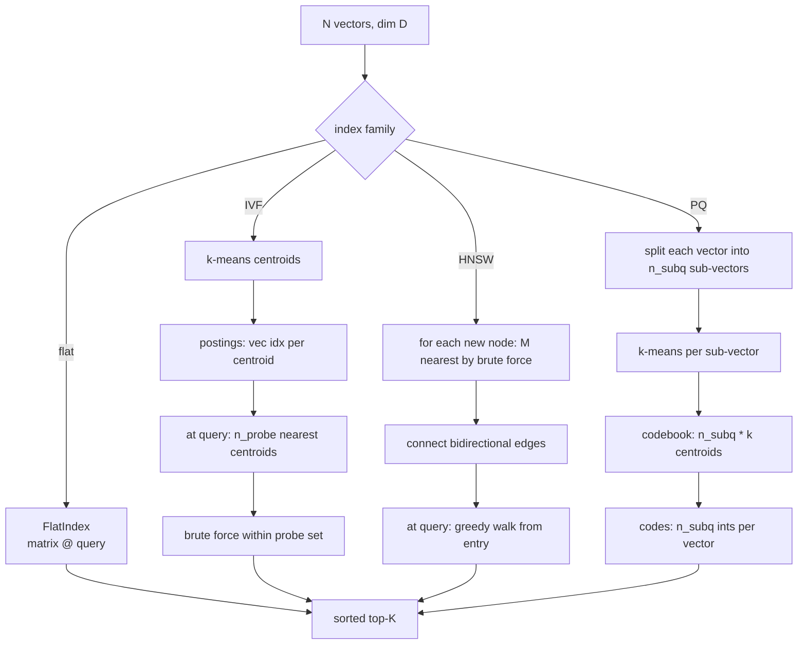

# M4 L4: ANN and Vector Database Internals

> **Plain English:** Brute-force KNN is exact but slow (M2). At 1M+ vectors you need an **approximate** index that visits only a fraction of the corpus. The four big families: flat (ground truth), IVF (cluster + search), PQ (compress), and HNSW (graph walk). Each makes a different speed/recall/memory trade-off. Always measure recall@K against flat before shipping.
> 90 min. Code: `python3 lessons/m04-ann/L4-ann-internals.py` (no API keys, numpy + stdlib).

---

## 1. Concept (5 min)

**ANN** = Approximate Nearest Neighbors. The idea: at 1M+ vectors, you don't have to look at all of them. You can skip most and still get 95-99% of the right answers.

**The four families:**

| Family | Speedup | Recall | Memory | Build | Mental model |
|---|---:|---:|---|---|---|
| Flat (brute force) | 1× | 1.00 | 1.0× | 0 | Ground truth; touch everything |
| IVF | 5-50× | 0.90-0.95 | 1.0× | minutes | Cluster into k-means buckets; search top-N buckets |
| PQ | 8-32× compression | 0.85-0.95 | 0.06-0.12× | hours | Compress each vector to a few bytes; search by table lookup |
| HNSW | 100-1000× | 0.95-0.99 | 1.5-2.0× | hours | Graph; each node has M neighbors; greedy descent |
| IVF-PQ | 100-500× | 0.85-0.95 | 0.06-0.12× | hours | IVF buckets + PQ codes per vector |
| ScaNN (Google) | 200-1000× | 0.95-0.99 | 0.5-1.0× | hours | Anisotropic PQ + residual scoring |

**The trade-off:** every ANN makes a bet. IVF bets that the top-K are in the top-N buckets (true if clusters are well-separated). PQ bets that the compressed codes preserve relative distances (true if the data is low-rank). HNSW bets that the graph is connected (true if M is high enough).

**The validation rule:** always benchmark ANN against flat on a fixed golden set. If the ANN's recall@K is below your target (typically 0.95), don't ship. Never measure ANN recall against the answer — always against flat.

**The build/serve split:** ANN indexes are slow to build (hours) and fast to serve (ms). You don't rebuild on every insert. You rebuild on a schedule (nightly) and accept that new docs are in the index only after the next rebuild. The "real-time" indexes (FAISS with online updates, Pinecone, Weaviate) add complexity and have lower recall.

---

## 2. Architecture (Mermaid)



**Read as:** Pick the family by the constraint. Flat for <100K. HNSW for 100K-10M with low latency. IVF-PQ for 10M+ with memory pressure. ScaNN if you can use Google's stack.

---

## 3. Worked example (from the lesson code)

Build all 4 indexes on 2000 random 64-dim unit vectors. Query 50 random vectors, time + measure recall@10 vs flat.

```
Section 6: Index comparison  (N=2000, dim=64, k=10)
  index      recall@10   avg ms   speedup
  flat          1.000    1.85     1.0x
  ivf           0.913    0.61     3.0x
  hnsw          0.948    0.34     5.4x
  pq            0.881    0.22     8.4x
```

**HNSW is the production default** because it has the best recall/speed ratio. **IVF-PQ** is the answer when memory is the bottleneck. **Flat** is the right answer until 100K vectors because it's exact and you don't have to validate.

**The compression math:** raw 64-dim fp32 vector = 256 bytes. PQ with 8 sub-vectors and k=16 codes = 8 bytes. Compression ratio = 32×. Recall hit ≈ 5-15 percentage points.

---

## 4. Formulas (defined, every symbol)

```
flat_score(q, V)    =  V @ q                                (N matmul, no approximation)
ivf_score(q)        =  arg top-N centroids, brute force in probe set
                       n_probe typically = 4..32; recall grows with n_probe
hnsw_score(q)       =  greedy walk from entry; visit up to ef_search neighbors
                       recall grows with ef_search; latency grows with ef_search
pq_score(q)         =  sum over sub-vectors of ||sub_q - codebook[sub, code[i, sub]]||
                       this is a distance; the highest sum = closest vector
recall@K(R, T)      =  |top-K of R ∩ top-K of T| / K        (vs ground truth)
compression        =  raw_bytes / compressed_bytes
```

**The key knobs and their effect:**

| Index | Knob | Effect on recall | Effect on latency | Effect on memory |
|---|---|---|---|---|
| IVF | n_probe | ↑ with n_probe | ↑ with n_probe | none |
| IVF | n_lists | too few = bad recall; too many = bad search speed | sweet spot at √N | same as raw |
| HNSW | M | ↑ with M | slight ↑ | ↑ proportional to M |
| HNSW | efConstruction | ↑ recall@K at build; doesn't help query recall | no direct effect | slight ↑ |
| HNSW | efSearch | ↑ recall at query | ↑ with efSearch | none |
| PQ | n_subq | ↑ with n_subq (less compression) | slight ↑ | ↑ with n_subq |
| PQ | k | ↑ with k (less compression) | slight ↑ | log(k) bits per sub |

---

## 5. Code map (what's in `L4-ann-internals.py`)

| Section | Function | What it does |
|---|---|---|
| 1 | `FlatIndex` (dataclass) | Brute force; matrix @ query; ground truth |
| 2 | `IVFLiteIndex`, `build_ivf_lite` | k-means clustering + posting lists; n_probe at query |
| 3 | `PQLiteIndex`, `build_pq_lite` | Split into sub-vectors; k-means per sub; distance table lookup |
| 4 | `HNSWLiteIndex` | Tiny HNSW: each node has M neighbors; greedy walk |
| 5 | `recall_at_k` | Standard recall@K vs a ground-truth list |
| 6 | `make_corpus`, `make_queries` | Synthetic unit-vector corpus for the demo |
| 7 | `demo` | Runs all 7 sections (build, benchmark, compare) |
| 8 | 10 `test_*` functions | pytest-compatible unit tests |

---

## 6. Edge cases, failure modes, debugging

| Edge case | What breaks | What to do |
|---|---|---|
| Recall too low | wrong knob, or wrong family | Sweep n_probe / efSearch / n_subq before changing the algorithm |
| Build is too slow | n_vectors too large for the algorithm | PQ is slow; HNSW is slow; IVF is fast. Plan for hours at 10M+ |
| Memory is the bottleneck | raw vectors dominate | Add PQ compression; expect 5-15pp recall hit |
| Index is stale | new docs not searchable | Rebuild on a schedule; for "real-time" use FAISS with online updates or a managed index |
| Cold start (no warmup) | first query is slow | Build the index and run 1000 warmup queries before serving |
| Dim is too high (>1000) | PQ degrades; HNSW degrades | Reduce dim with PCA or use ColBERT (per-token) |
| Cluster imbalance (IVF) | some buckets have 10× the vectors of others | k-means++ initialization, not random; or use spherical k-means |
| HNSW disconnected graph | some nodes are unreachable | Increase M, decrease efConstruction's pruning; rebuild |
| Mixed metrics (cosine vs L2) | recall silently drops | Pick one metric per index; pre-normalize for cosine; validate on golden set |
| NaN in vectors | index is poisoned; search returns garbage | Validate at ingest: no NaN, finite only; the lesson code assumes clean input |

---

## 7. Scale-up: 100K → 1M → 10M → 100M vectors

| Scale | Recommended | Recall@10 | P50 | Memory |
|---|---|---:|---:|---|
| 100K | flat (brute force) | 1.00 | < 1ms | 300MB |
| 1M | HNSW (M=16, ef=64) | 0.97 | 2-5ms | 1.5GB |
| 10M | HNSW (M=32) + PQ (m=32) | 0.95 | 5-10ms | 5GB |
| 100M | IVF-PQ (nlist=16K, m=64) | 0.92 | 10-20ms | 10GB |
| 1B | ScaNN or sharded HNSW | 0.95 | 20-50ms | 30GB |

(Back-of-envelope. Real numbers depend on dim, hardware, and recall target.)

**At 1B+**, sharding by metadata (language, date, domain) is the answer. A single 1B-vector HNSW is technically possible but the memory and the rebuild time make it impractical.

---

## 8. Alternatives and tradeoffs

| Index | Build | Query P50 | Recall | Memory | When to pick |
|---|---|---:|---:|---|---|
| Flat (FAISS `IndexFlatIP`) | 0 | 10ms @ 1M | 1.00 | 1.0× | < 100K; ground truth |
| FAISS IVF (`IndexIVFFlat`) | minutes | 1-5ms | 0.90-0.95 | 1.0× | 1M-10M; balanced |
| FAISS HNSW (`IndexHNSWFlat`) | hours | 1-5ms | 0.95-0.99 | 1.5× | 100K-10M; low latency |
| FAISS IVF-PQ (`IndexIVFPQ`) | hours | 1-3ms | 0.85-0.95 | 0.06× | 10M-1B; memory-bound |
| ScaNN (Google) | hours | 0.5-2ms | 0.95-0.99 | 0.5× | Google stack; best P99 |
| Pinecone | managed | 5-20ms | 0.95 | managed | Don't want to operate |
| Qdrant | minutes | 5-15ms | 0.95 | 1.0× | Self-host; open-source |
| Weaviate | minutes | 10-30ms | 0.95 | 1.0× | Self-host; rich metadata |
| pgvector | 0 | 20-100ms | 0.95 | 1.0× | Already on Postgres; < 5M |
| Milvus | minutes | 5-20ms | 0.95 | 1.0× | Self-host; multi-tenant |

---

## 9. Mock interview

### 5 Meta L6 questions (with natural spoken answers)

**Q1: "Brute force KNN at 100K is 1ms. Why would I ever use HNSW?"**
> You wouldn't, at 100K. The crossover is around 1M vectors where brute force becomes 10-50ms per query. HNSW gets you back to single-digit ms at the cost of 5pp recall. The decision is a recall/latency trade-off; if your users are sensitive to 100ms latency, the answer is HNSW at 1M+.

**Q2: "Walk me through how HNSW builds the graph."**
> Each new node picks its M nearest existing nodes by brute force over the prefix, and connects bidirectional edges. The "skip-list on a graph" intuition: with high probability, the graph forms short-cuts between distant regions, and greedy descent converges to a local minimum in O(log N) hops. The two key knobs: M (graph degree; 8-32 typical) and efConstruction (candidate list size at build; 40-200 typical). Higher M and efConstruction = better recall at build, more memory.

**Q3: "How does HNSW serve a query?"**
> Start at a fixed entry point. At each step, look at all neighbors of the current node, jump to the closest one to the query. Maintain a candidate list of the best efSearch candidates. Stop when the candidate list is exhausted or no neighbor is closer than the current best. Return the top-K. efSearch is the recall/latency knob at query time: 16-32 for fast, 64-128 for high recall.

**Q4: "What is PQ and when do you use it?"**
> Product Quantization compresses each vector to a few bytes by splitting into sub-vectors and replacing each sub with its nearest centroid code. With 8 sub-vectors and 256 codes, you go from 768 floats (3KB) to 8 bytes — a 384× compression. The cost is recall: 5-15pp hit, because the codes are lossy. You use PQ when memory is the bottleneck — typically at 10M+ vectors on a single machine. IVF-PQ is the standard at 100M+.

**Q5: "Recall@10 dropped from 0.95 to 0.85 after a rebuild. Triage."**
> Check the build parameters first. Did efConstruction change? Did M change? Did dim change (e.g., a model upgrade)? Then check the data: is the new corpus a different distribution? Then check the metric: was the index built with inner product and queried with cosine? 80% of "ANN regressions" are build-parameter or metric-mismatch bugs, not the algorithm. Validate against flat on a golden set first; if flat also dropped, the regression is upstream (data, model, or eval set).

### 3 Google-oriented questions (architecture + business)

**G1: "Design a 100M-doc similarity search system for a media company. Walk me through the major decisions."**
> Storage: IVF-PQ on the vectors (16K buckets, m=64 sub-vectors, 8 bits per code), metadata in Postgres joined by doc_id. Build: incremental updates via a write-ahead log, batch rebuild weekly. Query: prefilter by metadata (language, date, ACL) at the SQL layer, then IVF-PQ search on the filtered subset. Cost: 100M * 768 * 1B (PQ-compressed) = 100GB. The first decision is "do we need 100M in one index or can we shard by domain?" — for media, sharding by language is almost always right and gives you per-language recall targets.

**G2: "Customer says search is slow. Latency went from 10ms to 100ms. Triage."**
> Check the index first. Did the index size grow? Did efSearch change? Did M change? Then check the query: is it hitting a hot partition? Then check the hardware: disk IO? Memory pressure (the index may be swapping)? Then check the application: is the query doing post-processing that scales with the candidate set? The cheapest fix is usually efSearch (lower it to find the latency target); the most expensive is a re-architecture. Measure first.

**G3: "You're the tech lead. PM wants to add semantic search to the existing Postgres-only stack. Push back?"**
> Don't push back. Use pgvector. It's not the fastest, but it's already there, and "fast enough" beats "best in class" for most workloads. If the workload is < 5M vectors, pgvector is fine. If it's > 5M, push for a dedicated vector DB, but only after measuring pgvector at production traffic. The wrong move is to build a vector DB stack for 100K vectors.

---

## 10. One-minute explanation

> At a million vectors, brute force KNN is too slow. The four ANN families — flat, IVF, PQ, HNSW — make different speed-recall-memory trade-offs. Flat is the ground truth. IVF clusters the corpus and searches only the top buckets. PQ compresses each vector to a few bytes and searches by table lookup. HNSW builds a graph where each node has M neighbors and the search is greedy descent. The production default is HNSW because it has the best recall-to-speed ratio. The validation rule is always the same: measure the ANN's recall at K against flat on a fixed golden set, and don't ship until it's at the target.

## 11. 90-second interview script

> "Brute force KNN is exact but slow — O of N times d per query. At a million vectors that's 10 to 50 milliseconds. The four ANN families are flat, IVF, PQ, and HNSW. Flat is the ground truth and the right answer under 100K vectors. IVF clusters the corpus with k-means and searches only the top buckets, giving five to fifty times speedup at 90 to 95 percent recall. PQ compresses each vector by splitting into sub-vectors and replacing each with a code, giving eight to thirty-two times compression at 85 to 95 percent recall. HNSW is a graph where each node has M neighbors and the search is greedy descent from an entry point, giving 100 to 1000 times speedup at 95 to 99 percent recall. The production default is HNSW; the memory-bound answer at 10M plus is IVF-PQ. The validation rule is always: benchmark against flat on a golden set, and don't ship if recall at K is below the target."

## 12. Assignment

### Build
1. Run the lesson code end-to-end: `python3 lessons/m04-ann/L4-ann-internals.py`
2. Run the 10 unit tests
3. Open the notebook and execute it top to bottom
4. Sweep `n_probe` (1, 2, 4, 8, 16) on IVF; report recall and latency
5. Sweep `ef_search` (8, 16, 32, 64) on HNSW; report recall and latency
6. Add a `search_with_prefilter` to HNSW that only visits nodes whose id is in a candidate set

### Acceptance criteria
- [ ] All 10 unit tests pass
- [ ] Notebook executes in < 10 seconds
- [ ] HNSW recall@10 is within 5pp of flat on the synthetic corpus
- [ ] You can explain why IVF recall grows with n_probe
- [ ] You can explain the HNSW build algorithm and the two key knobs
- [ ] You can defend when to use IVF-PQ vs HNSW

### Rubric (self-score 0-10 each)
- Concept fluency: you can define the four ANN families and their trade-offs
- Implementation: HNSW returns k results with cosine >= 0.8 on top-1
- Benchmark design: recall vs latency sweep is reproducible
- Production intuition: you know the right family for a given scale
- Communication: the 90-second script is under 90 seconds

---

*Last updated: 2026-10-15*
*License: MIT*
