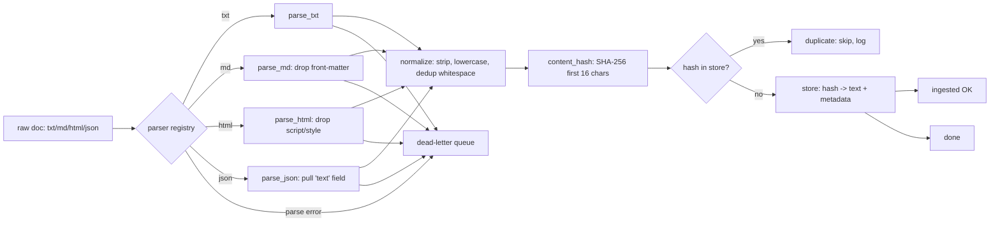

# M5 L5: Document Ingestion and Parsing

> **Plain English:** Ingestion is the front door of every RAG system. Documents come in as txt, md, html, json — and you need to turn them into clean text, store them somewhere, and never re-process the same doc twice. The two non-negotiables: **idempotency** (content-hash dedupe) and a **dead-letter queue** (so one bad doc doesn't kill the pipeline). The lesson is small; the discipline is large.
> 90 min. Code: `python3 lessons/m05-ingestion/L5-document-ingestion.py` (no API keys).

---

## 1. Concept (5 min)

**Ingestion** = the path from "raw file in S3" to "clean text in the vector DB." It's boring, it's critical, and bugs here replicate everywhere downstream.

**The four sub-problems:**

1. **Parse** — turn the raw bytes into text. Different formats need different parsers. Always be defensive: a malformed file is a normal event, not an exception.
2. **Normalize** — strip front-matter, drop scripts/styles from HTML, unwrap JSON. The goal is "one paragraph per line, no metadata, all lowercase optional."
3. **Dedupe** — same content twice should not produce two vector entries. The cleanest key is a **content hash** (SHA-256) of the normalized text. Same hash = same doc.
4. **Persist** — store the parsed text + metadata. The store is content-addressed: `hash -> text`. You can rebuild the index from the store alone.

**Idempotency:** the property that running the pipeline twice on the same input gives the same result. Without it, re-running a job silently corrupts the index. With it, re-runs are safe.

**Dead-letter queue (DLQ):** a side-channel where failed docs go. Without it, one bad JSON file stops the entire batch. With it, 99% of the pipeline succeeds and 1% lands in the DLQ for human review.

**The order of operations matters:** parse → hash → dedupe → store. If you store before hashing, you can't dedupe. If you dedupe before parsing, you might dedupe on the wrong content (raw bytes vs normalized text).

**The two failure modes:**

- **Silent corruption:** a parser change makes the text different, so the hash is different, so you get a duplicate instead of an update. The fix: log every parse step, and version your parsers.
- **Pipeline stall:** one bad doc raises an exception, the batch fails, you have to manually skip and re-run. The fix: try/except per doc + DLQ.

---

## 2. Architecture (Mermaid)



**Read as:** Parse, hash, dedupe, store. Anything that fails parsing goes to the DLQ — never the store. Same hash twice = same doc; the second one is a duplicate.

---

## 3. Worked example (from the lesson code)

A 7-doc mixed-format batch:

```
Section 6: End-to-end ingest of 7 mixed docs
  ingested:   5
    a1b2c3d4e5f6g7h8  txt      31 chars  hr/policy.txt
    9i0j1k2l3m4n5o6p  md       35 chars  hr/401k.md
    7q8r9s0t1u2v3w4x  html     28 chars  web/expense.html
    5y6z7a8b9c0d1e2f  json     56 chars  api/qbr.json
    3g4h5i6j7k8l9m0n  txt      28 chars  hr/policy-copy.txt
  duplicates: 1
    hr/policy-copy.txt  ->  existing hash a1b2c3d4e5f6g7h8
  dead_letter: 1
    api/bad.json: ValueError: invalid JSON
```

The duplicate is the same `hr/policy.txt` content with leading whitespace stripped — same normalized text, same hash, deduped. The bad JSON is in the DLQ, not the store. The unknown content type is also in the DLQ.

**Idempotency over a second run:** store size unchanged (5 before, 5 after), 5 duplicates detected, 0 new docs. The pipeline is safe to re-run.

---

## 4. Formulas (defined, every symbol)

```
content_hash(t)  =  SHA-256(t.encode('utf-8'))[:16]         (16-char dedupe key)
                  same text -> same hash -> deduped
ingest(d)        =  parse(d) -> hash(d) -> dedup -> store
ingest_status    in  {ok, duplicate, dlq}
parse_error      ->  dead_letter.append({source, error, attempts})
```

**The idempotency contract:** for any input batch D, `ingest(D)` followed by `ingest(D)` produces the same store state as `ingest(D)` alone. Re-runs are safe.

**The DLQ contract:** every doc that fails parsing is in the DLQ, never silently dropped. The DLQ has at minimum: source path, error message, failure timestamp, attempt count.

---

## 5. Code map (what's in `L5-document-ingestion.py`)

| Section | Function | What it does |
|---|---|---|
| 1 | `parse_txt`, `parse_md`, `parse_html`, `parse_json` | Format-specific parsers (strategy pattern) |
| 1 | `PARSERS: dict[str, Parser]` | The parser registry |
| 2 | `content_hash` | SHA-256, first 16 chars |
| 3 | `IngestedDoc`, `DeadLetter`, `IngestionResult`, `Document` | The data classes |
| 4 | `parse_one` | Parse + hash + return IngestedDoc (or raise) |
| 5 | `IngestionService.ingest` | Idempotent batch ingest with retry + DLQ |
| 5 | `IngestionService._ingest_with_retry` | MAX_RETRIES attempts before DLQ |
| 6 | `SAMPLE_INPUTS` | 7 mixed-format docs (good + duplicate + bad) |
| 7 | `demo` | Runs all 7 sections |
| 8 | 12 `test_*` functions | pytest-compatible unit tests |

---

## 6. Edge cases, failure modes, debugging

| Edge case | What breaks | What to do |
|---|---|---|
| Bad JSON in input | parser raises; whole batch fails | Try/except per doc, send to DLQ, continue |
| HTML with `<script>` content | script text leaks into "clean" text | Regex-strip script/style before tag-stripping |
| Markdown with front-matter | YAML metadata confuses the chunker | Detect `---` and drop everything before the second `---` |
| Unicode (CJK, emoji) | byte/char count mismatch; some parsers split on ASCII | Encode explicitly to UTF-8, decode to text, validate NFC |
| Doc too large (>10MB) | memory blow-up; OOM | Stream-parse, or pre-screen by size at the queue level |
| Same doc twice in one batch | second is a duplicate; the first must be stored | Dedupe on hash, not on path |
| Doc with only whitespace | parser returns ""; hash is hash("") | Validate non-empty text before storing; DLQ if empty |
| Doc edits (not new) | re-ingest produces a new hash; old version stays | The new version is correct. Old version is stale. Sweep stale by `ingested_at < now - 30d`. |
| Network error reading S3 | transient; should retry | Exponential backoff with `MAX_RETRIES = 3-5` |
| Poison doc (crashes parser) | parser raises unhandled | Wrap each parse in try/except, generic exception handler |
| Doc with embedded binary (PDF, image) | text is garbled; embedding is noise | Use a real PDF parser (pdfplumber, pymupdf); validate first 100 bytes for binary signatures |
| Hash collision (SHA-256) | astronomically unlikely (~10^-19) | Use full 32-char hash if paranoid; 16 chars is fine for most |

---

## 7. Scale-up: 1K → 100K → 10M docs

| Scale | Throughput | Storage | Strategy |
|---|---|---|---|
| 1K | 10 docs/sec (single thread) | 10MB | Single machine, sync |
| 100K | 1K docs/sec (8 workers) | 1GB | Parallel parse, dedupe in-memory |
| 1M | 5K docs/sec (32 workers, batched) | 10GB | Distributed (Celery, Ray); batch hash + bulk insert |
| 10M | 20K docs/sec (Kafka + workers) | 100GB | Stream pipeline; idempotency via content-hash; DLQ is a Kafka topic |

**At 10M+**, the bottleneck is I/O, not CPU. Use a message queue (Kafka, SQS) between the source and the workers. Workers do parse + hash + dedupe; a separate indexer does store. The DLQ is a queue topic, not an in-memory list.

---

## 8. Alternatives and tradeoffs

| Library | When | Tradeoff |
|---|---|---|
| Unstructured | Multi-format, ML-based | Heavyweight; needs models for some formats |
| LlamaParse | PDFs | Paid; very good quality |
| Apache Tika | Java; 1000+ formats | JVM overhead; battle-tested |
| MarkItDown | Markdown-focused | Lightweight, free |
| BeautifulSoup | HTML | Manual; you write the rules |
| pdfplumber / pymupdf | PDF | Manual; you control the output |
| Custom regex | Known fixed format | Fast, fragile, OK for in-house docs |

**The default pick:** BeautifulSoup for HTML, regex for Markdown front-matter, `json.loads` for JSON, plain `.strip()` for txt. Add a heavy parser (Unstructured, LlamaParse) only when the lightweight one is too crude.

---

## 9. Mock interview

### 5 Meta L6 questions (with natural spoken answers)

**Q1: "Why is idempotency the first thing you build into an ingestion pipeline?"**
> Because every other property depends on it. If re-running produces different state, you can't recover from a partial failure. If re-running is safe, you can retry, you can roll out parser changes, you can re-process a corrupted partition. The mechanism is a content hash: same text = same key = same store entry. With that, dedup is free and re-runs are safe.

**Q2: "Walk me through your dead-letter queue. How do you decide what's a DLQ item vs a hard fail?"**
> A DLQ item is a doc that fails parsing or validation after MAX_RETRIES attempts. A hard fail is a system-level error (DB down, queue broken). The DLQ is per-doc, the hard fail is per-batch. The DLQ is a Kafka topic in production, an in-memory list in tests. The DLQ has the source path, the error message, the failure timestamp, and the attempt count. A human reviews the DLQ daily.

**Q3: "How do you handle a doc that was edited? Do you re-embed the whole thing?"**
> The new version has a different content hash, so the re-ingest produces a new entry. The old version is stale; you can either keep both (full history) or sweep stale entries by `ingested_at < now - 30d`. The choice depends on the use case: search usually keeps only the latest; audit/compliance keeps all versions. Don't try to do an in-place update — the hash changes, treat it as a new doc.

**Q4: "You have 10M docs to ingest. How do you parallelize?"**
> The pipeline is parse (CPU-bound) + dedupe (memory-bound on the hash set) + store (I/O-bound). I split into three stages: a Kafka queue for source paths, N parser workers (8-32, sized to CPU), M dedupe + store workers (4-8, sized to memory and DB). The DLQ is a separate Kafka topic. Throughput is bounded by the slowest stage, which is usually the store. Measure each stage, scale the slow one.

**Q5: "How do you validate that your parser is correct on a new format?"**
> Golden set. Hand-pick 50-100 docs across edge cases (very long, very short, malformed, mixed languages, with and without front-matter). Run the parser, diff against the expected output. Automate this — it runs in CI on every parser change. If you can't describe the expected output, you don't understand the format well enough to ship a parser for it.

### 3 Google-oriented questions (architecture + business)

**G1: "Design an ingestion system for a media company with 50M articles in 5 formats. Walk me through the major decisions."**
> Storage: S3 for raw, Postgres for metadata, vector DB for embeddings. Pipeline: S3 event -> Kafka -> parser workers (32x) -> content-hash dedupe in Redis -> store in Postgres. Throughput: 50M / 5 days = ~115K/day = ~1.3/sec average, but spiky. Workers scale on Kafka lag. DLQ: a Kafka topic, reviewed weekly. Cost: ~32 parser workers, ~8 store workers, 1 Redis cluster. Decisions: do you re-ingest the corpus on a parser change? (No, only on demand.) Do you version the parsers? (Yes, every parser has a version, stored with the doc.)

**G2: "Customer says 'the search is missing some documents.' Triage."**
> First, check the DLQ — are the missing docs in the DLQ? If yes, fix the parser and re-run. If not, check the store — is the doc present? If present but not in the index, the indexer is broken. If absent, the ingestion didn't run on that path. If present and indexed, the embedding model or the chunker is wrong. 80% of "missing docs" issues are parser bugs caught by the DLQ.

**G3: "PM wants to add a new format (e.g., docx). Push back?"**
> Don't push back — but ask: what's the corpus size? If 5% of docs are docx, the answer is yes. If 0.1%, maybe later. The cost is one parser + golden set + CI; ~2 days of work. The benefit is full coverage. The risk is parser fragility — docx has 10x the edge cases of plain text (tables, images, embedded fonts). Budget 1 week for the first version, then 1 day per month for the edge cases that come up.

---

## 10. One-minute explanation

> Ingestion is the front door of every RAG system. The four sub-problems are parse, normalize, dedupe, persist. The two non-negotiables are idempotency — same text produces the same store entry, every time — and a dead-letter queue — a single bad document never stops the batch. The mechanism for idempotency is a content hash: SHA-256 of the normalized text, first 16 characters. The mechanism for the DLQ is a try/except per document, sending failures to a side channel. With those two pieces, you can retry, re-run, roll out parser changes, and never lose data.

## 11. 90-second interview script

> "Ingestion is the front door of every retrieval system and the place where most production bugs live. The four sub-problems are parse, normalize, dedupe, persist. The two non-negotiables are idempotency and a dead-letter queue. Idempotency means re-running the pipeline on the same input gives the same state — the mechanism is a content hash, SHA-256 of the normalized text, so same text equals same key equals same store entry. The dead-letter queue catches the doc that failed parsing after retries; without it, one bad file kills the batch. With those two pieces, you can recover from partial failures, roll out parser changes safely, and never lose data. The order of operations matters: parse first, then hash, then dedupe, then store. A common mistake is to store before hashing — then you can't dedupe. Another is to skip the DLQ — then a single bad JSON file silently drops the batch."

## 12. Assignment

### Build
1. Run the lesson code end-to-end: `python3 lessons/m05-ingestion/L5-document-ingestion.py`
2. Run the 12 unit tests
3. Open the notebook and execute it top to bottom
4. Add a new parser `parse_pdf` that handles a tiny PDF format (you can mock it)
5. Add a `metrics` dict to `IngestionService.ingest` that returns: `n_in, n_ok, n_dup, n_dlq, total_bytes, total_chars`
6. Add a `reingest(source)` method that reads from a given source, parses, and overwrites the existing entry (only if hash differs)

### Acceptance criteria
- [ ] All 12 unit tests pass
- [ ] Notebook executes in < 5 seconds
- [ ] Re-ingesting the same batch produces 0 new docs and N duplicates
- [ ] Bad JSON lands in DLQ, never in store
- [ ] `content_hash("a") != content_hash("A")` (or equal, depending on your normalize step — pick one and document)
- [ ] You can explain why content-hash dedupe is the right key

### Rubric (self-score 0-10 each)
- Concept fluency: you can define parse, normalize, dedupe, persist
- Implementation: the pipeline is idempotent end-to-end
- Edge case handling: DLQ catches parse failures, store catches the rest
- Production intuition: you know when to use a queue (Kafka) vs in-memory
- Communication: the 90-second script is under 90 seconds

---

*Last updated: 2026-10-15*
*License: MIT*
