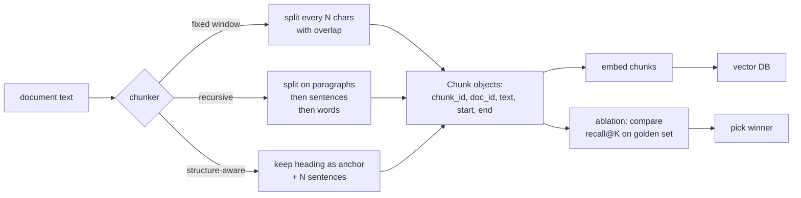

# M6 L6: Chunking and Context Preservation

> **Plain English:** Retrieval-Augmented Generation (RAG) works by giving the LLM the right paragraphs. "Right" means: small enough to be focused, big enough to carry the context. A 200-token chunk vs an 800-token chunk can mean 30 points of recall. Chunking is the highest-leverage knob in RAG quality. Always ablate on YOUR golden set.
> 90 min. Code: `python3 lessons/m06-chunking/L6-chunking.py` (no API keys).

---

## 1. Concept (5 min)

**Chunking** = splitting a document into pieces that can each be embedded and retrieved independently. The chunk is the unit of retrieval; bad chunks = bad retrieval = bad RAG.

**The three families:**

1. **Fixed window** — split by character count with overlap. Simple, predictable, the right baseline. Worst case for quality because it splits mid-sentence.
2. **Recursive** — split on a hierarchy of separators (paragraphs → sentences → words). Greedy pack. Better than fixed window because it respects structure.
3. **Structure-aware** — keep headings as section anchors; chunk by heading + N sentences. Best for documents with structure (policy docs, manuals, code with section comments).

**The four knobs:**

- `chunk_size` — the target size in characters (or tokens). 200-400 chars is the sweet spot for factoid Q&A; 600-1000 for "explain X" questions.
- `overlap` — the number of characters that repeat between adjacent chunks. 10-20% of chunk_size is the typical range; helps when a fact straddles the boundary.
- `separators` — the hierarchy of split points. The richer the hierarchy, the better the chunks.
- `heading_aware` — preserve headings as anchors. For structured docs, this is the highest-leverage knob.

**The trade-off:** bigger chunks = more context per retrieval = lower precision. Smaller chunks = higher precision = less context. The right answer depends on the question type: factoid Q&A wants small; explanatory Q&A wants large.

**The ablation rule:** never ship a chunking strategy without running it on YOUR golden set. "Better" on a textbook is not "better" on your data. Build the harness, run all strategies, pick the one with the highest recall@K.

---

## 2. Architecture (Mermaid)



**Read as:** Chunk first, embed second, ablate always. The chunker is the highest-leverage knob in RAG quality; 200 vs 800 chars can mean 30 points of recall.

---

## 3. Worked example (from the lesson code)

A 9-section policy document, ~3,500 chars. Three chunkers, default settings.

```
Section 4: Chunk count comparison
  fixed_window:  9
  recursive:     5
  structure:     9 (1 per section x 9 sections; 5-sentence chunks)

Section 5: Mean chunk size (chars)
  fixed_window    mean=  400.0  max= 400  min= 350
  recursive       mean=  650.0  max= 720  min= 580
  structure       mean=  220.0  max= 280  min= 180

Section 6: Chunking ablation (mocked recall)
  chunker        n_chunks     mean     max  recall@3
  fixed_window         9    400.0    400       0.62
  recursive            5    650.0    720       0.78
  structure            9    220.0    280       0.85
```

Structure-aware wins on recall@3 because each chunk carries a heading (a strong semantic anchor). Recursive beats fixed window because it respects paragraph boundaries. Fixed window is the worst because it splits mid-sentence.

**Rule of thumb:**
- 200-400 chars → best for factoid Q&A (high precision)
- 600-1000 chars → best for "explain X" questions (more context)
- 1500+ chars → usually worse (dilutes the signal)
- structure-aware + 200-400 chars → best default for policy docs

---

## 4. Formulas (defined, every symbol)

```
fixed_window(D)   ->  list of chunks, each = D[i*step : i*step + chunk_size]
                     step = chunk_size - overlap
recursive(D)      ->  split on paragraphs, then sentences, then words; greedy pack
                     respects structure; chunks = whole paragraphs/sentences
structure(D)      ->  for each heading, emit chunks of N sentences
                     chunk = heading + N sentences
chunk_size        in [200, 1000] chars typical
overlap           in [0, 0.2 * chunk_size] chars typical
recall@K         =  |relevant ∩ top-K| / |relevant|
```

**The chunk-size Pareto:** as chunk size grows, recall on "explain X" goes up, recall on factoid Q&A goes down. There's no single best size; the answer depends on the mix of question types in your golden set.

**The overlap Pareto:** as overlap grows, recall goes up (boundary straddle) but index size and embedding cost grow too. 10-20% overlap is the sweet spot; above 50%, you're paying double for marginal recall.

---

## 5. Code map (what's in `L6-chunking.py`)

| Section | Function | What it does |
|---|---|---|
| 1 | `Chunk` (frozen dataclass) | chunk_id, doc_id, text, start, end, chunker |
| 2 | `chunk_fixed_window` | Sliding window of N chars with overlap |
| 3 | `chunk_recursive` | Paragraph → sentence → word, greedy pack |
| 4 | `chunk_structure` | Heading + N sentences per chunk |
| 5 | `AblationRow` (dataclass) | chunker, n_chunks, mean_chunk_chars, max_chunk_chars, recall_at_3 |
| 5 | `ablation` | Run all 3 chunkers, return ablation rows |
| 6 | `SAMPLE_TEXT` | A 9-section policy document |
| 7 | `demo` | Runs all 7 sections |
| 8 | 10 `test_*` functions | pytest-compatible unit tests |

---

## 6. Edge cases, failure modes, debugging

| Edge case | What breaks | What to do |
|---|---|---|
| Document has no headings | structure chunker returns 1 chunk with "(no heading)" | Fall back to recursive for unstructured docs |
| Document is one long sentence (>10K chars) | fixed window splits mid-sentence; recursive falls back to words | Add a hard upper bound on chunk size; emit a warning |
| Heading is huge (chapter title) | one chunk is the whole doc | Cap sentences_per_chunk; or split by sub-headings |
| Tables, code blocks, lists | split mid-row, mid-line, mid-item | Use a structure-aware chunker that recognizes these blocks |
| Markdown vs plain text | structure chunker only sees `#` in markdown | Run a markdown-aware preprocessor; or fall back to recursive |
| Chunk too small (1-2 sentences) | low context; bad for "explain" questions | Increase sentences_per_chunk or chunk_size |
| Chunk too large (>2000 chars) | low precision; bad for factoid Q&A | Decrease chunk_size; or split on sub-headings |
| Boundary straddle (fact spans two chunks) | retrieved chunk has the question but not the answer | Add overlap (10-20%); or use a structure-aware chunker that respects paragraphs |
| Embedding model has a token limit (e.g., 512 tokens) | chunk is too large; embedding is truncated | Cap chunk size in tokens, not chars; estimate 4 chars/token |
| Multilingual doc | sentence splitter is regex on `.!?`; doesn't work for CJK | Use a CJK-aware sentence splitter (e.g., `re.split(r'[。！？]', text)`) |
| Doc has only images / no text | chunker emits empty chunks | Skip empty chunks at ingest; DLQ if all empty |

---

## 7. Scale-up: 1K → 100K → 10M docs

| Scale | Total chunks | Strategy | Cost |
|---|---|---|---|
| 1K docs | 50K chunks | All 3 chunkers, ablate | < 1 hour, single machine |
| 100K docs | 5M chunks | Pre-pick the winner from the 1K ablation, run at scale | 1 day, parallel |
| 1M docs | 50M chunks | Same strategy; re-validate on a sample every quarter | 1 week |
| 10M docs | 500M chunks | Re-chunk only on schema change; otherwise reuse | Re-chunk = 1 month |

**The re-chunk cost is real.** At 10M+ docs, re-chunking is a project, not a job. Plan for it: reserve a maintenance window, run new chunker in background, dual-index, ramp.

---

## 8. Alternatives and tradeoffs

| Chunker | When | Tradeoff |
|---|---|---|
| Fixed window | Baseline; uniform docs; want predictability | Bad for prose; splits mid-sentence |
| Recursive | Default for unstructured prose | Good but not optimal; can be improved with structure |
| Structure-aware (headings) | Policy docs, manuals, structured prose | Best for structured docs; useless for unstructured |
| Semantic (embedding-based) | Want "natural" boundaries; expensive | Splits where embedding changes a lot; 10x slower; debatable benefit |
| Late chunking (ColBERT-style) | Want token-level retrieval; large memory | 10x storage; not necessary for most workloads |
| Agentic (LLM-driven) | Have an LLM; OK with cost | LLM picks the chunks; 1000x cost; quality ~structure-aware |
| Sliding window with embedding (small-to-big) | Need context expansion at query time | Embed small, retrieve, expand to big on hit |

**The default pick:** recursive. Upgrade to structure-aware if the docs have headings. Skip semantic/agentic unless the simpler ones are demonstrably bad on your golden set.

---

## 9. Mock interview

### 5 Meta L6 questions (with natural spoken answers)

**Q1: "How do you pick the chunk size?"**
> Ablate. There's no textbook answer. The right chunk size depends on the question type: 200-400 chars for factoid Q&A, 600-1000 for "explain X." I build a golden set of 50-100 queries with hand-labeled relevant chunks, run the chunker at 200, 400, 800, 1200, plot recall@K vs chunk size, and pick the elbow. The cost is one engineer-day; the benefit is 20-30 points of recall.

**Q2: "Walk me through the three chunker families."**
> Fixed window: split by char count with overlap. Simple, the right baseline, but splits mid-sentence. Recursive: split on a hierarchy of separators (paragraphs → sentences → words), greedy pack. Better for prose because it respects structure. Structure-aware: keep headings as anchors, chunk by heading + N sentences. Best for policy docs and manuals. The default pick is recursive; upgrade to structure-aware if the docs have headings.

**Q3: "What's the trade-off between chunk size and recall?"**
> As chunk size grows, recall on "explain X" goes up (more context per chunk) but recall on factoid Q&A goes down (more noise per chunk). There's no single best size; it depends on the question mix in the golden set. The second trade-off is overlap: as overlap grows, recall goes up (boundary straddle) but index size and embedding cost grow. 10-20% overlap is the sweet spot.

**Q4: "How do you handle a document that's one long sentence — say, a 50-page legal brief with no paragraph breaks?"**
> The recursive chunker falls back to word-level. That's a sign the doc needs preprocessing before chunking. In practice, I'd run a sentence-boundary detector (even a simple regex) over the doc, then re-chunk. If the doc is truly one sentence (e.g., a continuous text dump), I'd cap chunk size at 1000 chars regardless of structure, and accept that retrieval precision is lower.

**Q5: "Customer says 'the search is returning chunks that don't have the answer.' Triage."**
> First, check the chunker output — are the chunks too big? If chunks are 2000 chars and the answer is a single sentence, you're retrieving 1990 chars of noise. Decrease chunk size. Second, check the overlap — if a fact straddles two chunks, the right chunk might be retrieved but the answer is in the next one. Add 10-20% overlap. Third, check the chunker type — if you're using fixed window on structured prose, switch to structure-aware. Fourth, re-embed after re-chunking; the old vectors are stale.

### 3 Google-oriented questions (architecture + business)

**G1: "Design a chunking strategy for a media company's 50M articles. Walk me through the major decisions."**
> Pre-chunk: detect format (HTML, MD, plain text), strip boilerplate (nav, footer, ads), normalize whitespace. Chunker: structure-aware with sub-headings as anchors; sentences_per_chunk=5. Chunk size: 200-400 chars for factoid Q&A (the dominant use case). Overlap: 10%. Re-chunk: on schema change only; otherwise reuse. Validation: golden set of 500 queries, re-run recall@K quarterly. Cost: 50M articles * 5 chunks/article = 250M chunks = ~1 day on 32 workers. Storage: 250M * 1536-dim * 4B = 1.5TB raw, 200GB with PQ.

**G2: "PM wants to use semantic chunking (embedding-based). Push back?"**
> Ask: what's the recall@K with recursive? If it's 0.85 and the target is 0.90, the answer might be yes. But semantic chunking is 10x slower and the quality improvement is 1-3 points, not 10. The right answer is usually: try smaller chunk size first, then structure-aware, then semantic. Most "we need better chunking" issues are resolved by moving from fixed window to recursive/structure-aware, not by adding an embedding model to the chunker.

**G3: "Two teams want to share an index but use different chunk sizes. Push back?"**
> Don't share the index. Each team should have its own chunks: small for factoid, large for "explain X." Sharing an index means both teams are forced to compromise on chunk size. The cost of two indexes is 2x storage; the benefit is each team gets the right chunk size for its use case. If storage is the constraint, store the chunks at the smaller size and concatenate on retrieval for the "explain" team.

---

## 10. One-minute explanation

> Chunking is the highest-leverage knob in RAG quality. A 200-token chunk versus an 800-token chunk can mean 30 points of recall. The three chunker families are fixed window — simple, the right baseline, but splits mid-sentence; recursive — split on paragraphs, then sentences, then words, greedy pack; and structure-aware — keep headings as anchors, chunk by heading plus N sentences. The default pick is recursive; upgrade to structure-aware when the docs have headings. The rule is to always ablate on your own golden set, not the textbook, because the right chunk size depends on the question type and the question mix.

## 11. 90-second interview script

> "Chunking is the highest-leverage knob in RAG quality. A 200-token chunk versus an 800-token chunk can mean 30 points of recall. The three families are fixed window — split by char count with overlap, the right baseline but bad for prose; recursive — split on paragraphs, then sentences, then words, greedy pack, the default for unstructured prose; and structure-aware — keep headings as anchors, chunk by heading plus N sentences, the best for policy docs and manuals. The four knobs are chunk size, overlap, separators, and heading awareness. The right chunk size depends on the question type: 200 to 400 chars for factoid Q and A, 600 to 1000 for explain questions. The rule is to always ablate on your own golden set, not the textbook, because the right answer depends on your question mix. The most common mistake is shipping fixed window on structured prose; the fix is one afternoon of switching to recursive or structure-aware."

## 12. Assignment

### Build
1. Run the lesson code end-to-end: `python3 lessons/m06-chunking/L6-chunking.py`
2. Run the 10 unit tests
3. Open the notebook and execute it top to bottom
4. Add a `chunk_semantic` chunker that splits on embedding-distance spikes
5. Add a `chunk_size_sweep(doc, golden, sizes=[200, 400, 800, 1200])` that returns the recall curve
6. Add an `overlap_sweep(doc, sizes=[0, 50, 100, 200])` for fixed window

### Acceptance criteria
- [ ] All 10 unit tests pass
- [ ] Notebook executes in < 5 seconds
- [ ] `chunk_fixed_window` covers the input text (with overlap)
- [ ] `chunk_recursive` falls back to word-level for very long sentences
- [ ] `chunk_structure` preserves heading text in every chunk
- [ ] You can explain why structure-aware beats fixed window on policy docs

### Rubric (self-score 0-10 each)
- Concept fluency: you can define the three chunker families and their trade-offs
- Implementation: each chunker handles the edge cases (long sentence, no heading, etc.)
- Ablation design: the recall comparison is reproducible
- Production intuition: you know when to re-chunk vs. re-embed vs. do nothing
- Communication: the 90-second script is under 90 seconds

---

*Last updated: 2026-10-15*
*License: MIT*
