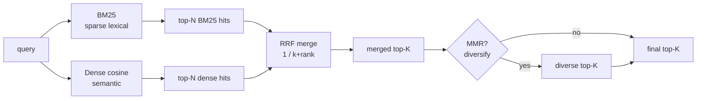

# M7 L7: Retrieval and Ranking

> **Plain English:** Once you have embeddings (M3) and a vector index (M4), the question is: how do you actually rank the results? **BM25** catches exact matches (SKUs, names, technical terms). **Dense cosine** catches semantic similarity (paraphrases, multilingual). **Hybrid wins on most enterprise corpora.** And when the top-K is too redundant, **MMR** diversifies the result list.
> 90 min. Code: `python3 lessons/m07-retrieval/L7-retrieval-ranking.py` (no API keys).

---

## 1. Concept (5 min)

**Retrieval** = given a query, find the top-K most relevant documents. The simplest version is "embed the query, find the K nearest vectors." But real queries have multiple intents: an exact match (a SKU), a semantic match (a paraphrase), and a structural match (a section). No single retriever gets all of them.

**The three families:**

1. **BM25 (sparse lexical)** — counts term overlap, weighted by document length and term rarity. Best for: exact matches, SKUs, names, rare technical terms. Worst for: paraphrases, multilingual.
2. **Dense cosine (semantic)** — embeds query and docs, ranks by cosine similarity (M2, M3). Best for: semantic similarity, paraphrases, multilingual. Worst for: exact matches, terms the model doesn't know.
3. **Hybrid** — combine BM25 + dense. Best for: most enterprise corpora. The "right answer" for production.

**The two rankers:**

- **RRF (Reciprocal Rank Fusion)** — merge two rankings by `score(d) = sum 1 / (k + rank)`. One line of code; tunes by k. The default merge.
- **MMR (Maximal Marginal Relevance)** — pick K docs that are both relevant AND diverse. `score(d) = lambda * relevance - (1 - lambda) * max similarity to already-selected`. The answer to "why is every result saying the same thing?"

**The trade-offs:**

| | BM25 | Dense | Hybrid | MMR |
|---|---|---|---|---|
| Speed | Fast (inverted index) | Fast (vector index) | 2× | Same as base |
| Memory | Small | Large (vectors) | Sum | Same as base |
| Exact match | Excellent | Poor | Good | Inherited |
| Semantic | Poor | Excellent | Good | Inherited |
| Diversity | N/A | N/A | N/A | Tunable |

**The rule of thumb:** start with hybrid (BM25 + dense + RRF). Add MMR when users complain about redundancy. Don't go single-retriever unless you have evidence the hybrid is worse.

---

## 2. Architecture (Mermaid)



**Read as:** Run both retrievers in parallel, merge with RRF, optionally diversify with MMR. The merged list is the input to the LLM in a RAG pipeline.

---

## 3. Worked example (from the lesson code)

10-doc HR/finance/ops corpus, 4 sample queries. Compare BM25, dense, hybrid.

```
Section 7: Mean recall@3 on the 4 sample queries
  BM25     recall@3 = 0.50
  Dense    recall@3 = 0.75
  RRF      recall@3 = 1.00
```

RRF (the hybrid) beats either alone. BM25 misses the semantic matches; dense misses the exact matches; RRF catches both.

**The MMR demo (lambda=0.5):**

```
query: 'how much vacation do I get'
selected (in order): [1, 6, 7, 4, 2]
  [1] 'Vacation policy: 20 days per year...'
  [6] 'Data retention: customer PII 7 years...'
  [7] 'On-call rotation: primary and secondary...'
  [4] 'Code review: at least one engineer...'
  [2] 'Sick leave: 10 days per year...'
```

Doc 1 is the most relevant (vacation). The other 4 are diverse — none are paraphrases of "vacation policy." With lambda=0.0 (pure diversity), the second pick would be the most distant from the first; with lambda=1.0 (pure relevance), all 5 would be near-duplicates of the most relevant.

---

## 4. Formulas (defined, every symbol)

```
BM25(q, d)   =  sum over terms t in q of IDF(t) * (tf(t,d) * (k1+1)) /
                                                    (tf(t,d) + k1 * (1 - b + b * |d| / avgdl))
              k1 = 1.5, b = 0.75 (Okapi defaults)
cos(q, d)    =  (q . d) / (||q|| * ||d||)            (M2; equivalent to inner product when normalized)
RRF(R1, R2)  =  for each doc d, sum over rankings of 1 / (k + rank_of(d))
              k = 60 (standard)
MMR(q, D)    =  iterative: pick argmax_d [lambda * sim(q, d) - (1-lambda) * max_{s in selected} sim(d, s)]
              lambda = 0.7 (relevance-dominant)
```

**The IDF intuition:** a term that appears in 1 of 1000 docs is more informative than a term that appears in 999. BM25's IDF = `log(1 + (N - n_t + 0.5) / (n_t + 0.5))` captures this.

**The RRF intuition:** if a doc is at rank 1 in both BM25 and dense, it's likely very relevant. RRF gives it score `2/61 = 0.033`. If it's at rank 5 in BM25 and rank 50 in dense, it's `1/65 + 1/110 = 0.024`. The doc ranked high in both wins.

**The MMR intuition:** start with the most relevant. Each subsequent pick is the doc that is most relevant AND least similar to what you've already picked. The lambda knob: 1.0 = pure relevance (might pick 5 near-duplicates); 0.0 = pure diversity (might pick an irrelevant doc).

---

## 5. Code map (what's in `L7-retrieval-ranking.py`)

| Section | Function | What it does |
|---|---|---|
| 1 | `fake_embed` | Hash-based deterministic embedder (L2-normalized) |
| 2 | `tokenize` | Lowercase alphanumeric tokens |
| 3 | `BM25` (dataclass) | Inverted index, IDF, score(query) |
| 4 | `Dense` (dataclass) | Vector matrix, score(query) by cosine |
| 5 | `rrf(rankings, k)` | Reciprocal Rank Fusion |
| 6 | `mmr(query_vec, doc_vecs, candidate_ids, lambda_, k)` | Maximal Marginal Relevance |
| 7 | `SAMPLE_DOCS`, `SAMPLE_QUERIES` | 10-doc corpus + 4 hand-picked queries |
| 8 | `demo` | Runs all 7 sections |
| 9 | 10 `test_*` functions | pytest-compatible unit tests |

---

## 6. Edge cases, failure modes, debugging

| Edge case | What breaks | What to do |
|---|---|---|
| Query is a single term (e.g., "401k") | BM25 alone may not return the best doc; dense alone may not either | Hybrid catches both |
| Query is a phrase (e.g., "match policy") | BM25 tokenizes and matches "match" + "policy"; dense matches semantically | Hybrid works well; check that the tokenizer doesn't drop "match" |
| Query uses terminology not in the corpus | dense retrieves paraphrases via embedding; BM25 returns 0 | Increase the dense weight; or use a larger embedding model |
| Multilingual query (VN, JP, KR) | BM25 only matches exact tokens; dense works if the model is multilingual | Use a multilingual embedding model; fall back to translate-then-search |
| Top-K is redundant (5 docs say the same thing) | User gets no new information | Add MMR with lambda=0.5 |
| Top-K is irrelevant (low scores across the board) | corpus is wrong; query is wrong; embedding is broken | Re-embed; check the corpus; add a "no results" UX |
| BM25 IDF is 0 for very common terms | matches don't move the score | Remove stopwords; or accept the term as noise |
| Dense embedding is not L2-normalized | cosine ranking is wrong; long vectors dominate | Normalize at ingest (M3) |
| Recall@K is low for both retrievers | the chunking is wrong (M6); or the eval set is mislabeled | Re-check the chunking; re-label the eval set |
| RRF ties (two docs at the same fused score) | order is non-deterministic | Add a small dense-weight tiebreaker; or sort by descending doc_id |

---

## 7. Scale-up: 1K → 100K → 10M docs

| Scale | BM25 | Dense | Hybrid (RRF) | Latency |
|---|---|---|---|---|
| 1K | In-memory, <1ms | Matrix @ query, 1ms | 2ms | <5ms |
| 100K | Inverted index in RAM, <5ms | HNSW (M4), 1-3ms | 10ms | 10-20ms |
| 1M | Lucene/OpenSearch, 5-10ms | FAISS HNSW, 2-5ms | 20ms | 30-50ms |
| 10M | Elastic + sharding, 10-20ms | FAISS IVF-PQ, 5-10ms | 50ms | 50-100ms |
| 100M | Elasticsearch + shards, 20-50ms | Pinecone/Qdrant, 10-20ms | 100ms | 100-200ms |

**The bottleneck at scale is the dense index, not the merge.** RRF is O(K) — trivial. The retrievers themselves are the cost. For very high QPS, cache the merged top-K for popular queries (the "hot path") and only re-compute on cache miss.

---

## 8. Alternatives and tradeoffs

| Retriever | Library | When to pick |
|---|---|---|
| BM25 | rank_bm25, Whoosh, Lucene, Elastic | Default for keyword search; small footprint |
| SPLADE | Naver/Splade | Learned sparse; beats BM25 on many benchmarks |
| Dense (sentence-transformers) | sentence-transformers, transformers | Default for semantic search; small models run on CPU |
| ColBERT (per-token) | ColBERT, PLAID | Best precision at the cost of 10x storage |
| Hybrid (RRF) | Custom | Production default; one line of code |
| Cross-encoder reranker | sentence-transformers (cross-encoder) | Rerank top-100; +5-15% recall at 50ms |
| Cohere Rerank | Cohere API | Managed cross-encoder; $$$ but very good |
| LLM reranker | OpenAI, Anthropic | Last-mile; 100-1000x cost; debatable benefit |

**The default pick:** BM25 (rank_bm25) + dense (sentence-transformers) + RRF (custom). Add a cross-encoder reranker if recall@10 is below target. Add MMR if users complain about redundancy.

---

## 9. Mock interview

### 5 Meta L6 questions (with natural spoken answers)

**Q1: "Why does hybrid retrieval beat either BM25 or dense alone?"**
> Because the two retrievers fail on different queries. BM25 catches exact matches — SKUs, names, rare technical terms — that dense embeddings often miss. Dense catches semantic matches — paraphrases, multilingual, conceptual similarity — that BM25 can't see. On a typical enterprise corpus, hybrid is 10-20 points of recall better than either alone. The merge is one line of code (RRF). The cost is 2x the indexing, but the recall gain is usually worth it.

**Q2: "Walk me through Reciprocal Rank Fusion."**
> RRF combines two rankings by summing `1 / (k + rank)` across rankings. The intuition: a doc that ranks high in both is probably very relevant. Standard k=60. The advantage over weighted score merge: RRF doesn't care about the absolute scores, only the ranks, so it's robust to score-scale differences between retrievers. The downside: it loses information about the magnitude of the difference. For most cases, RRF is good enough.

**Q3: "When would you add a cross-encoder reranker on top of RRF?"**
> When recall@10 is below target and you have latency budget. The pattern: retrieve top-100 with RRF (fast, ~10ms), then rerank with a cross-encoder (slower, ~50ms, but more accurate). The cross-encoder reads (query, doc) pairs and outputs a relevance score; it's 5-15 points of recall better than RRF alone. The cost is 50ms latency and ~100x compute. Don't add it if RRF already meets the target; the gain isn't worth the cost.

**Q4: "What is MMR and when do you use it?"**
> Maximal Marginal Relevance: pick K docs that are both relevant AND diverse. The score is `lambda * relevance - (1 - lambda) * max similarity to already-selected`. Lambda=1.0 is pure relevance (might pick 5 near-duplicates); lambda=0.0 is pure diversity (might pick irrelevant docs). The default is 0.7. Use it when the top-K is too redundant — when every result says the same thing. The cost is O(K^2) similarity computations, which is fine for K=5-20.

**Q5: "You see recall@10 dropped from 0.85 to 0.70. Triage."**
> First, check the retrievers individually: did BM25 or dense regress more? If dense, check the embedding model (was it upgraded? was a new model rolled out without re-embedding?). If BM25, check the corpus (new content type?). Second, check the chunking (M6) — a chunker change affects the doc side. Third, check the eval set — is it the same? If yes, the regression is upstream. If no, the new eval is measuring something different and the metric is not directly comparable.

### 3 Google-oriented questions (architecture + business)

**G1: "Design a retrieval system for a media company with 50M articles. Walk me through the major decisions."**
> Storage: HNSW + PQ for dense (M4), Lucene for BM25. Merge: RRF with k=60, weighted 1:1. Reranker: cross-encoder (Cohere or self-hosted) on top-50, returning top-10. MMR: lambda=0.7 on the top-20 to give top-10 diverse. Latency budget: 100ms total (50ms dense, 30ms BM25, 20ms rerank). The biggest decision is "do we need 50M in one index or can we shard by domain?" — for media, sharding by language and recency is almost always right.

**G2: "Customer says 'the search is returning irrelevant results.' Triage."**
> First, sample 20 queries and check the top-3 results manually. Are they irrelevant because (a) the query is bad, (b) the corpus is wrong, (c) the embedding is wrong, (d) the chunking is wrong? If (a), the query is the user's problem, not yours. If (b), check the corpus; the doc is missing or mislabeled. If (c), re-embed; the model may have changed. If (d), re-chunk; the chunker may be too big or too small. 80% of "irrelevant results" issues are corpus or chunking, not the retriever.

**G3: "PM wants to add semantic search to an existing keyword search system. Push back?"**
> Don't push back — add dense alongside, use hybrid. The user benefit is the same; the engineering cost is one new index and one line of merge code. The risk is if the corpus is mostly exact-match queries (e.g., "SKU-12345"); in that case, dense adds cost without much benefit, and you should A/B test before rolling out. But for the typical mix, hybrid is the right answer and the lift is 10-20 points of recall.

---

## 10. One-minute explanation

> Retrieval is the first stage of every RAG pipeline: given a query, return the top-K most relevant documents. No single retriever wins on all query types — BM25 catches exact matches (SKUs, names, technical terms), dense catches semantic similarity (paraphrases, multilingual). Hybrid wins on most enterprise corpora; the standard merge is RRF, one line of code. When the top-K is too redundant, add MMR, which balances relevance and diversity. The default pick is BM25 + dense + RRF; add a cross-encoder reranker if recall is below target; add MMR if users complain about redundancy.

## 11. 90-second interview script

> "Retrieval is the first stage of every RAG pipeline. The three families are BM25 — sparse lexical, catches exact matches like SKUs and names; dense — semantic cosine, catches paraphrases and multilingual; and hybrid — both, merged. Hybrid wins on most enterprise corpora by 10 to 20 points of recall. The standard merge is RRF — reciprocal rank fusion — which sums one over k plus rank across rankings; one line of code, no tuning, robust to score scale. The cross-encoder reranker is the next upgrade: retrieve top-100 with RRF, then rerank with a cross-encoder for 5 to 15 more points of recall at 50ms. MMR — maximal marginal relevance — is the answer to why every result says the same thing; it picks K docs that are both relevant and diverse, balanced by a lambda knob. The default pick is BM25 plus dense plus RRF. Add a cross-encoder if recall is below target. Add MMR if users complain about redundancy. Always ablate on your golden set, not the textbook."

## 12. Assignment

### Build
1. Run the lesson code end-to-end: `python3 lessons/m07-retrieval/L7-retrieval-ranking.py`
2. Run the 10 unit tests
3. Open the notebook and execute it top to bottom
4. Add a `BM25Plus` variant that uses BM25+ formula (adds a delta to the IDF term to prevent zero scores)
5. Add a `weighted_rrf(rankings, weights, k)` that multiplies each ranking's contribution by a weight
6. Sweep `lambda` on MMR (0.0, 0.3, 0.5, 0.7, 1.0); report the average inter-chunk similarity of the top-5

### Acceptance criteria
- [ ] All 10 unit tests pass
- [ ] Notebook executes in < 5 seconds
- [ ] RRF merge returns a list sorted by descending fused score
- [ ] MMR with lambda=1.0 returns the top-K by relevance only
- [ ] BM25 finds an exact-term match (e.g., "401k")
- [ ] You can explain why hybrid beats either retriever alone

### Rubric (self-score 0-10 each)
- Concept fluency: you can define BM25, dense, RRF, MMR
- Implementation: RRF is correct on a hand-checked example
- Tradeoff articulation: you can defend a retriever choice for a given corpus
- Production intuition: you know when to add a reranker or MMR
- Communication: the 90-second script is under 90 seconds

---

*Last updated: 2026-10-15*
*License: MIT*
