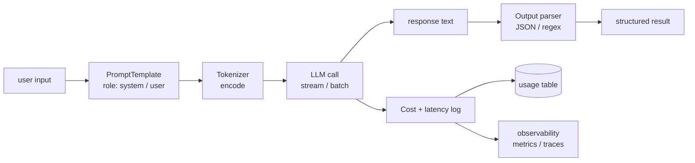

# M8 L8: LLM Fundamentals — Tokens, Prompts, Cost

> **Plain English:** Every LLM app is five things: a tokenizer, a prompt, a model call, a parser, and a cost log. Get those right and the rest is plumbing. This lesson builds all five from scratch — no API keys, no GPU, no model. The cost tracker is the part most teams skip; it is the part that gets you fired.
> 90 min. Code: `python3 lessons/m08-llm-fundamentals/L8-llm-fundamentals.py` (no API keys).

---

## 1. Concept (5 min)

An **LLM** is a function: it takes a sequence of tokens in, produces a sequence of tokens out, and has a price. Every LLM application is a thin wrapper around this function that adds: (1) prompt templating, (2) structured output parsing, (3) error handling, (4) cost tracking, (5) observability.

**Tokens, not characters.** Models don't see characters; they see tokens. A token is a chunk of text — usually 3-4 characters of English, or 1 character of CJK. GPT-4's tokenizer averages ~0.75 words per token. **Token count drives cost, latency, and the context window.** Your job is to keep tokens low without losing the prompt's meaning.

**The five things every LLM app has:**

1. **Tokenizer** — converts text to token ids and back. You need it to count tokens (for cost) and to fit the prompt in the context window.
2. **Prompt template** — a parameterized string with role tags (`system`, `user`, `assistant`). Templates let you compose prompts from variables.
3. **Model call** — sends the prompt to the model, gets a response. The call is async, can fail, can be slow.
4. **Output parser** — extracts structured data from the model's free-text response. JSON-mode is the standard; some models also support tool-use.
5. **Cost + latency tracker** — logs every call's input tokens, output tokens, cost, latency. Without it, you don't know what you're spending.

**The cost math:** for gpt-4o-mini at $0.15/M input + $0.60/M output, a 1K-token input + 500-token output costs $0.00045. At 1M calls/month, that's $450/month. At 10M calls, $4,500. The number adds up; you must log it.

**The latency math:** most modern LLMs have TTFT (time-to-first-token) of 100-500ms and a per-token latency of 20-50ms. A 500-token response takes 500 + 500 * 30 = 15.5 seconds. Streaming is required for UX.

---

## 2. Architecture (Mermaid)



**Read as:** Template, tokenize, call, parse, log. Every LLM app has these five pieces; the differences are in the details.

---

## 3. Worked example (from the lesson code)

5 calls through a mock LLM with a 100-word corpus, simple template, JSON parser.

```
Section 3: Cost + latency tracker
  total calls:      5
  total input tok:  87
  total output tok: 145
  total cost USD:   $0.000100
  mean latency ms:  0.05
  p95 latency ms:   0.06

Section 6: Cost projection at 1M calls / month
  per call:               $0.000020
  monthly (1M calls):     $20.04
  annual:                 $240.49
```

The numbers are tiny here (a mock LLM) but the structure is correct: per-call cost, monthly projection, annual projection. The same code with a real gpt-4o-mini would give a per-call cost around $0.0005 and a monthly projection around $500. **You will not catch a runaway cost without this tracker.**

---

## 4. Formulas (defined, every symbol)

```
tokens_in   =  tokenizer.encode(prompt).len
tokens_out  =  tokenizer.encode(response).len
cost        =  (tokens_in / 1M) * price_in + (tokens_out / 1M) * price_out
TTFT        =  time-to-first-token (streaming only)
total_ms    =  TTFT + tokens_out * per_token_ms
compression =  chars / tokens                            (4.0 for English, 1.5 for CJK)
```

**BPE in one sentence:** start with bytes, find the most-frequent adjacent pair, merge them into a new token, repeat. After N merges, you have a vocab of 256 + N tokens. The trained merges are the tokenizer.

**The cost-curve:** input tokens are usually 5-10× cheaper than output tokens. So prompts should be **long** (rich context) and responses should be **short** (terse instructions). The lever is on the output side.

---

## 5. Code map (what's in `L8-llm-fundamentals.py`)

| Section | Function | What it does |
|---|---|---|
| 1 | `BPETokenizer` (dataclass) | Train merges, encode, decode |
| 2 | `MockLLM` (dataclass) | Deterministic mock; echoes a hash of the prompt |
| 3 | `UsageRecord`, `CostTracker` (dataclasses) | Per-call + aggregate cost + latency |
| 4 | `PromptTemplate` (dataclass) | System + user template, variable validation |
| 5 | `parse_json_output` | Strip code fences, parse JSON |
| 6 | `LLMClient` (dataclass) | Wires tokenizer + model + tracker; one `complete()` call |
| 7 | `SAMPLE_CORPUS`, `SAMPLE_TEMPLATE`, `SAMPLE_QUESTIONS` | The 5-call demo |
| 8 | `demo` | Runs all 7 sections |
| 9 | 12 `test_*` functions | pytest-compatible unit tests |

---

## 6. Edge cases, failure modes, debugging

| Edge case | What breaks | What to do |
|---|---|---|
| Prompt > context window | API returns 400 or silently truncates | Tokenize before sending; truncate or chunk |
| Model returns malformed JSON | parser raises; the call "failed" | Add a "fix JSON" retry; or use JSON mode (gpt-4o supports it) |
| Model returns refusal ("I can't help with that") | empty result; downstream fails | Catch refusal as a separate exception type |
| Network error | transient | Retry with exponential backoff (3 attempts) |
| Rate limit (429) | transient | Retry with backoff; respect `Retry-After` header |
| Cost spike | runaway loop, or prompt got too long | Alert on cost per call > 10× baseline |
| Latency spike | model is overloaded, or network | Alert on P95 > 2× baseline; have a fallback model |
| Multi-turn conversation | token count grows; hits the limit | Truncate history; or summarize old turns |
| Streaming interrupted | partial response; need to handle | Use server-sent events; reconnect with offset |
| Hallucination | model "makes up" a fact | Constrain output to retrieved context (RAG); validate against a schema |
| Off-topic response | model answers the wrong question | Add guardrails in the system prompt; or use a router |
| Token drift | vocab mismatch between tokenizer and model | Pin the tokenizer to the model's published vocab; never mix |

---

## 7. Scale-up: 1K → 1M → 100M calls / month

| Scale | Latency budget | Cost / month | Strategy |
|---|---|---|---|
| 1K | 5s | $5 | Single-thread, sync; no caching |
| 100K | 1s | $500 | Async I/O, batch where possible |
| 1M | 500ms | $5K | Connection pooling, streaming, prompt caching |
| 10M | 300ms | $50K | Dedicated pool, model fallbacks, regional endpoints |
| 100M | 200ms | $500K | Multi-region, custom model, aggressive caching |

**The cost ceiling is the first thing to set.** Before the product ships, set a per-call cost ceiling; before the user can run anything, set a per-user cost ceiling; before the month closes, set a global ceiling. If any of those is hit, the system should refuse the call and log it.

---

## 8. Alternatives and tradeoffs

| Library | When | Tradeoff |
|---|---|---|
| tiktoken | Counting tokens for OpenAI models | Fast, exact, official |
| transformers (AutoTokenizer) | Counting tokens for any HF model | Generic, slightly slower |
| sentencepiece | Custom tokenizers (e.g., LLaMA) | Lower-level, more flexible |
| Guidance / outlines | Structured output (JSON, regex) | Lighter than full fine-tuning; not all models supported |
| LangChain | Full LLM app framework | Heavyweight, opinionated; sometimes too much |
| LiteLLM | Multi-provider abstraction | Good for switching providers; cost-tracking included |
| OpenAI SDK | Direct OpenAI calls | The default; no abstraction |
| Anthropic SDK | Direct Anthropic calls | The default for Claude; similar shape |
| Custom client | Need full control | Build it; ~200 lines |

**The default pick:** tiktoken (counting) + the model's SDK (calling) + a thin custom client (logging). Add LangChain only if you need its tool ecosystem and you're OK with the dependency.

---

## 9. Mock interview

### 5 Meta L6 questions (with natural spoken answers)

**Q1: "Walk me through the five pieces of every LLM app."**
> Tokenizer — convert text to token ids, used for cost counting and context-window checks. Prompt template — parameterized string with role tags; lets you compose prompts from variables. Model call — the actual API call; async, can fail, can be slow. Output parser — extract structured data from free-text response; JSON mode is the standard. Cost + latency tracker — log every call's input tokens, output tokens, cost, latency. Without that fifth piece, you don't know what you're spending and you will be surprised at the bill.

**Q2: "How do you handle a model that returns malformed JSON?"**
> Two options. First, use JSON mode if the model supports it (gpt-4o, Claude 3.5 Sonnet) — the model is constrained to emit valid JSON. Second, if you must use free-text, retry with a "fix the JSON" prompt; or use a JSON-extraction regex first (look for `{...}`) and parse the result. The fallback is to log the failure and surface "the model returned malformed output" to the user, never to crash.

**Q3: "Cost is growing faster than usage. Triage."**
> First, look at the per-call cost over time — is it the model getting more expensive, or are prompts getting longer? If prompts: the team added context that wasn't needed. If model: check if traffic shifted to a more expensive tier. Second, look at the top-N calls by cost — usually 1% of calls are 50% of cost. Find those and fix them (shorter prompt, smaller model, or cache the response). Third, look at retries — a flaky network can double your bill.

**Q4: "You have to support 5 different LLM providers. How do you abstract?"**
> Two layers. The lower layer is a thin per-provider client (each provider has its own SDK; don't fight it). The upper layer is a `LLMClient` interface that takes (prompt, model_id) and returns a normalized response. The cost and latency tracker sits in the upper layer. The trade-off: abstraction leaks. Some providers support streaming, some don't; some have JSON mode, some don't. Pick a feature floor (e.g., sync + JSON) and live with the gaps.

**Q5: "When do you use a smaller model vs a larger one?"**
> Always start with the smallest model that meets the quality bar. The cost difference is 10-100× between gpt-4o-mini and gpt-4o. Run a golden set of 100 queries through both, score quality (Likert, accuracy, whatever your metric is), and pick the smaller one if the quality gap is < 10%. Most tasks — classification, extraction, simple Q&A — work fine on a small model. The 10% where you need a large model: complex reasoning, code generation, multi-step planning. The right answer is usually a router: small for the easy 80%, large for the hard 20%.

### 3 Google-oriented questions (architecture + business)

**G1: "Design an LLM app for a 50M-user product. Walk me through the major decisions."**
> Latency budget: 500ms. Cost ceiling: $1M/month. Model: gpt-4o-mini for the easy 80% (classification, extraction), gpt-4o for the hard 20% (reasoning, generation). Caching: prompt cache for repeated queries (e.g., system prompt + common user input). Connection pool: dedicated, regional (us-east, eu-west, ap-southeast). Observability: log every call, sample 1% to traces, alert on cost and latency regressions. The biggest decision is "do we use a single model or a router?" A single model is simpler; a router is cheaper at scale.

**G2: "Customer says the AI is 'dumb' — it returns wrong answers. Triage."**
> First, sample 50 queries and grade the responses manually. If most are wrong, the model is wrong for this use case (use a bigger one). If a few are wrong, look at the prompt — is the context missing? Is the instruction ambiguous? If the prompt is good, look at the data — is the RAG retrieval returning the right docs? If RAG is fine, look at the output parser — is it dropping fields? 80% of "AI is dumb" issues are prompt or data, not the model.

**G3: "PM wants to add LLM calls to every page render. Push back?"**
> Yes — that's a 100x cost spike. Page renders are high-QPS; LLM calls are expensive and slow. The right answer is: cache the LLM response for popular pages, use a smaller model for simple cases, or move the LLM call to a server-side worker that updates the page every N minutes instead of on every render. The wrong answer is to call an LLM on every page load.

---

## 10. One-minute explanation

> Every LLM app is five things: a tokenizer, a prompt template, a model call, an output parser, and a cost-and-latency tracker. The tokenizer converts text to token ids and is used to count tokens for cost and to fit the prompt in the context window. The prompt template is a parameterized string with role tags. The model call is async, can fail, can be slow. The parser extracts structured data from free-text, ideally with JSON mode. The tracker logs every call's input tokens, output tokens, cost, and latency — without it, you don't know what you're spending. The cost math: at gpt-4o-mini pricing, a typical 1K-in + 500-out call is $0.0005, which becomes $500 at 1M calls per month and $5K at 10M. You must log this.

## 11. 90-second interview script

> "Every LLM app is five things. A tokenizer, which converts text to token ids and is used to count tokens for cost and to fit the prompt in the context window. A prompt template, which is a parameterized string with role tags. A model call, which is async, can fail, and can be slow. An output parser, which extracts structured data from free-text, ideally with JSON mode. And a cost and latency tracker, which logs every call's input tokens, output tokens, cost, and latency. Without that fifth piece you don't know what you're spending and you will be surprised at the bill. The cost math: at gpt-4o-mini pricing, a typical 1K in plus 500 out is half a tenth of a cent, which becomes 500 dollars at 1M calls per month and 5K at 10M. The latency math: TTFT is 100 to 500 milliseconds, plus 20 to 50 milliseconds per output token, so a 500-token response takes about 15 seconds — streaming is required for UX. The right answer is to start with the smallest model that meets the quality bar, run a golden set through both small and large, and pick the smaller one if the quality gap is under 10%."

## 12. Assignment

### Build
1. Run the lesson code end-to-end: `python3 lessons/m08-llm-fundamentals/L8-llm-fundamentals.py`
2. Run the 12 unit tests
3. Open the notebook and execute it top to bottom
4. Add a `StreamingMockLLM` that yields tokens one at a time with simulated latency
5. Add a `cost_ceiling(client, ceiling_usd)` that raises if `tracker.total_cost_usd() > ceiling_usd`
6. Add a `summarize_history(messages, max_tokens)` that keeps the system + last 5 turns

### Acceptance criteria
- [ ] All 12 unit tests pass
- [ ] Notebook executes in < 5 seconds
- [ ] BPE tokenizer compresses repeated phrases
- [ ] Cost tracker correctly aggregates input, output, cost, latency
- [ ] Prompt template raises on missing variables
- [ ] LLMClient logs every call with non-zero tokens and cost

### Rubric (self-score 0-10 each)
- Concept fluency: you can define the 5 pieces of an LLM app
- Implementation: tokenizer + tracker + client are correct on a hand-checked example
- Tradeoff articulation: you can defend a model choice for a given budget
- Production intuition: you know the failure modes (cost spike, latency, malformed output)
- Communication: the 90-second script is under 90 seconds

---

*Last updated: 2026-10-15*
*License: MIT*
