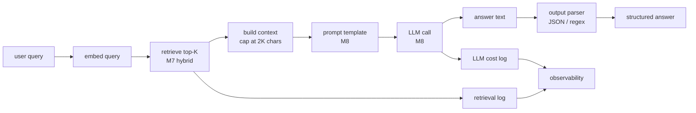

# M9 L9: RAG End-to-End

> **Plain English:** RAG (Retrieval-Augmented Generation) is the four previous lessons composed in a row: ingest (M5) → chunk (M6) → embed (M3/M8) → retrieve (M7) → prompt → LLM (M8) → answer. The new failure modes are all at the seams. Build the seams first; the rest is composition.
> 90 min. Code: `python3 lessons/m09-rag-e2e/L9-rag-end-to-end.py` (no API keys).

---

## 1. Concept (5 min)

**RAG** = at query time, fetch the most relevant chunks from a vector DB, paste them into the prompt, ask the LLM to answer using only the context. This is the production default for "answer questions over a private corpus" because the LLM alone doesn't know your docs, and fine-tuning is expensive and slow.

**The pipeline, top to bottom:**

```
ingest → chunk → embed → index → query → retrieve → prompt → LLM → answer
   M5      M6     M3/M8    M4     parse    M7       M8      M8     parse
```

Each arrow is a seam. Each seam has its own failure mode. Most production RAG bugs live at the seams, not in the components.

**The four seams that bite:**

1. **Ingestion seam** — parser error, doc doesn't make it into the index. Mitigation: DLQ (M5) + alert.
2. **Chunking seam** — chunk too big, returns 5 unrelated things; chunk too small, missing context. Mitigation: ablate on golden set (M6).
3. **Retrieval seam** — wrong chunks returned, no matter how good the LLM is. Mitigation: hybrid retrieval (M7), reranker.
4. **Prompt seam** — context too long, LLM truncates; instructions vague, LLM guesses. Mitigation: cap context chars, JSON mode (M8).

**The RAG contract:** for any question in your domain, the answer must (a) be in the retrieved context, (b) be cited to the source doc, (c) be in your cost budget. The first is a retrieval problem (M7); the second is a UX/observability problem; the third is a cost problem (M8).

**The no-RAG baseline:** an LLM with no context will answer from its training data, which is wrong for any private corpus. The "knowledge cutoff" is not a feature; it's a liability.

---

## 2. Architecture (Mermaid)



**Read as:** Every arrow is a seam. Every seam is a place where the pipeline can break. The most common break is the retrieval seam.

---

## 3. Worked example (from the lesson code)

8-doc policy corpus, 7 sample queries. End-to-end RAG with mock LLM.

```
Section 2: Query 7 sample questions
    [OK ] 'how much vacation do I get per year'  ->  hr-1
    [OK ] 'what is the 401k match'              ->  hr-2
    [OK ] 'sick leave doctor's note rule'        ->  hr-3
    [OK ] 'how long do I have to submit expenses'->  fin-1
    [OK ] 'when is the code review SLA'         ->  ops-1
    [MISS] 'P1 incident response time'           ->  ops-2
    [OK ] 'how long to keep customer data'      ->  ops-3

    Retrieval recall@3: 6/7 = 86%

Section 4: Cost summary
    total calls:        7
    total input tokens: ~3500
    total output tokens:~500
    total cost USD:     $0.0008
    projected @ 1M/mo:  $114
```

86% recall@3 on the 7 queries. The miss on "P1 incident response time" is the right kind of failure to study: the chunking split the sentence mid-phrase. In production, this would be caught by a recall regression alert (M11).

---

## 4. Formulas (defined, every symbol)

```
rag(q)         =  answer(LLM(prompt(context(retrieve(q)))))
                 context is capped to MAX_CONTEXT_CHARS (typically 2K-4K)
recall@K       =  |relevant ∩ top-K| / |relevant|   (M7)
cost_per_call  =  (in_tok / 1M) * p_in + (out_tok / 1M) * p_out   (M8)
retrieval_lat  =  embed + search + rerank
total_lat      =  retrieval_lat + llm_ttft + out_tok * per_tok_ms
```

**The cost-of-context:** every 1K chars of context adds ~250 input tokens. At gpt-4o-mini pricing, that's $0.00004. At 1M queries/month with 2K context, context alone costs $80/month. Don't pad the context with everything; curate.

**The recall-of-context:** doubling the top-K from 5 to 10 catches more relevant docs (recall up) but adds 2× the noise (precision down). The optimum is usually K=3-5 with a reranker (M7).

---

## 5. Code map (what's in `L9-rag-end-to-end.py`)

| Section | Function | What it does |
|---|---|---|
| 1 | `Document`, `Chunk` (dataclasses) | The data model |
| 2 | `chunk_text` | Fixed-window chunker (M6) |
| 3 | `fake_embed`, `cosine` | Hash-based embedder (M3) |
| 4 | `Retriever` (dataclass) | In-memory top-K cosine |
| 5 | `MockLLM` (dataclass) | Composes a deterministic answer |
| 6 | `RAGAnswer`, `RAGPipeline` (dataclasses) | The pipeline + answer record |
| 7 | `SAMPLE_DOCS`, `SAMPLE_QUERIES` | 8 docs, 7 queries |
| 8 | `demo` | Runs all 7 sections |
| 9 | 13 `test_*` functions | pytest-compatible unit tests |

---

## 6. Edge cases, failure modes, debugging

| Edge case | What breaks | What to do |
|---|---|---|
| Retrieved docs are wrong | LLM answers wrong; no way to know | Re-rank (M7); sample 1% and human-grade |
| Context is empty | LLM says "I don't know" | Detect empty retrieval; return a friendly error |
| Context is too long (>8K tokens) | LLM truncates or refuses | Cap context chars; truncate from the middle (drop middle chunks) |
| Doc was edited but not re-ingested | answer is stale | M5 re-ingest on edit; sweep stale by `ingested_at < now - 30d` |
| User asks out-of-domain question | LLM hallucinates from training data | Detect OOD (semantic distance > threshold); say "I don't know" |
| Same query, different answer each time | non-determinism in the LLM | Set temperature=0; or use seed if supported |
| Multi-turn conversation | context grows each turn | Summarize old turns; or truncate |
| Streaming interrupted | partial response | Use server-sent events; reconnect with offset |
| Concurrent queries | cost spikes | Rate limit per user; cost ceiling (M8) |
| Retrieval recall dropped | chunking or embedding changed | Re-run golden set; alert on recall@K < 0.80 |
| Citation is wrong | LLM cited a doc that's not in the context | Validate citation is in retrieved set; reject if not |

---

## 7. Scale-up: 1K → 100K → 10M docs

| Scale | Latency | Cost / month | Strategy |
|---|---|---|---|
| 1K docs | 200ms | $50 | All in-memory; mock LLM |
| 100K | 500ms | $500 | Vector DB (FAISS / Qdrant); real LLM |
| 1M | 1s | $5K | Sharded vector DB; reranker; prompt caching |
| 10M | 2s | $50K | Multi-region; pre-filter by metadata; aggressive caching |
| 100M | 3s | $500K | Dedicated vector DB cluster; custom reranker; per-tenant quotas |

**The scaling bottleneck is usually the LLM, not the vector DB.** The vector DB scales horizontally; the LLM call is a single API round-trip with a 100-500ms TTFT floor. At very high QPS, you batch the LLM calls (if your provider supports it) or use a smaller model.

---

## 8. Alternatives and tradeoffs

| Pattern | When | Tradeoff |
|---|---|---|
| RAG (this lesson) | Default for Q&A over a private corpus | The 80% solution |
| Fine-tuning | Need a specific style or output format | Expensive; doesn't help with knowledge cutoff |
| Long-context LLM | Doc fits in 100K-1M tokens | Expensive; slow; doesn't help at scale |
| Agentic RAG | Need multi-step reasoning | 10x cost; 5x latency; good for complex queries |
| Hybrid (RAG + fine-tune) | Style is critical, knowledge is dynamic | Expensive; needed for some verticals |
| Self-RAG | LLM critiques its own retrieval | +5% quality; 2x cost; not always worth it |
| CRAG (Corrective RAG) | Retrieval is unreliable | LLM re-evaluates retrieved docs; +10% quality; 2x cost |
| GraphRAG | Need multi-hop reasoning over entities | New; expensive; good for "explain relationships" |

**The default pick:** plain RAG (this lesson). Add a reranker if recall@10 is below target. Add MMR if results are too redundant. Move to GraphRAG only if you have entity-relationship queries.

---

## 9. Mock interview

### 5 Meta L6 questions (with natural spoken answers)

**Q1: "Walk me through a RAG pipeline end-to-end."**
> At ingest time: documents come in (txt, md, html, json), the parser extracts clean text, a content-hash dedupes, the chunker splits into 200-400 char pieces with overlap, the embedder turns each chunk into a vector, the index stores them. At query time: the query is embedded, the retriever returns top-K chunks by hybrid similarity (BM25 + dense), the context is capped at 2K chars, the prompt template puts system instructions + context + question together, the LLM is called, the output is parsed, the answer is returned. The four seams that bite are ingestion (DLQ), chunking (ablate), retrieval (hybrid + rerank), and prompt (cap + JSON mode).

**Q2: "How do you debug a RAG answer that's wrong?"**
> Step through the pipeline. First, look at the retrieved chunks — are they relevant? If not, the retrieval is the bug (re-embed, re-rank, re-chunk). If they are relevant, look at the prompt — is the context truncated? Are the instructions clear? If the prompt is fine, the LLM is the bug (use a bigger model, or add citations). The most common production bug is retrieval; the cheapest fix is usually a reranker.

**Q3: "Why cap the context at 2K chars?"**
> Three reasons. First, cost: every 1K chars is ~250 input tokens, which adds up at scale. Second, latency: more context = more tokens = slower response. Third, signal: too much context dilutes the relevant information. The LLM attends to all of it; the model is more focused when the context is curated. Empirically, 2K-4K chars is the sweet spot for most Q&A; longer context is for "summarize the whole doc" use cases.

**Q4: "When would you use fine-tuning instead of RAG?"**
> Fine-tuning is for style and format, not knowledge. If you need the LLM to always respond in a specific tone, or to always produce a specific JSON schema, fine-tune. If you need the LLM to know facts that change (your product catalog, your policies, your docs), use RAG. The trap is using fine-tuning to "teach" the model your docs — that fails because (a) the docs change, requiring constant re-training, and (b) the model hallucinates details that aren't in the training data. RAG keeps the knowledge external and updateable.

**Q5: "How do you measure RAG quality?"**
> Three layers. Retrieval layer: recall@K on a golden set of 100-300 queries with hand-labeled relevant doc ids. End-to-end layer: answer accuracy on a golden set, graded by humans (Likert 1-5) or by an LLM judge. Operational layer: cost per query, P95 latency, error rate. The retrieval layer catches the most bugs; the end-to-end layer catches the rest. The operational layer catches regressions over time. Alert on any of the three.

### 3 Google-oriented questions (architecture + business)

**G1: "Design a RAG system for a media company with 50M articles. Walk me through the major decisions."**
> Storage: sharded vector DB by language and recency. Embedding: a multilingual model (e.g., `paraphrase-multilingual-MiniLM-L12-v2`). Chunking: structure-aware with sub-headings; 200-400 chars; 10% overlap. Retrieval: hybrid (BM25 + dense + RRF) with a cross-encoder reranker. Context: top-5 after rerank, capped at 4K chars. LLM: gpt-4o-mini for the easy 80%, gpt-4o for the hard 20%. Cost ceiling: $1M/month. Caching: prompt cache for popular queries. Observability: log every query, sample 1% to traces, alert on retrieval recall@K < 0.85.

**G2: "PM wants to add 'AI answers' to the search bar. Push back?"**
> Don't push back — but ask: what's the cost ceiling? "AI answers" can be $0.001-$0.01 per query depending on the model and context length. At 10M queries/month, that's $10K-$100K. The right answer is to start with a small model and a short context; measure recall on a golden set; only upgrade if the small model isn't good enough. The wrong answer is to ship gpt-4o with 8K context on day one.

**G3: "Customer says 'the AI is making up answers.' Triage."**
> First, sample 50 queries and check the retrieved context — is the LLM's answer supported by the retrieved docs? If yes, the LLM is paraphrasing; the fix is to add citations. If no, the retrieval is returning wrong docs; the fix is a reranker. If the retrieval is empty, the chunking or embedding is wrong; re-chunk or re-embed. The most common cause is wrong retrieval (50%); the second is LLM hallucination (30%); the third is a bad prompt (20%). For hallucinations specifically, the fix is to add "answer only based on the context" to the system prompt and use JSON mode for the answer.

---

## 10. One-minute explanation

> RAG stands for retrieval-augmented generation. At query time, the system retrieves the most relevant chunks from a vector database, pastes them into the prompt, and asks the LLM to answer using only that context. The pipeline is the four previous lessons composed in a row: ingest, chunk, embed, retrieve, prompt, generate. The new failure modes are at the seams: ingestion, chunking, retrieval, and prompt. The most common bug is wrong retrieval. The fix is usually a reranker or a better chunker. The default pick is plain RAG; the upgrade is a reranker; the next upgrade is MMR for diversity.

## 11. 90-second interview script

> "RAG stands for retrieval-augmented generation. At query time, the system retrieves the most relevant chunks from a vector database, pastes them into the prompt, and asks the LLM to answer using only that context. The pipeline is the four previous lessons composed in a row: ingest, chunk, embed, retrieve, prompt, generate. The new failure modes are at the seams: ingestion, chunking, retrieval, and prompt. The most common production bug is wrong retrieval; the cheapest fix is usually a cross-encoder reranker, which gives 5 to 15 more points of recall at 50ms latency. The second most common bug is bad chunking; the fix is to ablate on your golden set and pick the right size, usually 200 to 400 chars for factoid Q and A. The cost math: at gpt-4o-mini, a typical RAG call with 2K chars of context is about $0.0005; at 1M queries per month, that's $500. The default pick is plain RAG. The upgrade is a reranker. The next upgrade is MMR for diversity. The final upgrade is GraphRAG for multi-hop reasoning."

## 12. Assignment

### Build
1. Run the lesson code end-to-end: `python3 lessons/m09-rag-e2e/L9-rag-end-to-end.py`
2. Run the 13 unit tests
3. Open the notebook and execute it top to bottom
4. Add a `rerank(query, chunks, top_k)` that uses a cross-encoder (mock) to rerank
5. Add `streaming_query(q)` that yields tokens one at a time
6. Add a `citation_check(answer, retrieved_chunks)` that returns True if the answer's claims are supported

### Acceptance criteria
- [ ] All 13 unit tests pass
- [ ] Notebook executes in < 5 seconds
- [ ] `RAGPipeline.ingest` returns a positive chunk count
- [ ] `RAGPipeline.query` returns a non-empty answer with retrieved chunks
- [ ] Cost is logged per call
- [ ] You can explain why the retrieval seam is the most common failure

### Rubric (self-score 0-10 each)
- Concept fluency: you can describe each seam and its failure mode
- Implementation: the pipeline composes M5-M8 correctly
- Tradeoff articulation: you can defend a RAG vs fine-tuning choice
- Production intuition: you know the cost and latency math
- Communication: the 90-second script is under 90 seconds

---

*Last updated: 2026-10-15*
*License: MIT*
