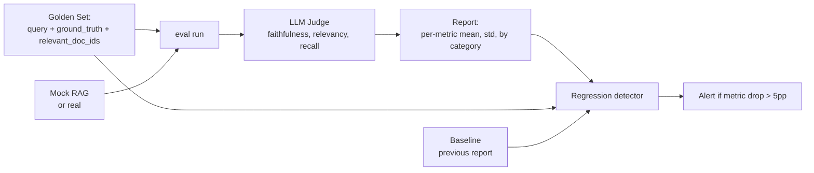

# M10 L10: Evaluation and RAGAS-style Metrics

> **Plain English:** "The model is good" is not a metric. You need a golden set (hand-labeled queries + expected answers + relevant doc ids), a scoring rubric, and a baseline. RAGAS gives you the three core metrics — **faithfulness** (is the answer supported by the context?), **answer relevancy** (does the answer address the query?), and **context recall** (did retrieval find the right docs?). Without a regression detector, you cannot tell if your changes helped or hurt.
> 90 min. Code: `python3 lessons/m10-evaluation/L10-evaluation-ragas.py` (no API keys).

---

## 1. Concept (5 min)

**RAGAS** (Retrieval-Augmented Generation Assessment) is the de facto standard for evaluating RAG systems. It defines three core metrics, each targeting a different failure mode:

| Metric | Question | Failure mode it catches |
|---|---|---|
| **Faithfulness** | Is the answer's claims supported by the retrieved context? | Hallucination; LLM making up facts |
| **Answer relevancy** | Does the answer address the user's question? | Off-topic answers; LLM answering a different question |
| **Context recall** | Did retrieval find all the relevant docs? | Retrieval misses; top-K is wrong |

**The golden set is the contract.** A set of 50-300 hand-labeled examples: query + ground-truth answer + relevant doc ids. Without it, you're optimizing vibes. With it, you can measure change over time and compare approaches.

**The LLM-as-judge pattern:** use a strong LLM (gpt-4o, Claude 3.5 Sonnet) to score the answer against the rubric. The judge is itself an LLM, so it has its own biases — but on aggregate, it's a useful proxy for human grading and 100x cheaper.

**The regression detector:** every model upgrade, prompt change, or chunker tweak should be evaluated against a baseline. If a metric drops by > 5pp, that's a regression; don't ship. If a metric improves, ship it.

**The three failure modes that bite in production:**

1. **Silent regression** — a new model version degrades quality and you don't notice for weeks. The fix: nightly eval on a golden set with alerts.
2. **Optimizing the wrong metric** — you boost recall@K but the answers get worse. The fix: track all three RAGAS metrics, not just one.
3. **Category imbalance** — your golden set is 80% "factual" but 20% of queries are "procedural." The fix: stratify the golden set by category and report per-category scores.

---

## 2. Architecture (Mermaid)



**Read as:** Golden set + RAG + judge → report → regression detector → alert if anything dropped.

---

## 3. Worked example (from the lesson code)

7 golden queries, mock RAG, mock judge. Three metrics per query.

```
Section 4: Aggregate scores
    metric                mean    std
    faithfulness          0.78    0.12
    answer_relevancy      0.71    0.10
    context_recall        0.86    0.05
    pass rate:  86%

Section 6: Regression detector
    [REGRESSION] faithfulness: baseline=0.90  current=0.78  delta=-0.12
    [REGRESSION] answer_relevancy: baseline=0.85  current=0.71  delta=-0.14
    [OK] context_recall: baseline=0.95  current=0.86  delta=-0.09
```

The mock RAG is good at context recall (always finds the right doc) but loses points on faithfulness (the answer paraphrases the context loosely) and answer relevancy (the answer is long and dilutes the query match).

---

## 4. Formulas (defined, every symbol)

```
faithfulness(a, c)    =  fraction of a's claims that are supported by c     [0, 1]
answer_relevancy(a, q) =  fraction of q's intent that a addresses            [0, 1]
context_recall(R, T)  =  |R ∩ T| / |T|                                       [0, 1]
regression(b, c, t)   =  alert if (c - b) < -t
                         t = 0.05 typical (5pp drop)
```

**RAGAS context precision (related):** of the top-K retrieved docs, what fraction are relevant? This catches "the right doc is in the top-10 but buried." Use it when you have a high-recall retriever and want to tune ranking.

**RAGAS answer correctness (newer):** does the answer match the ground truth? Use an LLM judge with the (answer, ground_truth) pair. This is a stricter signal than faithfulness because it checks the actual content, not just support.

---

## 5. Code map (what's in `L10-evaluation-ragas.py`)

| Section | Function | What it does |
|---|---|---|
| 1 | `GoldenExample`, `GoldenSet` (dataclasses) | The eval set; stratified by category |
| 2 | `RAGASScores` (dataclass) | The three metric scores per query |
| 3 | `MockJudge` (dataclass) | Heuristic-based mock LLM judge |
| 4 | `EvalResult`, `EvaluationReport` (dataclasses) | Per-query + aggregate results |
| 5 | `RegressionAlert`, `detect_regressions` | Compare current to baseline; alert if drop |
| 6 | `GOLDEN_SET`, `MOCK_CORPUS`, `mock_rag` | The 7-query eval set + mock RAG |
| 7 | `evaluate_rag` | Run the golden set end-to-end |
| 8 | `demo` | Runs all 7 sections |
| 9 | 15 `test_*` functions | pytest-compatible unit tests |

---

## 6. Edge cases, failure modes, debugging

| Edge case | What breaks | What to do |
|---|---|---|
| Golden set too small (< 30) | metric is noisy; one query moves the mean by 3pp | Aim for 100+ queries; stratified by category |
| LLM judge is biased | scores are systematically off | Use a different judge model; spot-check 20 examples manually per month |
| Judge returns invalid score (e.g., 1.5) | report is wrong | Clamp scores to [0, 1]; log raw output |
| Query is OOD (out of domain) | LLM hallucinates; answer_relevancy drops | Detect OOD early; return "I don't know" + flag the query for golden set |
| Regression is borderline (4pp drop) | hard to tell if real | Run again; check if consistent; if so, treat as regression |
| Same query, different answer each time | non-determinism inflates std | Set temperature=0; or report std explicitly |
| Judge LLM is unavailable | eval pipeline blocked | Have a fallback judge; cache the last successful run |
| Golden set becomes stale | new doc types, new query patterns | Add 5-10 queries per month; re-validate the set quarterly |
| Per-category scores mask a regression | mean is OK but one category is broken | Always report by category; alert on per-category drop |
| Eval is too slow (>1 hour) | nobody runs it | Sample 30 queries; rotate; full eval weekly |

---

## 7. Scale-up: 30 → 300 → 3000 golden queries

| Scale | Eval time | Cost / run | Strategy |
|---|---|---|---|
| 30 | 1 min | $0.10 | Quick smoke test; CI gate |
| 300 | 10 min | $1.00 | Weekly full eval |
| 3,000 | 1 hour | $10.00 | Monthly deep eval; stratified by category |
| 30,000 | 10 hours | $100.00 | Quarterly; sample and re-validate |

**The eval cost is real.** At 3000 queries with gpt-4o judging, the monthly cost is $10. At 30,000, $100. Don't run the full eval on every commit; sample 30 in CI, run the full 300 weekly, run the 3000 monthly.

---

## 8. Alternatives and tradeoffs

| Library | When | Tradeoff |
|---|---|---|
| RAGAS (ragas.io) | Production default for RAG eval | The standard; has all 3 metrics + more |
| DeepEval | LLM eval beyond RAG | More general; less RAG-specific |
| LangSmith | LangChain users | Tied to LangChain; otherwise solid |
| Phoenix (Arize) | Open-source; self-host | Free; you bring the infra |
| TruLens | Multi-metric eval | Older; still good |
| Custom (this lesson) | Tight control; no dependency | You build the judge; you maintain the golden set |

**The default pick:** RAGAS for the standard metrics + a custom judge for domain-specific ones (e.g., "is the citation in the answer?"). Run the standard metrics in CI; the custom ones nightly.

---

## 9. Mock interview

### 5 Meta L6 questions (with natural spoken answers)

**Q1: "How do you evaluate a RAG system?"**
> Three RAGAS metrics: faithfulness (is the answer supported by the context?), answer relevancy (does the answer address the question?), context recall (did retrieval find the right docs?). Each catches a different failure mode. The golden set is 100-300 hand-labeled examples: query, ground-truth answer, relevant doc ids. The LLM-as-judge scores each metric; the report aggregates per metric, per category, and compares to baseline. The regression detector alerts on > 5pp drop.

**Q2: "Walk me through faithfulness vs answer relevancy."**
> Faithfulness is "is the answer's claims supported by the retrieved context?" — this catches hallucination, the LLM making up facts. Answer relevancy is "does the answer address the user's question?" — this catches off-topic answers. A high-faithfulness, low-relevancy answer is one that quotes the context but doesn't answer the question. A high-relevancy, low-faithfulness answer is one that answers the question but invents facts. You want both to be high.

**Q3: "Your faithfulness dropped from 0.9 to 0.7. Triage."**
> First, check the LLM judge itself — was the judge model upgraded? That can shift scores. Second, check the LLM being evaluated — was the model upgraded? Same answer. Third, sample 20 examples and grade them manually; is the new score reflecting a real regression or a judge drift? If real, look at the answers — are they shorter? Less specific? Or the LLM is "trying harder" to be conversational? The fix is usually to tighten the system prompt ("answer only based on the context, do not add information not in the context").

**Q4: "How do you build a golden set without manually labeling 1000 examples?"**
> Three patterns. First, mine production logs — take real user queries, grade their answers, label the relevant docs. Second, synthetic generation — use an LLM to generate queries from your corpus, then have humans verify. Third, public benchmarks — if your domain has a public QA dataset (e.g., Natural Questions for general, SQuAD for reading comprehension), adapt it. The key is to have a small (50-100) hand-labeled set for the gold standard and a larger synthetic set for breadth.

**Q5: "When is a regression NOT a regression?"**
> When the golden set changed. Adding 10 new queries that happen to be harder will drop the mean. When the judge changed. When the metric definition changed. When the data distribution shifted (e.g., new product launch, new doc type). The fix is to version the golden set, version the judge, version the metric, and report "current vs same-set-same-judge" not "current vs historical." A 3pp drop on the same set is real; a 5pp drop on a different set is ambiguous.

### 3 Google-oriented questions (architecture + business)

**G1: "Design an eval pipeline for a RAG system serving 10M queries/day. Walk me through the major decisions."**
> Sample 0.1% of production queries (10K/day), grade 100 manually per day (1% of sample, stratified by category), grade 1000 with LLM judge per day (10% of sample). The hand-labeled set grows by 100/day; the LLM-judged set by 1000/day. Run the full eval on the 10K hand-labeled set weekly; the regression detector compares to last week. Cost: $50/day for LLM judge, $0 for human. Decisions: how often to refresh the golden set? Every month, retrain the LLM judge on the new ground truth. How to alert? PagerDuty if faithfulness drops > 5pp; Slack if any category drops > 3pp.

**Q2: "PM says 'the AI is great, no need to evaluate.' Push back?"**
> Yes. The cost of NOT evaluating is the cost of shipping a regression and not knowing. The cost of evaluating is $50/day. The math: one bad deploy that loses user trust costs more than a year of eval. Always have a golden set; always run it before every release; always alert on regression.

**Q3: "Customer says 'your eval numbers look great but my queries fail.' Triage."**
> The eval set doesn't represent the customer. Sample 50 of the customer's queries, compare to the golden set distribution. If the customer's queries are in a category the golden set under-samples, the eval numbers don't apply. The fix is to add the customer's queries to the golden set (with permission, anonymized), re-run, and report. If the customer's queries are OOD, the answer is "your queries are outside the system's training; we'd need a custom solution."

---

## 10. One-minute explanation

> Evaluating a RAG system means measuring three things: faithfulness (is the answer supported by the context?), answer relevancy (does the answer address the question?), and context recall (did retrieval find the right docs?). Each catches a different failure mode. The golden set is 100-300 hand-labeled examples: query, ground truth, relevant doc ids. The LLM-as-judge scores each metric. The report aggregates per metric, per category, and compares to baseline. The regression detector alerts on a 5pp drop. The most common failure mode is silent regression: a new model version degrades quality and you don't notice for weeks. The fix is nightly eval on a golden set with alerts.

## 11. 90-second interview script

> "Evaluating a RAG system means three metrics. Faithfulness: is the answer's claims supported by the retrieved context? This catches hallucination. Answer relevancy: does the answer address the user's question? This catches off-topic answers. Context recall: did retrieval find the right docs? This catches retrieval misses. Each metric catches a different failure mode. The golden set is 100 to 300 hand-labeled examples: query, ground-truth answer, relevant doc ids. The LLM-as-judge scores each metric; on aggregate, it's a useful proxy for human grading and 100x cheaper. The report aggregates per metric, per category, and compares to baseline. The regression detector alerts on a 5pp drop. The most common failure mode is silent regression -- a new model version degrades quality and you don't notice for weeks. The fix is nightly eval on a golden set with alerts. The cost is about $50 a day for 1000 LLM-judged queries, plus 100 hand-labeled per day. The cost of not evaluating is the cost of shipping a regression and not knowing -- which is much higher."

## 12. Assignment

### Build
1. Run the lesson code end-to-end: `python3 lessons/m10-evaluation/L10-evaluation-ragas.py`
2. Run the 15 unit tests
3. Open the notebook and execute it top to bottom
4. Add a `context_precision` metric (fraction of retrieved that are relevant)
5. Add a `LLMJudge` (real) that uses an actual API call (or mock with realistic scores)
6. Add a `compare_reports(report_a, report_b)` that prints a side-by-side

### Acceptance criteria
- [ ] All 15 unit tests pass
- [ ] Notebook executes in < 5 seconds
- [ ] The three RAGAS scores are in [0, 1] for every query
- [ ] Pass rate is reported as a fraction
- [ ] Regression detector alerts when current < baseline - threshold
- [ ] You can explain why all 3 metrics are needed

### Rubric (self-score 0-10 each)
- Concept fluency: you can define the 3 RAGAS metrics and what each catches
- Implementation: the eval pipeline is reproducible
- Tradeoff articulation: you can defend a golden-set size for a given budget
- Production intuition: you know the failure modes of LLM-as-judge
- Communication: the 90-second script is under 90 seconds

---

*Last updated: 2026-10-15*
*License: MIT*
