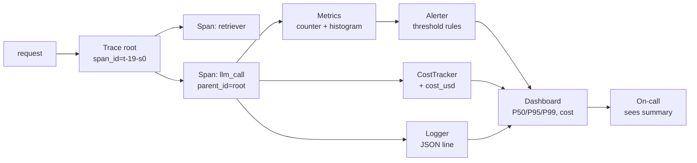

# M11 L11: Observability and Cost

> **Plain English:** "The system is up" is not observability. You need the three pillars -- **metrics** (counters, gauges, histograms), **logs** (structured events), and **traces** (parent/child spans) -- plus a fourth pillar for LLM apps: **cost**. Every LLM call has a USD price tag, and the bill arrives monthly. If you're not tracking it, you're flying blind. The pattern is: instrument everything, log the structured event, span the request, alert on thresholds, and dashboard the totals.
> 90 min. Code: `python3 lessons/m11-observability/L11-observability-cost.py` (no API keys).

---

## 1. Concept (5 min)

**Observability is the ability to answer questions about a running system from its outputs.** In the LLM world, the three pillars are:

| Pillar | Question it answers | Example |
|---|---|---|
| **Metrics** | "How much, how fast, how often?" | Calls/sec, P95 latency, error rate |
| **Logs** | "What happened to this specific request?" | `{"level": "error", "call_id": "c0042", "model": "gpt-4o", "msg": "rate_limited"}` |
| **Traces** | "Where did the time go in this request?" | Pipeline root -> retriever -> reranker -> LLM (4 spans) |

**Cost is the fourth pillar for LLM apps.** A traditional microservice has CPU/RAM cost. An LLM call has token cost -- and the price ranges from $0.15/M tokens (Haiku) to $15/M tokens (GPT-4o output). A single rogue loop can burn $1,000 in a night.

**Why you need all four:** metrics tell you something is wrong; logs tell you which request; traces tell you where in the call chain; cost tells you the damage. Without any one of them, you're guessing.

**The alert pattern:** every metric gets a threshold rule with a severity. `error_rate > 5%` is a page; `p95 > 1000ms` is a Slack; `cost > $100/day` is a PagerDuty. The rule fires when the value crosses the threshold; the alerter records the fired alert; the dashboard shows the highest current severity.

**The dashboard pattern:** a single screen showing total calls, error rate, P50/P95/P99 latency, total cost, and active alerts. It's the "is the system healthy?" answer in 5 seconds. Anything that can't fit on a dashboard is a report, not a metric.

**The three production failure modes this module addresses:**

1. **Silent cost overrun** -- a prompt change increased token usage 5x; nobody noticed for a week. The fix: per-feature cost tracking with daily budgets and alerts.
2. **Latency cliff** -- a new model version has 2x latency; the system "works" but is unusable. The fix: P95/P99 alerts on every model swap.
3. **Cascading errors** -- one upstream service is failing; all 100 downstream services log the same error. The fix: trace the parent_id back to the origin and alert once.

---

## 2. Architecture (Mermaid)



**Read as:** Every request gets a trace root; the LLM call is one span; the span emits a log, updates a histogram, and writes a cost record. The alerter evaluates threshold rules against the current values; the dashboard shows the totals; the on-call sees the dashboard.

---

## 3. Worked example (from the lesson code)

100 simulated LLM calls across 5 models, 5 users, 5 features.

```
Section 2: Metrics (counter, gauge, histogram)
    counter  calls_total    = 100.0
    counter  errors_total   = 4.0
    hist     latency_ms       n=100 mean=442.7  p50=360.9  p95=1027.1  p99=1112.7

Section 3: Cost breakdowns
    by model   (top 3): [('gpt-4o', 0.4277), ('claude-sonnet', 0.3158), ('claude-haiku', 0.0304)]
    by user    (top 3): [('u-carol', 0.232), ('u-alice', 0.1894), ('u-erin', 0.1372)]
    by feature (top 3): [('extract', 0.253), ('summarize', 0.1742), ('classify', 0.1378)]

Section 6: Alerts
    [ERROR] slow_p95: p95_latency_ms=1027.1 > 1000.0
    [INFO ] healthy_throughput: calls_total=100.0 > 0

Section 7: Dashboard summary
    total_calls:        100
    error_count:        4  (rate=4.00%)
    p50 / p95 / p99:      360.9 /  1027.1 /  1112.8 ms
    total_cost_usd:     $0.7897
    input/output tok:   203528 / 77404
    alerts fired:       2  (max severity=error)
```

**The story:** 100 calls, 4 errors (4% rate -- below the 5% page threshold, so no page). P95 latency is 1027ms (above the 1000ms error threshold -- one alert). Total cost is $0.79 for 100 calls -- extrapolated to 1M calls/month, that's $7,900. The top model is gpt-4o (54% of cost); the top user is u-carol (29% of cost); the top feature is extract (32% of cost). The action: investigate why extract is so expensive, and ask u-carol if they're doing something unusual.

---

## 4. Formulas (defined, every symbol)

```
cost(call, m)        =  (tokens_in / 1000) * rate_in(m) + (tokens_out / 1000) * rate_out(m)
total_cost           =  sum of cost(call_i) for i in calls
p_k(values)          =  the k-th percentile of values (linear interpolation)
error_rate           =  error_calls / total_calls
alert.fires(v, op, t) =  v op t   (op is >, >=, <, <=; t is threshold)
dashboard.summary    =  {calls, errors, error_rate, p50, p95, p99, cost_usd, alerts}
```

**Why P50 / P95 / P99 and not just mean?** Mean latency hides the tail. A service with mean 200ms and P99 30 seconds is broken; the mean looks fine. P95 is the "most users are happy" line; P99 is the "the worst 1% is suffering" line. For LLM apps, P99 matters because the user who waits 30 seconds is the user who churns.

**Why linear interpolation for percentiles?** With 100 calls, a simple "nearest rank" percentile gives P50 = 50th value, which is jittery. Linear interpolation between the two surrounding ranks smooths it. This is what NumPy's `np.percentile(..., method='linear')` does by default.

**Why an alert severity ladder (info < warn < error < page)?** Not everything should wake up the on-call. `info` is for the dashboard. `warn` is for Slack. `error` is for a ticket. `page` is for PagerDuty at 3 AM. The dashboard shows the highest current severity, not all of them, so the on-call sees one number.

---

## 5. Code map (what's in `L11-observability-cost.py`)

| Section | Class / Function | What it does |
|---|---|---|
| 1 | `Counter`, `Gauge`, `Histogram`, `MetricSeries` | The three metric types + a bundle |
| 2 | `Span`, `Trace` | Parent/child spans; trace = tree of spans |
| 3 | `CostRecord`, `CostTracker`, `compute_cost_usd` | Per-call records; aggregates by model/user/feature |
| 4 | `Logger` | Structured JSON logger with level filtering |
| 5 | `AlertRule`, `Alert`, `Alerter` | Threshold rules with severity; evaluates and records |
| 6 | `Dashboard` | Read-only summary across metrics + cost + alerts |
| 7 | `simulate_call` | One simulated LLM call with realistic latency/cost |
| 8 | `run_pipeline`, `evaluate_alerts` | End-to-end: 100 calls, full stack |
| 9 | `demo` | Runs all 7 sections |
| 10 | 21 `test_*` functions | pytest-compatible unit tests |

---

## 6. Edge cases, failure modes, debugging

| Edge case | What breaks | What to do |
|---|---|---|
| Histogram has 0 observations | p50/p95/p99 divide by zero | Return 0.0; never NaN |
| Cost record has negative tokens | negative cost; absurd totals | Validate `>= 0` on record creation |
| Trace has no root span | `total_duration_ms` returns 0 | Detect missing root; log a warning |
| Alert rule has unknown comparator | silent failure | Raise on rule creation; fail loud |
| Logger has no sink | logs go to `/dev/null` | Default to in-memory; production wires stdout |
| `by_model()` called on empty tracker | returns `{}` (fine) | Document; let it be |
| Concurrent span IDs | trace tree corrupted | Use monotonic counter per trace; for multi-process, add a worker_id |
| Cost currency mismatch (EUR vs USD) | totals are wrong | Tag the currency in `CostRecord`; never mix |
| Percentile with 1 observation | p50 = p95 = p99 = the value | That's correct; document it |
| Alert storm (rule fires every second) | on-call alert fatigue | Add a `for_cooldown_s` field; fire at most once per window |
| `top_n` with n > unique keys | returns all keys | Cap n at `len(agg)`; don't error |
| Histogram memory grows unbounded | OOM in long-running service | Use bucketed histograms with a fixed bucket count (HDR-style) |

---

## 7. Scale-up: 100 -> 100K -> 10M calls/day

| Scale | Metrics cardinality | Cost tracker memory | Strategy |
|---|---|---|---|
| 100/day | low (~10 tags) | ~10 KB | In-memory; daily flush |
| 100K/day | medium (~1K tag combos) | ~10 MB | In-memory + hourly flush; or Prometheus |
| 10M/day | high (~1M tag combos) | ~1 GB | Sampled metrics; or aggregate at edge |
| 100M/day | very high | too big | Drop per-call cost records; keep only aggregates |

**The cardinality problem:** every unique (model, user, feature) combination is a new time series. 5 models x 5 users x 5 features = 125 series -- fine. 50 models x 10K users x 20 features = 10M series -- your metrics backend will fall over. The fix: bound the user_id cardinality (top 100 + "other"), drop raw span data after 24h, sample traces (1 in 100).

**The cost tracker memory problem:** at 10M calls/day, a per-call record is ~200 bytes = 2 GB/day. Don't keep them all. The pattern: keep a rolling 24h window in memory, flush aggregates to a database, drop the raw records. The database has hourly aggregates forever; the in-memory tracker has the last 24h.

---

## 8. Alternatives and tradeoffs

| Tool | When | Tradeoff |
|---|---|---|
| **Prometheus + Grafana** | Industry default for metrics | Free, ubiquitous, pull-based; alert manager is solid |
| **OpenTelemetry** | Vendor-neutral traces + metrics + logs | Standard; the SDK is the future; instrumentation cost is real |
| **Datadog** | One bill, one UI, one agent | Expensive at scale; great UX; vendor lock-in |
| **LangSmith** | LangChain users; LLM-specific | Has LLM-specific features (token counts, prompt diffs); tied to LangChain |
| **Helicone** | LLM proxy; drop-in OpenAI replacement | Cheap; one-line swap; limited customization |
| **Phoenix (Arize)** | Open-source LLM observability | Free; you bring the infra; good for evals |
| **Custom (this lesson)** | Tight control; no vendor; no data leaves your box | You build the dashboard; you build the alerts; you wire the storage |

**The default pick:** OpenTelemetry SDK for instrumentation (vendor-neutral, free), Prometheus + Grafana for metrics and dashboards, ClickHouse or Postgres for cost records, and a LangSmith or Helicone proxy for LLM-specific features (prompt diffs, token counts). For a startup with no ops team: Helicone is the path of least resistance.

---

## 9. Mock interview

### 5 Meta L6 questions (with natural spoken answers)

**Q1: "What are the three pillars of observability?"**
> Metrics, logs, traces. Metrics answer "how much, how fast, how often" -- counters, gauges, histograms. Logs answer "what happened to this specific request" -- structured JSON events with a request_id. Traces answer "where did the time go" -- a tree of spans sharing a trace_id. For LLM apps, cost is the fourth pillar. Without all four, you're guessing.

**Q2: "Walk me through how you'd instrument a new LLM feature."**
> Three things. First, wrap the call in a span -- start a span before the call, finish it after, capture the model, the latency, the token counts, the cost. Second, increment a histogram with the latency and a counter with the call; log the result as a structured JSON event. Third, add alert rules: P95 latency, error rate, daily cost. Then the dashboard shows totals and the alerts fire when something's wrong.

**Q3: "Your cost spiked 10x overnight. Triage."**
> First, look at the cost breakdown by feature and by user. Is one feature responsible, or is it uniform? If uniform, the model changed or the traffic spiked. If one feature, look at the prompt -- did someone add a long system message? Look at the top users -- is one user looping? The pattern: the top-1 cost bucket is usually 30-50% of the spike. Fix that bucket first.

**Q4: "How do you decide what to alert on?"**
> The SLOs. If your SLO is 99% of calls under 2 seconds, alert on P99 > 2s. If your SLO is error rate under 1%, alert on error_rate > 1%. If your SLO is cost under $100/day, alert on daily_cost > $100. Everything else is informational. The rule: every alert has a runbook. If there's no runbook, it's not an alert, it's a dashboard widget.

**Q5: "When would you use sampling for traces?"**
> When trace volume exceeds what your storage can hold. At 10M calls/day, storing 100% of traces is 1 TB/day -- too much. Sample 1% (100K/day) and you keep the structure for debugging without the cost. The trick: sample head-based (every Nth trace) for uniform coverage, or tail-based (keep all errors, sample the successes) for error visibility. Head-based is cheaper; tail-based catches more bugs.

### 3 Google-oriented questions (architecture + business)

**G1: "Design an observability stack for an LLM app serving 50M requests/day. Walk me through the major decisions."**
> Three layers. Edge: every request gets a trace_id and a user_id; the proxy tags with model, feature, and token counts. Ingestion: OpenTelemetry collector fans out to Prometheus (metrics), ClickHouse (logs + cost records), and a trace backend (Tempo or Honeycomb). Storage: 30 days of metrics at 10s resolution, 90 days of logs at 1h resolution, 7 days of full traces (sampled at 1% head + 100% errors). Cost: $5K/month for the storage, $2K/month for the compute. Decisions: how to handle PII? Strip user_id from logs but keep in the access-controlled cost records. How to alert? PagerDuty for error_rate and P99; Slack for cost thresholds; email for daily summaries.

**Q2: "PM says 'we don't need observability yet, we're pre-PMF.' Push back?"**
> Yes. Pre-PMF is exactly when you need it. The cost of a runaway prompt is $1K overnight; the cost of observability is $200/month. The cost of a silent regression is "users churned and we don't know why." The cost of a missed error spike is "we found out from Twitter." The math always favors observability, even pre-PMF. The minimum: log every call as a JSON line to stdout, count tokens and cost, alert on daily cost > $50. That's 50 lines of code.

**Q3: "Customer says 'your dashboards are great but the latency is bad for me.' Triage."**
> Get the customer's request_id. Look up the trace. Is it one bad hop or a chain? Is the P99 for their user_id elevated? If yes, it's their query or their data -- the system is fine for everyone else. If no, sample 20 of their queries and see what's different -- are they sending long prompts? Hitting a slow model? The pattern: one customer's "the system is broken" is usually a P99 specific to their usage pattern. The dashboard average hides it.

---

## 10. One-minute explanation

> Observability is the ability to answer questions about a running system from its outputs. The three pillars are metrics (counters, gauges, histograms -- "how much, how fast, how often"), logs (structured JSON events -- "what happened to this request"), and traces (parent/child spans sharing a trace_id -- "where did the time go"). For LLM apps, cost is the fourth pillar -- every call has a USD price tag. The pattern is: instrument every call as a span, log the structured event, update the histogram, write the cost record, evaluate alert rules, and dashboard the totals. The most common production failure is silent cost overrun -- a prompt change increased token usage 5x and nobody noticed for a week. The fix is per-feature cost tracking with daily budgets and alerts.

## 11. 90-second interview script

> "Observability is the ability to answer questions about a running system from its outputs. The three pillars are metrics, logs, and traces. Metrics answer how much, how fast, how often -- counters for total calls, gauges for queue depth, histograms for latency with P50, P95, P99. Logs answer what happened to this specific request -- structured JSON events with a request_id. Traces answer where did the time go -- a tree of spans sharing a trace_id. For LLM apps, cost is the fourth pillar -- every call has a USD price tag, and the bill arrives monthly. The pattern: instrument every call as a span, log the structured event, update the histogram, write the cost record, evaluate alert rules, and dashboard the totals. The alert pattern is threshold rules with severity -- info, warn, error, page. The dashboard shows total calls, error rate, P50 P95 P99 latency, total cost, and active alerts. The most common production failure is silent cost overrun -- a prompt change increased token usage 5x and nobody noticed for a week. The fix is per-feature cost tracking with daily budgets and alerts. The cost of observability is 50 lines of code; the cost of not having it is a 1000 dollar surprise bill."

## 12. Assignment

### Build
1. Run the lesson code end-to-end: `python3 lessons/m11-observability/L11-observability-cost.py`
2. Run the 21 unit tests
3. Open the notebook and execute it top to bottom
4. Add a `latency_buckets` histogram with explicit buckets (e.g., 100, 250, 500, 1000, 2500ms)
5. Add a `cost_per_user_alert(alerter, tracker, threshold)` that fires when one user exceeds threshold
6. Add a `trace_to_dict(trace)` that serializes a trace for sending to a backend

### Acceptance criteria
- [ ] All 21 unit tests pass
- [ ] Notebook executes in < 5 seconds
- [ ] Every simulated call creates exactly one span, one log line, and one cost record
- [ ] P50/P95/P99 are computed via linear interpolation
- [ ] Alert rules with `>` comparator do not fire on the threshold value (strict)
- [ ] `Dashboard.summary()` returns all 11 documented keys
- [ ] Cost is broken down by model, user, and feature

### Rubric (self-score 0-10 each)
- Concept fluency: you can define the 3 pillars + cost and give a failure mode for each
- Implementation: the pipeline is reproducible and the math is correct
- Tradeoff articulation: you can defend a percentile choice for a given SLO
- Production intuition: you know the cardinality and cost-tracker memory problems
- Communication: the 90-second script is under 90 seconds

---

*Last updated: 2026-10-15*
*License: MIT*
