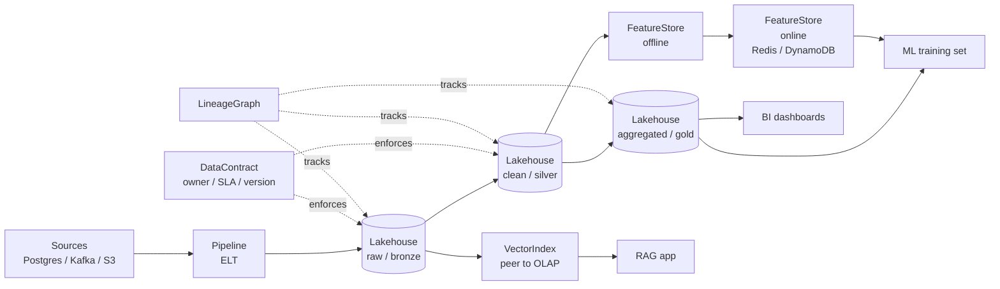

# M14 L14: AI-Native Data Platforms — Lakehouse, Vector DBs, Contracts

> **Plain English:** A modern data platform is five primitives that have to talk to each other: a lakehouse, a vector index, a feature store, a contract layer, and a lineage graph. The "AI-native" part is that the vector index sits beside OLTP/OLAP as a peer data product, not behind a bespoke microservice. And ELT (extract -> load -> transform) beats ETL because cheap storage plus a SQL engine lets the warehouse do the heavy lifting. This lesson builds all five from scratch — no Spark, no Iceberg, no cloud account.
> 90 min. Code: `python3 lessons/m14-data-platforms/L14-data-platforms.py` (no API keys, no Spark).

---

## 1. Concept (5 min)

A **data platform** is the layer between raw sources (databases, events, files) and consumers (dashboards, ML models, applications). The AI-native twist: a **vector index** is now a peer to the OLTP and OLAP stores, queryable like a SQL table.

**The five primitives:**

1. **Lakehouse** — open table formats (Iceberg, Delta, Hudi) that combine data-lake scale with data-warehouse ACID. Snapshots, time travel, partition pruning, schema evolution.
2. **Vector index** — a peer to OLTP/OLAP, holding embeddings and metadata. Queryable with `SELECT ... WHERE` plus a nearest-neighbor operator.
3. **Feature store** — online store (latest per entity, sub-ms read) + offline store (history, used for backfills). The hard part is **point-in-time correctness** — when you join a label, you must use features that were known at the label's timestamp, not the latest.
4. **Data contract** — owner, SLA freshness, schema version, consumer list. The interface between the producer and the consumer; without it, schemas rot silently.
5. **Lineage graph** — a DAG of tables and transforms, topologically sortable, with impact analysis (which downstream tables break if X changes?).

**ELT vs ETL:** ETL pre-transforms in Python/Spark before loading — you lose the raw, and recomputation is expensive. ELT loads raw first (cheap), then transforms in SQL (the warehouse is fast). The lakehouse makes ELT practical: cheap storage + fast query engine = best of both.

**The cost math:** S3 + Iceberg on cheap storage is ~$23/TB/month. The same data in a managed warehouse is ~$1K-2K/TB/month. The lakehouse wins on cost; the warehouse wins on ergonomics. The "lakehouse" claim is that you can have both.

**The lineage math:** in a 1000-table platform, a single schema change can break 50+ downstream tables. Without a lineage graph, you find out from a broken dashboard. With one, you query `impact("orders")` and get the answer in milliseconds.

---

## 2. Architecture (Mermaid)



**Read as:** sources -> raw -> clean -> aggregated, with a feature store, vector index, data contract, and lineage graph layered on top. Every table has an owner and an SLA; every transform is in the lineage.

---

## 3. Worked example (from the lesson code)

A 5-node lineage graph: `postgres -> raw_orders -> clean_orders -> agg_user_orders -> ml_features`. Time travel: a 2-snapshot orders table where v1 has 2 rows and v2 has 1. Point-in-time join: `user_orders_30d` for entity `u1` on `2024-02-15` returns `{orders_30d: 1, gmv_30d: 29.99}` (the Feb 1 snapshot), not the latest `{orders_30d: 2, gmv_30d: 79.98}` (the Feb 15 snapshot). This is the correctness invariant the feature store is designed to protect.

```
Section 3: LakehouseTable
  snapshots:  2
  latest:     version=2, rows=1
  v1 rows:    2
  partitions: {(1,): 1}

Section 4: FeatureStore
  online u1:  {'orders_30d': 2, 'gmv_30d': 79.98}
  pit u1 @Feb 1: {'orders_30d': 1, 'gmv_30d': 29.99}

Section 7: LineageGraph
  execution order: ['src_pg', 'raw_orders', 'clean_orders', 'agg_user_orders', 'ml_features']
  impact of 'raw_orders': ['agg_user_orders', 'clean_orders', 'ml_features']
```

The numbers are tiny here (in-memory mocks) but the structure is correct: snapshots + time travel, point-in-time joins, topological lineage. The same code with Iceberg on S3 + Feast for features + a real DAG orchestrator (Airflow / Dagster) gives you a production data platform.

---

## 4. Formulas (defined, every symbol)

```
snapshot_id        = monotonic counter per lakehouse table
schema_version     = integer, bumped on breaking schema change
freshness_sla_min  = max allowed minutes between snapshot and read
partitions         = {partition_key_tuple: row_count}
pit_features       = last feature row with event_ts <= label_ts
topological_sort   = Kahn's algorithm on the lineage DAG
impact(x)          = {node : reachable from x in the lineage DAG}
```

**The freshness invariant:** every read of a contracted table must return data whose age is `<= freshness_sla_min`. If the pipeline is delayed, the read must fail or fall back to a stale read with a warning.

**The point-in-time invariant:** `pit_features(entity, t) = feature row r such that r.event_ts <= t and r.entity_id == entity and r is the latest such row`. A label at `t` may only be joined with features that were known at `t`. Joining with the latest features is **data leakage** and silently inflates offline metrics.

**The lineage invariant:** the lineage graph is a DAG. A cycle means a table depends on itself — a bug. Topological sort should succeed; if it raises, you have a cycle to fix.

---

## 5. Code map (what's in `L14-data-platforms.py`)

| Section | Class / Function | What it does |
|---|---|---|
| 1 | `Column`, `Table` (dataclasses) | Schema + rows, with `add_row` validation, `filter`, `select` |
| 2 | `DataContract` (dataclass) | Owner, SLA, schema_version, compatibility check |
| 3 | `LakehouseTable`, `Snapshot` | Append/overwrite, time travel, partition pruning |
| 4 | `FeatureStore`, `FeatureView`, `FeatureRow` | Online store, point-in-time join |
| 5 | `VectorIndex` | Flat index, `query` + `select` with `where` (SQL-like) |
| 6 | `Pipeline` | Extract -> load -> transform (ELT order) |
| 7 | `LineageGraph` | DAG with `topological_sort` and `impact` analysis |
| 8 | `make_users_table`, `make_orders_table`, `make_products_table`, `make_embeddings_index` | 4 sample tables |
| 9 | `demo` | 7-section walkthrough |
| 10 | 15 `test_*` functions | pytest-compatible unit tests |

---

## 6. Edge cases, failure modes, debugging

| Edge case | What breaks | What to do |
|---|---|---|
| Schema change on producer | Downstream consumers fail | Contract: bump `schema_version`; require consumers to ack |
| Late-arriving data | Aggregation is wrong | Use event-time + watermarking; recompute affected partitions |
| Point-in-time leak | Offline metric inflated | Always use `pit_features` for training; never the online store |
| Cycle in lineage | `topological_sort` raises | Topological sort detects it; find the cycle in the DAG UI |
| Vector index stale | RAG returns old docs | Re-embed + re-index; track an `index_version` per index |
| Partition skew | One hot partition dominates | Re-partition by a higher-cardinality key; or use hash bucketing |
| Small files (Iceberg) | Read amplification, slow compactions | Schedule a compaction job; aim for 100MB-1GB per file |
| Snapshot explosion | Metadata table bloat | Expire old snapshots; keep N most recent |
| Owner left the team | Contract is unmaintained | Contracts list an `owner_team`, not an `owner_person` |
| Vector + filter cardinality | Scan is O(N) even with WHERE | Build a payload index (e.g., per-category HNSW) |
| Source DB schema drift | Lakehouse schema out of sync | Schema registry (Confluent / Glue) + automated contract tests |
| Missing partition | `partitions()` returns partial data | Add partition to source + backfill; or accept partial freshness |
| Cross-region replication | Snapshot IDs collide | Use globally unique snapshot IDs (UUID) or per-region prefixes |

---

## 7. Scale-up: 1GB → 1TB → 1PB

| Scale | Tables | Storage | Strategy |
|---|---|---|---|
| 1 GB | 10 | Postgres | Single node; no lakehouse; just SQL |
| 100 GB | 100 | Postgres + S3 | Lakehouse (Iceberg on S3); single warehouse |
| 1 TB | 1K | Iceberg on S3 | Trino / Spark for SQL; Feast for features; pgvector for vectors |
| 100 TB | 10K | Iceberg on S3, partitioned | Separate compute + storage; auto-compaction; column-level stats |
| 1 PB | 100K | Iceberg / Delta on object store | Multi-region; federated catalogs; data mesh (per-domain ownership) |

**The data mesh claim:** at 100K+ tables, a central data team can't own all of them. The mesh says: each domain team owns its tables, exposes them as data products with contracts, and federates a catalog. The platform team provides the tools (Iceberg, Trino, Feast, a lineage UI); the domain teams provide the data. This works only if the contract layer is real — otherwise schemas rot.

**The AI-native claim:** a vector index is a peer to OLTP/OLAP, queryable like a table. RAG becomes `SELECT * FROM embeddings WHERE kth_nearest(embedding, :q) <= 5 AND category = 'product'`, and you can JOIN against a SQL table for metadata. This is the unification: one query language (SQL) for relational + vector, one storage (lakehouse), one lineage graph.

---

## 8. Alternatives and tradeoffs

| Layer | Option | When | Tradeoff |
|---|---|---|---|
| Table format | Apache Iceberg | Open standard, multi-engine | Slightly slower writes; richer time travel |
| Table format | Delta Lake | Databricks-heavy shops | Tight Spark integration; less open |
| Table format | Apache Hudi | Incremental upserts, CDC | More complex; good for streaming |
| Warehouse | Snowflake | Managed, simple | Expensive at scale; vendor lock |
| Warehouse | BigQuery | Serverless, ML-friendly | Streaming inserts are pricey |
| Warehouse | Trino + Iceberg | Open, federated | You operate it; no managed service |
| Vector DB | pgvector | Already on Postgres | Limited scale (~10M vectors) |
| Vector DB | Pinecone | Managed, scale | Vendor lock; expensive |
| Vector DB | Weaviate / Qdrant | Self-hosted, scale | More ops work |
| Vector DB | LanceDB | Embedded, serverless | New; smaller community |
| Feature store | Feast | Open, Python-first | You operate it |
| Feature store | Tecton | Managed, low-latency | Expensive; tight to Tecton |
| Feature store | Databricks Feature Store | On the lakehouse | Vendor lock |
| Orchestration | Airflow | Open, mature | UI is dated; complex at scale |
| Orchestration | Dagster | Asset-centric, lineage-first | Newer; smaller community |
| Orchestration | Prefect | Cloud-friendly, dynamic | Smaller; less lineage |
| Catalog | DataHub | Open, lineage-first | Heavier to deploy |
| Catalog | Amundsen | Open, Lyft-origin | Less active |
| Catalog | Glue / Unity | Managed | Vendor lock |

**The default pick:** Iceberg on S3 + Trino (compute) + Feast (features) + pgvector or LanceDB (vectors) + Dagster (orchestration) + DataHub (catalog). Swap managed equivalents (Snowflake, Pinecone, Tecton) if you need to move fast and have the budget.

---

## 9. Mock interview

### 5 Meta L6 questions (with natural spoken answers)

**Q1: "What's the difference between a data lake, a data warehouse, and a lakehouse?"**
> A data lake is cheap object storage with no ACID, no schema enforcement, and no query engine — you dump files. A data warehouse is a managed, ACID, schema-on-read system with a fast query engine — you load structured data and pay for the ergonomics. A lakehouse is the best of both: cheap object storage with an open table format (Iceberg / Delta / Hudi) that adds ACID, snapshots, and schema evolution, plus a separate compute engine (Trino / Spark / Snowflake) that queries it. The claim: you get the warehouse semantics at lake economics.

**Q2: "Walk me through the five primitives of an AI-native data platform."**
> Lakehouse — open table format, snapshots, time travel, partition pruning. Vector index — peer to OLTP/OLAP, queryable like a SQL table with a nearest-neighbor operator. Feature store — online + offline, with point-in-time correctness so training labels only see features that were known at the label's timestamp. Data contract — owner, SLA, schema version; the interface between producer and consumer. Lineage graph — DAG of tables and transforms, topologically sortable, with impact analysis. The AI-native part is the vector index as a peer, not as a sidecar microservice.

**Q3: "Why is ELT better than ETL?"**
> Because storage is cheap and warehouse compute is fast. ETL pre-transforms in Python or Spark before loading — you lose the raw, and recomputation is expensive. ELT loads raw first (cheap), then transforms in SQL where the warehouse is optimized for it. The lakehouse makes this practical: append-only raw tables, time travel, and a SQL engine that can read the raw directly. You can always re-derive the clean tables from the raw. The trade-off: you need a warehouse that handles semi-structured data well (Trino, BigQuery, Snowflake all do).

**Q4: "What is point-in-time correctness in a feature store, and why does it matter?"**
> When you train a model, each label has a timestamp. The features you join to that label must be the features that were known AT that timestamp, not the latest. If you use the latest, you leak future information into training, and your offline metrics will look great while the model fails in production. The feature store implements this by storing all historical feature values with their event_ts, and the PIT join selects the latest row with `event_ts <= label_ts`. The hard part is backfill: re-computing PIT features when a definition changes.

**Q5: "How do you decide what's a feature vs what's a table column?"**
> A feature is anything used for model training or serving — a derived value, an aggregation, an encoding. A table column is the raw source data. The rule: if a data scientist would compute it, it's a feature; if a producer owns it, it's a column. The feature store owns feature definitions and versioning; the lakehouse owns raw tables. The two are linked by lineage: a feature view depends on one or more lakehouse tables.

### 3 Google-oriented questions (architecture + business)

**G1: "Design a data platform for a 50M-user product. What are the major decisions?"**
> Storage: Iceberg on S3, partitioned by date and entity_id. Compute: Trino for ad-hoc SQL, Spark for heavy transforms. Features: Feast with Redis for online, the lakehouse for offline. Vectors: pgvector if scale permits (under 10M), else Pinecone or LanceDB. Orchestration: Dagster (asset-centric, lineage-first). Catalog: DataHub for search + lineage. Contracts: per-domain, owned by the domain team. The biggest decision is central-vs-mesh: a central team is faster initially; a mesh scales better at 100K+ tables.

**G2: "PM wants to add embeddings for every product page. How do you decide?"**
> Cost: a 768-dim embedding at $0.0001/1K tokens, with 10M products and 1K-token descriptions, is $1,000 one-time + $50/month storage + $200/month query cost. Latency: nearest-neighbor search is O(log N) with HNSW, so 10ms p50. The decision: yes if the product uses semantic search or recommendations, no if a keyword search suffices. Build it as a vector index in the lakehouse (peer to OLAP), not as a sidecar microservice — then it's queryable in the same SQL.

**G3: "You inherit a 5-year-old data platform with 10K tables and no contracts. Triage."**
> First, you don't rebuild — you wrap. Add a contract layer (DataHub) that records owner, schema, and freshness for every table; you can infer 80% from query logs. Second, identify the top-100 tables by query count and assign owners — those are the load-bearing ones. Third, add a lineage graph from query logs (which tables join which) and run impact analysis on the top-100. Fourth, introduce a 1-page contract template and ask the top-100 owners to fill it. The result: a contract layer in 3 months, not 3 years. Don't try to add contracts to all 10K at once.

---

## 10. One-minute explanation

> A modern data platform has five primitives. A lakehouse — open table format on cheap storage with ACID, snapshots, and time travel. A vector index — a peer to OLTP/OLAP, queryable like a SQL table with a nearest-neighbor operator. A feature store — online + offline, with point-in-time correctness so training labels only see features that were known at the label's timestamp. A data contract — owner, SLA, schema version; the interface between producer and consumer. A lineage graph — DAG of tables and transforms, topologically sortable, with impact analysis. The AI-native part is the vector index as a peer, not as a sidecar microservice. And ELT beats ETL because storage is cheap and warehouse compute is fast — you load raw first, transform in SQL, and keep the raw for re-derivation.

## 11. 90-second interview script

> "A modern data platform has five primitives. A lakehouse — open table format on cheap storage with ACID, snapshots, and time travel. A vector index — a peer to OLTP and OLAP, queryable like a SQL table with a nearest-neighbor operator. A feature store — online plus offline, with point-in-time correctness so training labels only see features that were known at the label's timestamp, not the latest. A data contract — owner, SLA, schema version, the interface between producer and consumer. And a lineage graph — a DAG of tables and transforms, topologically sortable, with impact analysis so you can ask which downstream tables break if X changes. The AI-native part is that the vector index sits beside OLTP and OLAP as a peer data product, not behind a sidecar microservice. ELT beats ETL because storage is cheap and warehouse compute is fast — you load raw first, transform in SQL, and keep the raw so you can always re-derive the clean tables. The point-in-time invariant is the one most teams get wrong — if you use the latest features instead of the features that were known at the label's timestamp, you leak future information into training and your offline metrics look great while the model fails in production."

## 12. Assignment

### Build
1. Run the lesson code end-to-end: `python3 lessons/m14-data-platforms/L14-data-platforms.py`
2. Run the 15 unit tests
3. Open the notebook and execute it top to bottom
4. Add a `Snapshot.expire(self, keep_last_n)` method to the lakehouse that drops the oldest snapshots
5. Add a `FeatureView.materialize(self, as_of_ts)` that returns a snapshot of features at `as_of_ts`
6. Add a `LineageGraph.shortest_path(upstream, downstream)` that returns the dependency path between two tables

### Acceptance criteria
- [ ] All 15 unit tests pass
- [ ] Notebook executes in < 5 seconds
- [ ] Lakehouse time travel returns correct rows at each version
- [ ] Point-in-time join returns the features known at the label timestamp
- [ ] Topological sort succeeds on a DAG and raises on a cycle
- [ ] Impact analysis returns all downstream nodes

### Rubric (self-score 0-10 each)
- Concept fluency: you can define the five primitives
- Implementation: lakehouse + feature store + vector index are correct on hand-checked examples
- Tradeoff articulation: you can defend ELT vs ETL and the data mesh claim
- Production intuition: you know the failure modes (point-in-time leak, schema drift, partition skew)
- Communication: the 90-second script is under 90 seconds

---

*Last updated: 2026-10-15*
*License: MIT*
