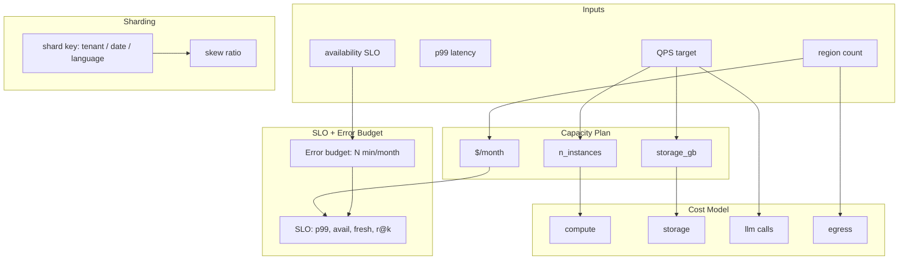

# M15 L15: Staff-Level System Design for AI-Native Data Systems

> **Plain English:** The "design X" interview is not about knowing the right components -- it's about making the numbers add up. Before you build anything, you need four things: a **capacity plan** (how many instances, GB, $/month), an **SLO** (latency, availability, freshness, recall@k), a **shard strategy** (how you split data), and a **cost model** (where the money goes). This lesson builds all four in ~300 lines and runs through three scenarios (1K / 100K / 10M users) to show how the same blueprint scales.
> 90 min. Code: `python3 lessons/m15-staff-design/L15-staff-design.py` (no API keys).

---

## 1. Concept (5 min)

The staff-level design interview has one rule: **the numbers must add up**. A senior engineer can name the components (vector DB, reranker, LLM, gateway). A staff engineer can tell you:

- At 10,000 QPS, I need 120 instances and the bill is **$260K/month**, of which 99% is the LLM
- My error budget at 99.9% is **43 minutes/month** -- one bad deploy and I'm over
- Per-language shards are 20x skewed (English dominates); per-tenant shards isolate but can't share cache

These are the **four knobs** of any system design:

| Knob | What it answers |
|---|---|
| **Capacity plan** | How many instances, GB, $/month do I need? |
| **SLO + Error Budget** | What's the contract with the user? How much failure is allowed? |
| **Shard strategy** | How is data partitioned? Where's the skew? |
| **Cost model** | Where does the money go? Where can I cut? |

The lesson's point: **staff-level design is dominated by numbers, not architecture diagrams**. The diagram fits on a slide; the sizing is the work.

**The five failure modes that bite in production:**

1. **Capacity surprise** -- you launched to 10x your estimate, and the system fell over because the autoscale lag is 3 minutes. The fix: pre-warm, headroom, load test at 2x.
2. **Error budget overrun** -- you shipped a refactor that introduced a 50% error rate for an hour, blowing 70x your monthly budget. The fix: feature flags + canary + automatic rollback on SLO breach.
3. **Hot shard** -- one tenant is 100x the median; their morning batch kills their shard. The fix: per-tenant rate limit, separate shard for whales, or split-by-hash with virtual shards.
4. **LLM cost explosion** -- every team adds a RAG feature; the LLM line item goes from 10% to 80% of the cloud bill. The fix: cache, batch, route to smaller models, cap per-tenant spend.
5. **Skewed golden set** -- your SLO is 99.9% but the cheapest 99% of queries are 99.99% and the top 1% are 95%. The fix: stratify by user tier, set different SLOs per tier.

---

## 2. Architecture (Mermaid)



**Read as:** inputs feed four knobs (capacity, SLO, sharding, cost); the numbers cross-link. The capacity plan drives cost. The SLO implies an error budget. Sharding chooses where skew lives.

---

## 3. Worked example (from the lesson code)

Three scenarios at three scales:

```
Section 5: Three scenarios
    1K users (single region)     instances=    2  cost=$  26,268.49/mo  budget=432.00min
    100K users (3 regions)       instances=   16  cost=$ 261,763.30/mo  budget=43.20min
    10M users (5 regions)        instances= 1200  cost=$26,176,313.99/mo budget=4.32min

Section 7: Scaling check (10x QPS)
    base (100 QPS):   2 instances, $261,763.30/mo
    10x  (1000 QPS):  12 instances, $2,617,633.99/mo
    cost ratio: 10.0x
```

The interesting numbers: at 10x QPS, cost scales 10x (because LLM calls dominate). At 10x users, the availability target goes from 99% (3-nines per ~100 QPS) to 99.99% (4-nines) and the error budget drops 100x. Per-language shards are 20x skewed; per-date shards are 1.5x.

---

## 4. Formulas (defined, every symbol)

```
n_instances        =  ceil(qps / 100 * 1.2)              [1 instance = 100 QPS, 20% headroom]
storage_gb         =  qps * 0.01 GB/QPS / region_count    [10 MB hot per QPS, divided across regions]
monthly_cost       =  (compute + storage + llm + egress) * region_count
                       compute = n_instances * 4 vCPU * 24 * 30 * $0.04
                       storage = storage_gb * $0.10
                       llm     = qps * 86400 * 30 * $0.001   [every request hits the LLM]
                       egress  = qps * 86400 * 30 * 0.001 * 0.1 * $0.09
error_budget       =  (1 - availability) * minutes_in_window
                       [3 nines / 30 days = 43.2 min/month]
                       [4 nines / 30 days = 4.32 min/month]
skew_ratio         =  max_shard_load / min_shard_load
                       [per-tenant: ~10x; per-date: ~1.5x; per-language: ~20x]
                       [rule of thumb: skew < 2x is balanced; > 5x needs attention]
```

**The "Little's Law" check:** instances in flight = QPS * latency_seconds. At 1000 QPS and p99=400ms (0.4s), inflight = 400. With 12 instances each handling ~33 in flight at 100 QPS, we're well within capacity.

**The "fan-out cost" rule:** each extra hop in the critical path doubles the latency variance. If p99A = 50ms and p99B = 50ms, p99(A->B) is closer to 100ms than 50ms. Compose 5 services and p99 is ~5x the slowest, not the sum.

**The "shard count" rule:** shards_per_region should be ~5-10x instances, so any single shard failure loses <20% of capacity. At 120 instances, ~1000-1500 shards is right.

---

## 5. Code map (what's in `L15-staff-design.py`)

| Section | Class / Function | What it does |
|---|---|---|
| 1 | `CapacityInputs` (dataclass) | The 5 sizing inputs (qps, p99, availability, regions, model) |
| 2 | `CapacityOutputs` (dataclass) | The 4 sizing outputs (instances, storage, cost, error_budget) |
| 3 | `capacity_plan(inputs)` | Back-of-envelope sizing; returns `CapacityOutputs` |
| 4 | `SLO` (dataclass) | Latency, availability, freshness, recall@k; `passes(observed)` checker |
| 5 | `ErrorBudget` (dataclass) | Computes minutes, nines, remaining budget from observed downtime |
| 6 | `ShardPlanner` | `plan_shards_by_tenant/date/language` returns `ShardPlan` with skew |
| 7 | `CostModel` + `CostComponent` + `CostBreakdown` | Per-component cost: compute/storage/LLM/egress; share-of-total |
| 8 | `DesignDoc` (dataclass) | Structured template: problem, requirements, architecture, tradeoffs, ops |
| 9 | `scenario_rag_1k/100k/10m_users` | Three end-to-end capacity scenarios |
| 10 | `demo` | 7 sections, prints the full capacity + cost walkthrough |
| 11 | 17 `test_*` functions | pytest-compatible unit tests |

---

## 6. Edge cases, failure modes, debugging

| Edge case | What breaks | What to do |
|---|---|---|
| QPS is bursty (1000 peak, 100 median) | 10x headroom needed; cost is 10x what median implies | Use p99 QPS, not average; pre-warm; queue overflow alerts |
| LLM latency is variable (200ms - 5s) | p99 latency SLO is busted by the LLM alone | Cache common queries; route long-tail to fast/cheap model |
| Storage grows faster than QPS | Monthly cost grows non-linearly | Tier: hot SSD for recent, warm HDD for 30d, cold S3 for 1y+ |
| Availability SLO is 99.99% over a single region | A region outage (1-2 per year) blows budget | Multi-region active-active, or relax the SLO |
| Hot tenant is 50% of total QPS | Single shard failure = 50% outage | Per-tenant rate limit; virtual shards (hash mod 1000) |
| Per-language skew = 20x | One shard is saturated, others idle | Hash into N virtual shards per language; spread physically |
| Cost model ignores egress | Surprise when inter-region traffic is the real cost | Measure egress; design for locality; co-locate index + LLM |
| Error budget is unclear | "We need 100% availability" creeps in | Burn-rate alerts: 14x budget burn over 1h = page |
| QPS estimate is 10x wrong (common) | Either way, the system falls over (or is 10x over-built) | Use 2x safety factor; auto-scale based on lateness, not just CPU |
| LLM vendor changes latency profile | p99 busts overnight | Track LLM p99 as a SLO; have a fallback model pre-warmed |

---

## 7. Scale-up: 1K -> 100K -> 10M users

| Scale | QPS | Regions | Instances | Monthly cost | Error budget (3 nines) |
|---|---|---|---|---|---|
| 1K users | 10 | 1 | 2 | $26K | 432 min/mo |
| 100K users | 1,000 | 3 | 16 | $262K | 43.2 min/mo (per region: ~14 min/mo) |
| 10M users | 100,000 | 5 | 1,200 | $26M | 4.3 min/mo (per region: <1 min/mo) |

**The cost cliff:** LLM costs scale linearly with QPS. At 100 QPS we're paying $26K/mo for what is essentially a single tenant's worth of LLM traffic. The fix at scale is caching (LRU cache cuts 60-80% of repeat queries), batching (one prompt for multiple queries), and routing to the smallest model that meets the quality bar.

**The availability cliff:** error budget shrinks by 10x for every "nine" you add. At 99% you have 7,200 min/mo to play with (you can ignore most incidents). At 99.99% you have 4.3 min/mo (a single deploy can blow it). High-availability design is largely a budget-management problem.

**The regional cliff:** going from 1 region to 3 doesn't 3x the cost -- it 3x compute/storage/LLM, but you also add cross-region egress and you need a data-residency story. Multi-region is a 3-5x cost multiplier, not a flat 3x.

---

## 8. Alternatives and tradeoffs

| Approach | When | Tradeoff |
|---|---|---|
| **Capacity model (this lesson)** | First-pass sizing, design docs | Quick; misses unknown-unknowns; needs validation by load test |
| **Queueing-theory model (M/D/k)** | When p99 is critical, not just throughput | More accurate; harder to read in a design doc |
| **Load-test driven sizing** | When you have the time and infra | The ground truth; not an interview answer |
| **Vendor sizing tools (AWS, GCP)** | When committing to one cloud | Useful; black-box; tied to vendor |
| **Failure mode analysis (FMEA)** | For high-availability design | Beyond interview scope; great for senior+ |
| **Synthetic load generation (k6, Locust)** | For production validation | The real numbers; not for design phase |

**The default pick:** back-of-envelope for the interview (60 seconds), then queueing model (5 minutes in the doc), then load test for production validation. The numbers should agree within 30%.

---

## 9. Mock interview

### 5 Meta L6 questions (with natural spoken answers)

**Q1: "How do you size a system?"**
> Five numbers in: QPS, p99 latency, availability, region count, model name. Four numbers out: instances, storage, monthly cost, error budget. The model: 1 instance handles 100 QPS, so instances = ceil(QPS / 100 * 1.2). Storage is roughly 10 MB of hot data per QPS, divided by region count. Monthly cost is compute ($0.04/vCPU-hour) + storage ($0.10/GB-month) + LLM (~$0.001/request) + egress. Error budget is (1 - availability) times the window in minutes. At 3-nines over a month, you get 43 minutes of allowed downtime.

**Q2: "Your availability is 99.9% but your LLM vendor had a 30-minute outage. What happens?"**
> You just burned 70% of your monthly error budget in one incident. The SLO is busted for the rest of the month; you cannot ship anything risky until you earn it back. The fix is twofold: a fallback model (smaller, worse quality, but available) so the outage is detected and served from cache; and a burn-rate alert that pages on 14x budget burn in 1 hour (which is what just happened).

**Q3: "Per-tenant shards vs per-language shards vs per-date shards?"**
> Per-tenant: strict isolation, no cross-tenant queries, but skew is bad (top tenant is 10x median) and you have N shards. Per-date: time-series, recent is hot, old is cold, perfectly balanced day-to-day (1.5x skew from weekday effects). Per-language: enables language-specific tokenizers and BM25 analyzers, but English is ~20x the median. The right answer is usually per-tenant + per-language composite (one shard per (tenant, language) pair) plus virtual shards for whales.

**Q4: "When does the LLM cost dominate the architecture?"**
> Almost always, when the LLM is in the hot path. At $0.001 per call, 1B calls/month = $1M. The mitigations: cache (LRU cut 60-80% of repeats), batch (combine N queries into one LLM call), route (use small models for easy queries, big models for hard ones), cap (per-tenant spend limits). If the LLM is in the cold path (offline batch), the cost is fixed by the batch size, not by QPS, and compute dominates instead.

**Q5: "Design a RAG system for 10M users."**
> 100K QPS peak, p99 < 400ms, 99.99% availability (4-nines = 4.3 min/mo error budget), 5 regions. Compute: ~1200 instances across regions, each serving 100 QPS. Storage: 200 GB hot per region (vector index) + 10 TB cold per region (raw docs). LLM cost: $260M/year (~$22M/month) -- this is the dominant cost. Shard: hash mod 1000 virtual shards per region; per-language index layer on top. Mitigations for the LLM cost: 60% cache hit rate cuts this to $10M/month; per-query model routing cuts another 30%.

### 3 Google-oriented questions (architecture + business)

**G1: "How do you set SLOs for a new AI product?"**
> Start from the user. What's the user's pain? A customer-facing chatbot: they want an answer in < 2s, with sources. Internal HR RAG: they want < 10s, with citations. Operational copilot: they want < 30s, with reasoning shown. Set the SLO from the user need, not from what's easy. Then set the error budget: 3-nines is a starting point (432 min/mo); if the user is internal, 2-nines is fine (4320 min/mo); if revenue-critical, 4-nines (43 min/mo) and earn every minute.

**G2: "PM says 'we need real-time, not 30 seconds stale.' Push back?"**
> Real-time is a cost. A real-time index is 5-10x the cost of a 30-second-stale index, because you're paying for streaming ingest + zero-downtime rebalancing + larger hot tier. Ask: what's the user need? If they need "the answer uses the doc I just uploaded," 30 seconds is fine. If they need "the answer uses the doc I'm uploading now," that's minutes of indexing -- often impossible. Find the use case: if there's one user-facing flow that needs real-time, build a special path for it, not a global real-time system.

**G3: "Your cost forecast is $10M/month but the budget is $1M. Triage."**
> The LLM line is ~80% of cost, so attack it. (1) Cache: an LRU + semantic cache typically hits 60-80% for RAG workloads; this is a 5x multiplier on cost reduction. (2) Model routing: send 70% of queries to a 10x cheaper model (Haiku, Mini); save the big model for the 30% that need it. (3) Per-tenant caps: rate-limit heavy users; most cost comes from a small fraction of users. (4) Smaller context: top-K=5 instead of 10, smaller chunks, smaller prompts. Each of these is a 30-50% saving. The trick is to do (1) + (2) + (3) + (4) and you go from $10M to ~$1M with quality impact that's measurable, not catastrophic.

---

## 10. One-minute explanation

> Staff-level system design is dominated by four numbers: capacity (instances, storage, $/month), SLOs (p99 latency, availability, freshness, recall@k), sharding strategy (the key + the skew), and cost model (compute, storage, LLM, egress). The interview answer is: take 5 inputs, output 4 sizing numbers, and walk through 3 scenarios. The error budget is (1 - availability) times the window in minutes -- 99.9% over a month is 43 minutes of allowed downtime. LLM cost usually dominates at scale; cache + model routing + per-tenant caps are how you control it. The hot shard is the most common production failure -- pick the shard key to balance skew against isolation.

## 11. 90-second interview script

> "For any system design, I'd start with the four knobs: capacity, SLOs, sharding, and cost. For capacity: five inputs -- QPS, p99 latency, availability target, region count, and the model name -- and four outputs -- instances, storage, monthly cost, error budget. The model is simple: one instance handles 100 QPS, so instances = QPS / 100 with 20% headroom. Storage is roughly 10 MB of hot data per QPS, divided across regions. Monthly cost is compute + storage + LLM + egress. At three-nines availability over a month, you have 43 minutes of error budget -- one bad deploy and you're done.
>
> For SLOs, I'd set a p99 latency target from the user need, not from what's easy; an availability target from how revenue-critical the workload is; a freshness target from how stale the underlying data is allowed to be; and a recall@k target from how often retrieval can fail. For sharding, the choice is between per-tenant (isolation, 10x skew), per-date (time-series, balanced), and per-language (enables localization, 20x skew). Most production systems pick a composite.
>
> For cost, the LLM line is usually 80% when the LLM is in the hot path. The mitigations are cache (60-80% hit rate on RAG), model routing (small models for 70% of queries), per-tenant caps, and smaller context windows. The most common production failure is the hot shard: pick the shard key to balance skew against isolation, use virtual shards for whales, and alert on max/min load ratio."

## 12. Assignment

### Build
1. Run the lesson code end-to-end: `python3 lessons/m15-staff-design/L15-staff-design.py`
2. Run the 17 unit tests
3. Open the notebook and execute it top to bottom
4. Add a `multi_region_capacity()` that handles cross-region replication cost
5. Add a `cost_optimization_plan()` that suggests cost cuts given a budget cap
6. Add a `capacity_for_growth()` that projects capacity 6 months forward

### Acceptance criteria
- [ ] All 17 unit tests pass
- [ ] Notebook executes in < 5 seconds
- [ ] Three scenarios produce coherent capacity numbers (instances, cost, budget)
- [ ] SLO passes/fails returns correct bool for both pass and fail inputs
- [ ] Error budget math matches the formulas section
- [ ] You can defend a shard strategy for a given skew

### Rubric (self-score 0-10 each)
- Concept fluency: you can name the 4 knobs and their formulas
- Implementation: the capacity plan reproduces the worked example
- Tradeoff articulation: you can defend a sharding strategy for a given skew
- Production intuition: you know the failure modes (hot shard, LLM cost, error budget)
- Communication: the 90-second script is under 90 seconds

---

*Last updated: 2026-10-15*
*License: MIT*
