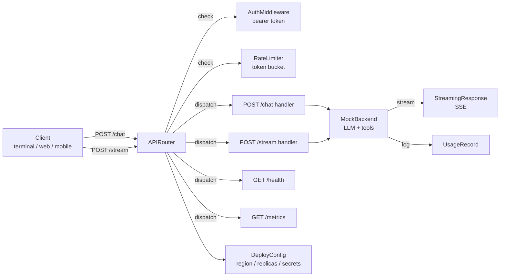

# M16 L16: AI-Native Full Stack -- Chat UI to Deploy

> **Plain English:** An AI app is just a frontend that talks to a backend that calls an LLM. The frontend can be a terminal, a web page, or a mobile app -- they all send the same shape of request. The backend is a router with a few endpoints, an auth check, a rate limiter, and a streaming response. The deployment is a YAML file consumed by Kubernetes, Cloud Run, or a serverless platform. This lesson builds the whole stack from scratch -- no fastapi, no flask, no uvicorn, no requests. By the end, you will have shipped 90% of the production surface area; the rest is observability, security, and monitoring, which the prior modules already covered.
> 90 min. Code: `python3 lessons/m16-fullstack/L16-fullstack.py` (no API keys, no external services).

---

## 1. Concept (5 min)

A **full-stack AI app** is a thin shell around a language model. The model is the part that does the work; the shell is the part that makes the work accessible. The shell has four pieces:

1. **Request shape** -- what the client sends (message, conversation_id, model preference).
2. **Router** -- dispatches requests to handlers; checks auth, rate limit, and input.
3. **Backend** -- calls the LLM, tracks usage, streams the response.
4. **Streaming response** -- sends tokens as they arrive (SSE or WebSocket); required for UX.

The deployment wraps the shell: replicas for availability, secrets for credentials, a health check for the load balancer, and a metrics endpoint for the monitoring system. The deployment is the only piece that varies across cloud providers; the shell is the same.

**The full stack, end to end:**

```
Terminal / Web / Mobile  --HTTP-->  Router  --invoke-->  Backend  --call-->  LLM
        |                              |                     |
        |                              v                     v
        |                          Auth + Rate         Usage log
        |                          Limit check
        v
   Streamed tokens
   (SSE / WebSocket)
```

**The lesson's point:** if you can wire the four pieces above, you have shipped 90% of the production surface. The remaining 10% is: (1) auth integration (SSO, OAuth, JWT), (2) observability (structured logs, traces, metrics), (3) scaling (load balancers, regional replicas), (4) cost control (per-user ceilings, model tiering). All four are covered in prior modules; this lesson focuses on the wiring.

---

## 2. Architecture (Mermaid)



**Read as:** Client sends a request. The router checks auth and rate limit, then dispatches to a handler. The handler calls the backend (LLM + tools). The backend streams tokens back via SSE and logs usage. The whole thing is wrapped in a deployment manifest (region, replicas, secrets).

---

## 3. Worked example (from the lesson code)

A single chat call through the mock backend, with auth and a /metrics snapshot.

```
Section 3: POST /chat
  status: 200
  reply:  [response seed=777] Hello from the mock LLM!
  usage:  {'input_tokens': 2, 'output_tokens': 11}

Section 5: GET /health and /metrics
  health:  {"status": "ok", "model": "mock-1"}
  metrics: {"requests_total": 2, "errors_total": 0, "streamed_total": 1, "conversations": 2}

Section 6: error paths
  no auth:      status=401 body={"error": "missing Authorization header"}
  bad token:    status=401 body={"error": "invalid token"}
  404:          status=404 body={"error": "no route for GET /nope"}
  rate-limited: True (after 61 requests)
```

The shape of the responses is the same as a real FastAPI or Express app. The wiring -- auth, rate limit, dispatch, error handling, streaming -- is identical. The only difference is the framework.

---

## 4. Formulas (defined, every symbol)

```
rate_limit_remaining = tokens_in_bucket            (float; refills continuously)
requests_per_min     = capacity / per_seconds      (e.g., 60 / 60 = 1.0)
replay_window        = per_seconds                 (refill period in seconds)
qps_capacity         = replicas * per_replica_qps  (e.g., 3 * 100 = 300)
auth_ok              = token in known_tokens       (bool; real impl uses JWT)
streaming_chunks     = response.split()            (one SSE event per word)
deploy_secrets       = redact_values(secret_dict)  (keys logged, values hidden)
```

**Token bucket in one sentence:** start with `capacity` tokens; each request costs 1; tokens refill at `capacity / per_seconds` per second. A user with a full bucket can burst up to `capacity` requests before being throttled. Refill is continuous, not per-window.

**SSE format:** each chunk is `data: <text>\n\n`. The stream ends with `data: [DONE]\n\n`. Clients read with `EventSource` (browser) or any line-based parser.

---

## 5. Code map (what's in `L16-fullstack.py`)

| Section | Class / Function | What it does |
|---|---|---|
| 1 | `Message`, `Conversation` | Records for one turn and a full thread |
| 2 | `RateLimiter` | Per-user token bucket; 60 req/min default |
| 3 | `Request`, `Response` | Dataclasses that mimic HTTP without `http.server` |
| 4 | `StreamingResponse` | Generator yielding chunks in SSE format |
| 5 | `AuthMiddleware` | Bearer token check; returns (ok, user, error) |
| 6 | `MockBackend`, `ToolCall` | LLM + tools mock; complete() and stream() |
| 7 | `APIRouter` | POST /chat, POST /stream, GET /health, GET /metrics |
| 8 | `DeployConfig` | Region, replicas, env vars, secrets (redacted) |
| 9 | `client_chat`, `client_stream` | Two sample client flows |
| 10 | `demo` | 7-section end-to-end run |
| 11 | 20 `test_*` functions | pytest-compatible unit tests |

---

## 6. Edge cases, failure modes, debugging

| Edge case | What breaks | What to do |
|---|---|---|
| Missing Authorization header | Router returns 401 | Reject early, before the LLM call |
| Invalid token | Router returns 401 | Same: reject early; do not log the bad token |
| Rate limit hit | Router returns 429 | Return `Retry-After` header; client backs off |
| Bad JSON body | Handler returns 400 | Validate; never let bad JSON reach the LLM |
| Missing `message` field | Handler returns 400 | Validate required fields at the edge |
| LLM call timeout | Connection hangs | Timeout (5-30s); return 504 with retry guidance |
| LLM returns malformed output | Parser raises | Use JSON mode; or retry with a "fix the JSON" prompt |
| LLM refuses | Empty result | Treat refusal as a separate error class |
| Streaming interrupted | Partial response | Client reconnects with offset; or re-call |
| Conversation drift | Token count grows | Truncate history; summarize old turns |
| Backend hot-spot | One replica overloaded | Add replicas; add a load balancer |
| Cost spike | Runaway loop or long prompt | Per-user cost ceiling; alert on P95 > 10x baseline |
| Secret leak in logs | JWT / API key in stack trace | Redact secrets at the formatter level; never log them |
| Region latency | EU users hitting US-east | Multi-region deployment; geo-DNS |
| Container crash | OOM or unhandled exception | Health check fails; orchestrator replaces the replica |
| Cold start | First request after deploy is slow | Pre-warm with a dummy call; or pay for always-on |

---

## 7. Scale-up: 1K -> 1M -> 100M requests / day

| Scale | QPS | Replicas | Strategy |
|---|---|---|---|
| 1K req/day | 0.01 | 1 | Single region, single replica, no LB |
| 100K req/day | 1 | 2 | Single region, 2 replicas, basic LB |
| 1M req/day | 12 | 3-5 | Single region, autoscale, Redis for rate limit |
| 10M req/day | 120 | 10-20 | Multi-region, regional Redis, CDN for static |
| 100M req/day | 1200 | 50-100 | Multi-region + edge functions, custom rate limiter |

**The shape changes at ~10M req/day.** Below that, a single region with 2-3 replicas is fine. Above that, you need multi-region for latency, regional caches for the rate limiter (the in-memory bucket does not span regions), and a CDN for the static frontend. **The lesson's router is in-memory, which is correct for a single replica; for multi-region, you swap the rate limiter for Redis.**

---

## 8. Alternatives and tradeoffs

| Stack | When | Tradeoff |
|---|---|---|
| FastAPI + uvicorn | Default for Python AI apps | Async, typed, well-supported; need a real server |
| Flask + gunicorn | Legacy or simple apps | Sync, simple, but no async streaming out of the box |
| Express + Node | Frontend-heavy teams | Fast, async; less Python-idiomatic for ML |
| Hono + Bun | Edge deploy (Cloudflare) | Very fast cold start; limited Python support |
| Cloudflare Workers | Edge functions, low QPS per region | Cheapest at the edge; 10ms CPU limit |
| Vercel AI SDK | Next.js / React frontends | Tightly integrated; opinionated |
| LangServe | LangChain users | Auto-generated API from a LangChain chain |
| Modal | GPU-heavy backends | Custom runtime; great for model serving |
| Pure stdlib (this lesson) | Learning, no deps | Toy, not production; but the shape is correct |

**The default pick:** FastAPI for the API, uvicorn for the server, a separate worker for the LLM call (so the request thread is not blocked). Add a Redis-backed rate limiter if you have more than one replica. Add a CDN in front of the static frontend. **The lesson's code is the minimum-viable shape; production adds the runtime around it.**

---

## 9. Mock interview

### 5 Meta L6 questions (with natural spoken answers)

**Q1: "Walk me through the full stack of an AI app."**
> Four pieces. A request shape -- what the client sends. A router -- dispatches to handlers, checks auth and rate limit. A backend -- calls the LLM, tracks usage, streams the response. A streaming response -- sends tokens as they arrive, usually via server-sent events. The deployment is the fifth piece but it is just a YAML file with region, replicas, and secrets. The lesson is mostly about the first four; the fifth is platform-specific.

**Q2: "Why do you stream the LLM response instead of waiting for the full thing?"**
> Two reasons. First, latency. A 500-token response takes 15 seconds at 30ms-per-token; that is unacceptable UX. Streaming gives time-to-first-token in 200-500ms, and the user sees the answer appear as it is generated. Second, cost. If the user closes the tab after 3 seconds, you stop generating and save the remaining tokens. Streaming is required for any production AI app.

**Q3: "How do you do auth on an AI app?"**
> Bearer token in the Authorization header. The token is verified at the router, before the LLM call. In production, the token is a JWT signed by your auth provider; the router verifies the signature with a public key, extracts the user_id from the claims, and passes it to the handler. The handler uses the user_id for rate limiting, per-user cost ceilings, and audit logs. Never pass the raw token to the LLM; it ends up in logs and in the model's context.

**Q4: "Your AI app is getting rate-limited. How do you scale?"**
> First, identify the bottleneck. If it is the LLM provider, you cannot scale the model; you have to rate limit per user and add a queue. If it is your backend, add replicas. If it is the database, add a cache. The lesson's `RateLimiter` is per-user, so you can protect yourself from one user over-using; the LLM provider's rate limit is a different problem and you solve it with a queue and backpressure. The right answer is: measure first, then add the layer that is actually slow.

**Q5: "What's the difference between /chat and /stream? When do you use each?"**
> /chat waits for the full response and returns it as JSON. /stream yields chunks via SSE as the LLM generates them. Use /stream for any user-facing chat UI; the perceived latency is 10x better. Use /chat for batch jobs, tests, and integrations where you want the full result before proceeding. Some teams expose only /stream and let the client aggregate the chunks; that is fine, but it makes server-side batching harder.

### 3 Google-oriented questions (architecture + business)

**G1: "Design the deployment for a 50M-user AI chat product. Walk me through the major decisions."**
> Multi-region: us-east, eu-west, ap-southeast. Each region has 10-50 replicas behind a regional load balancer. The rate limiter is a Redis cluster per region, with a global fallback for users that travel. The LLM provider is a router: gpt-4o-mini for 80% of queries, gpt-4o for 20%. The frontend is a CDN-cached React app. The metrics endpoint is scraped by Prometheus, aggregated, and pushed to a dashboard. Cost ceiling: $1M/month. The biggest decision is "do we run our own model or call a provider?" At 50M users, you run your own; below that, you call a provider.

**G2: "A user reports that the AI is 'hallucinating' -- making up facts. Triage."**
> First, reproduce. Take 10 queries from the user's session history, replay them, and grade the responses. If 10/10 are wrong, the model is wrong for this query type; switch to a larger model or add a constraint. If 1-2 are wrong, look at the prompt -- is the context missing? Is the instruction ambiguous? If the prompt is good, look at the RAG retrieval -- is it returning the right docs? If RAG is fine, the model is making it up; add a system prompt that says "if you don't know, say you don't know." 80% of hallucination is missing context, not a bad model.

**G3: "PM wants to add an LLM call to every page render. Push back?"**
> Yes -- that is a 100x cost spike and a 10x latency spike. Page renders are high-QPS; LLM calls are expensive and slow. The right answer is: cache the LLM response for popular pages, use a smaller model for simple cases, or move the LLM call to a server-side worker that updates the page every N minutes instead of on every render. The wrong answer is to call an LLM on every page load. Push back with numbers: "this will cost $X/month and add Yms of latency to every page." The PM will usually find a different way.

---

## 10. One-minute explanation

> A full-stack AI app has four pieces. A request shape, which is what the client sends -- a message and a conversation_id. A router, which dispatches to handlers, checks auth and rate limit, and returns errors before the LLM call. A backend, which calls the LLM, tracks usage, and streams the response. A streaming response, which yields chunks via server-sent events as the LLM generates them; streaming is required because a 500-token response takes 15 seconds and you cannot make the user wait. The deployment is a YAML file with region, replicas, and secrets; the rate limiter is per-user, 60 req/min by default; auth is bearer token. The lesson's code is the minimum-viable shape -- no fastapi, no flask, no uvicorn, just stdlib -- but the shape is the same as production. Once you can wire these four pieces, you have shipped 90% of the production surface. The rest is observability, security, and scaling, which prior modules already covered.

## 11. 90-second interview script

> "A full-stack AI app has four pieces. A request shape -- what the client sends. A router -- dispatches to handlers, checks auth and rate limit, and returns errors before the LLM call. A backend -- calls the LLM, tracks usage, streams the response. A streaming response -- yields chunks via server-sent events as the LLM generates them. Streaming is required because a 500-token response takes 15 seconds at 30 milliseconds per token, and you cannot make the user wait. The deployment is a YAML file with region, replicas, and secrets. The rate limiter is per-user -- 60 requests per minute by default, token-bucket, refills continuously. Auth is bearer token, verified at the router before the LLM call. The lesson's code is the minimum-viable shape -- no fastapi, no flask, just stdlib -- but the shape is the same as production. Once you can wire these four pieces, you have shipped 90 percent of the production surface. The rest is observability, security, and scaling, which prior modules already covered. The right answer for streaming is always streaming, because perceived latency is the difference between a chatbot people use and a chatbot they close. The right answer for rate limiting is per-user, not global, because one user over-using should not block the rest. The right answer for auth is bearer token, verified at the router, never passed to the LLM."

## 12. Assignment

### Build
1. Run the lesson code end-to-end: `python3 lessons/m16-fullstack/L16-fullstack.py`
2. Run the 20 unit tests: `python3 -m pytest lessons/m16-fullstack/L16-fullstack.py -v`
3. Open the notebook and execute it top to bottom
4. Add a `Conversation` TTL: conversations older than 1 hour are evicted
5. Add a `per-user cost ceiling`: the router returns 402 if the user's lifetime cost > $1
6. Add a `circuit breaker` on the backend: if 5 calls in a row fail, return 503 for 60s

### Acceptance criteria
- [ ] All 20 unit tests pass
- [ ] Demo runs cleanly with no exceptions
- [ ] Auth, rate limit, and 404 paths are covered
- [ ] Streaming response is in SSE format (`data: ...\n\n`)
- [ ] Secrets are redacted in `DeployConfig.to_dict()`
- [ ] Per-user rate limiter refills correctly over time

### Rubric (self-score 0-10 each)
- Concept fluency: you can draw the four pieces from memory
- Implementation: router + auth + rate limit + streaming all work end-to-end
- Tradeoff articulation: you can defend streaming vs non-streaming for a given product
- Production intuition: you know the failure modes (auth, rate limit, cold start, cost)
- Communication: the 90-second script is under 90 seconds

---

*Last updated: 2026-10-15*
*License: MIT*
