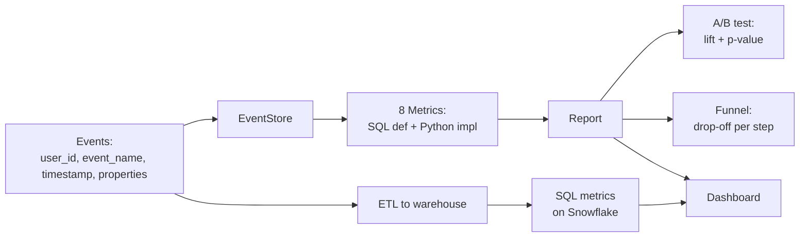

# M17 L17: Product Metrics + SQL/Python for AI Products

> **Plain English:** An AI product is measured on three axes: do people use it, does it actually work, and is it cheap enough to run? The metrics that answer those questions are DAU/WAU/MAU (usage), adoption (try it once?), engagement (use it a lot?), quality (RAGAS from M10), cost (cents per user), retention (D7 came back?), task success (did the user get an answer?), and latency (P50/P95/P99). For each metric, you need the SQL definition (so analytics can compute it on a warehouse) AND the Python equivalent (so the eval pipeline can compute it on a sample). Without both, the metric lives in only one world and you'll always be guessing.
> 90 min. Code: `python3 lessons/m17-product-metrics/L17-product-metrics.py` (no API keys).

---

## 1. Concept (5 min)

**An AI product has three failure modes, and each has a metric:**

| Failure mode | Metric | Question it answers |
|---|---|---|
| Nobody uses it | DAU / WAU / MAU, adoption | Are users even trying the AI? |
| It doesn't work | quality (RAGAS), task success | Are the answers good? |
| It's too slow / too expensive | latency P95, cost per user | Is it cheap to serve? |

**Engagement** (queries per user per day) tells you if the AI is sticky or one-and-done. **Retention** (D7) tells you if the AI is creating a habit or a novelty.

**The SQL/Python duality:** every metric needs both representations. SQL is the source of truth on the warehouse (Snowflake, BigQuery, Postgres) over millions of events. Python is the version you run on a sample (the golden set) for fast iteration. If the two disagree, you have a bug. The lesson defines both for all 8 metrics, side by side, so the contract is visible.

**The three metric gotchas:**

1. **The metric is computed on the wrong window.** A "DAU" that includes a 7-day backfill looks great and tells you nothing. Fix: every metric declares its window explicitly (today, last 7 days, last 30 days).
2. **The metric is a vanity number.** "Total queries" grows with users; it doesn't tell you if engagement is up. Fix: report per-user rates (queries per active user per day).
3. **The metric is computed on biased data.** If you only log events when the user is on the new UI, your "adoption" is inflated. Fix: log all events; sample uniformly.

**The A/B test framework:** without one, every product change is a guess. The framework has four parts: variant assignment (deterministic by hash so the same user always gets the same variant), the metric (e.g., quality_ragas), the lift (relative improvement, `treatment - control / control`), and a p-value (is the lift real or noise?). The lesson mocks the p-value because a real one needs more statistics than a 90-minute module allows — the wiring is what matters.

**The funnel:** the linear path from "user logged in" to "user got a useful answer" reveals where users drop. The four-step funnel here is `login -> view_ai -> ai_query -> ai_thumbs_up`. The biggest drop-off is your biggest opportunity.

---

## 2. Architecture (Mermaid)



**Read as:** events flow into the EventStore; metrics are computed both in Python (for fast iteration on samples) and in SQL (for the warehouse on full data); the report feeds the A/B test, the funnel, and the dashboard.

---

## 3. Worked example (from the lesson code)

```
Section 3: Computed metrics (against synthetic 30-day store)
    metric                   value   unit
    dau                     63.000   count
    wau                    120.000   count
    mau                    120.000   count
    adoption_rate            0.600   ratio
    engagement               1.230   count
    quality_ragas            0.746   score
    cost_per_user           14.703   cents
    retention_d7             0.508   ratio
    task_success             0.876   ratio
    latency_p95           1721.728   ms
```

200 synthetic users, 30 days, ~4,400 AI queries. 60% of users ever tried the AI. They average 1.23 queries per day. RAGAS is 0.75 (decent). 12% of queries are "I don't know" (so task success is 88%). P95 latency is 1.7s (acceptable for chat, bad for autocomplete). D7 retention is 51% (high — typical of a sticky AI feature).

---

## 4. Formulas (defined, every symbol)

```
dau                    =  COUNT(DISTINCT user_id)            [count]
                          WHERE event_name = 'ai_query'
                          AND timestamp::date = day

adoption              =  users_with_ai_query / all_users    [0, 1]

engagement             =  total_queries
                          / unique_active_users
                          / n_days                            [queries / user / day]

quality_ragas          =  mean(ragas_score)                  [0, 1]

cost_per_user          =  sum(cost_cents) / unique_users     [cents]

retention_d7           =  users_active_on_d7
                          / users_first_seen_on_d0           [0, 1]

task_success           =  1 - (i_dont_know / total_queries)  [0, 1]

latency_p95            =  PERCENTILE(latency_ms, 0.95)        [ms]

lift                   =  (treatment_mean - control_mean)
                          / control_mean                      [ratio]

p_value                =  P(observed | null is true)         [0, 1]
                          (mocked here; real test needs
                           more statistics)
```

**Why per-user rates, not totals?** A growing user base inflates totals without saying anything about behavior. Per-user rates normalize for growth and are comparable week-over-week.

**Why D7, not D30?** D7 is the earliest signal that a new feature is sticky. D30 is the gold standard but takes a month to measure. Most teams make the D7 retention call before they ever see D30.

**Why P95, not mean latency?** Mean is dragged around by long tail. P95 is what the slow 5% of users experience — and that's what they tweet about. P99 is for SLA dashboards.

---

## 5. Code map (what's in `L17-product-metrics.py`)

| Section | Class / Function | What it does |
|---|---|---|
| 1 | `Event` (frozen dataclass) | The base record: user_id, event_name, timestamp, properties |
| 2 | `EventStore` | In-memory list with `query(name, since, until)` |
| 3 | `Metric` (frozen dataclass) | name + SQL def + Python equiv + unit |
| 4 | `METRICS` (list of 10) | The 8 core AI metrics (DAU/WAU/MAU share a count axis) |
| 5 | `compute_metric`, `_percentile` | Python implementation of every metric |
| 6 | `ABTest`, `compute_lift`, `_mock_pvalue` | Variant assignment + lift + p-value scaffold |
| 7 | `Funnel.analyze` | Per-step counts + drop-off rates |
| 8 | `_build_synthetic_store` | 30-day synthetic dataset for the demo |
| 9 | `demo` | Runs all 7 sections with output |
| 10 | 17 `test_*` functions | pytest-compatible unit tests |

---

## 6. Edge cases, failure modes, debugging

| Edge case | What breaks | What to do |
|---|---|---|
| No events for a day | DAU = 0; looks like a regression | Distinguish "no traffic" from "metric broken" with a separate "events received" counter |
| One heavy user skews engagement | Per-user mean is dragged up | Report median + p95 per-user, not just mean |
| RAGAS is 0.0 for 80% of queries | Quality metric is meaningless | Make scoring a hard gate; queries without a score don't enter the metric |
| Cost is computed on prompt tokens only | Hidden cost (retrieval, embedding) is missed | Track all four: prompt, completion, retrieval, embedding |
| Retention is computed on first login, not first query | Adoption funnel is wrong | D7 should be "first ai_query day + 7", not "first login + 7" |
| A/B test runs for 1 day | p-value is meaningless | Run for at least 1-2 weeks; report sample size, not just p |
| Funnel step has zero users | Division by zero | Use `NULLIF` in SQL; check `if prev == 0` in Python |
| Latency is bimodal (fast for cached, slow for cold) | P95 is between the two modes | Report the histogram; alert on the cold-mode P95 specifically |
| "I don't know" has many phrasings | Task success is over-counted | Use exact regex; report the variant distribution |
| Users from multiple devices inflate DAU | DAU is too high | Dedup by user_id + device_id; report DAU on deduped user_id |

---

## 7. Scale-up: 1K → 100K → 10M events/day

| Scale | Storage | Compute | Strategy |
|---|---|---|---|
| 1K events/day | CSV / in-memory list | Python loop, sub-second | The lesson. Single-process. |
| 100K events/day | Postgres / SQLite | Indexed queries, < 5s | SQL on the warehouse; Python on a sample |
| 1M events/day | ClickHouse / DuckDB | Sub-second aggregates | Materialized views; pre-aggregated daily / weekly rollups |
| 10M events/day | Snowflake / BigQuery | Materialized dashboards | Rollup tables; A/B tests sampled at 1%; alerts on daily rollup |

**The metric computation cost is real.** At 10M events/day, computing the full metric set on every event is wasteful. The fix: pre-aggregate daily (`daily_metrics`) and roll up to weekly / monthly. The metric definitions don't change; only the compute window does.

---

## 8. Alternatives and tradeoffs

| Stack | When | Tradeoff |
|---|---|---|
| Custom (this lesson) | Teaching, prototypes, small data | Full control; you build everything |
| SQL-only on a warehouse | Standard production analytics | Scales, but no real-time; requires SQL skill |
| Pandas on a sample | Fast iteration on a notebook | Convenient; not the source of truth |
| Mixpanel / Amplitude | Product-led SaaS | Off-the-shelf funnels, retention; expensive at scale |
| PostHog (self-host) | Open-source product analytics | Free; you bring the infra |
| Datadog / Honeycomb | Engineering-led | More infra metrics; less product metrics |
| dbt + Snowflake | Data team owns the metrics | Version-controlled; great for governance; slow to change |

**The default pick:** dbt (or sqlmesh) on Snowflake / BigQuery for the SQL metrics, a Python service for the A/B test, and a dashboard (Looker / Mode / Superset) for the humans. This lesson simulates all three in a single file.

---

## 9. Mock interview

### 5 Meta L6 questions (with natural spoken answers)

**Q1: "How do you measure an AI product?"**
> Three axes: usage, quality, cost. Usage is DAU/WAU/MAU, adoption (% of users who tried the AI), engagement (queries per user per day), and retention (D7 came back?). Quality is RAGAS — faithfulness, answer relevancy, context recall — plus task success rate (did the answer avoid "I don't know"?). Cost is cents per user, with prompt, completion, retrieval, and embedding tracked separately. Latency is P50/P95/P99. Each metric needs both a SQL definition (for the warehouse) and a Python equivalent (for the eval pipeline). The two must agree.

**Q2: "What's the difference between adoption and engagement?"**
> Adoption is "did the user try the AI at least once?" — a binary. Engagement is "how often do they use it per day?" — a rate. A feature can have 100% adoption and 0.1 engagement (everyone tried it once and left). A feature can have 5% adoption and high engagement (a small power-user group). You want both: adoption tells you the surface area; engagement tells you the depth.

**Q3: "Your DAU is up 20% this week. What does that tell you?"**
> Almost nothing by itself. DAU can grow because you added more users, because the new users are more active, because you shipped a notification, or because marketing pushed a campaign. Before celebrating, I'd break it down: new vs returning users, per-user query rate, and which segment drove the change. Then I'd check quality and cost — DAU up is great unless quality dropped 10% and cost doubled.

**Q4: "Walk me through an A/B test for a new prompt template."**
> Deterministic variant assignment by `hash(salt:name:user_id) % 2`, so the same user always gets the same variant. Pick a primary metric (e.g., task_success) and a guardrail (latency, cost). Run for at least 1-2 weeks; report sample size, lift, and p-value. The lift is `(treatment - control) / control`. The p-value answers "is this lift real or noise?" — below 0.05 is the conventional threshold. The mock in this lesson uses a normal approximation; in production you'd use a two-proportion z-test or a Bayesian model.

**Q5: "Your D7 retention is 30%. Is that good?"**
> Depends on the product. For a chat product, 30% D7 is healthy (industry average is 20-30%). For a transactional AI (e.g., summarize-this-email), 30% is low — the use case is one-and-done, so retention measures the wrong thing. For a habit-forming AI (e.g., daily-briefing), 30% is a crisis. Always compare to a baseline: your own past performance, a competitor, or the industry. And stratify by user segment — power users retain at 80%, casual users at 10%.

### 3 Google-oriented questions (architecture + business)

**G1: "Design the metric pipeline for an AI product serving 10M users. What tables do you need?"**
> Three tables. `events` (raw, append-only, partitioned by day): user_id, event_name, timestamp, properties JSON. `daily_metrics` (materialized daily rollup): user_id, day, dau_flag, queries, ragas_mean, latency_p95, cost_cents. `metric_snapshots` (the numbers that go to the dashboard): metric_name, value, day, segment. The events table is the source of truth; daily_metrics is what you query for the dashboard (fast); metric_snapshots is for the A/B test and alerts (pre-computed per segment). A/B test results live in a separate `ab_assignments` + `ab_results` table. Cost to run: Snowflake at ~$1K/month for 10M users.

**Q2: "PM wants to ship a new feature without an A/B test. Push back?"**
> Yes. The cost of shipping a bad feature to 100% of users is much higher than the cost of testing on 10% for a week. The A/B test is the safety net: if the lift is positive and significant, ship. If it's negative or null, you've saved a rollback. The exception is "obviously trivial" changes (color of a button) where the test cost exceeds the risk. For any change to the AI — prompt, model, retrieval — always test.

**Q3: "Cost per user doubled this month. Triage."**
> Three places to look. First, traffic — did queries per user grow? Second, model — was a more expensive model deployed? Third, retrieval — was the index rebuilt with a chunker that produces more chunks? Compute cost per query, then cost per user, and compare to last month. The fix is usually one of: cache common queries, downsize the model for simple queries (router pattern), or reduce the chunk count in retrieval. The metric to watch is cost per successful query, not cost per query — a "I don't know" is the most expensive possible answer.

---

## 10. One-minute explanation

> An AI product is measured on three axes: usage (DAU/WAU/MAU, adoption, engagement, retention), quality (RAGAS, task success), and cost (cents per user, latency P95). For each metric, you need both a SQL definition (for the warehouse on full data) and a Python equivalent (for the eval pipeline on a sample). The A/B test framework has four parts: deterministic variant assignment by hash, the metric, the lift (treatment - control / control), and a p-value. The funnel reveals where users drop off — the biggest drop is your biggest opportunity. The most common failure mode is reporting a vanity metric (total queries, total cost) instead of a per-user rate, which inflates with user growth and tells you nothing about behavior.

## 11. 90-second interview script

> "An AI product is measured on three axes. Usage: DAU, WAU, MAU; adoption -- percent of users who tried the AI; engagement -- queries per user per day; retention -- D7 came back. Quality: RAGAS -- faithfulness, answer relevancy, context recall; plus task success rate -- did the answer avoid 'I don't know'? Cost: cents per user, tracked separately for prompt, completion, retrieval, and embedding; plus latency P50, P95, P99. For every metric, you need both a SQL definition -- for the warehouse on full data -- and a Python equivalent -- for the eval pipeline on a sample. The two must agree; if they don't, you have a bug. The A/B test framework has four parts: deterministic variant assignment by hash of salt plus name plus user_id, the metric, the lift -- treatment minus control divided by control -- and a p-value. Run for at least one to two weeks; report sample size, not just p. The funnel reveals where users drop off -- the biggest drop is your biggest opportunity. The most common failure mode is reporting a vanity metric -- total queries, total cost -- instead of a per-user rate, which inflates with user growth and tells you nothing about behavior. The fix is always: report rates, not totals, and report per-segment, not just overall."

## 12. Assignment

### Build
1. Run the lesson code end-to-end: `python3 lessons/m17-product-metrics/L17-product-metrics.py`
2. Run the 17 unit tests: `python3 -m pytest L17-product-metrics.py -v`
3. Open the notebook and execute it top to bottom
4. Add a `WauByVariant` metric that breaks WAU down by A/B variant
5. Add a `cohort_retention` function that returns retention by week-of-signup
6. Add a real two-proportion z-test (or a chi-square test) to replace `_mock_pvalue`

### Acceptance criteria
- [ ] All 17 unit tests pass
- [ ] Notebook executes in < 5 seconds
- [ ] All 10 metrics report a numeric value
- [ ] SQL definitions and Python equivalents both visible in the demo
- [ ] A/B test reports lift + p-value
- [ ] Funnel reports per-step drop-off
- [ ] You can explain the difference between adoption and engagement

### Rubric (self-score 0-10 each)
- Concept fluency: you can name the three axes and the 8 metrics
- Implementation: the metric pipeline is reproducible
- SQL skill: you can write the SQL for each metric from scratch
- Tradeoff articulation: you can defend a per-user rate over a total
- Production intuition: you know the failure modes of each metric
- Communication: the 90-second script is under 90 seconds

---

*Last updated: 2026-10-15*
*License: MIT*
