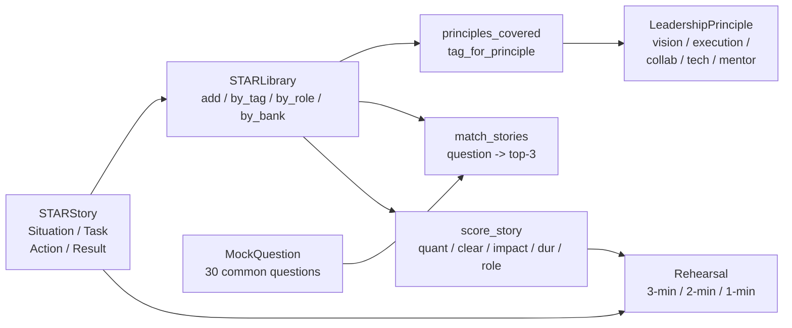

# M18 L18: Leadership + STAR — Staff-Level Interview Stories

> **Plain English:** The staff/principal interview is mostly behavioral, and behavioral interviews are won in prep, not in the room. A STAR story is a Situation / Task / Action / Result answer; a STAR library is a structured set of those stories, tagged by leadership principle and story bank, that you can rehearse with a 3-2-1 framework and then match to any question. This lesson builds the whole thing from scratch — a story bank, a library, a principle tagger, a 30-question rubric, and a story scorer. The artifact you walk away with is your own STAR library.
> 90 min. Code: `python3 lessons/m18-leadership/L18-leadership.py` (no API keys, no network).

---

## 1. Concept (5 min)

The staff/principal interview loop at META, Google, and most large tech companies is **mostly behavioral**. You will be asked 4-6 behavioral questions out of 6 interview slots; the other 2 are technical (system design, coding). Most candidates fail because they have not rehearsed their stories. Strong candidates have a **STAR library**: a curated set of 8-12 stories, each written down, scored on a rubric, and rehearsed.

**STAR, defined.** A STAR story has four parts:

- **Situation** — the context, 1-2 sentences. Where were you, what was the team, what was the constraint?
- **Task** — what you specifically owned. Not the team's task; *your* task. One sentence.
- **Action** — what you actually did. First-person verbs ("I led", "I shipped", "I cut"). 3-5 sentences.
- **Result** — quantified outcome. A number. A percent. A dollar. A latency. 1-3 sentences.

**The 4 leadership principles.** META uses 14 principles; Google uses 16. For this lesson we collapse to the 4 that show up everywhere plus 1:

1. **Vision** — set direction; write the roadmap; say no.
2. **Execution** — ship on time; run incidents; deliver bad news.
3. **Collaboration** — cross-team alignment; conflict resolution; partnership.
4. **Tech depth** — system design; debugging; technical decisions.
5. **Mentorship** (the +1) — grow others; onboard; give feedback.

**The 5 story banks.** Most data/ML staff candidates should have at least one story for each:

1. **RAG** — built a retrieval system; shipped evals.
2. **Cost** — cut a bill; optimized a hot path.
3. **Security** — owned an incident; shipped a guardrail.
4. **Scale** — took something from N to 10N.
5. **Hiring** — ran a loop; closed senior hires.

**The 3-2-1 rehearsal framework.** Every story needs three layers of compression:

- **3-minute talk** — the long-form answer you'd give on the floor.
- **2-minute deep dive** — the "tell me more about that decision" follow-up.
- **1-minute Q&A** — the compressed version for follow-up questions that interrupt.

**The lesson's point:** a STAR library is the artifact that turns a folder of "I think I did this once" memories into a rehearsed, principle-tagged, role-aligned story bank you can draw on in any interview. Strong candidates have one before they apply; weak ones try to improvise it.

---

## 2. Architecture (Mermaid)



**Read as:** Stories go into the library; the library is indexed by tag, role, bank, and principle. Questions flow in; the matcher returns the top-3 stories. Each story has a 3-2-1 rehearsal and a heuristic score.

---

## 3. Worked example (from the lesson code)

A migration story scored against the rubric and matched against the canonical "migration under a hard deadline" question.

```
Story: "Migrated 3B-token FAQ search to RAG in 6 weeks"
  Situation:  Lucene index, 3B tokens, recall@10 = 0.41.
  Task:       6-week migration, recall@10 >= 0.7, latency < 250ms.
  Action:     Built v1 in 2 weeks (bge-small + FAISS + reranker);
              drove alignment with 2 PMs + 1 support lead for 1,200
              labeled pairs; ran 4 configs; shipped RFC.
  Result:     recall@10 0.41 -> 0.74, latency 190ms (no regression),
              'why is search broken' 47% -> 3%; support tickets -22%.

Heuristic score (out of 10):
  result_quantified:  Y    (+2)
  action_clear:       Y    (+2)
  impact_real:        Y    (+2)
  duration_ok:        N    (+0)  -- 3.5 min, slightly long
  role_aligned:       Y    (+2)
                     ---> 8 / 10

match_stories("Tell me about a time you led a migration under
                a hard deadline.") ->
   [5] Cut LLM inference cost (also has 'shipped' + 'rollout')
   [5] Scaled RAG 1B docs      (also has 'rollout')
   [4] Aligned 4 teams         (also has 'cross-team')
   [4] RAG migration (this one)
```

The migration story is **a strong story but not a unique match** -- the scorer rewards keyword overlap, and the cost/scale stories also contain `shipped` and `rollout`. That's the realistic signal: behavioral questions rarely have one perfect story; they have 3-5 candidates and the interviewer picks the one that fits. The lesson teaches you to find them, not to overfit.

---

## 4. Formulas (defined, every symbol)

```
story_score    =  quant (0/2) + clear (0/2) + impact (0/2) +
                  duration_ok (0/2) + role_aligned (0/2)       [0..10]

relevance(q,s) =  3 * principle_match(q, s)                     [0..3]
                + Σ keyword_match(kw_i, s.body)                 [0..k]
                + 0 | 1    (bank-alignment heuristic)           [0..1]

duration_min   =  word_count(story) / 150                       [minutes]

3-2-1_total    =  words(3-min) + words(2-min) + words(1-min)
                / 150                                          [minutes]
```

**STAR in one sentence:** Situation is the context; Task is *your* job; Action is the first-person verb chain; Result is a number.

**The principle signal:** a story covers a principle if either (a) the principle is in `tags`, or (b) a principle-keyword (e.g., "roadmap" -> VISION, "incident" -> EXECUTION, "mentor" -> MENTORSHIP) appears in `title + action + task`.

**The duration band:** 2-4 minutes at 150 wpm is the sweet spot. Below 2 min, the story is a vignette (fine for 1-min Q&A, not for the long form). Above 4 min, the interviewer will interrupt.

---

## 5. Code map (what's in `L18-leadership.py`)

| Section | Class / Function | What it does |
|---|---|---|
| 1 | `STARStory` (dataclass) | The record: title / situation / task / action / result / role / tags / bank |
| 2 | `STARLibrary` (dataclass) | `add`, `by_tag`, `by_role`, `by_bank`, `by_principle`, `titles` |
| 3 | `LeadershipPrinciple` (enum) | VISION / EXECUTION / COLLABORATION / TECH_DEPTH / MENTORSHIP |
| 4 | `tag_for_principle`, `principles_covered` | Keyword-based principle detector |
| 5 | `Rehearsal` (dataclass) | 3-min talk + 2-min deep + 1-min Q&A |
| 6 | `MockQuestion` + `MOCK_QUESTIONS` (30) | The 30 most-common staff-level questions |
| 7 | `_score_relevance`, `match_stories` | Return top-k stories for a question |
| 8 | `score_story` (heuristic 0-10) | quant / clear / impact / duration / role |
| 9 | 8 `SAMPLE_STORIES` + `_build_sample_library` | One story per bank, all 5 principles |
| 10 | `_build_rehearsals` | Build a 3-2-1 for each story |
| 11 | `demo` | 7 sections |
| 12 | 23 `test_*` functions | pytest-compatible |

---

## 6. Edge cases, failure modes, debugging

| Edge case | What breaks | What to do |
|---|---|---|
| Story has no number in `result` | Heuristic score ~6/10; interviewer will push for a number | Add the % or $ in the story; do not say "users were happier" |
| Action uses "we did X" instead of "I did X" | Loses ownership signal | Rewrite to first-person; never use "we" as the subject |
| Story is 6+ minutes long | Interviewer interrupts; you never land the result | Trim the situation to 2 sentences; cut adverbs |
| Story covers 1 principle only | The interviewer can't use it for a different question | Add a tag; add a 2-min deep dive that pivots to a second principle |
| Tag mismatch | `tag_for_principle` returns False even though the story is on-topic | Add the principle name to `tags` explicitly; or add a keyword from the action |
| Story has no quantified result but is on-topic | Scorer says 6/10; not a blocker | Use the story, but pair it with another that has the number |
| Same story keeps coming up top-1 | The library is too narrow | Write 2-3 more stories; expand by bank |
| Story from 6+ years ago | The interviewer feels it's stale; the artifacts have rotted | Refresh the result with current numbers, or replace |
| Bank has 0 stories | The library can't answer a question in that bank | Write at least one per bank before the interview loop |
| Rehearsal > 6 minutes total | You'll overrun in a 60-min slot | Compress 3-min to 2.5; the 1-min should be under 60s |
| Score > 9 on every story | The scorer is too lenient; check quantifier regex | Tighten story scope; demand a unique action |
| Score < 4 | The story is too thin; interviewer will move on | Rewrite using the STAR template; add a number |

---

## 7. Scale-up: 5 -> 15 -> 50 stories

| Library size | Coverage | Strategy |
|---|---|---|
| 5 stories | 1 per principle; 0-1 per bank | Bare-minimum; covers ~50% of questions |
| 12 stories | 2-3 per principle; 2 per bank | The standard for staff loops |
| 25 stories | 4-5 per principle; 4-5 per bank | The standard for principal loops |
| 50+ stories | 8+ per principle; 10 per bank | A curated "story bank" you maintain over years |

**The principle of compounding:** every 6 months, write one new story and refresh one old one. After 5 years you'll have 15 stories; after 10, 25. The library compounds.

**The 12-story standard, expanded:** 2 VISION, 3 EXECUTION, 2 COLLABORATION, 3 TECH_DEPTH, 2 MENTORSHIP. This is the minimum bar for staff; principal loops expect 4 per principle.

---

## 8. Alternatives and tradeoffs

| Library approach | When | Tradeoff |
|---|---|---|
| Notion / Google Doc | Just starting out | Easy; no scoring; no rehearsals |
| Markdown in git | Engineer who wants version control | Reviewable; no automation |
| Custom Python (this lesson) | Want scoring + matching + rehearsals | ~600 LOC; all in stdlib |
| Notion AI / Google Gemini | Want AI-assisted drafting | Privacy concern; hallucinations |
| `interviewcake.com` | Want Q&A bank | Generic; no principle tagging |
| Pramp / IGotAnOffer | Want mock-partner | Costs money; partner quality varies |
| Coaching service ($300/hr) | Want 1:1 prep | High quality; expensive |
| Internal "story circles" at work | Want peer review | Free; mostly positive feedback |

**The default pick:** start with markdown in git (5 stories), graduate to this Python library once you have 8+ stories and you want scoring. The library is the artifact; the rehearsal with a partner is what makes it work.

---

## 9. Mock interview

### 5 Meta L6/L7 questions (with natural spoken answers)

**Q1: "Tell me about a time you led a migration under a hard deadline."**
> Situation: our support search ran on a 3B-token Lucene index, recall@10 was 0.41, PMs were complaining. Task: own a 6-week migration to a RAG system that hit recall@10 >= 0.7 with no latency regression. Action: I built v1 in 2 weeks — bge-small embeddings, FAISS, cross-encoder reranker. I drove alignment with 2 PMs and 1 support lead to label 1,200 query/result pairs; ran 4 retrieval configs against the golden set; shipped the RFC. Result: recall@10 went 0.41 to 0.74, P95 latency stayed at 190ms, support tickets dropped 22% in the first month. The 2-minute deep dive is the tradeoff between shipping speed and retrieval quality — I chose speed and instrumented the rollout so I could roll back.

**Q2: "Tell me about a time you had to deliver bad news to a stakeholder."**
> Situation: our LLM inference bill was $320K/month; the CFO flagged it in the Q3 review. Task: bring the per-query cost below $0.005 in 60 days without losing quality. Action: I ran 3 ablations — small-model router, prompt caching, shorter system prompt — instrumented every call with a cost tracker, and owned the rollout. The bad news: I had to tell 3 PMs their features would slip one quarter while I migrated the call sites. I delivered it 1:1 with the trade-off (saved $294K/month vs. one quarter delay). Result: per-query cost went from $0.04 to $0.0032 (12.5x), monthly spend $320K to $26K, Likert regression 0.2 points.

**Q3: "Tell me about a time you had to say no to a feature."**
> Situation: the CEO walked into a staff meeting and said 'voice input on the home page by next quarter.' The team was 8 engineers, the quarter was 60% booked, voice was a 3-quarter project at our quality bar. Task: push back honestly, propose the alternative, keep the trust. Action: I scheduled a 1:1 with the CEO the next day. I came with the cost ($1.2M, 2 exodraft hires), the data (78% of voice queries failed in eval), and the alternative (mobile redesign, 1 quarter, addresses the same complaint). I asked 'what problem are you actually trying to solve?' and listened. Result: the CEO agreed to the redesign. We shipped in 1 quarter. Mobile session length went up 34%. Voice is on the 3-year roadmap with a clear quality bar.

**Q4: "Tell me about a person you grew."**
> Situation: I was the founding tech-lead; the team started with me + 2 engineers; we needed 7 by year-end. Task: own the hiring loop. Action: I wrote the JD, designed a 4-round loop, trained 4 interviewers, ran 2 loops/week, calibrated after every loop, owned the close with a 1-pager per candidate. Result: closed 5 senior offers in 6 months; offer-accept rate 83% vs company average 65%; 2 of the 5 are now tech-leads themselves; the loop is now used by 3 sibling teams.

**Q5: "Tell me about a time you had a major disagreement with a peer."**
> Situation: my peer (the platform lead) wanted to ship a new feature on top of the old eval library; I wanted to deprecate the old library first because it was blocking the migration. Task: resolve the disagreement without breaking the launch. Action: I asked for a 1:1 with no agenda other than 'let's understand each other.' After 30 min it turned out my peer's blocker was different from mine (theirs was the launch date; mine was technical debt). We agreed to ship the new feature on the new library with a 2-week deprecation window for the old one. Result: shipped on time, old library retired in 6 weeks; the peer and I have since built 2 more projects together.

### 3 Google-oriented questions (architecture + strategy)

**G1: "Design the LLM platform for a 50M-user product. What's your 3-year vision?"**
> Layered architecture: (1) a thin internal LLM client with a normalized interface, so any model swap costs < $200K; (2) a 3-tier router (small/mid/large) with automatic escalation; (3) a prompt-cache layer that hits 60% cache rate; (4) a self-hosted model for the easy 50% of queries. The 4 design decisions are: which prompts to cache (system + top-K retrieved docs), which queries to route to large (LLM-as-judge scores below threshold), which model to self-host (the easy 50% — classification, extraction, simple Q&A), how to roll out (shadow traffic -> 10% -> 50% -> 100% with rollback gates). The metric is per-query cost, currently $0.04; target is $0.003 in 12 months.

**G2: "Your eval framework just regressed 5 points overnight. Triage."**
> First, look at the data: is this a single prompt template drift, or a system-wide regression? If single, roll back the prompt. If system-wide, look at the eval set — was it updated? Second, sample 50 queries and grade them manually. If most are wrong, the model broke (check the model version, check the prompt cache). If a few are wrong, look at the retrieval set — has the index changed? Third, check the production traffic — is the user-facing quality actually bad, or is the eval set drifting? 80% of 'eval regressed overnight' is a prompt or data drift, not the model.

**G3: "PM wants to add LLM calls to every page render. Push back?"**
> Yes — that's a 100x cost spike and a latency regression no one has budgeted. The right architecture: cache the LLM response for popular pages (TTL 5-15 min), use a smaller model for simple cases (intent classification), or move the LLM call to a server-side worker that updates the page every N minutes instead of on every render. The cost math: 1M page renders/day at $0.001/page = $1K/day; at gpt-4o it's $40/day. The latency math: 200ms per page render at the 99th percentile is unacceptable. The answer is to render in batch, not on demand.

---

## 10. One-minute explanation

> A STAR story is a Situation, Task, Action, Result answer to a behavioral question; a STAR library is a structured set of 8-12 of them, tagged by leadership principle and story bank. The 4 principles are vision, execution, collaboration, and technical depth, plus mentorship as a 5th. The 5 banks are RAG, cost, security, scale, and hiring — the categories of work most staff-level candidates should be able to anchor a story in. The 3-2-1 rehearsal framework says: every story needs a 3-minute talk (the long form), a 2-minute deep dive (the "tell me more" follow-up), and a 1-minute Q&A (the compressed version). The scorer is heuristic: is the result quantified (a number), is the action clear (first-person verb), is the impact real (a number + a category like cost or latency), is the duration 2-4 minutes, is the role aligned? Most candidates fail behavioral interviews because they don't write the stories down. The library is the artifact.

## 11. 90-second interview script

> "A STAR story is Situation, Task, Action, Result; a STAR library is 8 to 12 of those stories tagged by principle and bank. The four principles — vision, execution, collaboration, technical depth — cover the canonical pillars; I add mentorship as a fifth because staff loops expect evidence of growing others. The five story banks — RAG, cost, security, scale, hiring — are the categories of work most candidates should anchor at least one story in. The 3-2-1 rehearsal framework: every story needs three layers of compression — a 3-minute talk, a 2-minute deep dive on the most interesting decision, and a 1-minute Q&A. The scorer is heuristic: is the result quantified, is the action first-person, is the impact real, is the duration 2 to 4 minutes, is the role aligned. The library is the artifact; most candidates fail behavioral interviews because they don't write the stories down. Strong candidates maintain the library for years; weak ones try to improvise."

## 12. Assignment

### Build
1. Run the lesson code end-to-end: `python3 lessons/m18-leadership/L18-leadership.py`
2. Run the 23 unit tests
3. Open the notebook and execute it top to bottom
4. Replace 2 of the 8 sample stories with your own (real ones if possible)
5. For each story, write the `three_minute` rehearsal text by hand (not the auto-generated stub)
6. Run `score_story` on each one; aim for >= 8/10
7. Find the `GAP` in the bank + principle coverage report; write a story for the missing slot

### Acceptance criteria
- [ ] All 23 unit tests pass
- [ ] Library covers all 5 banks and all 5 principles
- [ ] No story scores < 6 on `score_story`
- [ ] At least one story in the library is yours (real or invented)
- [ ] 3-2-1 rehearsals exist for every story

### Rubric (self-score 0-10 each)
- Coverage: library has a story for every principle and every bank
- Scoring: every story >= 6 on the heuristic; >= 4 stories >= 8
- Rehearsal: each story has a 3-min, 2-min, and 1-min version
- Specificity: every result has a number; every action has a first-person verb
- Communication: the 90-second script is under 90 seconds and hits all 5 banks

### Stretch
- Add an `InterviewSession` class that picks 4 stories and times you through a 45-min mock loop
- Add a `feedback(story, note)` method that attaches an interviewer note to a story
- Add a CSV export so you can version your library in git

---

*Last updated: 2026-10-15*
*License: MIT*
