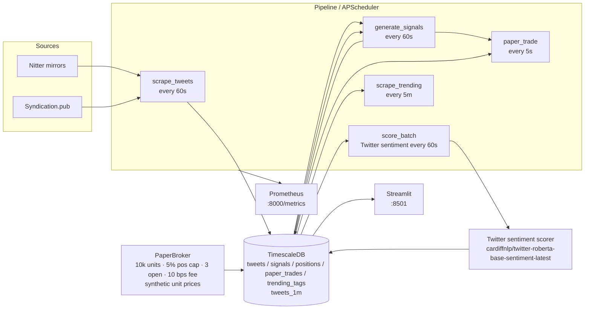

# Architecture

## High-level flow



## Component responsibilities

| Layer | Module | Responsibility |
|---|---|---|
| Config | `src/config.py` | Pydantic Settings, env-driven, single `settings` singleton. |
| Sources | `src/sources/base.py` | `SourceAdapter` ABC + `RawTweet` dataclass. |
| Sources | `src/sources/nitter_mirror.py` | Token-bucket 1 req/sec, per-mirror 24h denylist, BS4 HTML parse. |
| Sources | `src/sources/syndication.py` | syndication.twitter.com profile JSON fallback. |
| Sources | `src/sources/registry.py` | Primary Nitter → fallback Syndication; 10-min cache of working adapter. |
| Sources | `src/sources/trending.py` | Extract cashtags/hashtags/keywords from a tweet; 1-min aggregate. |
| ML | `src/ml/sentiment.py` | Lazy-loaded `pipeline("sentiment-analysis", cardiffnlp/twitter-roberta-base-sentiment-latest)`. |
| ML | `src/ml/signal.py` | Z-score over rolling sentiment history; `score = sent_z` ≥ ±1σ → BUY/SELL. |
| Trader | `src/trader/paper.py` | Cash, positions, trades, equity-curve; fee + position-cap enforcement. Currency-agnostic (units). |
| Store | `src/store/db.py` | SQLAlchemy engine, ORM, CRUD helpers, schema bootstrap. |
| Store | `src/store/schema.sql` | 5 hypertables (no `prices`); compression + retention policies. |
| Store | `src/store/aggregates.sql` | Continuous aggregate `tweets_1m` (1-min refresh). |
| Pipeline | `src/pipeline.py` | APScheduler wiring + SIGINT handler. |
| Metrics | `src/metrics.py` | Counters + histograms, exposed on `:8000/metrics`. |
| Dashboard | `dashboard/app.py` | Streamlit 4-tab UI (`Overview`, `Sentiment`, `Paper PnL`, `🔥 Trending`), `st_autorefresh(60s)`, Plotly charts. |
| Bootstrap | `scripts/bootstrap.sh` | `cp .env.example .env`, `docker compose up -d`, `init_schema()`. |

## Data model

| Hypertable | Key columns | Notes |
|---|---|---|
| `tweets` | `(ts, tweet_id)` PK; `symbol, text, author, sentiment_score` | `ON CONFLICT (tweet_id, ts) DO NOTHING` for idempotency. |
| `signals` | `(ts, symbol)` PK; `action, score, sentiment_zscore, momentum_zscore, reason` | Append-only. `momentum_zscore` is always 0 — kept for schema back-compat. |
| `positions` | `(ts, symbol)` PK; `qty, avg_price, realized_pnl` | Snapshot at every fill. |
| `paper_trades` | `(ts, symbol)` PK; `side, qty, price, fee, cash_after, reason` | Append-only. `price` / `fee` are in generic units (not USD). |
| `trending_tags` | `(ts, tag, tag_kind)` PK; `bucket, count, avg_sentiment, sample_text, sample_url` | 1-min bucketed. Powers the 🔥 Trending page. |

## Continuous aggregates

| Materialized view | Granularity | Refresh | Source |
|---|---|---|---|
| `tweets_1m` | 1 minute | 1 minute | `tweets` |

## Scheduling

| Job | Interval | Offset | First-run |
|---|---|---|---|
| `scrape_tweets` | 60s | 0s | t=0 |
| `score_batch` | 60s | 5s | t=5 |
| `generate_signals` | 60s | 10s | t=10 |
| `paper_trade` | 5s | 15s | t=15 |
| `scrape_trending` | 5 min | 0s | t=0 |

## Signal math

`score = sent_z` where

```
sent_z = (sentiment_value − μ) / σ
```

computed over the rolling 24h of 5-min bucketed average sentiment scores
per tracked tag. The `μ` and `σ` are population stats (`÷n`, not `÷n-1`).

| Condition | Action |
|---|---|
| `score > +threshold` (default 1.0σ) | `BUY` |
| `score < −threshold` | `SELL` |
| otherwise | `HOLD` |

There is no momentum leg — the broker uses a synthetic unit price
(`likes + 2×retweets + 0.1×followers`, floored at 1.0) derived from each
scraped tweet's engagement. **This is a paper-trading simulator, not a
production price feed.** See `docs/trading_disclaimer.md`.

## Failure modes & recovery

- **Nitter mirror 403** → 24h denylist, auto-rotate to next mirror.
- **Sentiment-model OOM / init failure** → `pipeline_errors_total{stage="scorer_init"}` increments; pipeline keeps running with old scores.
- **DB down** → writes log a warning and increment `pipeline_errors_total`; pipeline keeps running (eventual retry on next cycle).
- **SIGINT** → `scheduler.shutdown(wait=False)`.
