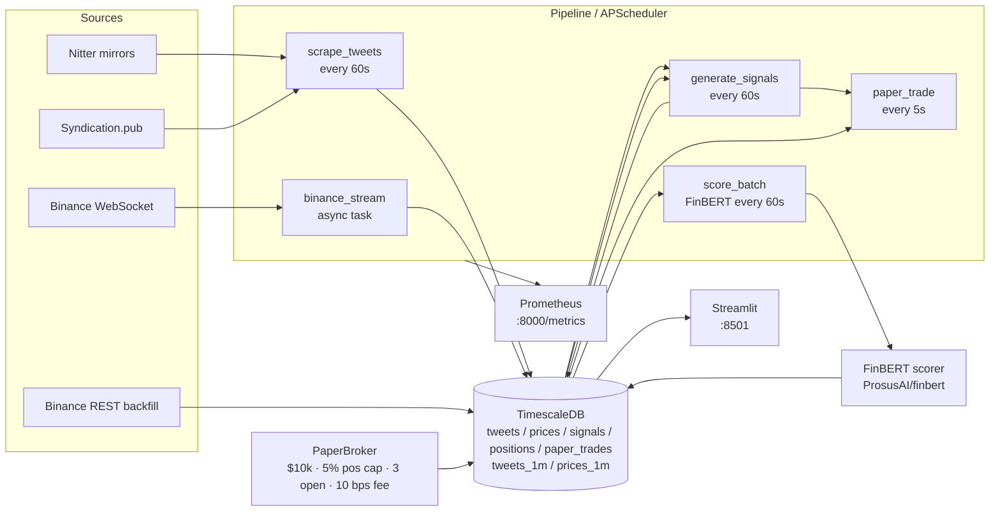

# Architecture

## High-level flow

## Component responsibilities

| Layer | Module | Responsibility |
|---|---|---|
| Config | `src/config.py` | Pydantic Settings, env-driven, single `settings` singleton. |
| Sources | `src/sources/base.py` | `SourceAdapter` ABC + `RawTweet` dataclass. |
| Sources | `src/sources/nitter_mirror.py` | Token-bucket 1 req/sec, per-mirror 24h denylist, BS4 HTML parse. |
| Sources | `src/sources/syndication.py` | syndication.twitter.com profile JSON fallback. |
| Sources | `src/sources/registry.py` | Primary Nitter → fallback Syndication; 10-min cache of working adapter. |
| Prices | `src/prices/binance_ws.py` | Async WebSocket consumer, exponential backoff 1→60s. |
| Prices | `src/prices/binance_rest.py` | 7-day klines backfill via 1000-row window iteration. |
| ML | `src/ml/finbert.py` | Lazy-loaded `pipeline("sentiment-analysis", ProsusAI/finbert)`. |
| ML | `src/ml/signal.py` | Z-score over rolling 24h history; `0.6*sent_z + 0.4*mom_z` ≥ ±1σ → BUY/SELL. |
| Trader | `src/trader/paper.py` | Cash, positions, trades, equity-curve; fee + position-cap enforcement. |
| Store | `src/store/db.py` | SQLAlchemy engine, ORM, CRUD helpers, schema bootstrap. |
| Store | `src/store/schema.sql` | 4 hypertables + compression + retention policies. |
| Store | `src/store/aggregates.sql` | Continuous aggregates `tweets_1m`, `prices_1m` (1-min refresh). |
| Pipeline | `src/pipeline.py` | APScheduler wiring + WS thread + SIGINT handler. |
| Metrics | `src/metrics.py` | Counters + histograms, exposed on `:8000/metrics`. |
| Dashboard | `dashboard/app.py` | Streamlit 4-tab UI, `st_autorefresh(60s)`, Plotly charts. |
| Bootstrap | `scripts/bootstrap.sh` | `cp .env.example .env`, `docker compose up -d`, `init_schema()`. |
| Backfill | `scripts/backfill_prices.py` | Loops symbols, calls REST backfill, bulk insert. |

## Data model

| Hypertable | Key columns | Notes |
|---|---|---|
| `tweets` | `(ts, tweet_id)` PK; `symbol, text, author, sentiment_score` | `ON CONFLICT (tweet_id, ts) DO NOTHING` for idempotency. |
| `prices` | `(ts, symbol)` PK; `price_usd, volume_usd` | Updated on every Binance trade; `DO UPDATE` on conflict. |
| `signals` | `(ts, symbol)` PK; `action, score, sentiment_zscore, momentum_zscore, reason` | Append-only. |
| `positions` | `(ts, symbol)` PK; `qty, avg_price, realized_pnl` | Snapshot at every fill. |
| `paper_trades` | `(ts, symbol)` PK; `side, qty, price_usd, fee_usd, cash_after, reason` | Append-only. |

## Continuous aggregates

| Materialized view | Granularity | Refresh | Source |
|---|---|---|---|
| `tweets_1m` | 1 minute | 1 minute | `tweets` |
| `prices_1m` | 1 minute | 1 minute | `prices` |

## Scheduling

| Job | Interval | Offset | First-run |
|---|---|---|---|
| `scrape_tweets` | 60s | 0s | t=0 |
| `score_batch` | 60s | 5s | t=5 |
| `generate_signals` | 60s | 10s | t=10 |
| `paper_trade` | 5s | 15s | t=15 |
| `binance_stream` | — | — | start of process (background thread) |

## Failure modes & recovery

- **Nitter mirror 403** → 24h denylist, auto-rotate to next mirror.
- **Binance WS disconnect** → exponential backoff 1→60s, reconnect.
- **FinBERT OOM** → `pipeline_errors_total{stage="scorer_init"}` increments; pipeline keeps running with old scores.
- **DB down** → writes log a warning and increment `pipeline_errors_total`; pipeline keeps running (eventual retry on next cycle).
- **SIGINT** → `loop.call_soon_threadsafe(loop.stop)` + `scheduler.shutdown(wait=False)`.
