# Inside the BCG Platinion Hiring Process: Every Round, What They Ask, and Who They Actually Hire

### A round-by-round guide for senior Data & AI architects moving into technology consulting

> **Read this first.** BCG does not publish its interview process for senior technology roles. What follows combines the role brief a recruiter shared, BCG's public material, and interview experiences candidates report on public prep sites. Treat the structure as **typical and reported, not BCG-confirmed**. Rounds, order and interviewers change by office, level and practice. Ask your recruiter for the exact loop.

---

## Why this role is different

Most "BCG interview" advice is written for generalist consultants: market-sizing, profitability cases, McKinsey-style frameworks. That is **not** the whole story here.

**BCG Platinion** is BCG's technology-architecture practice. It sits close to **BCG X**, the unit that builds technology for clients. Its senior hires are not graded mainly on a case-math drill. They are graded on a harder question:

> *Can this person sit in front of a bank CIO, tell them their core modernisation plan is wrong, and be technically right?*

That sentence drives every round below.

---

## The ideal candidate (what the brief asks for)

### Background
- Technology consulting background, from a top-tier firm or a specialist technology consultancy
- Experience across **Banking, Insurance, Energy, Industrial Goods or Telco**

### Core skillsets
| Area | What "credible" looks like |
|---|---|
| Data & AI | Platform design, governance, ML in production |
| Enterprise Architecture | Target-state, roadmaps, trade-off decisions |
| Legacy Modernisation | Mainframe/monolith decomposition, migration waves |
| Cloud Transformation | Landing zones, cost, security, operating model |
| Technology Strategy | Build/buy/partner, investment cases |
| AWS, Databricks | Hands-on design depth, not logo familiarity |
| Generative AI / OpenAI | RAG, guardrails, evaluation, cost control |

### Key characteristics
- A strong communicator who is comfortable with **C-suite stakeholders**
- Bridges business and technology teams
- **Technically credible and commercially minded**
- Has **anchored and led** consulting engagements
- Writes executive-level briefs and recommendations

### What they want you to be able to do
1. Lead enterprise architecture and transformation engagements
2. Design Data & AI solutions for large organisations
3. Advise senior stakeholders on technology strategy
4. Drive legacy modernisation
5. Build and scale enterprise data and AI capability
6. **Influence executives while staying hands-on**

The last line is the filter. Pure strategists fail the technical rounds. Pure engineers fail the executive rounds. The hire is the person who passes both.

---

## The process at a glance

```mermaid
flowchart LR
    R0["Round 0<br/>CV screen<br/>Sector + skill match"] --> R1["Round 1 · 20-30 min<br/>Recruiter call<br/>Motivation, level, logistics"]
    R1 --> R2["Round 2 · 30-45 min<br/>Hiring manager<br/>Experience depth, ownership"]
    R2 --> R3["Round 3 · 45-60 min<br/>Architecture interview<br/>AWS, Databricks, GenAI"]
    R3 --> R4["Round 4 · 45-60 min<br/>Case interview<br/>Tech-flavoured business case"]
    R4 --> R5["Round 5 · 30-60 min<br/>Executive brief<br/>Reported for senior roles"]
    R5 --> R6["Round 6 · 45-60 min<br/>Partner / MD<br/>Presence, judgement, fit"]
    R6 --> R7["Round 7 · days to weeks<br/>Decision and offer<br/>Committee, references, level"]

    classDef screen fill:#306FC7,stroke:#306FC7,color:#fff
    classDef tech fill:#43938F,stroke:#43938F,color:#fff
    classDef exec fill:#F6C24A,stroke:#F6C24A,color:#222
    classDef decide fill:#DA3832,stroke:#DA3832,color:#fff
    class R0,R1,R2 screen
    class R3,R4 tech
    class R5,R6 exec
    class R7 decide
```

*Blue: screening. Green: technical and case. Yellow: executive and partner. Red: decision.*

| # | Round | Who | Length | What is really tested |
|---|---|---|---|---|
| 0 | Application and CV screen | Recruiter / talent team | n/a | Sector + skill match, consulting signal |
| 1 | Recruiter call | Recruiter | 20–30 min | Motivation, level, logistics, red flags |
| 2 | Hiring-manager conversation | Senior Manager / Principal | 30–45 min | Experience depth, credibility |
| 3 | Technical architecture interview | Platinion architect | 45–60 min | Design judgement across AWS / Databricks / GenAI |
| 4 | Case interview | Principal / Managing Director | 45–60 min | Structured thinking on a client problem |
| 5 | Executive-brief exercise *(reported for senior roles)* | Partner-level | 30–60 min | Recommendation writing and defence |
| 6 | Partner / MD interview | Partner | 45–60 min | Presence, commercial instinct, fit |
| 7 | Decision, references, offer | HR + committee | days to weeks | Consensus and level |

Expect **4 to 6 conversations**, usually spread over **3 to 6 weeks**.

---

## Round 0: The CV screen

**What they look for in the first 30 seconds**
- Names of firms (top-tier consulting or specialist consultancies read as a strong signal)
- Sectors: Banking, Insurance, Energy, Industrial Goods, Telco
- Verbs: *led, anchored, advised, designed, modernised*
- Numbers: cost saved, time cut, scale handled

**How to win it**
Rewrite every bullet as *situation → decision you made → measurable result*. "Built a lakehouse" loses. "Chose a lakehouse over a warehouse to unify 3 countries' data, cut month-end close from 5 days to 2 hours" wins.

**Questions to test your CV against (answer each in one line)**
1. Which single bullet on your CV would you defend for 10 minutes?
2. Where is the evidence you have led a client-facing engagement?
3. Which sector on this CV would you pitch to a BCG client tomorrow?
4. What is the biggest number on your CV, and how was it measured?
5. Where do you show Data & AI *and* business impact in the same bullet?

**If you come from in-house, not consulting:** say so plainly in the cover note and point to client-facing proof: regulators, multi-country stakeholders, executive dashboards.

---

## Round 1: The recruiter call

**Typical questions**
- Why consulting, and why BCG Platinion?
- Why now?
- What level are you targeting? (Senior Manager, Principal, Director)
- Which sectors have you worked in?
- Travel, location and notice-period expectations
- Compensation expectations

**What they are really checking**
- Are you running **towards** something, or away from your current job?
- Is your level realistic for your evidence?
- Will you accept client-site and travel-heavy life?

**Strong answer shape for "Why consulting?"**
> "I've spent my career building platforms for one company at a time. I want to apply the pattern across industries, sit closer to the decision-makers, and be accountable for the full outcome: the architecture and the adoption."

**More questions to expect**
1. Walk me through your CV in two minutes.
2. What do you know about BCG Platinion and how it differs from BCG X?
3. Which of our five sectors (Banking, Insurance, Energy, Industrial Goods, Telco) is your strongest, and why?
4. Are you talking to other firms? Where are you in those processes?
5. How do you feel about 4 to 5 days a week at a client site?
6. What would make you decline an offer?
7. Which level do you believe fits you, and what is your evidence?

**Avoid:** "I want a change", "better pay", and any criticism of your current employer.

**Ask them:** the target level, the interview stages, who the interviewers are, and the sector focus.

---

## Round 2: The hiring-manager conversation

A senior practitioner walks through your CV. This is a credibility interview.

**Typical questions**
- "Walk me through the most complex architecture you've owned end to end."
- "What was the decision you were least sure about, and how did you resolve it?"
- "Tell me about a time a senior stakeholder disagreed with your recommendation."
- "How did you move a legacy system without stopping the business?"
- "Which part of that was your work, and which was your team's?"

**More questions to expect**
1. Describe a legacy modernisation you led. What went wrong?
2. How did you justify the investment to a CFO?
3. Tell me about a Data & AI platform you scaled from pilot to enterprise.
4. How have you worked with a business team that did not trust the data?
5. Describe a time you changed an executive's mind using evidence.
6. How did you decide what *not* to build?
7. What is the biggest architecture mistake you have made?
8. How have you led engineers, consultants or vendors you did not manage directly?
9. Tell me about an engagement you anchored. How did you structure the team?
10. How do you keep technical credibility while leading?

**What they are really checking**
- **Ownership.** Do you say "I decided" or "we did"?
- **Depth.** Can you survive three follow-up questions on one claim?
- **Business translation.** Do you explain value, or just technology?

**A structure that works (use it for every story)**
1. **Context:** client, scale, constraint (30 seconds)
2. **Decision:** the options and why you chose one
3. **Action:** what *you* personally did
4. **Result:** a number
5. **Lesson:** what you would change

**Red flags interviewers note:** vague scale, buzzwords with no trade-offs, "we" for everything, and no failures.

---

## Round 3: The technical architecture interview

This is where most strong consultants and most strong engineers each lose half of the points. You need breadth *and* depth.

### 3a. Data & AI platform design
- "Design a data platform for a bank with 15 countries and different regulators."
- "Lakehouse, warehouse or data mesh for this client, and why?"
- "How do you handle data residency, lineage and access control across jurisdictions?"
- "How would you design real-time fraud or churn detection for a telco?"

### 3b. Legacy modernisation
- "A bank runs core processing on a mainframe. Walk me through a modernisation roadmap."
- "Strangler pattern versus big-bang: when does each win?"
- "How do you de-risk migration waves, and what do you migrate first?"
- "How do you keep two systems consistent during the transition?"

### 3c. Cloud transformation (AWS-leaning)
- Landing zone, networking, identity, guardrails
- Cost governance and FinOps (expect "How did you cut cloud cost?")
- Security and resilience in regulated sectors
- Build, buy or partner decisions

### 3d. Databricks
- Delta Lake, Unity Catalog, governance model
- Batch versus streaming, medallion layers
- Workspace and cluster design, cost control
- When Databricks is **not** the right answer

### 3e. Generative AI
- "Design an enterprise assistant over internal documents."
- "How do you evaluate it before launch, and monitor it after?"
- "How do you handle PII, hallucination and prompt injection?"
- "OpenAI API versus open-weights versus a cloud-hosted model: how do you choose?"

**A GenAI answer skeleton interviewers like**
> Start with a use case that has a measurable decision. Ground the model on governed data with retrieval and citations. Add PII controls, human-in-the-loop for high-risk outputs, evaluation before launch, and monitoring for cost and drift. Close on adoption: the data foundation and the change plan matter more than the model.

### 3f. Enterprise architecture and strategy
- "How do you build a target-state architecture and a roadmap a CIO will fund?"
- "How do you govern architecture across 10 delivery teams without becoming a bottleneck?"
- "Build, buy or partner for a feature store, a vector database, an orchestration layer?"
- "How do you measure whether an architecture is 'good'?"

### 3g. Rapid-fire checks
1. Delta Lake versus Iceberg: when do you choose each?
2. How do you size and cap Databricks cost?
3. How do you make a RAG system's answers auditable?
4. Event-driven versus batch: your decision rule?
5. How do you migrate 50 TB with near-zero downtime?
6. What is your approach to data contracts?
7. How do you secure PII in a lakehouse across countries?
8. What breaks first when an LLM app goes from 10 to 10,000 users?
9. How do you prove an ML model is still valid in production?
10. What would you refuse to automate with GenAI?

**What they are really checking**
- Do you give **trade-offs**, not a single "best" answer?
- Do you ask clarifying questions before drawing boxes?
- Do you tie each choice to cost, risk, time and people?
- Can you whiteboard calmly and adjust when challenged?

**Common failure:** jumping to a tool list. Strong candidates start with requirements, constraints and success metrics.

---

## Round 4: The case interview

Expect a **technology-flavoured business case**, not a pure market-sizing puzzle.

**Typical prompts**
- "A bank's finance team takes 5 days to close the month. How do you fix it?"
- "An insurer wants GenAI for claims triage. Where do you start?"
- "A telco wants real-time churn prediction. What do you build, and what do you tell the CEO?"
- "An energy company has 30 years of operational data in silos. Build the case for a data platform."
- "A manufacturer wants to retire its legacy ERP integration layer. What is your roadmap and your budget logic?"

**More case prompts to practise**
1. A bank's cloud bill is up 60% in a year. Find the cause and the fix.
2. An insurer has 12 policy systems after acquisitions. Consolidate or federate?
3. A telco's data science team has 40 models and no production use. What do you do?
4. An industrial-goods group wants predictive maintenance across 80 plants. Where do you start and what is the business case?
5. A utility must meet new regulation on AI use in customer decisions. What is your governance plan?
6. A CEO says "we need a GenAI strategy by next month." What do you ask first?
7. A bank wants to sunset a mainframe in 3 years. Is that realistic, and how do you decide?
8. A bank is buying a software company. How do you run the technology due diligence? *(mirrors a reported question)*
9. Two companies merge and each runs its own data centres. Do you consolidate, and in what order? *(mirrors a reported question)*
10. A client's IT cost is 20% above peers. Where do you look first, and what do you cut? *(mirrors a reported question)*

**The structure interviewers expect**
1. **Clarify** the goal, constraints and success metric
2. **Frame** the problem into 3 to 4 buckets
3. **Diagnose** with hypotheses, driving to the biggest lever
4. **Recommend** with sequencing, quick wins, then platform
5. **Risks and next steps**, then a one-line summary for the CEO

**The BCG lens: 10-20-70**
BCG often frames AI value as roughly **10% algorithms, 20% technology and data, 70% people and process change**. Using it signals you understand that adoption, not tooling, decides outcomes.

**What they are really checking**
- Hypothesis-driven thinking
- Comfortable, simple arithmetic and sensible assumptions
- Whether your answer is *commercial* (value, cost, payback) and not only technical

**Tip:** state your hypothesis in the first two minutes, then test it. Do not wait to be "sure".

---

## Round 5: The executive-brief exercise (reported for senior roles)

For leadership-track roles, some loops ask you to produce or defend a short recommendation. The format varies: a short written brief, a one-page slide, or an oral "pitch to the CIO".

**The task shape**
> "You have 5 minutes with the CIO. Recommend a cloud and data strategy for the next 3 years."

**More prompts they may use**
1. "Write a half-page recommendation: should a bank move its data platform to Databricks on AWS?"
2. "Summarise the risks of GenAI in insurance claims for a Chief Risk Officer."
3. "Give the board three options for modernising a core system, and recommend one."
4. "The CFO thinks the programme is too expensive. Respond in five minutes."
5. "Explain a lakehouse to a CEO in 60 seconds."
6. "What are the three questions you would ask before signing off a 3-year cloud commitment?"

**What a strong brief contains**
- **The answer first** (one sentence)
- 3 supporting reasons
- Cost, risk and timeline in one view
- The decision you need from the executive
- What you would do in the first 90 days

**What they are really checking**
- Can you be brief and senior?
- Can you defend it when the "CIO" pushes back hard?
- Do you hold your ground without arguing?

---

## Round 6: The Partner / MD interview

The most senior conversation. Often shorter on technology, heavier on judgement.

**Typical questions**
- "Why would a CEO trust you in the first meeting?"
- "How do you win and grow an engagement, not only deliver it?"
- "Tell me about a time you told a client something they didn't want to hear."
- "How do you manage a team of consultants who are less technical than you, and engineers who are less commercial?"
- "Where is enterprise AI heading in 3 years, and what should our clients do now?"
- "What would make you leave BCG in 18 months?"

**More questions to expect**
1. Which of our clients' problems would you want to solve first, and why?
2. How would you build Platinion's Data & AI offering in Southeast Asia?
3. Describe how you would handle a client escalation at 9 p.m. on a Friday.
4. When have you said no to a client? What happened?
5. How do you work with BCG X builders and generalist consultants on one team?
6. What is one thing BCG should stop doing in technology?
7. How do you develop and retain senior engineers and architects?
8. What would your first 90 days look like?
9. Which trend is overhyped in enterprise AI today?

**What they are really checking**
- **Presence and judgement**, the "would I put this person in front of a client" test
- Commercial instinct: pipeline, scoping and pricing awareness at your level
- Resilience for the pace, the travel and the pressure
- Culture fit: intellectual rigour, structure, humility

**Behaviours that score well**
- Short, structured answers
- Opinions held with evidence
- Admitting what you do not know, then explaining how you would find out
- Curiosity about the Partner's own clients

---

## Round 7: Decision, references, offer

- Interviewers share feedback and a committee agrees on **hire / no hire and level**
- Reference checks follow, often two to three senior references
- Level can differ from what you applied for (for example, a Principal offer when you applied as a Director; candidates report this happening)
- Compensation is negotiated against level and market

**Questions you will face (from referees and the offer stage)**
- Referees: "How does this person handle disagreement with senior stakeholders?"
- Referees: "Would you work with them again, and in what role?"
- Referees: "Where do they need to grow?"
- Offer: "What is your expected package and your notice period?"
- Offer: "Do you have any competing offers or deadlines?"
- Your questions: "Why this level? What would move me to the next one, and over what timeframe?"

**Tip:** have references briefed, and ask each to speak to *leadership and client influence*, not just technical skill.

---

## Real questions candidates report

The questions in the rounds above are practice prompts I wrote to match the role. This section is different: it lists what candidates say they were asked, taken from public interview-prep sites. These are self-reported, short, and not BCG-confirmed. Loops differ by office and level.

**Reported loop shapes**
- Architect roles: about 3 rounds over 3 to 5 weeks, covering a screen, technical deep dives and case-based interviews
- Glassdoor reports: 2 rounds with 4 interviewers (3 Managers, 1 Director), each about an hour, with a fit part and a case part. The first round is remote and the second is in the office
- AI Architect roles: AI architecture, solution architecture, enterprise integration, model deployment, MLOps, production monitoring and scalability

**Reported case and technical questions**
1. Perform tech due diligence for a bank that is buying a software company
2. Improve a company's IT architecture
3. Discuss the pros and cons of a cloud implementation
4. Propose an IT strategy and a cost-reduction plan
5. Manage a post-merger integration (PMI) programme
6. Merge two data centres

Candidates also describe the *topics* below. They did not quote exact questions, so treat these as themes, not wording:
- Technology vendor selection
- IT transformation programmes
- Enterprise systems and digital platforms

**Reported fit questions**
1. Walk through your career and the impact you made
2. What challenges did you face, and how did you handle them?
3. Why technology consulting specifically?
4. What technology experience do you bring?

**More reported questions (PrepLounge)**
1. How do you merge two applications?
2. How do you reduce cost during IT sourcing?
3. A company wants to move its IT department somewhere cheaper. Which countries in Europe would you consider?
4. How would you improve a company's IT architecture, and what benefits would specific changes give?

**Reported case types (RoadToOffer)**
- *IT transformation (insurance):* an ageing landscape of 200-plus applications to rationalise, consolidate or replace, with IT spend above peers
- *ERP selection:* replace a legacy ERP and compare SAP S/4HANA with Oracle Cloud (sometimes Microsoft Dynamics)
- *Cloud migration roadmap:* move from on-premise to AWS, Azure or GCP
- *M&A technology due diligence:* assess a target's IT landscape for a private-equity or strategic buyer

**How cases are run:** candidates describe a free-format case given by a Principal or Director, often based on one of their own past projects. Do not expect a fixed script.

**Reported difficulty:** most Glassdoor reviewers rate the loop as hard, and about 1 in 2 candidates with a known outcome received an offer.

---

## Model answers to the reported questions

These answers are mine, written as a senior Data and AI architect would give them. They are not BCG's answers. Any numbers are illustrative. Use the shape, then replace the numbers with your own evidence.

### 1. Tech due diligence for a bank buying a software company
**Open with the goal:** "Is the target's technology worth the price, and what will it cost to integrate?"
- **Clarify:** deal thesis (product, customers, talent, or cost synergy), timeline, and walk-away conditions
- **Five lenses:**
  1. *Product and architecture:* monolith or services, scalability limits, tech debt, key-person dependency
  2. *Security and compliance:* breach history, penetration tests, data residency, licences the bank's regulator will care about
  3. *Data and AI:* data quality, ownership of the data, model provenance, open-source licence risk
  4. *Engineering health:* release frequency, test coverage, incident rate, team attrition
  5. *Integration cost:* what must change to meet the bank's controls, and in what order
- **Output:** red, amber, green per lens, a cost-to-fix estimate, and a price adjustment or condition for each red
- **Close:** "My recommendation is proceed, proceed with conditions, or stop, and the first condition is X."

### 2. Improve a company's IT architecture
- **Diagnose before you prescribe:** map applications, integrations, data flows and run cost. Find where change is slow, costly or risky
- **Pick the biggest lever** (usually integration sprawl, duplicated systems or manual data movement)
- **Recommend in waves:** quick wins (decommission duplicates, API-enable the top 3 systems), then platform (shared data layer, event backbone), then core replacement
- **Quantify benefits:** run-cost saved, lead time cut, incidents avoided, and the cost and risk of getting there
- **Governance:** a small architecture board with standards and an exception path, so you do not become a bottleneck

### 3. Cloud implementation: pros and cons
| Pros | Cons |
|---|---|
| Elastic capacity, faster delivery | Cost can rise without FinOps discipline |
| Managed services reduce toil | Lock-in to provider services |
| Resilience and global reach | Skills gap and operating-model change |
| Security tooling at scale | Data residency and regulatory limits |

**Close with a decision rule:** "Move workloads that are variable, customer-facing or data-heavy first. Keep stable, latency-bound or heavily regulated workloads where they are until the business case is clear."

### 4. IT strategy and cost reduction
1. **Baseline:** split IT spend into run, grow and transform, and benchmark against peers
2. **Find the levers:** vendor and contract renegotiation, application rationalisation, infrastructure consolidation, sourcing mix, demand management
3. **Sequence:** contracts and licences first (fast, low risk), then rationalisation, then structural change
4. **Protect value:** never cut the spend that funds the strategy. Track savings against a baseline the CFO accepts

### 5. Manage a post-merger integration (PMI)
- **Day 1:** keep the business running. Email, access, finance close and customer-facing systems must work
- **First 100 days:** integration management office, one target-state decision per domain (keep A, keep B, or new), synergy tracker
- **Key decisions:** which application wins in each domain, which data model is the master, and what to retire
- **Risks:** losing key engineers, regulatory deadlines, and integrating too much too fast
- **Answer the CEO's question:** "Synergies of X by month 18, with the first quarter spent on stability, not savings."

### 6. Merge two data centres
1. **Inventory:** workloads, dependencies, latency needs, contracts and end-of-life dates
2. **Decide the destination:** consolidate into one site, move to cloud, or a hybrid. Do not default to the larger site
3. **Wave plan:** low-risk workloads first, rehearse each migration, define rollback, and keep a freeze window around the business peak
4. **Network and data:** dual-run replication for near-zero downtime, then cut over
5. **Decommission:** the savings only land when the old site is switched off, so budget the exit contracts

### 7. Merge two applications
- **Compare:** functional fit, data quality, cost, users and technical health
- **Choose:** keep one and retire the other, build a new one, or federate through an API layer when the business case for a full merge is weak
- **Migrate:** map and clean data first, migrate in cohorts (a product line or a country), and run both in parallel until reconciliation passes
- **Risk:** customer-visible change. Plan communication and training as part of the project

### 8. Reduce cost during IT sourcing
- Consolidate vendors and use volume leverage
- Run a competitive bid for any contract over its renewal window
- Move from time-and-materials to outcome-based pricing where scope is stable
- Right-size licences and cloud commitments to actual usage
- Mix onshore, nearshore and offshore, but price in coordination and quality cost, not only the day rate

### 9. Move IT somewhere cheaper: which European countries?
**Answer with criteria, not a list.** Talent depth, language and time-zone fit, wage level and trend, political and legal stability, data-protection regime, and infrastructure.
- Candidates often cited: Poland, Romania, Portugal, Bulgaria and the Baltics. The right pick depends on the skills you need
- **Caveat:** wage gaps narrow over time and attrition can be high in hot markets. Check the current numbers before you commit

### 10. ERP selection (S/4HANA versus Oracle Cloud)
- **Start with requirements and process fit**, not the brand. Which processes are standard and which are differentiating?
- **Compare on five axes:** functional fit, total cost of ownership over 7 to 10 years, implementation risk, ecosystem and talent, and roadmap and vendor viability
- **Test with a fit-gap workshop** and reference calls with similar clients
- **Recommend:** the option that fits the most processes with the least customisation. Customisation is where ERP programmes fail

### 11. Cloud migration roadmap
1. **Assess:** classify each application (retire, retain, rehost, replatform, refactor)
2. **Foundation first:** landing zone, identity, networking, guardrails and cost tagging before the first workload
3. **Waves:** pilot, then low-risk, then business-critical. Each wave has exit criteria
4. **Operating model:** FinOps, security operations, and a platform team
5. **Close:** the roadmap fails on people and process before it fails on technology

### 12. Insurance IT transformation: 200-plus applications and a spend gap
- **Diagnose the gap:** is the overspend in run cost, licences, duplication, or projects?
- **Rationalise with a simple rule per application:** *retire* (low value), *consolidate* (duplicated), *modernise* (high value, high debt), *keep* (stable and fit)
- **Build the case:** savings from retired and consolidated systems fund the modernisation. Show payback and the cash profile by year
- **Sequence:** quick decommissions, then shared platforms (policy, claims, data), then core replacement

### 13. Walk me through your career and the impact you made
Use two minutes: where you started, the turning point, the biggest outcome with a number, and why this role is the logical next step. End on the connection to technology consulting.

### 14. Why technology consulting, and what technology experience do you bring?
> "I have built Data and AI platforms for one organisation at a time. I want to apply the pattern across industries and be accountable for the full outcome. What I bring is hands-on depth in [your stack] and a record of [your measurable result]."

### 15. What challenges did you face, and how did you handle them?
Pick one real failure. Use the five-step story: context, decision, action, result, lesson. Own your part of the mistake and show what you changed afterwards.

---

## The scorecard they're effectively using

| Dimension | Weak | Strong |
|---|---|---|
| Technical depth | Tool lists | Trade-offs, failure modes, cost |
| Structure | Rambling | Answer-first, 3 buckets |
| Executive presence | Defensive | Calm, direct, concise |
| Commercial sense | Tech for tech's sake | Value, cost, payback |
| Leadership | "We" only | Clear personal ownership |
| Sector insight | Generic | Specific to bank / insurer / telco / energy |
| Consulting readiness | Needs training | Already communicates like a consultant |

---

## Ten mistakes that end senior candidates' interviews

1. Starting with technology before the problem
2. No numbers in any story
3. Saying "we" so often no one knows what you did
4. One-size answers for every sector
5. Refusing to commit to a recommendation
6. Over-engineering; ignoring cost and change management
7. Criticising previous employers
8. Not asking any questions
9. Bluffing a skill you cannot defend
10. Treating the Partner round as a formality

---

## A 3-week preparation plan

**Week 1: Build your evidence**
- Write 6 stories (modernisation, executive disagreement, failure, scale, cost, leadership) in the 5-step structure
- Attach a number to each

**Week 2: Build your technical range**
- Whiteboard 5 designs aloud: bank data platform, mainframe migration, insurance GenAI claims, telco real-time churn, energy data foundation
- Revisit AWS landing zones, Databricks governance and RAG evaluation

**Week 3: Build your consulting voice**
- Do 4 to 6 timed mock cases aloud
- Practise a 5-minute CIO pitch, then have someone interrupt it
- Prepare 3 sharp questions for each interviewer

---

## Questions worth asking them

- "How do Platinion architects split time between client delivery and reusable assets?"
- "What does a strong first 90 days look like for this role?"
- "How do consultants and architects share ownership of a client outcome?"
- "How is BCG approaching Responsible AI governance in delivery?"

---

## The one-paragraph summary

BCG Platinion is not hiring a cloud specialist, a strategist or an AI enthusiast. It is hiring **a senior person who can do all three in one room**: explain to the board why the roadmap is right, then open the architecture and prove it. Prepare for the technical depth, but win the interview on structure, commercial judgement and executive presence.

---

### Sources and honesty note
- Role requirements: recruiter brief (20 Oct 2026)
- Firm facts (Platinion and BCG X positioning, the 10-20-70 framing): BCG public material. Check against the current BCG site before publishing
- Real questions: [Glassdoor BCG Platinion interviews](https://static.glassdoor.co.in/Interview/BCG-Platinion-Interview-Questions-E947061.htm), [PrepLounge](https://www.preplounge.com/consulting-forum/how-to-prep-for-bcg-platinion-20581), [Dataford AI Architect guide](https://dataford.io/interview-guides/bcg-platinion/ai-architect), [MBBPrep](https://mbbprep.com/community/is-the-bcg-platinion-interview-process-different-from-core-bcg-245)
- Fetched in full: [PrepLounge](https://www.preplounge.com/consulting-forum/how-to-prep-for-bcg-platinion-20581) and [RoadToOffer](https://www.roadtooffer.com/blog/bcg-platinion-case-interview). Glassdoor and Dataford could not be read in full
- Interview structure: aggregated candidate reports on public interview-prep sites. **Not BCG-confirmed**; verify with your recruiter

*If this helped, follow for more breakdowns of consulting and big-tech hiring loops for data and AI engineers.*

**Tags:** `Career` · `Consulting` · `Data Engineering` · `Artificial Intelligence` · `Interview Preparation`
