# ROUND 1 — Role Related Knowledge (RRK) — Question & Answer Bank

**Role:** Data & Analytics Lead, Google Cloud Consulting (Singapore) — Professional Services Organisation
**Interviewer:** the RRK interviewer | **Duration:** ~60 min
**Loop context:** Two RRK rounds → Googleyness & Leadership (G&L) → informal senior-leader conversation. All virtual.
**Round 2 note:** One of the two RRK rounds includes a hands-on practical — reviewing a short piece of data-processing code and designing an enterprise data platform live. You are not asked to write a full solution; you are asked to reason about correctness, scale, reliability, security and maintainability, and to draw and defend an architecture.

**Companion docs:** `../HOW_TO_PASS.md` (strategy + rubric), `ROUND_1_RRK_GAP_CLOSURE.md` (resolved TODOs, the 60-day GCP plan, the practice-P&L answer, the duplicate-40% fix), `ROUND_1_RRK_CODE_REVIEW_DRILL.md` (Q15 — six-pass review order and 16 verified findings), `../../INTERVIEW_PREP/MASTER_QUESTION_BANK.md` (question index), `../../GCP_DATA_ENGINEERING_COURSE/` (technical depth).

---

## 📌 How to Use This Document

**1. Numbers rule — read this first.**
Every metric in this bank comes from your **verified resume** (`portfolio/interview/meta/coach/resume-facts.md`, extracted from `Prem_Resume_2026.pdf` on 2026-09-26). Anything in the wider corpus like "$2.1M → $12.3M ARR practice", "$2.5M / 120TB migration", "500TB FSI programme", "$5.4M revenue / 35% margin" is an **aspirational model, not your history** — `HOW_TO_PASS.md` says so explicitly. Do not present those as fact.

Where a real fact needs sharpening (attribution, baseline, definition), the answer carries a `[TODO]` block. **Resolve every TODO before the interview.** An interviewer will probe exactly those places.

**2. The universal hypothetical framework — memorise the shape, not the words.**
Use this for every scenario/hypothetical question:
`UNDERSTAND → PREPARE → OPTIONS → RECOMMEND → SUPPORT`
- **Understand** — ask clarifying questions first. If you get no answer, *state your assumptions explicitly* and move on. Do not silently guess.
- **Prepare** — say what data, metrics or artefacts you need, where you'd get them, which stakeholders and constraints matter.
- **Options** — 2–3 options, weighed honestly against explicit trade-offs (correctness, latency, availability, security, cost, migration risk, organisational readiness).
- **Recommend** — be prescriptive. "It depends" is a starting point, not an answer.
- **Support** — execution plan, what could go wrong, how you'd measure it worked.

**2b. These answers are scripts, not testimony — and that distinction is the whole game.**
Every quoted answer in this bank is written in **your first person** so it can be rehearsed out loud. It is **the shape of a strong answer**, not a claim that you did these things. Before you say any of it, check three things:

- **Is it true?** The structural content (the framework, the sequence, the trade-off) is sound and safe. The **specifics** — your numbers, your mechanisms, your stories — must come from `resume-facts.md` or your own memory. Where a passage asserts something you have not verified (for example the *mechanism* behind each of the two 40% cost claims, or the *detail* of what happened inside your $3M budget), it is marked and it is **your job to correct it**. A beautifully-worded answer about something that did not happen is worse than a plain one that did — the interviewer will pull the thread, and you cannot sustain it.
- **Is it yours?** Do not deliver my phrasing verbatim. Rehearse until you could say it while making coffee, then say it in your own words. A rehearsed-sounding answer is detectable and it reads as coaching.
- **Would you defend the follow-up?** The test of any sentence here is not whether it sounds good but whether you can answer *"how do you know that?"* and *"who else could have caused it?"* If you cannot, cut the sentence.

**Never present a number you cannot source.** If the real answer is *"I don't have that number, and here's the mechanism instead"* — say that. It is a strong answer. Inventing one is not.

**3. The behavioural frame — lead with the outcome and your specific role.**
`STAR` (Situation, Task, Action, Result). Lead with the result. Be concrete with scale and numbers. Anonymise employers and clients — name the *industry and size*, not the name. Every answer must answer *"why you and not the team?"*.

**4. The level filter — enterprise scope, not project scope.**
A technically correct answer that doesn't reach **enterprise dependencies, adoption, operating model and sustained outcomes** will not pass at L7. Where you have a project-scale example, extend it explicitly: ownership, observability, rollback, decommissioning, commercial impact.

---

## 🎯 Part A — Positioning & Scope (opening 10 minutes)

### Q1. "Walk me through your background — 90 seconds."

**Framework:** Scope → Impact → Why this role

> "I have **15+ years** in data engineering, moving from warehouse and ETL work at **PayPal** and **Exilant**, where I built Apple-facing data products, through **DBS** where I built the SCD2 modelling framework, to **SCB Bank** as a Big Data Consultant supporting AML across **15+ countries** on Hadoop and Hive.
>
> The scale step came at **Lazada** — five and a half years, July 2018 to January 2024, as **VP Data Engineering**, part of Alibaba. There I owned a platform handling **100M+ daily events**, delivered **20M+ insights a day** through Flink and ClickHouse, and had **600+ production tables** under my ownership. That was where I learned to build for ten-times growth, and where I learned that the second-order effects — governance, operability, cost — matter as much as the pipeline.
>
> Since **July 2024** I've been **Head of Data Engineering** at **Makro** within CP Group, running the data, analytics and AI platform for an **$8B omnichannel retail business across three countries**. I scaled the organisation from **8 to 30** across four domain squads, hold a **$3M budget** with vendor accountability, and the lakehouse processes **10B+ rows a day**. The outcomes I'd point to: month-end close from **five days to two hours**, near real-time inventory across **200+ stores and 5 DCs**, and demand forecasting covering **1,000+ vendors**.
>
> Why this role: my last five years have been exactly the three things this job needs — enterprise architecture, executive and commercial accountability, and leading senior engineers. What I want to add is the practice-building half: taking a capability and making it repeatable across a region rather than running it in one company."

**Key elements:** 15+ years, **six** employers with visible progression, marquee names (Alibaba, Apple, PayPal, SCB, DBS) stated without boasting, the "scale step" narrative, current title matches the role's scope, and a *forward-looking* close rather than a summary.

**Pass signal:** You talk about the **operating model** and **adoption**, not only the technology.
**Fail signal:** A chronological CV recital with no outcome, or "I've been doing data for 15 years."

**RESOLVED against your current resume (the one the interviewer holds):** title is **Head of Data Engineering | Makro (CP Group) | July 2024 – Present**. Lazada is **VP Data Engineering | Lazada Group (Alibaba) | Jul 2018 – Jan 2024**; say "Lazada, part of Alibaba". Every figure in the opener above is on that resume. An earlier note here cited a "Head of Data" headline, an 8-to-25 team, a $2M budget and a Xendit role from a stale facts file; all of that is withdrawn. The resume has **no** Xendit role and shows **January to July 2024 as a gap**; Q5 below is the honest answer for that.

---

### Q2. "Why Google Cloud Consulting, and why Singapore, and why now?"

**Framework:** Capability fit → Market thesis → Personal motivation → Specificity

> "Three reasons.
>
> **Capability fit.** My deepest experience is in exactly the problems Google Cloud's data and AI practice sells: high-volume streaming (Kafka, Flink at Lazada's 100M+ daily events), large-scale warehousing migration, and cost architecture on a real budget — the **$3M annual cloud spend** I own today. I've also spent my career in the regulated APAC markets this role serves: MAS compliance at SCB, PDPA in Singapore and Thailand, Vietnam's Decree 13, and GDPR for EU data subjects.
>
> **Market thesis.** Most enterprise data programmes I see in this region don't fail on technology choice — they fail on **operating model and adoption**: pipelines nobody owns, platforms nobody adopts, migration programmes that miss the behaviour change. That's a consulting problem first and a technology problem second, which is exactly why this is a Consulting role and not an engineering role.
>
> **Personal motivation.** I'm at the point where I want to build a *capability* rather than run one platform. I've done the platform-owner version of this at Makro. I want the version where I take a methodology, get it into a partner's hands, and have it used on five engagements instead of one.
>
> **On Singapore.** It's where the practice, the customers and the partner ecosystem are. I've worked in Singapore since 2016 and I want to be physically close to the engagements and the team."

**Key elements:** Third reason is *specific to this role*, not "Singapore is a good market." The market thesis shows you understand consulting sells **behaviour change**.

**Pass signal:** You say something only a practitioner would say — e.g. that most failures are operating-model failures.
**Fail signal:** Generic enthusiasm about "Google's mission" or "the future of AI" with no link to your evidence.

---

### Q3. "Your resume says $8B+ revenue impact. Is that yours?"

**Framework:** Direct correction → Precise framing → Attribution honesty → The real claim

> "That's a fair challenge, and I should have stated it more precisely on the resume. The accurate framing is: **I own the data platform that supports a group with $8B+ in revenue.** I did not drive $8B of revenue.
>
> What I did drive was the platform's contribution to it. At Makro I scaled the team from **8 to 30** across four squads, own a **$3M annual cloud and vendor budget**, and the platform carries **10B+ daily rows**. Concretely, month-end close went from **5 days to 2 hours**, inventory for **200+ stores and 5 DCs** moved to near real time, and demand forecasting now covers **1,000+ vendors**. If a merchandising decision lands an hour sooner, that's platform and data latency showing up in the business.
>
> The distinction I'd draw: **owning a platform under an $8B business is not the same as driving $8B.** My claim is about the reliability, speed and cost of the decision-making that business runs on — and I can walk you through exactly which metrics moved and how they were measured."

**Key elements:** You **correct the framing yourself** before being pushed. This is the single most important behaviour in the interview — overclaiming under direct challenge is a hard fail; correcting yourself is a strong pass.

**Pass signal:** You separate *reach* from *causation* and then show you know how to defend causation.
**Fail signal:** Defending "$8B" as your impact, or over-correcting into "it was just the business, not me."

[Not on the current resume, so say only with baseline and attribution ready: 500+ daily jobs, 99.99% uptime, incidents −60%, delivery −40%. If you use the delivery figure, have the split ready: "X% was platform latency, Y% was algorithm, Z% was process."]

---

### Q4. "You scaled the team from 8 to 30. What did *you* hire, and what did you inherit? Did quality hold?"

**Framework:** Inherited vs built → Quality mechanisms → Attrition → Honest gap

> "Both, and the split matters. I inherited a small team with a lot of operational load — roughly **8** people, most of them running pipelines rather than building platforms — and the hiring I did myself was the platform, data-product and ML capability layer.
>
> The mechanisms I used to hold quality while growing: a written **bar** for what a senior engineer had to demonstrate before I promoted them into the senior band, not just years of service; a **level rubric** that separated 'runs pipelines' from 'designs platforms', because that was the confusion I inherited; and **rotation** so people got exposure to architecture, not just their own component.
>
> On retention I was deliberate about it — the common failure is hiring ahead of the work and then having people idle or stretched. I'd rather be short for two quarters and pipeline the ramp."

> [Fill with your real attrition/retention figure and the quality mechanism you actually used — the rubric, the rotation, the scorecards. If you don't have a retention number, say so plainly and describe the mechanism instead. **Do not invent a number.**]

**Key elements:** "Inherited vs built" is the exact distinction an interviewer is testing. Mechanisms over adjectives.

**Pass signal:** You can name a quality mechanism you personally owned.
**Fail signal:** "I hired great people" with no mechanism, or a suspiciously perfect retention number.

[TODO: real headcount split (inherited vs hired) by function; real attrition/retention; the one hiring mistake you made and the fix.]

---

### Q5. "Your resume shows Lazada ending in January 2024 and Makro starting in July. What happened in between?"

**Framework:** Say it plainly → What you did with the time → Why it is not on the resume → Connect forward → Stop

Your resume does not list a role for January to July 2024. The interviewer will see the gap. The only bad answer is one that sounds like a cover story. Two honest versions; pick the one that is true and say it in under 45 seconds.

**Version A, if you did a short engagement in that window and left it off the resume:**

> "Between Lazada and Makro I did a six-month principal-engineer engagement at a payments company, focused on platform cost. // I don't list it because it was short and the scope turned out narrower than I'd signed up for, // and I'd rather the resume show the roles that define me. // The work itself was real: job-level Spark and DBT tuning, instance right-sizing, scheduling. // By month four it was clear it was a cost-optimisation engagement rather than a platform role, so I made the call and joined Makro in July. // Happy to go into the detail if useful."

**Version B, if the time was a deliberate break or a search:**

> "I finished at Lazada in January after five and a half years and took the first half of 2024 deliberately: // I wanted the next role to be a platform-and-organisation role, not another architecture seat, // and I used the time to [the true thing: study, family, the Northwestern application, a specific search]. // Makro was the right fit and I started in July."

**Key elements:** Plain. No employer criticism. One sentence of reason, one of evidence, then stop. If you use Version A, **the numbers from that engagement are not on your resume**: say them only if you can defend baseline and measurement, and never attach them to Makro.

**Pass signal:** Clear-eyed, factual, under 45 seconds, and you move on.
**Fail signal:** Vagueness ("it was a restructure"), a story that contradicts the resume dates, or defending a number you did not put on paper.

[TODO: decide A or B and fill the one true detail. If A, decide whether the engagement should go back on the resume before the next round; a recruiter compares the two.]

---

## 🔧 Part B — Technical & Domain Depth

### Q6. "A customer's analytics pipeline processes 10B+ rows/day with late and out-of-order events, and duplicate writes are corrupting downstream aggregates. How do you diagnose and fix it?"

**Framework:** Contain → Understand → Trace → Options (A, B, C) → Recommend in sequence → Support on GCP → Measure

**The frame to say first:** "I treat this as a **correctness incident first and a scale problem second.** More Dataflow workers or BigQuery slots improve throughput. They do not repair event-time handling or non-idempotent writes."

**Flow 1. The whole answer on one page**

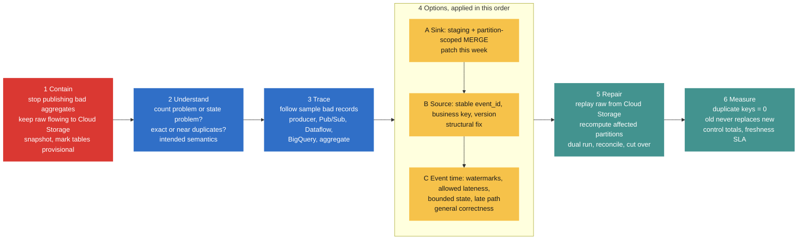

> **Contain.** "Before I change the pipeline I protect the business. I stop publishing the corrupted aggregates to Looker, APIs and finance reports, but I do **not** stop ingestion: raw events keep landing in immutable Cloud Storage. I record the first bad event date and the affected partitions, take table snapshots, mark the affected tables provisional, and keep the corrupted tables for audit.
>
> **Understand.** Two questions decide the whole fix. Is it a **count** problem, the same event counted twice, or a **state** problem, an older event overwriting a newer one? And are the duplicates **exact**, same event ID, or **near**, the same business transaction under different IDs or payloads? Then the intended semantics: at-least-once ingestion, with idempotent writes.
>
> **Trace.** I take a sample of bad records and follow each one through producer, Pub/Sub, Dataflow, staging and canonical table, using event ID, business key, version, event time, ingestion time, Pub/Sub message ID and the Dataflow job. I look at the **whole lateness distribution**, p50, p95, p99, p99.9, not the mean. That tells me whether the duplicates come from producer retries, Pub/Sub redelivery, Dataflow replay, an overlapping backfill, or a non-idempotent write."

**Flow 2. Where the duplicate enters: what to inspect at each layer**

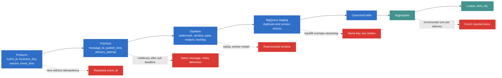

| Layer | What I inspect | Likely cause |
|---|---|---|
| Producer | Repeated `event_id`, retry logs | Retry that mints a new ID, or reuses one with a changed payload |
| Pub/Sub | Message IDs, delivery attempts, ack latency | Redelivery after the ack deadline |
| Dataflow | Worker restarts, watermark, backlog | Replay or duplicate processing |
| Backfill | Date range and job overlap | Streaming and backfill writing the same keys |
| BigQuery | Duplicate keys per partition | Append-only, non-idempotent write |
| Aggregate | Same event counted more than once | Incremental sum on each delivery |

First two queries, on a bounded date range. The second separates identical retries from conflicting duplicates.

```sql
SELECT event_date, event_id, COUNT(*) AS occurrences
FROM `project.analytics.events_raw`
WHERE event_date BETWEEN '2026-11-01' AND '2026-11-07'
GROUP BY event_date, event_id
HAVING COUNT(*) > 1
ORDER BY occurrences DESC;

SELECT event_id,
       COUNT(*) AS rows_received,
       COUNT(DISTINCT payload_hash) AS payload_versions,
       MIN(ingestion_time) AS first_seen,
       MAX(ingestion_time) AS last_seen
FROM `project.analytics.events_raw`
WHERE event_date BETWEEN '2026-11-01' AND '2026-11-07'
GROUP BY event_id
HAVING COUNT(*) > 1;
```

`payload_versions = 1` points at redelivery or replay. `payload_versions > 1` means the source reused an ID or sent updates without version semantics.

**Flow 3. Count versus state: the distinction that picks the fix**

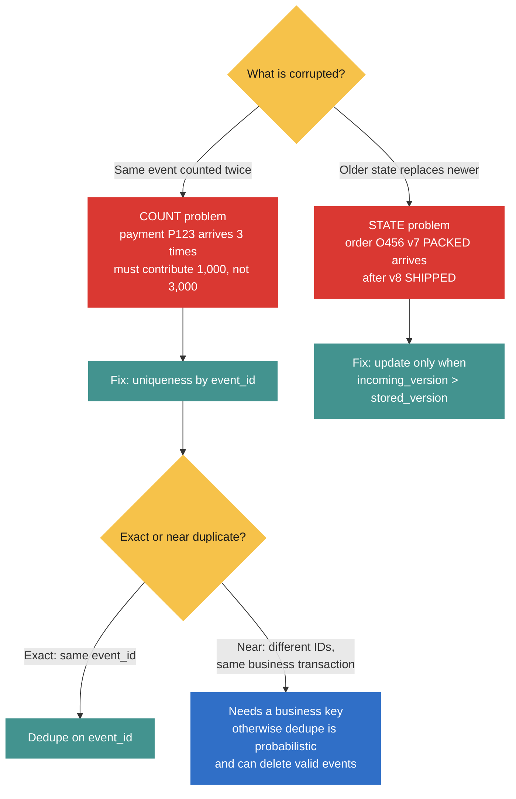

**Event ID prevents double counting. Version or sequence prevents old state replacing new.** A Pub/Sub message ID is not a business key: if a producer publishes the same event twice, Pub/Sub assigns two message IDs. A safe key is `source_system + source_business_id + event_type + version`. If the source has no ID, hash **stable** fields only, never ingestion time, or a replay mints a new key.

> **Options.** "Three, and I'd apply all three, in sequence.
>
> **A, fix at the sink.** Land in BigQuery staging, then a **partition-scoped MERGE** on `event_id` and version into the canonical table. Fast, makes reruns and backfills safe, but it does not stop upstream duplication, history still needs repair, and an unbounded MERGE is expensive at this volume.
>
> **B, fix at the source.** The producer reuses the **same** `event_id` on every retry and sends a business key and a monotonic version. This is the real long-term fix and it needs the upstream team.
>
> **C, event-time semantics.** Deduplication alone does not fix out-of-order data. Dataflow decides on event time and version, not arrival order: event-time timestamps, windows, watermarks, allowed lateness, triggers, keyed state and timers, and a path for very-late events."

**Option A in SQL.** Deduplicate the staging rows *inside* the source first. Without that, BigQuery fails the MERGE with "UPDATE/MERGE must match at most one source row for each target row" whenever staging holds two rows for one key. Filter both sides on the partition column so BigQuery prunes.

```sql
MERGE `project.analytics.events_canonical` AS target
USING (
  SELECT * EXCEPT (rn)
  FROM (
    SELECT *, ROW_NUMBER() OVER (
             PARTITION BY event_id
             ORDER BY event_version DESC, ingestion_time DESC) AS rn
    FROM `project.analytics.events_staging`
    WHERE event_date = @event_date
  )
  WHERE rn = 1
) AS source
ON  target.event_id   = source.event_id
AND target.event_date = source.event_date          -- partition pruning
WHEN MATCHED AND source.event_version > target.event_version THEN
  UPDATE SET event_version = source.event_version,
             event_time    = source.event_time,
             payload       = source.payload,
             ingestion_time = source.ingestion_time
WHEN NOT MATCHED THEN
  INSERT ROW;
```

For append-only events the matched branch does nothing. For mutable events it updates only when the incoming version is newer. The same statement serves streaming, replay and backfill, so the two paths cannot disagree.

**Option C: derive the lateness policy from the data, not from a guess.**

| Percentile | Measured lateness (example) |
|---|---|
| p50 | 20 seconds |
| p95 | 8 minutes |
| p99 | 2 hours |
| p99.9 | 20 hours |

A policy that fits that distribution: early results every 5 minutes, on-time result when the watermark passes the window, corrections for 24 to 48 hours, anything later to a reconciliation table, and a scheduled backfill for older corrections.

| Trade-off | Long allowed lateness | Short allowed lateness |
|---|---|---|
| Upside | More automatic corrections | Lower state and cost, simpler operations |
| Downside | More state, more cost, later finality | More events handled by batch reconciliation |

At 10B+ events a day, keeping every event ID in state for seven days is unaffordable. **Bound the streaming state by the lateness window, and keep the long-horizon uniqueness guarantee in the idempotent sink and the immutable raw layer.**

> **Recommend.** "A for containment this week: quarantine the aggregates, preserve raw, introduce the partition-scoped MERGE so the numbers stop getting worse. B for the structural fix, so retries become safe. C for general correctness, so the pipeline is right for the next source and not just this one.
>
> **Aggregates are built from the canonical deduplicated table, never by adding to a total on each delivery.** A duplicate message adds the amount twice. When late events land, I recompute only the affected windows and MERGE the result on `event_date + store_id + product_id + metric_name`, so a rerun produces the same answer."

**Flow 4. Target architecture on Google Cloud**

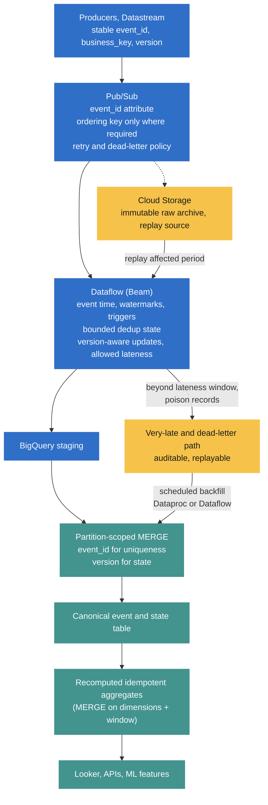

> **Support.** "Pub/Sub is at-least-once, so I never assume a message arrives once. **Cloud Storage** is the immutable raw archive and replay source. **Pub/Sub** carries the event ID as an attribute, uses ordering keys only per entity where order matters, and has a dead-letter policy. **Dataflow** does event-time processing, bounded deduplication, version-aware updates, and routes records past the lateness window to an auditable path. **BigQuery** takes staging, the partition-scoped MERGE, and recomputed aggregates. **Dataproc** handles heavy Spark backfills where that is what already exists. **Cloud Monitoring** watches backlog, watermark lag and freshness, and **Dataplex** gives lineage and quality visibility.
>
> I won't claim end-to-end exactly-once. Pub/Sub exactly-once delivery stops redelivery after an ack, but it does not remove duplicates the producer itself published, and Dataflow's deduplication on an ID attribute is best effort over a bounded window. What I claim is an **effectively-once business outcome**: stable event identity, bounded deduplication, version control and an idempotent write, so any stage can be retried, replayed or reordered without changing the answer."

**Scale check at 10B+ rows a day.**

| Item | Value or check |
|---|---|
| Average rate | About 115,700 events per second |
| Peak | Several times the average, depending on traffic shape: measure it, do not assume it |
| Check | Pub/Sub throughput and key skew, Dataflow CPU, shuffle and state size, watermark lag, hot keys, BigQuery write throughput, staging size, MERGE partition pruning |
| Hot keys | Shard the **processing** key, for example `HASH(event_id) MOD 1000`. The uniqueness rule in the sink still uses the real `event_id` |
| Never | An unbounded MERGE over the whole table. Filter source and target on `event_date` |

**Flow 5. Repair and cut over**

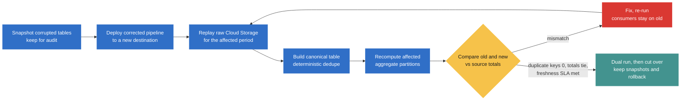

Compare against the source: distinct event IDs, row counts, amounts and quantities, null and schema violations, late-event distribution.

> **What could go wrong.** "Producers can't change: Option B is blocked, and sink-side idempotency becomes **permanent architecture**, so plan and fund it that way. Near duplicates with no reliable business key: deduplication becomes probabilistic and can delete valid events, so I'd quarantine rather than drop. Ordering keys on a hot entity: throttled partition, so order per entity, never globally. Lateness too long: state and cost balloon. Lateness too short: legitimate late events leak out and need frequent reconciliation. Backfill overlapping streaming: both paths must use the same keys and the same MERGE. Business definitions that change retroactively: versioned data contract plus immutable raw data to recompute from.
>
> **How I'd measure it.**"

| Measure | Target |
|---|---|
| Duplicate canonical `event_id` | 0 |
| Older version replacing newer | 0 |
| Source-to-canonical reconciliation | Within the agreed tolerance |
| Aggregate accuracy | Matches control totals |
| Replay determinism | Same input gives the same canonical output |
| Lateness p50, p95, p99, p99.9; watermark lag; Pub/Sub backlog | Tracked and alerted |
| Freshness SLA | Set from measured lateness, for example 99% within one hour |
| Manual corrections and incidents | Trending down |

**90-second version to memorise.** Notation: `//` short pause, `///` long pause.

> "I treat this as a correctness incident before a performance problem. // First I stop publishing the corrupted aggregates but keep every event landing in immutable Cloud Storage. /// Then I establish whether it's a **count** problem or a **state** problem: double-counting needs event uniqueness, older data overwriting newer needs version-aware updates. // And whether duplicates are exact or near.
>
> I trace bad records through producer, Pub/Sub, Dataflow and BigQuery on event ID, business key, version, event time and ingestion time, and I look at the full lateness distribution, not the average. ///
>
> Containment is BigQuery staging and a partition-scoped MERGE on event ID and version, // but that's only the first layer. // Long term, producers reuse a stable event ID on retries, // and Dataflow handles event time, watermarks, allowed lateness and bounded state, // with very-late records going to an auditable path instead of being dropped. ///
>
> Aggregates come from the canonical table, never from message deliveries. // I repair history by replaying raw data and recomputing only the affected partitions. ///
>
> My target isn't a vague exactly-once claim. // It's an **effectively-once business outcome**: duplicate keys at zero, old versions never replacing new, reconcilable aggregates, // and a freshness SLA based on measured lateness."

**Key elements:** Contain first; the **count vs state** distinction; **exact vs near** duplicates; event ID for uniqueness and version for state; idempotency as a property of the write path; **event time vs processing time** with a lateness policy derived from the measured distribution; bounded state plus an idempotent sink; aggregates from the canonical table; recommendation as a sequence with an honest blocker; "effectively-once" instead of a universal exactly-once claim; reconciliation as the measure.

**Pass signal:** You say **"at-least-once ingestion with idempotent writes"** unprompted, separate count from state, and treat idempotency as a *key property* rather than a feature.
**Fail signal:** "Use BigQuery partitioning and clustering" as the answer, since partitioning does not fix duplicate writes. Or claiming end-to-end exactly-once.

**RESOLVED — the honest bridge:** *"In my own production builds I used Kafka's exactly-once semantics and Flink checkpointing. On GCP the equivalents are Pub/Sub exactly-once delivery (a pull-subscription setting that prevents redelivery after ack) plus ordering keys, Dataflow's exactly-once state processing with dedup on a producer-assigned ID, and an idempotent BigQuery sink (Storage Write API offsets or `MERGE`). I have built those in lab exercises — the Pub/Sub dead-letter path, the ordering-key throughput planning, and the Dataflow watermark and late-data path — not yet at production scale on GCP."* **Say the last clause only if it is literally true on the day: run the labs end to end before the interview, or drop the sentence.** The labs are `GCP_DATA_ENGINEERING_COURSE/chapters/17-pubsub.md` (Lab 4 verifies the at-least-once dedup contract end to end; Lab 5 is the DLQ reason-code contract; Lab 6 is ordering-key throughput planning) and `chapters/22-apache-beam-and-dataflow.md` (Exercise 4 is the watermark and late-data path).

---

### Q7. "How do you design a data platform for a customer who has 2,000 pipelines across five lines of business, a regulatory data-residency requirement, and an 8-month deadline?"

**Framework:** Reduce the problem → Inventory and classify → Options (A, B, C) → Recommend waves + a stabilisation lane → Platform vs domain split → Residency as a boundary → 8-month plan → Define "done" → Measure

**The line to memorise:** "**Don't migrate 2,000 pipelines. Classify them, retire what shouldn't exist, build a golden path, and migrate business domains in waves.**"

**Opening move:** "I would not start by designing the GCP architecture. First I'd **reduce the problem**."

**Flow 1. The whole answer on one page**

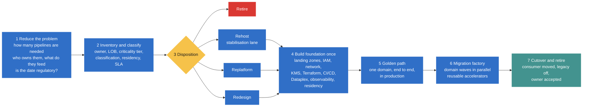

> **Reduce.** "With 2,000 pipelines across five lines of business I first want to know how many are genuinely required, who owns each, which business product it supports, how critical it is, and which can be retired. Then the **residency** requirement, precisely: which jurisdiction, does it apply to all data or only classes like PII and payment data, and does it cover backups, logs, metadata, encryption keys and disaster recovery? And whether eight months is a **regulatory date** or a board preference, because if the date cannot move, scope and strategy have to bend around it. **The question that decides the schedule is who has authority to retire a pipeline.**"

**1. Inventory before migration.** The inventory is the first deliverable, not a discovery exercise, because you cannot sequence 2,000 pipelines you have not classified.

```
Pipeline
├── Business owner          ├── Criticality: Tier 0 / 1 / 2
├── LOB / domain            ├── Batch / streaming / CDC
├── Source                  ├── Data classification
├── Target and consumers    ├── Residency boundary
├── SLA                     ├── Current technology
└── Migration pattern  →  Retire | Rehost | Replatform | Redesign
```

Classifying first stops you spending eight months faithfully migrating things nobody uses.

**Flow 2. The three options, and why waves win**

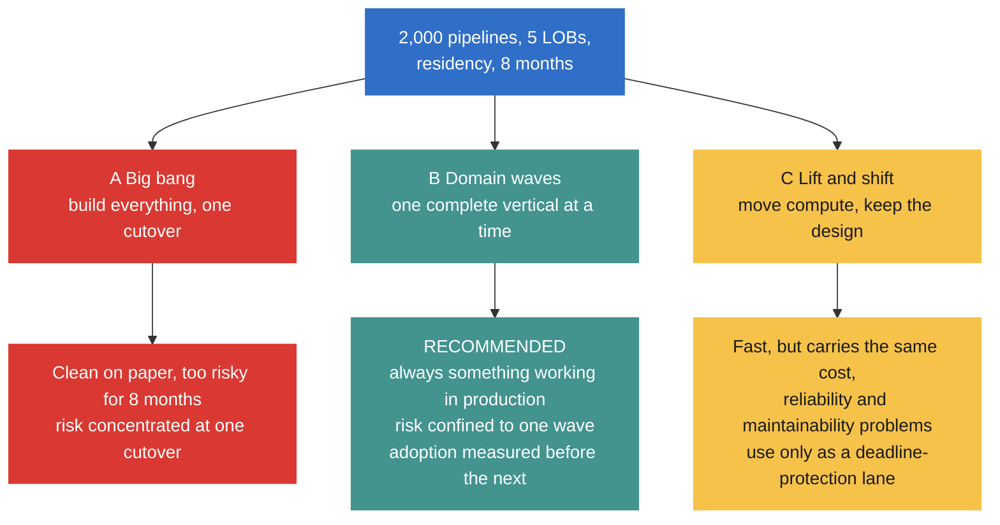

> **Options and recommendation.** "A, big bang: theoretically clean, too risky, and it will not land in eight months. B, **domain-aligned waves**: each wave is a complete production vertical from source through processing into BigQuery to a named business consumer, proven before the next starts. C, lift and shift: fast, but it imports today's cost and reliability problems into GCP. I recommend **B**, because it makes the operating model, not the pipeline, the unit of delivery. And I'd run **C as an explicit stabilisation lane** for workloads we cannot realistically redesign before the deadline: move them with minimal change, modernise later. That protects the date without pretending the mess is solved."

**Flow 3. Platform control plane versus domain-owned data products (the federated model)**

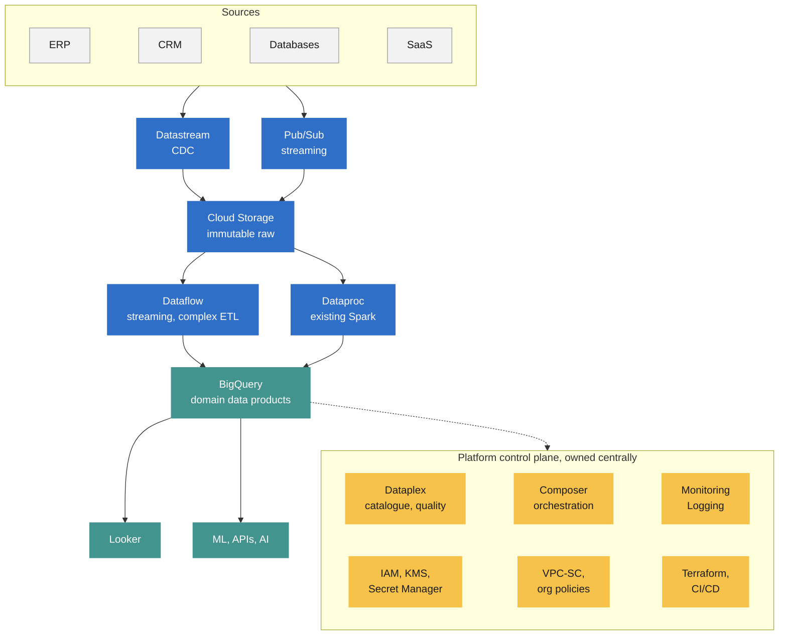

| Central platform team owns | Domains own |
|---|---|
| IAM patterns, networking, encryption | Business definitions |
| Terraform modules, CI/CD templates | Transformation logic |
| Observability, residency controls, guardrails | Data quality and SLAs |
| Reference architectures | The data products and their consumers |

"I wouldn't let each line of business design its own GCP platform. The platform team builds the foundation once, and domains build on the golden path."

**Flow 4. Residency is an architectural boundary, not a BigQuery setting**

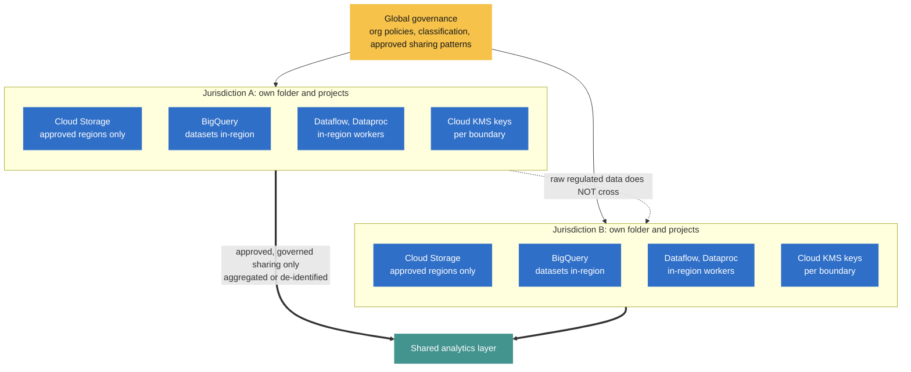

Enforced with: separate folders and projects per jurisdiction; resource-location **organisation policies** so drift is blocked, not just detected; IAM; **VPC Service Controls**; Cloud KMS keys per boundary (CMEK where required); private connectivity; dataset and bucket locations; audit logs; classification through policy tags. **I would not let one logical dataset span jurisdictions, because every query then becomes a residency question.** And I'd explicitly **test backups, DR, logs, metadata and key location**, since residency does not end at the primary BigQuery dataset.

**Flow 5. The 8-month plan: discovery and foundation in parallel, not in series**

```mermaid
flowchart LR
    subgraph M1["Month 0 to 1: discover and build, in parallel"]
        direction TB
        M1a["Inventory 2,000 pipelines<br/>classify: retire, rehost,<br/>replatform, redesign"]
        M1b["Foundation: landing zones, IAM,<br/>network, residency controls, KMS,<br/>Terraform, CI/CD, monitoring, Dataplex"]
    end
    subgraph M2["Month 2: golden path"]
        direction TB
        M2a["One representative domain,<br/>source to consumer to<br/>production support"]
    end
    subgraph M3["Months 3 to 6: migration factory"]
        direction TB
        M3a["Wave 1: critical domain"]
        M3b["Wave 2: finance"]
        M3c["Wave 3: customer"]
        M3d["Wave 4: supply chain<br/>reusable accelerators:<br/>Terraform modules, Dataflow templates,<br/>Composer DAG templates, DQ templates,<br/>validation framework"]
    end
    subgraph M4["Months 7 to 8: cutover and retire"]
        direction TB
        M4a["Consumers moved, reconciled,<br/>SLA met, owner accepted,<br/>legacy off, cost removed"]
    end
    M1 --> M2 --> M3 --> M4
    classDef blue fill:#306FC7,stroke:#306FC7,color:#fff
    classDef yellow fill:#F6C24A,stroke:#F6C24A,color:#1a1a1a
    classDef green fill:#43938F,stroke:#43938F,color:#fff
    class M1a,M1b,M3a,M3b,M3c,M3d blue
    class M2a yellow
    class M4a green
```

| Phase | What happens | Why |
|---|---|---|
| Month 0 to 1 | Inventory and classification run **alongside** the foundation build | Two months of discovery before any engineering burns a quarter of the schedule |
| Month 2 | **Golden path**: one domain, end to end through quality, security, Looker, monitoring and production support | It becomes the reference implementation every later wave copies |
| Months 3 to 6 | **Migration factory**: parallel waves with reusable accelerators | You are not hand-building 2,000 migrations; you are running a factory |
| Months 7 to 8 | Cutover and retirement | The project is not finished when pipelines run in GCP |

**Flow 6. The definition of "done" (the strongest leadership signal in this answer)**


"'Two thousand pipelines exist in GCP' is not done. **Consumer moved, legacy off** is done."

> **What I'd measure.** "Not percentage of pipelines migrated as the executive KPI. A pipeline can be migrated and still be unused."

| Group | Measures |
|---|---|
| Migration | Migrated, validated, cut over, **retired** |
| Business | Domains live, named consumers adopted, time to first value, critical data products migrated |
| Operations | Incidents, MTTR, freshness and SLA attainment, deployment frequency, data-quality failures |
| Economics | Cost per pipeline, cost per TB, BigQuery consumption, legacy infrastructure retired |
| Regulatory | **Residency violations = zero** |

> **What could go wrong.** "The likeliest failure is not technical: a wave is complete by pipeline count but nobody uses the outputs, so the platform changes nothing about a decision. Second, ownership sits with teams that have no incentive to retire anything, so the count never falls. So I make **retirement a funded deliverable in each wave**, with the business owner named, and I track adopters and retired pipelines as first-class KPIs. Third, the stabilisation lane quietly becomes permanent, so every lane-C workload gets a modernise-by date and an owner."

**Spoken answer (about 2 minutes).** Notation: `//` short pause, `///` long pause, **bold** = stress.

> "I wouldn't treat 2,000 pipelines as 2,000 migration tasks. // I'd treat them as a **portfolio that needs classifying first**. ///
>
> I'd identify the business owner, consumer, criticality, residency class and disposition of every pipeline: // retire, rehost, replatform or redesign. // And I'd clarify the residency rule and whether eight months is a regulatory date. ///
>
> I wouldn't recommend a big bang. // I'd use **domain-aligned waves**, where each wave is a complete production vertical, // source through Dataflow or Dataproc into BigQuery to a named business consumer. // And I'd build the common foundation **once**: IAM, networking, Terraform, CI/CD, Dataplex, observability and residency controls, // so domains build on a golden path instead of inventing their own platform. ///
>
> Residency is a **structural boundary**. // Separate projects and locations per jurisdiction, // organisation policies that block drift, // VPC Service Controls and IAM around sensitive data, // keys managed in Cloud KMS, // and data crossing only through approved patterns. ///
>
> I'd keep a **stabilisation lane** for workloads that can't be redesigned before the deadline, // moved with minimal change and modernised later. ///
>
> And migration isn't complete when a pipeline runs in GCP. // It's complete when the **consumer has moved, reconciliation passes, the SLA is met, and the legacy pipeline is switched off**. // So my executive dashboard shows adoption and retirement, not just migration count."

**Likely follow-ups**

| Probe | 20-second answer |
|---|---|
| "Who decides what gets retired?" | "That is the question that sets the schedule. I get a named business owner per pipeline and a decision rule: no consumer in 90 days and no regulatory duty means retire, with a sign-off, not a quiet deletion." |
| "How do five LOBs agree on one platform?" | "Federated: the platform team owns guardrails and the golden path, domains own definitions, quality and SLAs. Standards are the paved road, not a gate." |
| "Why not Dataflow for everything?" | "Rewriting working Spark because Dataflow is newer is a cost with no business outcome. Existing Spark goes to Dataproc, streaming and new pipelines go to Dataflow, and I choose per workload on measured need." |
| "What if the deadline is regulatory and the scope doesn't fit?" | "Then scope bends, not the date. Tier 0 and regulated data go first, the stabilisation lane takes the rest, and I put the trade-off in front of the sponsor with the named risk owner." |
| "How do you stop quality regressing across 2,000 migrations?" | "A migration validation framework that every wave uses: row counts, aggregates, key checks, freshness and consumer KPIs, with dual run for Tier 0 and 1 before cutover." |
| "How do you prove residency?" | "Org policies block non-approved locations, audit logs show where data sits, and I test backups, DR, logs, metadata and key location, not just the primary dataset." |

**Key elements:** The 2,000-pipeline problem is solved by **classification and wave sequencing, not by platform choice**; retirement is a funded deliverable; the domain vertical slice is the unit of delivery; central control plane with domain-owned products; residency is a *structural* constraint, not a config toggle; discovery and foundation run in parallel; "done" means consumer moved and legacy off; adoption tracked as a KPI.

**Pass signal:** You talk about **retiring** pipelines and **operating-model adoption** before the interviewer raises them, and you define done as consumer moved and legacy off.
**Fail signal:** A BigQuery/Dataflow component list with no sequencing logic and no mention of who owns the change.

---

### Q8. "A pipeline fails 40% of the time and the team is firefighting. What do you do in the first week?"

**Framework:** Stabilise → Diagnose → Fix the class → Prevent recurrence

> "**First, stop the bleeding, then find the class.** In week one I want three things, not a platform migration.
>
> **One — triage by severity, not by who is shouting.** I'll split into: data loss or wrong numbers reaching a customer (stop it now, by disabling the affected output or pinning to the last known-good), jobs failing but safely (let them fail, fix in order), and jobs failing noisily. I will not let the team spend week one on the noisiest jobs.
>
> **Two — find out how many distinct root causes there are.** A 40% failure rate is usually 5–8 root causes with a long tail, not 40 problems. I'll group the failures by signature and get the top three to cover most volume. If it's one shared dependency — a flaky source, a memory limit, a schema change upstream — then it isn't 40 problems, it's one problem with 40 symptoms, and that insight is often worth the whole week.
>
> **Three — make the failures legible.** Right now the team is firefighting, which usually means failures arrive as pager noise and get fixed reactively. I'd want the failure mode on the dashboard: which jobs, which error class, what changed, since when, and what's the business impact. I'd also check the single most common cause of pipeline failures in practice — an unhandled upstream schema change — and check whether this estate has any contract or schema-registry discipline at all.
>
> **Then fix the class, not the instance.** For each of the top root causes: one of *make it retry-safe*, *make it idempotent*, *make it fail fast and route to a dead-letter path*, or *remove the dependency*. I want a named owner and a date per root cause, and I'd review daily against that list.
>
> **What I'd avoid:** the temptation to introduce a new orchestration platform in week one. That reads as action but changes the failure surface while the team is already overloaded. The first win should be **fewer surprises**, and I'll get there by making existing behaviour visible and the top causes survivable.
>
> **How I'd measure it:** failure rate by root cause, mean time to detect, mean time to resolve, and — the one that matters — the number of pages that reach a human overnight. That last one is usually the real definition of 'firefighting'."

**Key elements:** Triage by severity; root-cause *classing* not instance-fixing; data loss first; dead-letter path; explicit avoidance of a big platform change in week one; a metric that reflects the pain ("pages reaching a human overnight").

**Pass signal:** You find the class before the instance and you refuse to add a platform in week one.
**Fail signal:** "I would introduce Airflow/Databricks and add monitoring" — changes surface area while overloaded.

**STILL NEEDS PREM** — this maps directly to your real "incidents −60%". The answer *structure* is drafted above (triage by severity → root-cause classing → dead-letter path → refuse a platform change in week one → measure pages-reaching-a-human). Supply the **actual baseline count**, **what the top root causes turned out to be**, and **the specific mechanism that took it down 60%**. See `ROUND_1_RRK_GAP_CLOSURE.md` §6 for the full list of the **9 items** that still need your own memory (this is Q8 of the 9; the other eight still carry a literal `[TODO]` marker).

---

### Q9. "Your team ships a data product that silently produces wrong numbers. How do you handle it — technically and organisationally?"

**Framework:** Contain → Communicate → Root cause → Systemic fix → Trust

> "**Contain first, and contain honestly.** I stop the wrong data reaching consumers — that's a freshness cut-off or a revert to last known-good — and then I tell people immediately. The instinct to hide it while you fix it is the wrong move, because the trust cost lands later and harder, and because the consumers of a wrong number may have already made a decision with it.
>
> **Then find out how it went undetected.** That's the real question. If a wrong number reached a dashboard, the failure was either in the data or in the detection. Usually it's detection — no reconciliation, no assertion on row counts or value distributions, no alert on schema drift. A silent wrong answer means the pipeline succeeded, and success is not correctness.
>
> **The fix has two halves, and I insist on both.** *Technical:* assertions on row counts, null rates, value ranges, referential integrity and schema at every boundary; reconciliation against a source of truth; freshness and volume monitoring as first-class signals; and a data contract with the producer so upstream changes are visible before they land. *Organisational:* a published definition of who owns correctness for each data product, and a channel where consumers report suspect numbers that's treated as a defect report, not a complaint.
>
> **On recovery:** I'll do a full reprocess from a known-good checkpoint, then verify with reconciliation rather than spot checks, and I'll publish what was wrong, for how long, who was affected and what changed — including the thing I missed that let it through.
>
> **The organisational point:** data quality is not a pipeline problem, it's a contract between producer and consumer. Once teams own the correctness of data products rather than the health of jobs, the class of problem shrinks."

**Key elements:** Contain + *honest* communication; detection failure is the real story; technical + organisational halves; reconciliation not spot-checks; data contracts; consumer feedback as a defect channel.

**Pass signal:** You identify that "the pipeline succeeded" is exactly why it was silent.
**Fail signal:** Treating it as only a data pipeline bug, or saying you'd communicate only after you understand the cause.

---

### Q10. "Where do you draw the line between BigQuery, Dataproc and Bigtable?"

**Framework:** Workload-shaped decision, with the deciding question first

> "The deciding question is always **what shape is the workload and what does the consumer need** — not which product is best. So:
>
> **BigQuery** when the workload is analytical: large scans, joins, aggregations, and the consumer is SQL. Serverless, managed, and you pay for the scan and the warehouse; it also has no operational burden, which matters for a team that shouldn't be running clusters.
>
> **Dataproc** when Spark is genuinely the right tool — heavy ETL that needs custom Scala/Python at scale, ML workloads on Spark, iterative algorithms that don't fit a SQL model, and importantly when you want to *keep your existing Spark investment and skills*. Its counterweight is that it is a platform you operate: clusters, autoscaling, job lifecycle, and someone on call.
>
> **Bigtable** when the access pattern is **random, low-latency key lookups at high request rates** — not scans. It's the serving store for a high-volume operational or serving workload, and it's where HBase-style semantics, strong consistency and predictable low-latency at scale come from.
>
> **The trap I'd warn an architect about** is using BigQuery as a serving database, or putting a random-access serving pattern on it because it was already there. That's how you end up with a warehouse carrying an application workload and an unpredictable bill. Second trap: standardising on one product for everything because 'simplicity' actually means you now have a tuning and capacity problem of a different shape.
>
> My default rule: **start serverless and move to Dataproc only when a measured constraint forces it.** The cost of moving to Dataproc later is low. The cost of running Spark clusters for two years for workloads that never needed them is high."

**Key elements:** Decision is driven by **access pattern and consumer**, not preference; each product has an honest downside; you name the anti-patterns; you state a **default direction of travel** (serverless-first) which is a real architectural stance.

**Pass signal:** You lead with the workload shape and can state when you would *move off* BigQuery.
**Fail signal:** A feature comparison, or "it depends" with no default.

---

### Q11. "When would you use Dataflow over Dataproc, and what would make you choose Spark anyway?"

**Framework:** Trade-off, then the forcing conditions

> "Dataflow is the streaming-first, serverless, managed choice. It gives me exactly-once state processing, windowing with explicit lateness semantics, and no cluster to operate — which for an enterprise team that doesn't want a platform on call is a real advantage. I reach for it when the work is continuous, event-driven, and stateful.
>
> **Spark still wins when:** the work is genuinely batch and iterative — graph algorithms, large feature engineering that doesn't fit a SQL model, or ML training that wants the Spark ecosystem. It also wins when there is **existing Spark investment and team fluency**: rewriting a working Spark estate to Dataflow costs real money and real time, and 'we standardised on Dataflow' is not a justification.
>
> **The decision I'd actually make in a customer engagement:** run the migration on **two tracks** — move streaming and continuous workloads to Dataflow, move batch Spark work to Dataproc, and unify them under a single lakehouse contract and orchestration layer (Dataform/Composer, with Dataplex managing the catalogue). That gives a consistent developer contract without forcing a single runtime.
>
> **One more thing I'd check:** whether the workload is actually streaming. A lot of 'streaming' pipelines are micro-batch in disguise, running every five minutes. If the freshness requirement is fifteen minutes and not seconds, Dataproc or BigQuery scheduled queries is simpler and cheaper, and I'd rather tell the customer that than over-engineer."

**Key elements:** Serverless/managed advantage vs ecosystem advantage; the two-track recommendation; **questioning the premise** ("is this actually streaming?").

**Pass signal:** You challenge the streaming requirement with a freshness SLA test.
**Fail signal:** Declaring a winner without conditions.

---

### Q12. "A client's data platform costs $4M a year. Where do you look first for savings — and how do you make savings that stick?"

**Framework:** Find the cost driver → Fix in order → Make it stick

> "**I start with where the money actually is, and I get that from the bill, not from assumptions.** The first cut of analysis is cost by service, by team, by environment and by job — because in most estates a small number of workloads account for most of the spend.
>
> **In order, the levers I pull:**
> **One — partition and cluster.** In BigQuery, the difference between a well-partitioned table and an unpartitioned one is often an order of magnitude on the same query. This is free money and it's almost always pure waste today. **Two — query discipline.** A query that scans a partition it doesn't need, or runs on a schedule when nobody reads the output, is the most common waste pattern I see. **Three — capacity model and storage tiering.** Move steady BigQuery workloads from on-demand to reservations (Editions) with separate reservations for ETL vs BI, and put `maximum_bytes_billed` guards on ad hoc work. For storage, use Cloud Storage lifecycle rules or Autoclass to move cold data to Nearline/Coldline/Archive based on measured access, remembering that GCS has no rehydration delay but does charge retrieval fees and minimum storage durations, so the threshold is a cost calculation, not a guess. **Four — idle resource elimination.** Always-on clusters, idle VMs, unattached disks, and a stream that keeps a pipeline alive for a subscriber that no longer exists. **Five — SLAs matched to value.** Not every pipeline needs to run every five minutes; a tiering of freshness SLAs by business criticality is often the largest single saving.
>
> **On making it stick** — this is the part most engagements get wrong. Savings evaporate because the thing you optimised becomes someone's new normal and nobody owns it. So: I embed the optimisation in the **data contract and the pipeline template**, not in a one-off script. I add cost to the **quality and governance gates** so a scan-bloat regression fails the build. I put cost per data product on the **QBR dashboard** next to adoption, so cost is discussed in the same meeting as value. And I make sure the team that benefits from the saving keeps the benefit — if my change reduces their compute bill and they don't own that budget, I've created a perverse incentive.
>
> **One caution.** I would not chase headline savings by tightening SLAs the business actually depends on. A 40% cost reduction that makes the business wait an extra day is not a saving, it's a deferral of cost into someone's operational pain. I want savings that show up in the P&L *and* survive contact with the users."

**Key elements:** Bill-first, ordered levers, **the governance work that makes savings stick** (gates, dashboards, incentives), and the explicit distinction between real saving and deferred cost.

**Pass signal:** The "make it stick" half — ownership, gates, dashboards, incentives — most candidates skip this entirely.
**Fail signal:** A list of tips. Or a saving that degrades an SLA with no acknowledgment.

**RESOLVED against your current resume.** Your resume carries **no** cost-reduction percentage at any employer. The "−40% AWS/Databricks cost" and "−60% DBT/Spark runtime" figures came from a stale facts file and are not on the document the interviewer holds. See `ROUND_1_RRK_GAP_CLOSURE.md` §4.

What that means for this answer:
- You are free to describe the **mechanism** of cost work at Makro (partitioning and clustering corrected across the estate, data contracts, cost attribution per job and team, FinOps ownership, Databricks cluster policies) without a headline percentage.
- If you want to quote a percentage, it must be one you can defend with **baseline, measurement window and what else changed**. State it as "roughly" and offer the baseline unprompted. A number that is not on the resume and cannot be defended is worse than no number.
- Do **not** attach any figure from a role that is not on the resume to Makro.

The strong form of this answer is the method, not the percentage: show the cost-per-job view, the three biggest levers you pulled, and the guardrail that stopped it coming back.

---

### Q13. "How do you handle data residency and regulatory requirements across Singapore, Thailand and Vietnam?"

**Framework:** Model the boundary → Controls → Evidence → Operating discipline

> "I treat residency and regulation as **architecture constraints**, not policies to apply after the fact. The discipline I use: if the constraint isn't expressed as a structural boundary, it will be violated eventually by someone in a hurry.
>
> **Structurally:** separate projects per jurisdiction, with **org policies** — resource location, service-account key restrictions — so that a mis-placed resource is blocked rather than detected. I would not allow a single logical dataset to span jurisdictions, because the moment it does, every query becomes a residency question and the answer becomes 'it depends on the data'.
>
> **Classification before protection.** You cannot apply masking without knowing what's sensitive, so I start with taxonomy: what classes of data exist, which are regulated under PDPA in Singapore, PDPA in Thailand, GDPR where it applies, and MAS TRM expectations for Singapore financial institutions. Those classifications become **policy tags in Dataplex** and flow into BigQuery column-level security and dynamic masking, so protection is applied by classification rather than by a developer remembering.
>
> **Cross-boundary flow** is the real design question. I define approved paths explicitly — which flows, which legal basis, which controls — rather than relying on network reachability. **VPC Service Controls** provides the perimeter for the most sensitive sets, and **CMEK** with a per-jurisdiction key hierarchy gives both residency evidence and customer-controlled destruction.
>
> **Evidence is the deliverable.** In regulated programmes the regulator asks for proof, not assurance. So controls map to named requirements, each with an artefact — a policy, a log, a scan result, an approval record. I've done this for MAS TRM at SCB across AML for 15+ countries, so I know the evidence discipline, not just the controls.
>
> **Country crib (verify with counsel before quoting as legal advice):** Singapore PDPA has no blanket localisation rule but imposes a transfer-limitation obligation (comparable protection abroad), and MAS outsourcing/TRM expectations apply to financial institutions. Thailand PDPA restricts cross-border transfer to destinations with adequate protection or via approved safeguards. Vietnam is the strictest of the three: Decree 13 (personal data protection) requires a transfer impact assessment, and the Cybersecurity Law/Decree 53 can require certain data to be stored locally. Say "the strictest regime sets the design baseline" and keep the exact legal reading with the client's counsel.
>
> **And the honest limitation:** no architecture makes a residency question disappear. If the client's business model genuinely requires data to move, I say so early and design the controls and the legal basis around it — rather than discovering it in month seven."

**Key elements:** Boundary as structure; classification-driven protection; **explicit approved cross-boundary paths**; evidence mapping to named requirements; honesty about when the constraint conflicts with the business.

**Pass signal:** You treat residency as a design input that constrains topology, not a checkbox.
**Fail signal:** "We keep that data in Singapore" with no controls, no evidence, no view on cross-border flow.

[TODO: your SCB AML work across 15+ countries and your PDPA/GDPR work at Makro are the real evidence here — pull the specific artefact you produced (control map, evidence pack, classification taxonomy) so you can point to a physical thing you built.]

---

### Q14. "How do you test a data pipeline? What do you actually assert?"

**Framework:** Test the contract, not the code

> "I test in layers, and the layer people skip is the one that matters most.
>
> **Unit:** pure transformation logic — a function that computes an order's tax should have cases for every jurisdiction, edge, and boundary. These are fast and they're where the business rules live.
>
> **Contract:** does the producer's schema match what the consumer expects? This is where schema evolution breaks things. I assert compatibility on every boundary — added optional column, widened type, new enum value — and I make an incompatible change *fail* rather than silently coerce.
>
> **Data quality:** not unit tests, but assertions in the pipeline — row counts within tolerance against a source of truth, null rates, uniqueness on the declared key, referential integrity, value ranges, freshness, and distribution checks that catch a truncated or duplicated load. A pipeline that has these as **gates** fails rather than publishing bad data.
>
> **Integration:** does the whole path work end to end, including the parts that talk to real systems.
>
> **What I'd add that most teams miss:** a **reconciliation test** against an independently computed control total, and a **restartability test** — kill the job mid-run and confirm it resumes correctly and produces identical output. And an **idempotency test**: run the same input twice and assert the output is unchanged. Those three catch the failures that actually happen in production and that unit tests never will.
>
> **And the test data question:** you don't need production data to test correctness, but you do need realistic *shape*. I'll use synthetic data with the right distributions and edge cases, and I'll use real data only where the shape itself is the risk — and then masked, with access logged, under the same controls as production."

**Key elements:** Layers with a **contract** layer people omit; quality gates that *fail* rather than warn; the three high-value tests most teams miss (**reconciliation, restartability, idempotency**); masked synthetic data.

**Pass signal:** You mention restartability and idempotency tests — these are rare and directly relevant to the brief's "restartability" language.
**Fail signal:** "We unit test the transformations and monitor in production."

---

### Q15. "Reviewing code: [DATA PROCESSING SNIPPET]"

**How to run the review.** Don't start at line 1. Work in this order and say your order out loud:
1. **Correctness** — what does this compute, and is that what it's supposed to compute? Look for wrong boundaries, off-by-one, timezone/precision, null handling, division by zero.
2. **Idempotency & restart** — if I run this twice, does it produce the same result? Can I restart it after a partial failure?
3. **Scale** — what happens at 100× the input? Where's the per-row work, the memory growth, the N+1?
4. **Data semantics** — late events, duplicate handling, ordering keys, schema evolution.
5. **Security of the write path** — is anything unvalidated reaching the sink? PII in logs?
6. **Maintainability** — can the next engineer read this and change it safely?

**What interviewers listen for:** you find the *semantic* bugs (a `join` that fans out on a non-unique key; a `dropDuplicates` without an ordering rule; a `MERGE` without a match condition) rather than style nits. You flag the *design* issue, not just the line — e.g. "this is a full-table scan per partition because the join isn't pushed down," not "this line is long."

**The sentence that signals seniority:** *"The line is probably correct. The risk is that it's correct only if the upstream guarantees exactly-once delivery, and nothing in this code enforces that assumption — so I'd make the write idempotent and explicit about which guarantee it relies on."*

**RESOLVED — see `ROUND_1_RRK_CODE_REVIEW_DRILL.md`**, which contains the six-pass review order and **16 verified findings** in the target file.

**Two corrections to the original note:** (1) `dataflow_batch_pipeline.py` is **not** in the course project — it is at `INTERVIEW_PREP/ROUND_2_TECHNICAL/code/dataflow_batch_pipeline.py`. `pipeline_logic.py` *is* in the course project (`GCP_DATA_ENGINEERING_COURSE/project/core/`). (2) **Lead with F3** — `datetime > date` raises `TypeError` on *every* record, and the broad `except Exception` swallows it, so every valid record is dead-lettered. It is the deepest finding and it shows you read past the happy path. Then **F5** (`WRITE_APPEND` with no dedupe key — re-running duplicates every row) and **F7** (the dead-letter path is tagged and logged but **never persisted** — a silent data-loss path).

Also run three timed rehearsals: two on this file, one on an **unfamiliar** snippet. Reading code you wrote is a different skill from reading code you have never seen.

---

## 🤝 Part C — Consulting, Executive Influence & Stakeholder Management

### Q16. "You're 8 weeks into a transformation programme and it's off track. What do you do in the first 72 hours?"

**Framework:** Stabilise → Diagnose → Re-plan → Communicate

> "**72 hours is for stabilising and diagnosing, not for fixing.** Fixing before you understand is how a programme loses another month.
>
> **Hours 0–12: establish the facts.** What is actually behind? I'll look for four things, because 'off track' is a symptom with four common causes: the *scope* grew or the *timeline* was never real; the *decision rights* aren't where we think they are, so we're waiting on someone who didn't know they had to decide; there's a *technical* blocker nobody owns; or the *value* was never agreed, so no one is fighting for it. I'd get the programme's own artefacts — plan, RAID log, decisions log, delivery dashboard — and talk to the people closest to the work, not the steering committee. The steering committee tells you what they think is happening; the delivery team tells you what is happening.
>
> **Hours 12–36: a small number of targeted conversations** with the programme sponsor, the key workstream owners, and whoever holds the decisions that are actually stuck. I'm not convening a big workshop — that's usually an escalation and it burns goodwill. I want to know what each of them believes is happening, because where their accounts differ, that's your diagnosis.
>
> **Hours 36–72: write down the diagnosis and make one decision.** The output of 72 hours is a one-page written position: what we believe is happening, the three things we will change, what we will explicitly *not* do, and what we need from whom by when. Then I take it to the sponsor and get agreement on the revised path.
>
> **Two things I'll be careful about.** I don't relitigate the plan in the first 72 hours — that reads as panic and it burns the team's trust. And I don't hide the bad news; I frame it as *here is the decision I need from you by Thursday*, which keeps the sponsor in the solution rather than in the blame.
>
> **And one thing I'll insist on:** name the possibility that the scope or the date has to change. Sometimes the honest move is a smaller programme that lands, not a full one that doesn't. I would rather negotiate that in week two than discover it in month six."

**Key elements:** 72 hours is for *diagnosis*, not fixing; four distinct root causes of "off track"; talk to delivery not the steering committee; written one-page output; "what I need from you by when" framing; willingness to reduce scope; explicit avoidance of a panic workshop.

**Pass signal:** You diagnose *before* you act and you distinguish programme failure from technical failure.
**Fail signal:** "I would call a meeting and re-plan" with no diagnostic structure.

---

### Q17. "Your executive sponsor wants a solution. You think it's wrong. What do you do?"

**Framework:** Understand the underlying goal → Separate goal from preference → Evidence → Prescribe → Respect the decision

> "The first thing I do is figure out whether they're attached to the *solution* or to the *outcome*. Executives are usually protecting an outcome — a date, a regulatory commitment, a budget, a stakeholder promise — and the solution is their current best model of how to get it. If I can find the outcome, I can have a real conversation, and often the executive will drop the preferred solution themselves once the constraint is named.
>
> **So I separate the goal from the preference explicitly.** "What must be true for this to work?" "Which of these is non-negotiable — the date, the scope, the cost ceiling, or the architecture?" Once the non-negotiable is named, the question becomes a genuine engineering or sequencing problem, and that's where I can help rather than oppose.
>
> **Then I bring evidence, not argument.** I want to make the cost of the preferred path concrete: a small proof of the risk, a benchmark, a failure mode from an analogous system. One number that can't be argued with — a measured latency, a realistic capacity ceiling, a cost estimate from actual usage — moves an executive conversation far more than a confident opinion. And I put it in writing, framed as "here's what happens on this path, and here's what I'd do instead."
>
> **Then I respect the decision.** If, having seen the evidence, the sponsor still wants their path, I say so plainly, I document the risk, I name the conditions under which it works, and I execute well. My obligation is to make the risk visible and my recommendation clear — not to win. The day I start covertly sabotaging a decision I've made is the day I've stopped being a leader.
>
> **One thing I'd add.** I make sure the sponsor also knows what I *need from them* to succeed on my path — a decision, a resource, a priority. My recommendations usually ask something of the sponsor too, and saying so keeps it a collaboration rather than a fight."

**Key elements:** Outcome vs preference; naming the non-negotiable; evidence over argument; respect the decision; document the risk; and the escalation-to-colleague line ("I've made the risk visible, I execute").

**Pass signal:** "I document the risk and execute well" — what separates a leader from a consultant who needs to be right.
**Fail signal:** Talking about convincing them to see it your way, with no acceptance of their authority.

---

### Q18. "How do you align three stakeholders who each want different things from the same data platform?"

**Framework:** Map interests → Find the overlap → Make trade-offs explicit → Decide the mechanism

> "I start by separating **interests from positions**, because people defend positions but interests are negotiable. The CFO wants cost predictability and will fight anything that looks like open-ended spend. The Chief Data Officer wants the platform to be genuinely strategic and will fight anything that makes the data team a service desk. The business unit wants their data *now* and will fight anything that doesn't serve them. Those are positions. Underneath: the CFO wants to be able to forecast and be accountable; the CDO wants the team respected and resourced; the business unit wants to be unblocked and to be the customer.
>
> **Then I look for the overlap that is genuinely available.** Usually there is one, and it's real: all three benefit from a platform where the cost of serving a new data product is predictable, and where the business unit can self-serve. If I can show that a well-governed platform *reduces* the CDO's support burden while giving the business unit speed, then the CDO and the business unit aren't actually in conflict — they're both better off with a different mechanism.
>
> **Then I make the trade-off explicit and recommend.** For example: I'd recommend a **tiered service model** — a self-serve path with published SLAs and cost transparency for the business unit, a curated path for the CDO's high-criticality products with stronger controls, and a monthly cost view that gives the CFO a forecast. One platform, three deliberately different entry points.
>
> **Then the mechanism matters more than the alignment.** Alignment that depends on everyone being in the same room decays the moment that room empties. So I convert agreement into: a decision-rights record (who decides what), a governance forum with a stated cadence and a real escalation path, and explicit metrics that each of them is accountable for. I also make sure the business unit's voice is structurally in the room — because the platform exists for them, and a platform designed without the consumer's constraint becomes a platform nobody adopts.
>
> **And my honest caveat:** if the interests genuinely cannot be reconciled, I don't force false consensus. I take the trade-off to the decision owner, make the cost of each path explicit, and let them decide — with the consequence written down."

**Key elements:** Interests vs positions; finding the *real* overlap; a concrete mechanism (tiered service); **alignment → decision rights + governance + metrics**; consumer structurally represented; honest handling of genuine conflict.

**Pass signal:** You convert alignment into durable structure — decision rights and metrics, not just a meeting.
**Fail signal:** "I'd run a workshop and get consensus" — that's the answer that has no mechanism in it.

---

### Q19. "How do you scope and estimate a large data transformation, and what do you do when it comes in over?"

**Framework:** Decompose → Estimate with ranges → State assumptions → Manage the variance

> "**Scope by deliverable, not by task.** A data transformation is usually estimated as effort — and effort estimates on 2,000 pipelines are fiction. I estimate by **data product and data domain**: how many domains, how many source systems in each, how many consumers, how critical each product is. That gives a structure I can reason about.
>
> **Then estimate in ranges with explicit assumptions, and separate the known from the unknown.** I'd break the estimate into: *assess* (inventory, profiling, discovery — real effort, but bounded), *design* (target architecture, migration mapping — depends on assessment output), *migrate* (the variable part, driven by pipeline complexity), and *operate* (the part most proposals forget — and often larger than people think). Each with a range, and each assumption written down: what we assume about data quality, source stability, and customer team availability.
>
> **The assumption that kills data programmes is customer team availability.** If the customer can't give me two engineers for six weeks, the migration slips and my estimate was fiction. So I make that an explicit commercial precondition in the proposal, not a footnote.
>
> **On coming in over**, I use a fixed set of moves, in order: **re-baseline openly** — say what changed, why, and what the new number is; **go back to the outcomes** and ask which scope actually drives the value the sponsor committed to, and offer to *de-scope* to protect the outcome and the date; **find the cost driver** — is it pipeline complexity, churn, an unresolved dependency, or my underestimating? Be honest about which; **then take the hit where it's cheapest** — my own estimate error is mine to absorb in the proposal, not the customer's.
>
> **And what I build in from the start:** change control with an impact assessment on any scope change, a weekly variance review against the re-baseline, and explicit management of the two biggest unknowns — source data quality and customer-side staffing — so they're visible early rather than discovered late. In my experience a data programme doesn't fail on technology; it fails on the *estimate of the discovery phase* and on *customer dependency* that was never contracted."

**Key elements:** Scope by domain/product not task; four-phase estimate with ranges and written assumptions; **customer staffing as a commercial precondition**; the ordered over-run moves; taking your own estimate error; change control.

**Pass signal:** You name the two most common causes of data-programme overrun — discovery underestimate and uncontracted customer dependency.
**Fail signal:** A single confident number.

---

### Q20. "How do you explain a technical trade-off to a CFO who has 3 minutes?"

**Framework:** Lead with the money → Name the choice → Give the decision

> "**Three minutes means no architecture diagrams and no product names unless they're essential.** I'd open with the business consequence in their language, give the choice, and ask for the decision.
>
> "Here's the shape: *Option A costs $X more per year but gets us to market in six weeks and removes this dependency. Option B is $Y cheaper but we're committed for two more years and I can't guarantee the compliance milestone.* My recommendation is A, because the $X difference is less than the cost of the delay, and here's the number for that."
>
> **Three rules.** *One:* lead with the financial or risk consequence, not the technical cause — "this choice affects the October regulatory date" before "this affects our ingestion architecture." *Two:* give a **clear recommendation, not a survey** — a CFO needs someone to have done the analysis. *Three:* **end with the decision and its owner**, because the most common failure of a three-minute update is that everyone leaves with different assumptions and no one owns the next step.
>
> **What I leave out deliberately:** the architecture detail, the technology names, the reasons I considered options we're not recommending. Those belong in the appendix, and I'll offer them if they want to go deeper. The CFO's decision doesn't change because I told them why I rejected a third option.
>
> **And I don't hide the downside of my recommendation.** If I recommend the more expensive option, I say plainly what I'm not solving with it. A CFO can make a trade-off; they can't make one if I've only shown one side."

**Key elements:** Business consequence first; clear recommendation; decision + owner; what you deliberately omit and why; no hiding the downside.

**Pass signal:** You say "end with the decision and its owner."
**Fail signal:** Explaining the architecture in detail, or offering three options and no recommendation.

---

## 👥 Part D — Practice, Commercial & People Leadership

### Q21. "You inherit a professional services practice. What do you do in the first 90 days?"

**Framework:** Diagnose the business → Fix the economics → Build the machine → Then scale

> "**First 30 days — understand the economics.** A practice is not healthy because people are busy. It's healthy because the *right* work is billable, delivered well, and leaves behind something reusable. So in month one I want the real numbers: billable utilisation by person, delivery margin by engagement, revenue and pipeline mix, and — most importantly — **why** utilisation sits where it does. A practice at 60% utilisation is either understaffed, badly staffed, or losing to better-paid work elsewhere, and those need three different fixes. I also want to know where margin actually leaks: scoping, staffing mix, or over-delivery.
>
> **Days 30–60 — fix the economics before growing volume.** You cannot scale a broken model; you scale the failure. So: make sure scopes have real acceptance criteria and change control, make sure staffing mix is deliberate rather than whoever's free, and make sure **over-delivery is visible and treated as a commercial signal** — a team consistently under-delivering scope is telling you the estimate was wrong or the team was under-resourced, and one of those is fixable and neither should be absorbed silently as goodwill. I also want to look hard at whether work is being sold that the practice cannot deliver profitably.
>
> **Days 60–90 — build the machine, then the assets.** Hiring and enablement, because a practice scales through people and their capability. Then the asset layer — because that's the only thing that makes delivery *repeatable* rather than repeatedly heroic. And the partner ecosystem, because in this market a significant share of delivery capacity is partner capacity and you have to be able to scale into it.
>
> **What I deliberately don't do in the first 90 days.** I don't launch a new service offering — you can't launch something you don't yet understand. I don't restructure the team before I understand the utilisation data. And I don't chase the biggest logo; a marquee logo at negative margin teaches the organisation the wrong lesson.
>
> **By day 90 I want three things:** a practice model I can defend — where the money comes from, what margin it should earn, and what has to be true to earn it; a clear view of the capability gaps against what we're trying to sell; and a first set of reusable assets with the engagement model to deploy them."

**Key elements:** Diagnosis before action; **utilisation has three different root causes needing three fixes**; margin leak analysis; over-delivery as a commercial signal not goodwill; assets and partners for scalability; explicit "what I won't do yet."

**Pass signal:** You distinguish understaffed / badly staffed / competing-for-better-work — that's a practitioner's decomposition.
**Fail signal:** "I'd hire more people and pursue bigger logos."

**RESOLVED — full answer in `ROUND_1_RRK_GAP_CLOSURE.md` §3.** The structure to say:

*"I'll be straight with you: **I have not owned a consulting practice P&L.** What I've owned is the platform, the team and a real budget inside a business — $3M a year at Makro, with genuine trade-offs I had to make. Let me answer the management question, because the mechanism transfers."*

Then give the three-cause decomposition of low utilisation (**understaffed / badly staffed / losing to better-paid work** — three different fixes), the margin-leak analysis (scoping, staffing mix, over-delivery), and the "what I deliberately would not do in the first 90 days" list (no new service offering before understanding the business; no restructuring before having the utilisation data; no chasing the biggest logo — a marquee logo at negative margin teaches the organisation the wrong lesson).

Close with the honest gap: *"The mechanics I'd need to learn are partner rate cards, bench cost, and how your model calculates utilisation. What I'd bring is the judgement underneath it — looking at a number and knowing whether it's telling the truth about the business."*

**Never borrow the $2.1M→$12.3M ARR or 34% margin numbers from the corpus — they are not yours.**

---

### Q22. "How do you run utilisation, delivery margin and capacity planning? Which matters most and why?"

**Framework:** Name the hierarchy → Define each → Explain the coupling → Have a view

> "**Utilisation is the operational heartbeat, but it is not the goal — and that's the important part.** Utilisation tells you whether your people are billable; it doesn't tell you whether the practice is profitable or whether the client is happy. A practice at 90% utilisation delivering late and over budget is in worse shape than one at 65% utilisation with healthy margins and happy clients, because it has no capacity to absorb a bad quarter, no room to upskill, and a team that's burning out.
>
> **So my hierarchy is: delivery margin first, client outcomes second, utilisation as the enabling constraint.** Margin is the number that actually tells you whether the business model works.
>
> **The coupling is where it gets interesting.** Utilisation and margin pull against each other: to raise utilisation you sell more, but if you fill the team with low-margin work, margin falls and you may go *backwards*. That's why you need to manage **mix**, not just utilisation — the right target is utilisation at a *given mix*, and I track the two together: utilisation, margin, and the mix shift underneath.
>
> **Capacity planning is then a three-input problem:** pipeline conversion, the average ramp time for a new consultant, and the **productivity curve** — how long until a new hire is net-contributing. That third input is the one people get wrong. A hire made in month 1 with a 6-month ramp is a cost for most of the first half-year; if you hire ahead of the ramp, utilisation looks great and margin collapses.
>
> **Over-delivery is the signal I watch most carefully**, because it's the honest measure of estimating quality. If a team consistently delivers 115% of scope for free, one of three things is true: the estimate was wrong, the team was under-resourced, or the scope was ambiguous and the team over-built to be safe. All three are fixable, and all three are being paid for by margin. I'd rather see it in the margin line than discover it at year end.
>
> **What I do with all of this:** I don't run the practice on utilisation alone. I keep a small set of numbers — utilisation, margin, and quality/outcome measures — and I look at them together. If utilisation is up and margin is down, I have a mix problem. If utilisation is up and margin is up but outcomes are down, I have a quality problem, and that's the one that destroys a practice over two years rather than two quarters."

**Key elements:** The hierarchy and a *reason*; margin as the number that matters; utilisation–margin coupling through **mix**; capacity as pipeline + ramp + productivity curve; over-delivery as an estimating-quality signal; the "high utilisation, bad outcomes" trap.

**Pass signal:** You say utilisation is a *constraint*, not the goal, and explain the mix coupling.
**Fail signal:** "Utilisation is the most important metric" — which is exactly the naive answer.

---

### Q23. "Pre-sales: an account team brings you a $3M data transformation opportunity. Walk me through how you'd approach it."

**Framework:** Qualify → Shape → Size → Position → Hand over cleanly

> "**Qualify before I commit senior people.** First I'd understand what the client actually wants to change: is this a **migration** off a platform that's not working, a **consolidation** of several platforms, a **new** data product, or a **regulatory** requirement? Those four have different shapes, different margins and very different competitor positions. And I'd ask what happens if they do nothing — if there's no cost to inaction, the deal usually isn't real, no matter how big the number.
>
> **Then I'd find the forcing function and the constraint set:** what's the deadline and what causes it; what must stay; which data is regulated and therefore residency-bound; what does the client already own, and what would be genuinely painful to replace — because that determines migration sequence and is the single biggest determinant of cost.
>
> **Then I'd shape the engagement.** My aim in a first conversation is to leave with a credible first-phase scope — something like an **assess-and-plan phase** that produces the inventory, the migration mapping, and the costed options. In data transformation, the discovery phase is genuinely valuable in its own right and de-risks everything after it, and it lets both sides test the relationship. I resist proposing a big fixed scope in a first meeting, because I'd be estimating things nobody has looked at yet — and a bad estimate in phase one poisons the whole relationship.
>
> **Then I'd position the platform honestly.** My job is to make Google Cloud the right answer, which sometimes means saying clearly where it isn't. I'd build the case on the specific things the client has told me matter: serverless analytics that removes the cluster-management burden their team doesn't want; a managed streaming stack with exactly-once and state; governance and residency controls built in rather than bolted on; and a migration path that lets them run the old and new in parallel during cutover — because *reversible cutover is a risk argument, not a technical detail*, and for a regulated client that's often the decisive point. And I'd compare on **their** criteria, not mine.
>
> **Competitively, I'd position honestly.** Against Snowflake: typically a stronger story where the requirement is managed streaming and ML platform integration in one, and a weaker one where the client wants maximum warehouse-only flexibility or very predictable consumption pricing. Against Databricks: they're usually stronger on Spark-native data engineering and ML, and typically weaker on the fully-managed, lowest-operational-burden story and on business-facing BI; both now offer serverless compute, so I would not lead with that gap. Against AWS: Google is usually stronger on BigQuery's serverless analytics, Dataflow's streaming semantics and Looker as a business-facing layer, and AWS is usually stronger on breadth of services, footprint and existing commitment. Against Microsoft: strong if they're a Microsoft shop and want Fabric and one contract, weaker if they want open, multi-cloud and a differentiated analytics and AI platform.
>
> I'd say all of that plainly to the account team, including where I'd rather not compete.
>
> **Then the handover.** A pre-sales engagement that isn't followed by a delivery plan the client believes is a broken promise. So I'd hand over with the assessed baseline, the risk register, and a delivery approach the client recognises — and I'd be explicit about which assumptions we still need to validate.
>
> **And the commercial discipline:** I wouldn't let a $3M opportunity be scoped without someone who'll deliver it weighing in early. Delivery feasibility is a pre-sales input, not a post-sale surprise."

**Key elements:** Qualify by problem *type*; cost of inaction; discovery as a legitimate phase one; **reversible cutover as a risk argument**; honest competitor positioning *including where you're weaker*; delivery feasibility as a pre-sales input.

**Pass signal:** You say where Google Cloud is weaker against Snowflake and Databricks — that's the credibility marker.
**Fail signal:** A feature checklist; or positioning that never loses.

---

### Q24. "You led a senior consultant through an engagement that was behind schedule and over budget. What did you do?"

**Framework:** Own it → Diagnose honestly → Act on the controllable → Coach the person → Prevent recurrence

> "**First: I take responsibility in front of the team.** The engagement failing is my failure as the lead — not the consultant's. If I start by asking the consultant what they did wrong, I've taught the team that bad news is punished, and the next time I won't hear about a slipping schedule until it's a crisis.
>
> **Then I diagnose honestly, and I separate what was controllable from what wasn't.** Schedule and budget on a data engagement usually come down to: source data quality that wasn't assessed properly in discovery; a dependency on a client team or vendor outside my control; a scope that grew informally without change control; or a genuine estimation error by me. Those need completely different responses, and pretending they're the same is how engagements get managed badly.
>
> **Then I act on what I control.** Re-plan against the real constraints, and be explicit with the client about what changes: the deliverable, the date, or the scope. If I need to take a hit on margin, I take it — but I take it knowingly and I document why, rather than degrading the work to protect the number.
>
> **On coaching the consultant specifically** — and this is the part I care about most — the conversation is not "you slipped." It's "here's the gap, here's what the signals were that we didn't act on earlier, here's what you're going to do differently, and here's what I am changing so you have what you need to succeed." I own my part of it, I give them a development action that is specific, and I follow up. If the same thing happens again, that's a performance conversation, and I have the evidence trail to have it because I've been documenting since the first time.
>
> **And the systemic part:** I ask what allowed this to happen — what signal was visible and ignored? If the answer is "we had the data and didn't look," then the fix is instrumentation and a review cadence, not a conversation. I want to make sure the same failure mode is caught earlier next time, at the team level, not just at the person level."

**Key elements:** You take responsibility first (and what that teaches the team); controllable vs uncontrollable split; margin taken knowingly; coaching that owns your share and gives a specific action; instrumentation as the real fix.

**Pass signal:** "If I start by asking what they did wrong, I've taught the team that bad news is punished."
**Fail signal:** A story where the consultant was the problem.

[TODO: **Do not use the corpus story** ("a Select partner missed 3 milestones on an $800K engagement") — that is not your history. Use a real engagement from Makro or Lazada where a delivery slipped. Be ready to name what *you* did, what you coached, and what system change followed.]

---

### Q25. "How do you develop a strong performer, and how do you handle an underperformer?"

**Framework:** Different conversations for different problems

> "**A strong performer doesn't need managing — they need a bigger problem.** My job is to find out what they're actually capable of and then put them somewhere that demands it. With a senior engineer, that usually means giving them the ambiguous, cross-cutting problem: the migration no one wants, the platform piece with no owner, the client situation with no precedent. I also give them **visibility and a voice** — exposure to the sponsor, a seat at the design review, ownership of a decision that's actually consequential. The people who grow are the ones whose work is seen by someone whose opinion matters to them.
>
> **And I protect them from the wrong kind of visibility.** A strong performer who's permanently on the critical path is now doing three jobs and burning out. I give them hard problems and then remove the noise.
>
> **For an underperformer, the diagnosis comes first, because the causes need completely different responses.** Is it a **capability** gap — they don't know how? Then it's training and a specific, supported plan. Is it a **clarity** gap — they don't know what's expected or they're blocked on someone else? Then the fix is my job: better definition, fewer handoffs, less ambiguity. Is it a **sustained** gap — they have the capability and the clarity and still aren't delivering? Then it's a performance conversation and it has consequences.
>
> **I've been deliberately direct in that last case.** I don't let it drift, because unfairness to the team is worse than a hard conversation. I give the feedback clearly, I give a specific timeframe, I state what happens if it doesn't change, and I support them through it. Most of the time the gap is capability or clarity and the person recovers — I've been surprised by that regularly. When it doesn't, the outcome should be a clean, respectful exit.
>
> **And there's a fairness obligation in all of this.** Before I judge individual performance, I check whether the system was fair — was the person given a real brief, real support, and real feedback? The most common root cause of a poor performance rating I've seen is that the manager failed to manage, and then blamed the person. I want to make sure I don't do that."

**Key elements:** Strong performers get bigger problems + visibility + protection from noise; **three distinct diagnoses** for underperformance with different responses; directness with a timeframe and consequence; the fairness check before judging performance.

**Pass signal:** The capability / clarity / sustained triage — that's the differentiator. Most candidates only know the third case.
**Fail signal:** "I'd have a feedback conversation and set goals" with no diagnosis.

[TODO: anchor in the Makro team scale 8→30. Be ready to name one person you developed into a bigger role and one performance case you handled — with the diagnosis, what you did, and the outcome. If you can't recall a formal underperformance case, use a "near-miss" example where you caught a capability vs clarity gap — and say so honestly.]

---

### Q26. "How do you build a diverse team, and what have you actually done about it?"

**Framework:** Process, not intent → Your own actions → Evidence, with an honest account

> "**Diversity outcomes come from process, not intent**, and the process is unglamorous: where the requisition goes, how the loop is structured, who is in it, and whether the pipeline is narrow at the top.
>
> **Concretely, what I do:** broaden the sourcing channels rather than posting the same role on the same boards; make sure the panel reflects the team and isn't always the same three people; and critically, **standardise the assessment** — a structured rubric and the same questions for everyone, so the decision isn't a function of who was in the room or who happened to speak first. I also check the drop-off points: where do we lose candidates? If it's at a particular stage, that's a process problem with a specific fix.
>
> **On the reality:** I'll be straight that I've made progress but I haven't solved it, and I don't want to overclaim. [Real example goes here — what you did, what moved, and what didn't.]
>
> **One thing I'd add:** in an inclusive team the more common failure is not overt exclusion, it's that the loudest voice defines the technical direction and the careful engineer's risk doesn't get heard. I handle that by requiring written risk assessment before design decisions and by making sure dissent has a channel that isn't just the meeting."

**Key elements:** Process over intent; sourcing, panel, structured assessment, drop-off analysis; **an honest, specific example with what moved and what didn't**; the subtler inclusion failure mode.

**Pass signal:** You cite a metric that moved, and you name what didn't work.
**Fail signal:** Values-only answer, or claiming more than you can evidence.

[TODO: real example required — a hiring process you changed, a diverse slate you built, a metric that moved. If your Makro hiring (8→30) included a deliberate sourcing or panel change, that's your example. Do not claim a number you can't source.]

---

### Q27. "How do you stay technically credible while leading a team?"

**Framework:** Hands-on selectively → Stay current deliberately → Credibility through quality of judgement

> "**My credibility comes from the quality of my judgement and my ability to review, not from doing all the work.** If I'm not the person writing the production code, I need to be the person whose review is worth their time — who can spot a correctness problem, a scaling problem, or a design that will hurt us in six months. So I keep a real practice of reading code and design docs, and I make sure my review is substantive. An architect who reviews in detail and is right is more credible than one who claims to still be hands-on.
>
> **On staying current — for a Google Cloud role this is not optional.** The stack moves fast and I need to be genuinely current on BigQuery, Dataflow, Dataproc, Pub/Sub, Vertex AI and Looker, not just have read about them. My approach has been hands-on with the platform rather than reading about it: building the actual pipelines, running the actual queries, and being the one who can answer "how does this behave at 10×?" from experience. I'm also completing an **M.S. in Data Science at Northwestern** (in progress, September 2025 to January 2027) — that's the AI/ML half of staying current, and I've deliberately taken the **AWS Solutions Architect Associate** and **Delta Lake** certifications alongside the AI ones.
>
> **And I protect time for it deliberately.** If leading a team fills every week, technical currency decays silently and it only shows up when you need it most. So I treat it as a commitment, not a leftover.
>
> **What I tell the team:** I don't need to be the best engineer in the room — the room is full of people better than I am in specific areas. But I need to be the person who can tell whether a design is sound, and who is honest about not knowing. That builds a team that can tell me I'm wrong, which matters more than it sounds."

**Key elements:** Credibility via *review quality*, not hands-on volume; deliberate current practice; **explicit stack gap acknowledgement and plan**; the M.S. Data Science and certifications as evidence; protected time.

**Pass signal:** You name a specific gap in your GCP hands-on depth and a concrete plan to close it — the recruiter explicitly says leaders here are expected to get hands-on with Google Cloud early.
**Fail signal:** "I stay current by reading blogs."

**RESOLVED — full 60-day plan in `ROUND_1_RRK_GAP_CLOSURE.md` §2.** The structure to say:

*"My production depth is Spark, Kafka, Flink and Databricks — that's where I've run platforms at 10B+ daily rows. My Google Cloud hands-on has been architect-level: I've designed and costed BigQuery and Dataflow solutions, and I've built this end-to-end course project — ingest, validation, dead-letter, BigQuery partitioning, IAM policy modelling, cost modelling — with a passing test suite, which I rebuilt this month because two of its tests were failing."*

Then the dated plan: **Days 1–15** deploy the project live on GCP (Pub/Sub → Dataflow → BigQuery, real GCS source, real DLQ topic) + Skills Boost; **Days 16–30** depth (BigQuery partitioning/clustering/slots, Dataflow templates + exactly-once + windowing, Pub/Sub ordering keys + exactly-once + DLQ, Dataproc and one migrated Spark job); **Days 31–45** governance (keyless service accounts, org policies, VPC-SC perimeter, Sensitive Data Protection, CMEK, residency via org policy); **Days 46–60** production patterns (Dataplex catalogue + policy tags + quality rules, Looker semantic layer + RLS, Vertex AI / BigQuery ML, then write it up).

Name the **Professional Data Engineer** and **Professional Cloud Architect** certifications — the recruiter's brief says *"certification included."*

Close on the credibility principle: *"I'm not the best engineer in the room. But I need to be the person who can tell whether a design is sound, and who is honest about not knowing. My credibility comes from the quality of my review, not the volume of my hands-on work."*
."* Honesty plus a concrete plan beats bluffing, and this question is likely to be probed precisely because it's true.]

---

### Q28. "How do you run a pre-sales-to-delivery handover so nothing falls between the two?"

**Framework:** One plan, one owner, explicit handoff artefacts

> "**The failure mode is two plans.** Pre-sales sells one thing and delivery builds another, and nobody notices until month three.
>
> **My mechanism:** the **same two-page delivery approach** goes to the client at proposal and lives as the delivery team's first artefact. One document, one owner, version-controlled, and the delivery lead co-authors it — so the person who has to build it is a party to what was promised.
>
> **Then I track assumptions as a register, not a paragraph.** Every estimate carries assumptions about data quality, source stability and client-side staffing, and each one has a validation action and a date. Where an assumption is still open at delivery start, it's a risk with an owner — not a footnote.
>
> **And there's a standing review** — not a big event, a recurring one — where pre-sales and delivery look at the pipeline together, so a pattern of over-promising gets corrected before it becomes a delivery problem rather than after.
>
> **The metric I use:** the gap between what was proposed and what was delivered, measured on scope, timeline and the assumptions that broke. If a proposal loses money at delivery, that's a sales problem, a delivery problem, and a practice problem — and it's usually traceable to an assumption that was written down and never checked."

**Key elements:** One shared document, co-authored, version-controlled; **assumption register with validation dates**; recurring review; a metric on proposal-vs-delivery gap.

**Pass signal:** The assumption register with dates and owners.
**Fail signal:** "We have a good handover meeting."

---

### Q29. "How do you build repeatable capability in a practice — assets, enablement, partners?"

**Framework:** Assets → Enablement → Partners → In that order, with a discipline

> "**Every engagement should leave behind an asset.** Not a document — a working artefact: a migration factory, a cost-sizing model, a reference architecture with a validated deployment path, a test harness, a set of control mappings. The test is whether a new team can use it on a new client and get most of the value in weeks rather than months. If it requires the author to explain it, it isn't an asset.
>
> **Enablement is what turns assets into scale.** You build the asset, then you enable partners and your own people to use it, with a certification path so that capability is verified rather than assumed. An asset nobody else can use is a personal productivity hack.
>
> **Partners are a capacity and capability multiplier, but only if they're managed.** A partner model needs tiers with clear expectations, enablement that gets them to competence, a scorecard with a regular review, and an escalation path. Partner-delivered work needs the *same* quality gates as our own — never a lower bar, because that is exactly where quality leaks.
>
> **And the discipline that makes it real:** I track **reuse** — how many engagements used each asset and what it saved. If an asset isn't being reused, it's either not good enough or not being marketed. That number is the honest test of whether you're building a practice or writing documents.
>
> **One caution:** over-investing in assets before you have repeat engagements produces a library nobody uses. So I'd sequence it to what the market is actually asking for, and I'd keep the investment proportional to confirmed demand."

**Key elements:** Asset definition and the test ("a new team uses it without the author"); enablement and certification; **same quality gates for partners**; reuse as the honest metric; sequence to demand.

**Pass signal:** You measure reuse and saved value — that's the difference between a practice and a document library.
**Fail signal:** "We create templates and reusable frameworks" with no test.

---

### Q30. "Your engagement is over-delivering and losing margin. What do you do?"

**Framework:** Diagnose the source → Distinguish generosity from estimate failure → Reset

> "**First, establish whether this is over-delivery or a bad estimate.** If they're delivering 130% of scope, that's either a genuinely generous team building trust — which has real value, because it earns you the next engagement — or the estimate was wrong and they're covering it, which is a problem that repeats on every engagement with the same assumptions.
>
> **The tell is whether it varies.** A consistent 130% across engagements means my estimating is systematically wrong and I own that. A 130% on some and 95% on others means the scope itself is ambiguous on those particular ones, and the fix is in how scope gets defined.
>
> **Then I act in a specific order.** *First*, tighten the scope definition and acceptance criteria in the contract — ambiguity is the most common source. *Second*, introduce change control so additional requests become a conversation with a cost attached, not a favour. *Third*, make sure staffing isn't absorbing an under-scoped deal. *Fourth*, and this is the delicate one — I address team behaviour directly, because an over-delivering culture is sustainable only for so long, and it hides the estimating problem rather than solving it.
>
> **And the commercial honesty:** if the over-delivery is deliberate and I've decided the goodwill is worth it, I make that an explicit decision with a named account — not an accident. Because the alternative is that every margin conversation in the practice becomes "are you going to give it away again?", and that's a corrosive way to run a team.
>
> **What I protect:** client outcome and team trust. Neither over-delivery nor margin protection is worth damaging either of those."

**Key elements:** Over-delivery vs bad estimate, and the "does it vary" test; four ordered moves; goodwill as an explicit decision; protecting client outcome and team trust.

**Pass signal:** The "does it vary" diagnostic — it distinguishes systematic estimating failure from ambiguous scope.
**Fail signal:** "I'd tell the team to stop over-delivering" with no diagnosis.

---

## 🧠 Part E — GCA / Hypothetical Reasoning Under Ambiguity

### Q31. "You're given a vague brief: 'help us do something with data.' What do you do in the first meeting?"

**Framework:** Understand → Prepare → Options → Recommend → Support (applied to a blank page)

> "**I'd start by trying to fail the brief usefully.** A vague brief usually hides a specific request — a funding decision, an internal argument, a stakeholder who needs to win, a risk someone wants to retire. So in the first meeting I'd ask questions designed to surface that: *what's changed recently that made this a priority now? who asked for it? what happens if we don't do it? who will be unhappy if we do?*
>
> **Then I'd try to get to a decision this work exists to serve.** "Is this about cost, growth, risk, or a regulatory commitment?" Those lead to very different work.
>
> **Then I want the data.** Not a lot of it — what metrics, what would better look like, what are they doing today, what's the pain, and what have they already tried. I'd also want to know the constraints: budget, deadline, what must not change, who will actually do the work with me.
>
> **Then, and importantly, I don't want to propose a solution in that meeting.** I want to end with a shared understanding and a proposed next step — usually a short assessment that produces something useful on its own and lets us both test the fit.
>
> **The assumption discipline matters here.** If the client won't give me answers, I state what I'm assuming, say how it changes the recommendation if I'm wrong, and move on. I'm not going to stall a programme waiting for perfect information, but I'm not going to make a big recommendation on a guess and call it diligence either."

**Key elements:** Surfacing the hidden purpose; the four motive categories; explicitly *not* proposing in the first meeting; stated assumptions with sensitivity.

**Pass signal:** You identify that a vague brief usually serves someone's decision.
**Fail signal:** You launch into solutioning, or you refuse to move without complete information.

---

### Q32. "How do you decide when to escalate to your manager or a sponsor? What do you escalate?"

**Framework:** Escalate the decision, not the status → Threshold → Format

> "**I escalate decisions, not status.** Telling someone a thing is going badly without asking them to decide something is a status update, and it transfers anxiety instead of authority.
>
> **My rule:** I escalate when the decision is no longer mine, when the consequence exceeds my authority, or when I've already tried the thing I can control.
>
> **Concretely, I escalate:** a scope, date or cost commitment that changes; a decision between two stakeholders I can't resolve; anything with a compliance or legal dimension; and any time I'm hiding a number. That last one is an absolute — the moment I'd be embarrassed for the sponsor to see a figure, that's the moment to escalate.
>
> **How I escalate:** I state the situation, the options with their consequences, my recommendation, and what I need by when. Same structure I'd use with a client. I don't escalate an open question — I escalate a decision.
>
> **And what I don't escalate:** things I should just decide. Escalating everything trains people to ignore you, and it tells your team you aren't the one making calls — which is the opposite of what a consulting lead needs to be.
>
> **One more thing.** I give the sponsor options, not just a problem. If I escalate, I've already thought it through, because the value of escalating is the speed of the decision, and that only holds if I hand over a decision-ready brief."

**Key elements:** Decisions not status; the "would I be embarrassed" test; the what-I-don't-escalate point; decision-ready brief.

**Pass signal:** The "don't escalate things you should just decide" — that's leadership, and it's what people leave out.
**Fail signal:** Escalating everything.

---

### Q33. "What would you do in your first 30 days in this role?"

**Framework:** Listen → Help → Small win → Trusted data → Hands-on GCP → Day-30 outcome (a 90-day plan)

**Spoken version (about 90 seconds).** Notation: `//` short pause, `///` long pause, **bold** = stress.

> "My first 30 days are about listening, learning and building credibility. // I wouldn't come in trying to reorganise anything.
>
> **First, understand the business and the team.** // I'd meet the senior people and learn what each of them is really good at, // where the capability gaps are, // which customer engagements are healthy and which are at risk, // and what the numbers say about pipeline, utilisation, margin and delivery.
>
> **Second, get into real work quickly.** // In the first week I'd want to join a customer conversation, review an architecture, or help on an at-risk delivery. // I want the team to see I'm there to help solve problems, // not just to inspect them.
>
> **Third, find one quick win.** // Not a reorganisation. // Something meaningful we can deliver inside the first quarter: // delivery predictability, utilisation visibility, an operational problem, or how we work with the Google account teams.
>
> **Fourth, establish trusted data.** // One view of pipeline, utilisation, margin, project health, customer satisfaction and delivery risk. /// If leadership is arguing about whether the numbers are right, // nobody can make a good decision on them.
>
> **Fifth, get hands-on with Google Cloud myself.** // Time with the architects and engineers on how we actually use BigQuery, Cloud Storage, Pub/Sub, Dataflow, Dataproc, Composer, Vertex AI and the security and governance stack, // and I'd start the certification path and make it visible.
>
> **By day 30 I want three things:** // a clear picture of where the practice is today, // agreement on the two or three biggest problems, // and a practical 90-day plan. /// The first 30 days aren't about showing everyone what I know. // They're about understanding the business well enough, and earning enough trust, // to make the right decisions afterwards."

**The flow to remember**

```
Listen → Help → Small win → Trusted data → Hands-on GCP → Day 30: picture + top 3 problems + 90-day plan
```

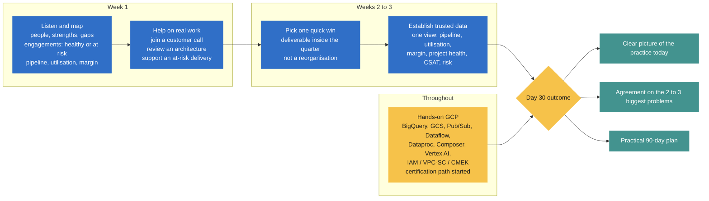

**Key elements:** Listen first, change nothing early; earn credibility by being useful, not by inspecting; one visible, achievable win; establish trusted data; hands-on GCP time, which directly answers the recruiter's note; and a concrete day-30 outcome so the answer ends on a deliverable rather than a mood.

**Likely follow-ups**

| Probe | 15-second answer |
|---|---|
| "What would the quick win actually be?" | "I'd choose it after week one, but the shape is: something the team already knows is broken, visible to leadership, done inside the quarter. Utilisation visibility or delivery predictability are the usual candidates." |
| "Why trusted data before anything else?" | "Because every harder call in months two and three, on people, pricing or engagements, depends on numbers people accept. If the first argument is about the data, I've lost the decision." |
| "Which certification, and when?" | "Professional Data Engineer first, inside the first quarter, because it matches what the practice sells. Then Professional Cloud Architect." |
| "What would you *not* do in 30 days?" | "Reorganise, change pricing, or make people decisions. Nothing irreversible before I have the picture and the trust." |

**Pass signal:** The "establish trusted data first" and "get hands-on with GCP early" items, and a day-30 outcome that is a plan, not a restructure.
**Fail signal:** A 30-day plan that's all restructuring, or one with no deliverable at the end.

---

### Q34. "Tell me about a time you disagreed with a decision. How did you handle it?"

**Framework:** One where you were right → one where you were wrong → the same method both times → what changed permanently

**Ground rule.** Tell each story on the platform it actually happened on, then **translate** the components to Google Cloud out loud ("on Google Cloud this layer is Dataproc"). Your GCP work is lab-scale (Q27 says so), so never say "I used Pub/Sub into Dataflow" as history. The interviewer still hears GCP fluency, and every sentence survives a follow-up. The spoken, personalised version with employer detail is in the private coach folder: `portfolio/interview/meta/coach/GOOGLE_RRK_Q34_DISAGREEMENT_ANSWER.md`.

**Structure of the spoken answer (about 2 minutes)**

> "I'll give you one where I was right, // and one where I was wrong, // because the first only tests whether you can win an argument.
>
> **Where I was right.** The proposal on the table was to keep scaling the existing batch platform to absorb growing volume. // My concern: that treats the symptom. // More compute makes today's jobs faster, but storage and compute stay coupled, the batch window keeps growing, recovery stays slow, and cost grows in a straight line with volume. /// So instead of an architecture debate I proposed a **benchmark**: representative workloads on both designs, measuring runtime, failure rate, recovery time, throughput and cost per workload. // The decoupled lakehouse design won on every one, and the conversation stopped being my architecture against somebody else's. // We had evidence. // [Close on a result that is on your resume: month-end close **5 days to 2 hours**. Do **not** close on a cost percentage; none is on the resume.]
>
> **Where I was wrong.** Later I pushed too hard toward the target architecture. // Technically right, but I underestimated how much new technology the team had to absorb at once while keeping production running. // A **sequencing** mistake, not a technology mistake. /// I changed one large migration into gated waves: foundation first, low-risk workloads second, critical datasets dual-run and reconciled before any consumer moved, cutover only against criteria agreed in advance.
>
> **What changed permanently.** I no longer ask only 'what is the best architecture?' // I ask 'what is the best architecture **this team** can safely adopt, operate and scale?' // And either way the method is the same: bring evidence, hear the counter-argument, write the risk down, make the decision, don't make it personal."

**Diagram 1. The disagreement: scale the legacy platform, or benchmark and decide**

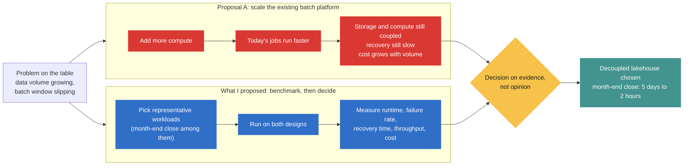

**Diagram 2. The reference architecture, translated to Google Cloud.** Memorise this one. Every follow-up is answered by pointing at a box.

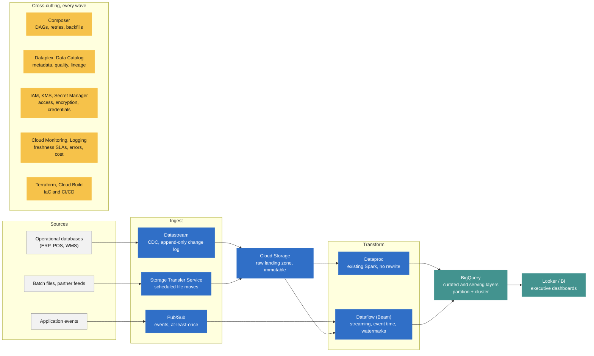

```
Sources → Datastream / Pub/Sub / Transfer → Cloud Storage → Dataproc / Dataflow → BigQuery → BI
            supporting every wave: Composer · Dataplex · IAM/KMS · Monitoring/Logging · Terraform
```

| GCP box | Why it is there (the one sentence to say) |
|---|---|
| Pub/Sub | Decouples producers from consumers; at-least-once, so consumers must be idempotent |
| Datastream | CDC without load on the source; append-only, so the merge happens downstream |
| Cloud Storage first | Replayable raw copy, cheap, shared by more than one engine; the warehouse is never the only copy |
| Dataproc | Keeps working Spark code working; a rewrite is a cost, not a goal |
| Dataflow | Streaming and new pipelines: event time, watermarks, allowed lateness, autoscaling, no cluster |
| BigQuery | Storage and compute scale independently; partition and cluster by access pattern |
| Composer | Dependencies, retries, backfills by logical date |
| Dataplex / policy tags | Discovery, quality rules, lineage, column-level access |
| IAM, CMEK, VPC-SC | Least privilege, customer-managed keys, no exfiltration path |
| Monitoring + Logging | Reliability measured, not anecdotal: freshness, failure rate, cost per job |
| Terraform + Cloud Build | Repeatable environments; every wave is a reviewed change |

**Diagram 3. The wrong story and the fix: from one big migration to gated waves**

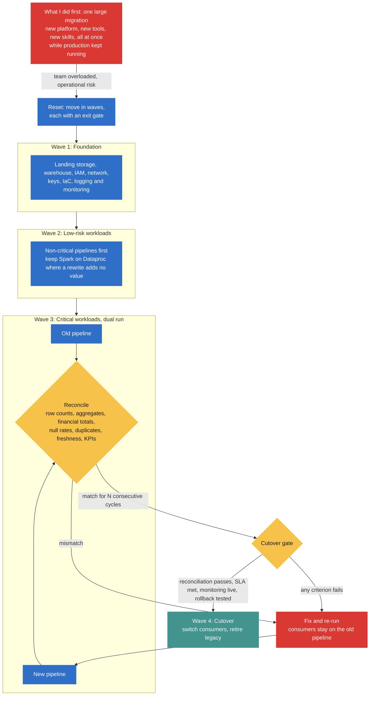

**What the benchmark measured (pick three rows in the room, not all five)**

| Dimension | Measure | How to say it |
|---|---|---|
| Performance | Pipeline runtime, query latency, freshness at the consumer | "Freshness at the dashboard, not job completion, is the number the business feels" |
| Reliability | Failure rate, recovery time, SLA misses, MTTR | "Recovery time mattered more than failure rate" |
| Scale | TB per hour, peak throughput, concurrent workloads | "We ran the peak day, not the average day" |
| Cost | Cost per TB processed, compute per job, storage, support effort | "Cost per workload, same window, both designs. A percentage only with the baseline and what was excluded" |
| Operations | Manual interventions per week, deployment lead time | "Count the human hours, not just the machine hours" |

**Cutover criteria, agreed before Wave 3 starts:** reconciliation passes for N consecutive cycles; freshness SLA met on the new path; monitoring and alerting live and tested; rollback exercised, not just written. Then switch consumers, run legacy dark for one more cycle, retire it.

**Follow-ups they will ask**

| Probe | 20-second answer |
|---|---|
| "Why Dataproc **and** Dataflow? Pick one." | "Different jobs. Dataproc keeps working Spark code working, so migration risk stays low. Dataflow is for streaming and new pipelines where event time and autoscaling matter. Rewriting Spark to Beam because Dataflow is newer is a cost with no business outcome." |
| "Why land in Cloud Storage before BigQuery?" | "Replay: a wrong transform is re-run from raw without going back to the source. Cost: raw stays cheap and the warehouse holds what people query. Decoupling: more than one engine reads the same raw data." |
| "How did you validate the migration?" | "Dual run and reconcile before any consumer moved: row counts, aggregates, financial totals, null rates, duplicates, freshness, and the KPIs as executives see them. Cutover criteria written before Wave 3; legacy ran dark one more cycle." |
| "How did you calculate the cost improvement?" | "Cost per workload, same window, both designs, exclusions written down. I don't have a cost percentage on my resume and I'd rather give you the method than a number without a baseline." |
| "Who told you the big-bang approach was too much?" | "The team did, and that is part of the lesson. I had the evidence for the architecture and had not weighted the evidence about the team." |
| "Would you make the same call on Google Cloud?" | "Same method, same waves. The foundation wave is shorter because BigQuery, Dataflow and Pub/Sub are serverless: fewer clusters to stand up and fewer to retire." |

**Key elements:** One where you were right **and one where you were wrong**; the second is the differentiator, and the recruiter's brief explicitly asks for "times you learned something new from a setback". Evidence over opinion. The method stays the same either way. No personalisation, no blame.

**Pass signal:** A genuinely self-critical example where you name your own error and what you changed afterwards, and an architecture you can defend box by box.
**Fail signal:** Only the success story; a "disagreement" that was really "someone else was wrong and I fixed it"; or a GCP claim stated as history.

[TODO: the "wrong" story must be literally true. Write down its one concrete casualty (the dataset, the week, the consumer) in the private file. If that memory is not there, use the fallback in `ROUND_1_RRK_GAP_CLOSURE.md` §5. Never close on a cost percentage.]

---

### Q35. "What questions do you have for us?"

**Framework:** Ask what you need to decide whether to do this job — 2–3 real questions, not ceremonial ones

> "**I'd ask about the practice, not the product.** I want to know what this role actually owns — whether the lead owns a P&L or owns delivery and quality, because that shapes what I'd do in the first year. And I'd want to know what the biggest constraint on the practice is right now: is it building pipeline, is it delivery capacity, is it the seniority mix on the team, or is it something nobody has fixed? I'd rather know what the hard part is, because that's the part I'd be hired to do.
>
> **Then I'd ask about the team.** Where are the strongest people and what are they working on, and where are the gaps? What's the retention picture, and where have people left?
>
> **And one about how the role is judged.** What does success look like at 12 months — what's the practice expected to have, and how is it measured? I want to be clear on that, because the differences in how it's measured reveal what the organisation actually values.
>
> **Then I'd make it two-way.** I'd share what I think the first challenge is, and ask them whether that's the right challenge — because if my read is wrong, that's useful information for me and useful for them."

**Key elements:** Ask about *your* work, not the company's website; one question that reveals what the role actually is; one that shows you want the hard truth; make it two-way.

**Pass signal:** A question that would only make sense if you were preparing for this specific job.
**Fail signal:** Questions answerable from the website, or none at all.

---

## 🔴 Red Flags to Avoid

| ❌ Don't | ✅ Do instead |
|---|---|
| Present the corpus's aspirational numbers ($12.3M ARR, $2.5M/120TB migration, 500TB FSI programme) as your history | Use only your resume facts: Makro, Lazada, SCB, DBS, PayPal, Apple/Exilant |
| Say "$8B revenue impact" as your impact | Correct the framing yourself: "I own the platform supporting a group with $8B+ revenue" |
| Claim a consulting practice P&L | Say plainly you ran a data org with a $3M budget and name the trade-offs; ask what you'd need to learn |
| Bluff hands-on GCP depth | Be honest: production depth is Spark/Kafka/Flink/Databricks; GCP is architect-level; here's the 60-day plan |
| Answer a hypothetical with a solution immediately | Ask clarifying questions, state assumptions, then proceed |
| Present options without a recommendation | Weigh honestly, then be prescriptive — "it depends" is a starting point |
| Say "we" without claiming your specific part | Name what *you* did, your decision, your artefact |
| Name-drop products without reasons | Tie every product to a workload shape, constraint or risk |
| Bluff on the 40% cost reduction appearing at two employers | Differentiate the two mechanisms explicitly — interviewers will notice |
| Let a "20M+ insights/day" soft metric stand unexamined | Define what an insight is, or drop the metric |
| Leave a TODO unresolved | Resolve every `[TODO]` before the interview — interviewers probe exactly there |

---

## ✅ Pre-Interview Checklist

- [ ] **Resolve every `[TODO]` in this document** — each one is a known probe point.
- [ ] **Re-read Part C and D aloud, timed** — these are where the level is judged, and they're the hardest to sound natural in.
- [ ] **Practise the code review (Q15) three times, timed**, against `pipeline_logic.py`, `dataflow_batch_pipeline.py`, and one unfamiliar snippet.
- [ ] **Rehearse Q33 and Q34 from the flow diagrams** — Q34's "I was wrong" story must be literally true with one concrete casualty written in the private file; it must sound self-critical, not rehearsed humility.
- [ ] **Prepare the Q23 competitor one-pager** — Snowflake, Databricks, AWS, Microsoft, including where Google is weaker.
- [ ] **Know your numbers cold, in two tiers.**
  - **On the resume the interviewer holds (say freely):** $8B business, 3 countries, org 8→30 across four squads (Finance, Supply Chain, O2O, Platform), $3M budget, 10B+ rows/day, month-end close 5d→2h, 50+ executive dashboards, 200+ stores and 5 DCs near real-time inventory, 1,000+ vendors forecasting; Lazada 100M+ daily events, 20M+ insights/day, 600+ governed tables, 10x growth, double promotion; SCB AML 15+ countries, MAS.
  - **Not on the resume (say only with baseline and measurement ready):** 500+ daily jobs, 99.99% uptime, incidents −60%, delivery −40%, any cost or runtime percentage. If you cannot state what was measured and over what window, do not say the number.
- [ ] **Re-read the recruiter's brief** — the six "what great looks like" themes are the rubric, not decoration.
- [ ] **Have one number ready for each metric you can't defend** — know the baseline, the measurement, and who else could have caused it.
- [ ] **Know the GCP stack cold**: BigQuery, Dataflow, Dataproc, Pub/Sub, Dataplex, Looker, Vertex AI, Composer, VPC-SC, CMEK, policy tags.
- [ ] **Set a 60-day GCP hands-on plan you can say out loud** (Q27) — include certifications, ideally a real project.
- [ ] **Mock: 60 minutes, one recorder, no notes.** The format of the interview is a conversation, and the format of your rehearsal should match.

---

*Prepared against the Round 1 RRK brief from the recruiter. Companion docs: `../HOW_TO_PASS.md`, `../../INTERVIEW_PREP/MASTER_QUESTION_BANK.md`, `../../GCP_DATA_ENGINEERING_COURSE/`.*
*Personal facts sourced from `portfolio/interview/meta/coach/resume-facts.md` (extracted from `Prem_Resume_2026.pdf`, 2026-09-26). All other numbers in the wider corpus are illustrative models, not biography.*

=== END CONTENT ===
