# ROUND 1 — Role Related Knowledge (RRK) — Question & Answer Bank

**Role:** Data & Analytics Lead, Google Cloud Consulting (Singapore) — Professional Services Organisation
**Interviewer:** the RRK interviewer | **Duration:** ~60 min
**Loop context:** Two RRK rounds → Googleyness & Leadership (G&L) → informal senior-leader conversation. All virtual.
**Round 2 note:** One of the two RRK rounds includes a hands-on practical — reviewing a short piece of data-processing code and designing an enterprise data platform live. You are not asked to write a full solution; you are asked to reason about correctness, scale, reliability, security and maintainability, and to draw and defend an architecture.

**Companion docs:** `../HOW_TO_PASS.md` (strategy + rubric), `ROUND_1_RRK_GAP_CLOSURE.md` (resolved TODOs, the 60-day GCP plan, the practice-P&L answer, the duplicate-40% fix), `ROUND_1_RRK_CODE_REVIEW_DRILL.md` (Q15 — six-pass review order and 16 verified findings), `../../INTERVIEW_PREP/MASTER_QUESTION_BANK.md` (question index), `../../GCP_DATA_ENGINEERING_COURSE/` (technical depth).

---

## 📌 How to Use This Document

**1. Numbers rule — read this first.**
Every metric in this bank comes from your **verified resume** (`portfolio/interview/meta/coach/resume-facts.md`, extracted from `Prem_Resume_2026.pdf` on 2026-09-26). Anything in the wider corpus like "$2.1M → $12.3M ARR practice", "$2.5M / 120TB migration", "500TB FSI programme", "$5.4M revenue / 35% margin" is an **aspirational model, not your history** — `HOW_TO_PASS.md` says so explicitly. Do not present those as fact.

Where a real fact needs sharpening (attribution, baseline, definition), the answer carries a `[TODO]` block. **Resolve every TODO before the interview.** An interviewer will probe exactly those places.

**2. The universal hypothetical framework — memorise the shape, not the words.**
Use this for every scenario/hypothetical question:
`UNDERSTAND → PREPARE → OPTIONS → RECOMMEND → SUPPORT`
- **Understand** — ask clarifying questions first. If you get no answer, *state your assumptions explicitly* and move on. Do not silently guess.
- **Prepare** — say what data, metrics or artefacts you need, where you'd get them, which stakeholders and constraints matter.
- **Options** — 2–3 options, weighed honestly against explicit trade-offs (correctness, latency, availability, security, cost, migration risk, organisational readiness).
- **Recommend** — be prescriptive. "It depends" is a starting point, not an answer.
- **Support** — execution plan, what could go wrong, how you'd measure it worked.

**2b. These answers are scripts, not testimony — and that distinction is the whole game.**
Every quoted answer in this bank is written in **your first person** so it can be rehearsed out loud. It is **the shape of a strong answer**, not a claim that you did these things. Before you say any of it, check three things:

- **Is it true?** The structural content (the framework, the sequence, the trade-off) is sound and safe. The **specifics** — your numbers, your mechanisms, your stories — must come from `resume-facts.md` or your own memory. Where a passage asserts something you have not verified (for example the *mechanism* behind each of the two 40% cost claims, or the *detail* of what happened inside your $3M budget), it is marked and it is **your job to correct it**. A beautifully-worded answer about something that did not happen is worse than a plain one that did — the interviewer will pull the thread, and you cannot sustain it.
- **Is it yours?** Do not deliver my phrasing verbatim. Rehearse until you could say it while making coffee, then say it in your own words. A rehearsed-sounding answer is detectable and it reads as coaching.
- **Would you defend the follow-up?** The test of any sentence here is not whether it sounds good but whether you can answer *"how do you know that?"* and *"who else could have caused it?"* If you cannot, cut the sentence.

**Never present a number you cannot source.** If the real answer is *"I don't have that number, and here's the mechanism instead"* — say that. It is a strong answer. Inventing one is not.

**3. The behavioural frame — lead with the outcome and your specific role.**
`STAR` (Situation, Task, Action, Result). Lead with the result. Be concrete with scale and numbers. Anonymise employers and clients — name the *industry and size*, not the name. Every answer must answer *"why you and not the team?"*.

**4. The level filter — enterprise scope, not project scope.**
A technically correct answer that doesn't reach **enterprise dependencies, adoption, operating model and sustained outcomes** will not pass at L7. Where you have a project-scale example, extend it explicitly: ownership, observability, rollback, decommissioning, commercial impact.

---

## 🎯 Part A — Positioning & Scope (opening 10 minutes)

### Q1. "Walk me through your background — 90 seconds."

**Framework:** Scope → Impact → Why this role

**Flow**

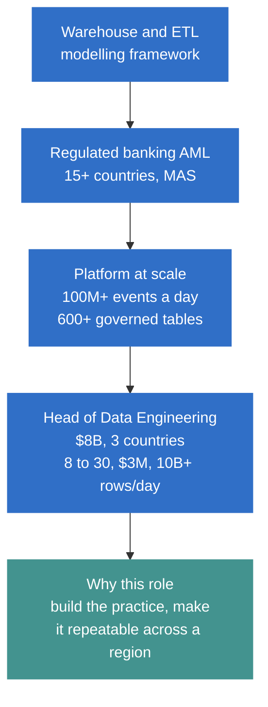


> "I have **15+ years** in data engineering, moving from warehouse and ETL work at **PayPal** and **Exilant**, where I built Apple-facing data products, through **DBS** where I built the SCD2 modelling framework, to **SCB Bank** as a Big Data Consultant supporting AML across **15+ countries** on Hadoop and Hive.
>
> The scale step came at **Lazada** — five and a half years, July 2018 to January 2024, as **VP Data Engineering**, part of Alibaba. There I owned a platform handling **100M+ daily events**, delivered **20M+ insights a day** through Flink and ClickHouse, and had **600+ production tables** under my ownership. That was where I learned to build for ten-times growth, and where I learned that the second-order effects — governance, operability, cost — matter as much as the pipeline.
>
> Since **July 2024** I've been **Head of Data Engineering** at **Makro** within CP Group, running the data, analytics and AI platform for an **$8B omnichannel retail business across three countries**. I scaled the organisation from **8 to 30** across four domain squads, hold a **$3M budget** with vendor accountability, and the lakehouse processes **10B+ rows a day**. The outcomes I'd point to: month-end close from **five days to two hours**, near real-time inventory across **200+ stores and 5 DCs**, and demand forecasting covering **1,000+ vendors**.
>
> Why this role: my last five years have been exactly the three things this job needs — enterprise architecture, executive and commercial accountability, and leading senior engineers. What I want to add is the practice-building half: taking a capability and making it repeatable across a region rather than running it in one company."

**Key elements:** 15+ years, **six** employers with visible progression, marquee names (Alibaba, Apple, PayPal, SCB, DBS) stated without boasting, the "scale step" narrative, current title matches the role's scope, and a *forward-looking* close rather than a summary.

**Pass signal:** You talk about the **operating model** and **adoption**, not only the technology.
**Fail signal:** A chronological CV recital with no outcome, or "I've been doing data for 15 years."

**RESOLVED against your current resume (the one the interviewer holds):** title is **Head of Data Engineering | Makro (CP Group) | July 2024 – Present**. Lazada is **VP Data Engineering | Lazada Group (Alibaba) | Jul 2018 – Jan 2024**; say "Lazada, part of Alibaba". Every figure in the opener above is on that resume. An earlier note here cited a "Head of Data" headline, an 8-to-25 team, a $2M budget and a Xendit role from a stale facts file; all of that is withdrawn. The resume has **no** Xendit role and shows **January to July 2024 as a gap**; Q5 below is the honest answer for that.

---

### Q2. "Why Google Cloud Consulting, and why Singapore, and why now?"

**Framework:** Capability fit → Market thesis → Personal motivation → Specificity

**Flow**

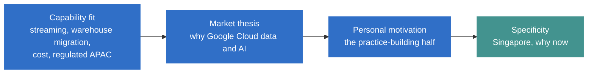


> "Three reasons.
>
> **Capability fit.** My deepest experience is in exactly the problems Google Cloud's data and AI practice sells: high-volume streaming (Kafka, Flink at Lazada's 100M+ daily events), large-scale warehousing migration, and cost architecture on a real budget — the **$3M annual cloud spend** I own today. I've also spent my career in the regulated APAC markets this role serves: MAS compliance at SCB, PDPA in Singapore and Thailand, Vietnam's Decree 13, and GDPR for EU data subjects.
>
> **Market thesis.** Most enterprise data programmes I see in this region don't fail on technology choice — they fail on **operating model and adoption**: pipelines nobody owns, platforms nobody adopts, migration programmes that miss the behaviour change. That's a consulting problem first and a technology problem second, which is exactly why this is a Consulting role and not an engineering role.
>
> **Personal motivation.** I'm at the point where I want to build a *capability* rather than run one platform. I've done the platform-owner version of this at Makro. I want the version where I take a methodology, get it into a partner's hands, and have it used on five engagements instead of one.
>
> **On Singapore.** It's where the practice, the customers and the partner ecosystem are. I've worked in Singapore since 2016 and I want to be physically close to the engagements and the team."

**Key elements:** Third reason is *specific to this role*, not "Singapore is a good market." The market thesis shows you understand consulting sells **behaviour change**.

**Pass signal:** You say something only a practitioner would say — e.g. that most failures are operating-model failures.
**Fail signal:** Generic enthusiasm about "Google's mission" or "the future of AI" with no link to your evidence.

---

### Q3. "Your resume says $8B+ revenue impact. Is that yours?"

**Framework:** Direct correction → Precise framing → Attribution honesty → The real claim

**Flow**

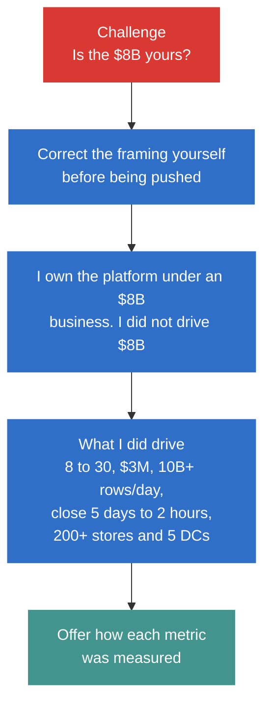


> "That's a fair challenge, and I should have stated it more precisely on the resume. The accurate framing is: **I own the data platform that supports a group with $8B+ in revenue.** I did not drive $8B of revenue.
>
> What I did drive was the platform's contribution to it. At Makro I scaled the team from **8 to 30** across four squads, own a **$3M annual cloud and vendor budget**, and the platform carries **10B+ daily rows**. Concretely, month-end close went from **5 days to 2 hours**, inventory for **200+ stores and 5 DCs** moved to near real time, and demand forecasting now covers **1,000+ vendors**. If a merchandising decision lands an hour sooner, that's platform and data latency showing up in the business.
>
> The distinction I'd draw: **owning a platform under an $8B business is not the same as driving $8B.** My claim is about the reliability, speed and cost of the decision-making that business runs on — and I can walk you through exactly which metrics moved and how they were measured."

**Key elements:** You **correct the framing yourself** before being pushed. This is the single most important behaviour in the interview — overclaiming under direct challenge is a hard fail; correcting yourself is a strong pass.

**Pass signal:** You separate *reach* from *causation* and then show you know how to defend causation.
**Fail signal:** Defending "$8B" as your impact, or over-correcting into "it was just the business, not me."

[Not on the current resume, so say only with baseline and attribution ready: 500+ daily jobs, 99.99% uptime, incidents −60%, delivery −40%. If you use the delivery figure, have the split ready: "X% was platform latency, Y% was algorithm, Z% was process."]

---

### Q4. "You scaled the team from 8 to 30. What did *you* hire, and what did you inherit? Did quality hold?"

**Framework:** Inherited vs built → Quality mechanisms → Attrition → Honest gap

**Flow**

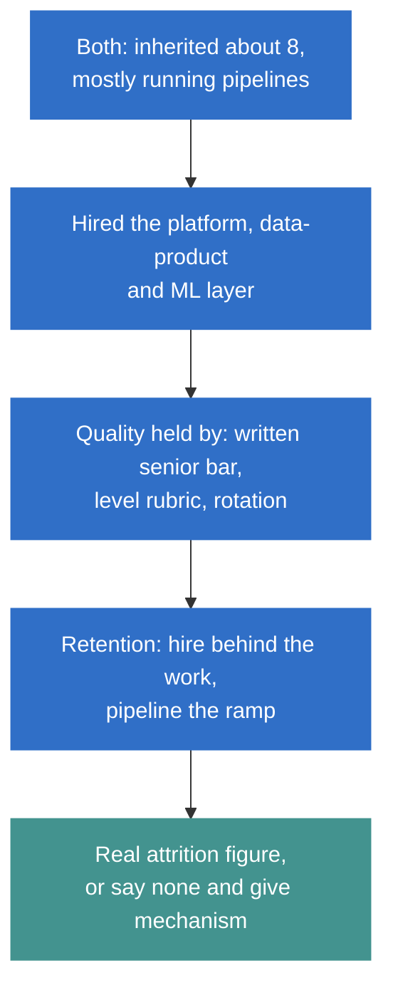


> "Both, and the split matters. I inherited a small team with a lot of operational load — roughly **8** people, most of them running pipelines rather than building platforms — and the hiring I did myself was the platform, data-product and ML capability layer.
>
> The mechanisms I used to hold quality while growing: a written **bar** for what a senior engineer had to demonstrate before I promoted them into the senior band, not just years of service; a **level rubric** that separated 'runs pipelines' from 'designs platforms', because that was the confusion I inherited; and **rotation** so people got exposure to architecture, not just their own component.
>
> On retention I was deliberate about it — the common failure is hiring ahead of the work and then having people idle or stretched. I'd rather be short for two quarters and pipeline the ramp."

> [Fill with your real attrition/retention figure and the quality mechanism you actually used — the rubric, the rotation, the scorecards. If you don't have a retention number, say so plainly and describe the mechanism instead. **Do not invent a number.**]

**Key elements:** "Inherited vs built" is the exact distinction an interviewer is testing. Mechanisms over adjectives.

**Pass signal:** You can name a quality mechanism you personally owned.
**Fail signal:** "I hired great people" with no mechanism, or a suspiciously perfect retention number.

[TODO: real headcount split (inherited vs hired) by function; real attrition/retention; the one hiring mistake you made and the fix.]

---

### Q5. "Your resume shows Lazada ending in January 2024 and Makro starting in July. What happened in between?"

**Framework:** Say it plainly → What you did with the time → Why it is not on the resume → Connect forward → Stop

**Flow**

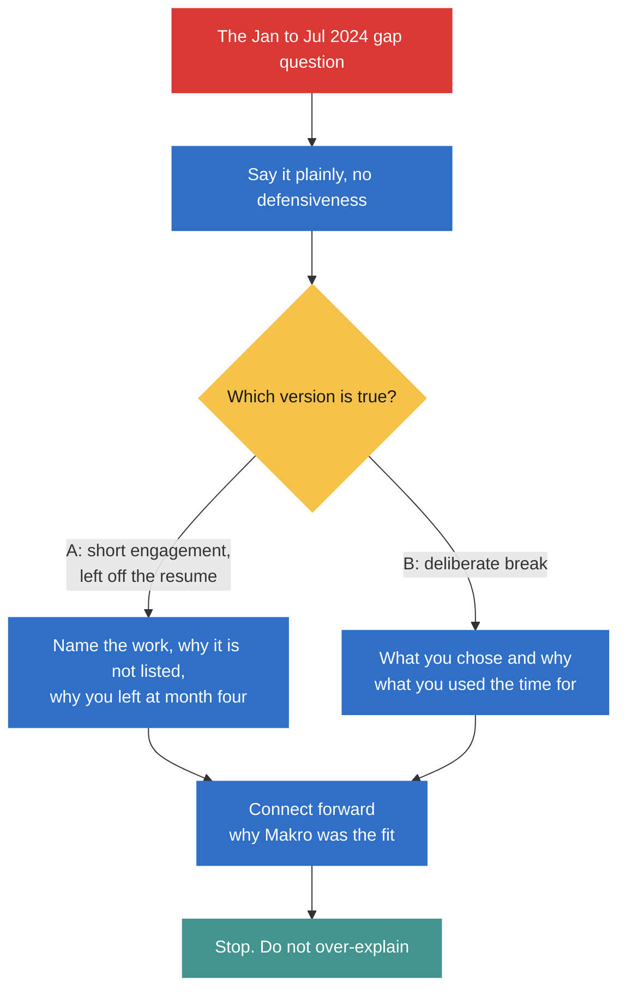


Your resume does not list a role for January to July 2024. The interviewer will see the gap. The only bad answer is one that sounds like a cover story. Two honest versions; pick the one that is true and say it in under 45 seconds.

**Version A, if you did a short engagement in that window and left it off the resume:**

> "Between Lazada and Makro I did a six-month principal-engineer engagement at a payments company, focused on platform cost. // I don't list it because it was short and the scope turned out narrower than I'd signed up for, // and I'd rather the resume show the roles that define me. // The work itself was real: job-level Spark and DBT tuning, instance right-sizing, scheduling. // By month four it was clear it was a cost-optimisation engagement rather than a platform role, so I made the call and joined Makro in July. // Happy to go into the detail if useful."

**Version B, if the time was a deliberate break or a search:**

> "I finished at Lazada in January after five and a half years and took the first half of 2024 deliberately: // I wanted the next role to be a platform-and-organisation role, not another architecture seat, // and I used the time to [the true thing: study, family, the Northwestern application, a specific search]. // Makro was the right fit and I started in July."

**Key elements:** Plain. No employer criticism. One sentence of reason, one of evidence, then stop. If you use Version A, **the numbers from that engagement are not on your resume**: say them only if you can defend baseline and measurement, and never attach them to Makro.

**Pass signal:** Clear-eyed, factual, under 45 seconds, and you move on.
**Fail signal:** Vagueness ("it was a restructure"), a story that contradicts the resume dates, or defending a number you did not put on paper.

[TODO: decide A or B and fill the one true detail. If A, decide whether the engagement should go back on the resume before the next round; a recruiter compares the two.]

---

## 🔧 Part B — Technical & Domain Depth

### Q6. "A customer's analytics pipeline processes 10B+ rows/day with late and out-of-order events, and duplicate writes are corrupting downstream aggregates. How do you diagnose and fix it?"

**Framework:** Contain → Understand → Trace → Options (A, B, C) → Recommend in sequence → Support on GCP → Measure

**The frame to say first:** "I treat this as a **correctness incident first and a scale problem second.** More Dataflow workers or BigQuery slots improve throughput. They do not repair event-time handling or non-idempotent writes."

**Flow 1. The whole answer on one page**

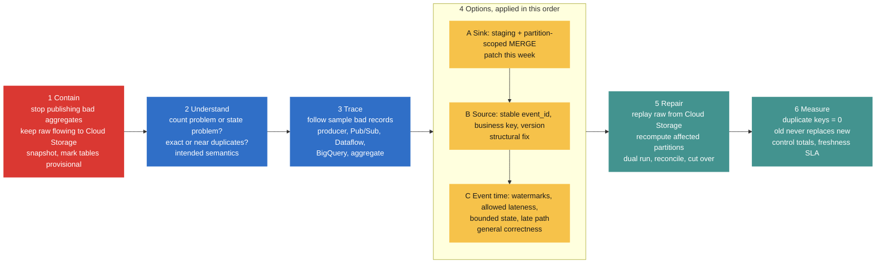

> **Contain.** "Before I change the pipeline I protect the business. I stop publishing the corrupted aggregates to Looker, APIs and finance reports, but I do **not** stop ingestion: raw events keep landing in immutable Cloud Storage. I record the first bad event date and the affected partitions, take table snapshots, mark the affected tables provisional, and keep the corrupted tables for audit.
>
> **Understand.** Two questions decide the whole fix. Is it a **count** problem, the same event counted twice, or a **state** problem, an older event overwriting a newer one? And are the duplicates **exact**, same event ID, or **near**, the same business transaction under different IDs or payloads? Then the intended semantics: at-least-once ingestion, with idempotent writes.
>
> **Trace.** I take a sample of bad records and follow each one through producer, Pub/Sub, Dataflow, staging and canonical table, using event ID, business key, version, event time, ingestion time, Pub/Sub message ID and the Dataflow job. I look at the **whole lateness distribution**, p50, p95, p99, p99.9, not the mean. That tells me whether the duplicates come from producer retries, Pub/Sub redelivery, Dataflow replay, an overlapping backfill, or a non-idempotent write."

**Flow 2. Where the duplicate enters: what to inspect at each layer**

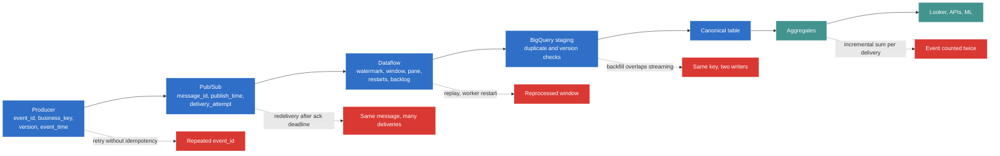

| Layer | What I inspect | Likely cause |
|---|---|---|
| Producer | Repeated `event_id`, retry logs | Retry that mints a new ID, or reuses one with a changed payload |
| Pub/Sub | Message IDs, delivery attempts, ack latency | Redelivery after the ack deadline |
| Dataflow | Worker restarts, watermark, backlog | Replay or duplicate processing |
| Backfill | Date range and job overlap | Streaming and backfill writing the same keys |
| BigQuery | Duplicate keys per partition | Append-only, non-idempotent write |
| Aggregate | Same event counted more than once | Incremental sum on each delivery |

First two queries, on a bounded date range. The second separates identical retries from conflicting duplicates.

```sql
SELECT event_date, event_id, COUNT(*) AS occurrences
FROM `project.analytics.events_raw`
WHERE event_date BETWEEN '2026-11-01' AND '2026-11-07'
GROUP BY event_date, event_id
HAVING COUNT(*) > 1
ORDER BY occurrences DESC;

SELECT event_id,
       COUNT(*) AS rows_received,
       COUNT(DISTINCT payload_hash) AS payload_versions,
       MIN(ingestion_time) AS first_seen,
       MAX(ingestion_time) AS last_seen
FROM `project.analytics.events_raw`
WHERE event_date BETWEEN '2026-11-01' AND '2026-11-07'
GROUP BY event_id
HAVING COUNT(*) > 1;
```

`payload_versions = 1` points at redelivery or replay. `payload_versions > 1` means the source reused an ID or sent updates without version semantics.

**Flow 3. Count versus state: the distinction that picks the fix**

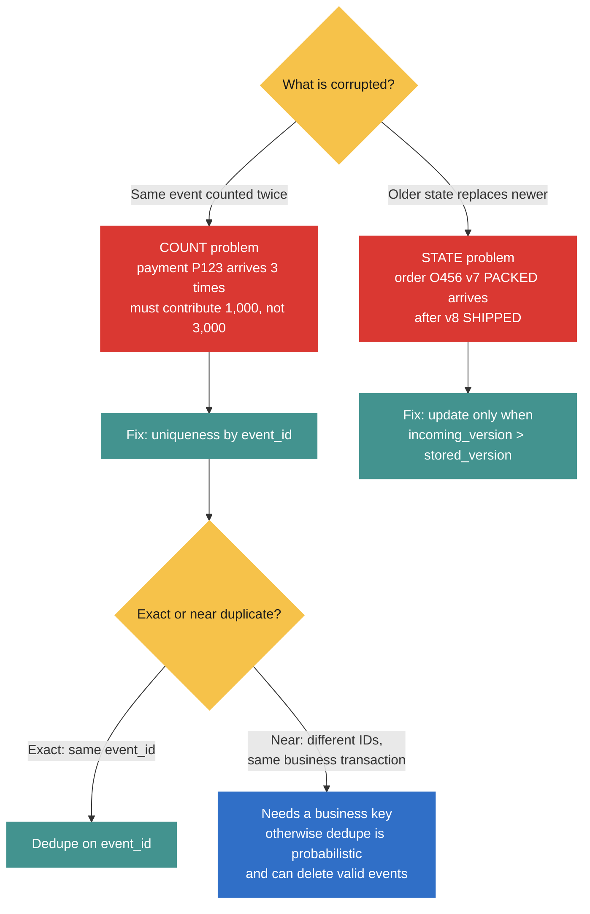

**Event ID prevents double counting. Version or sequence prevents old state replacing new.** A Pub/Sub message ID is not a business key: if a producer publishes the same event twice, Pub/Sub assigns two message IDs. A safe key is `source_system + source_business_id + event_type + version`. If the source has no ID, hash **stable** fields only, never ingestion time, or a replay mints a new key.

> **Options.** "Three, and I'd apply all three, in sequence.
>
> **A, fix at the sink.** Land in BigQuery staging, then a **partition-scoped MERGE** on `event_id` and version into the canonical table. Fast, makes reruns and backfills safe, but it does not stop upstream duplication, history still needs repair, and an unbounded MERGE is expensive at this volume.
>
> **B, fix at the source.** The producer reuses the **same** `event_id` on every retry and sends a business key and a monotonic version. This is the real long-term fix and it needs the upstream team.
>
> **C, event-time semantics.** Deduplication alone does not fix out-of-order data. Dataflow decides on event time and version, not arrival order: event-time timestamps, windows, watermarks, allowed lateness, triggers, keyed state and timers, and a path for very-late events."

**Option A in SQL.** Deduplicate the staging rows *inside* the source first. Without that, BigQuery fails the MERGE with "UPDATE/MERGE must match at most one source row for each target row" whenever staging holds two rows for one key. Filter both sides on the partition column so BigQuery prunes.

```sql
MERGE `project.analytics.events_canonical` AS target
USING (
  SELECT * EXCEPT (rn)
  FROM (
    SELECT *, ROW_NUMBER() OVER (
             PARTITION BY event_id
             ORDER BY event_version DESC, ingestion_time DESC) AS rn
    FROM `project.analytics.events_staging`
    WHERE event_date = @event_date
  )
  WHERE rn = 1
) AS source
ON  target.event_id   = source.event_id
AND target.event_date = source.event_date          -- partition pruning
WHEN MATCHED AND source.event_version > target.event_version THEN
  UPDATE SET event_version = source.event_version,
             event_time    = source.event_time,
             payload       = source.payload,
             ingestion_time = source.ingestion_time
WHEN NOT MATCHED THEN
  INSERT ROW;
```

For append-only events the matched branch does nothing. For mutable events it updates only when the incoming version is newer. The same statement serves streaming, replay and backfill, so the two paths cannot disagree.

**Option C: derive the lateness policy from the data, not from a guess.**

| Percentile | Measured lateness (example) |
|---|---|
| p50 | 20 seconds |
| p95 | 8 minutes |
| p99 | 2 hours |
| p99.9 | 20 hours |

A policy that fits that distribution: early results every 5 minutes, on-time result when the watermark passes the window, corrections for 24 to 48 hours, anything later to a reconciliation table, and a scheduled backfill for older corrections.

| Trade-off | Long allowed lateness | Short allowed lateness |
|---|---|---|
| Upside | More automatic corrections | Lower state and cost, simpler operations |
| Downside | More state, more cost, later finality | More events handled by batch reconciliation |

At 10B+ events a day, keeping every event ID in state for seven days is unaffordable. **Bound the streaming state by the lateness window, and keep the long-horizon uniqueness guarantee in the idempotent sink and the immutable raw layer.**

> **Recommend.** "A for containment this week: quarantine the aggregates, preserve raw, introduce the partition-scoped MERGE so the numbers stop getting worse. B for the structural fix, so retries become safe. C for general correctness, so the pipeline is right for the next source and not just this one.
>
> **Aggregates are built from the canonical deduplicated table, never by adding to a total on each delivery.** A duplicate message adds the amount twice. When late events land, I recompute only the affected windows and MERGE the result on `event_date + store_id + product_id + metric_name`, so a rerun produces the same answer."

**Flow 4. Target architecture on Google Cloud**

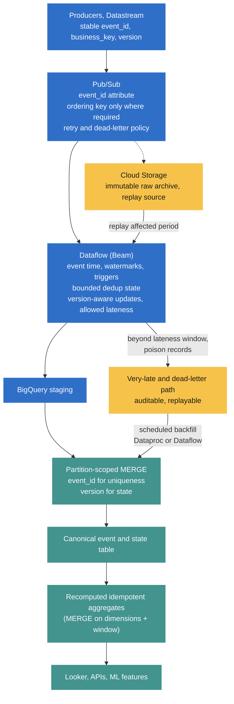

> **Support.** "Pub/Sub is at-least-once, so I never assume a message arrives once. **Cloud Storage** is the immutable raw archive and replay source. **Pub/Sub** carries the event ID as an attribute, uses ordering keys only per entity where order matters, and has a dead-letter policy. **Dataflow** does event-time processing, bounded deduplication, version-aware updates, and routes records past the lateness window to an auditable path. **BigQuery** takes staging, the partition-scoped MERGE, and recomputed aggregates. **Dataproc** handles heavy Spark backfills where that is what already exists. **Cloud Monitoring** watches backlog, watermark lag and freshness, and **Dataplex** gives lineage and quality visibility.
>
> I won't claim end-to-end exactly-once. Pub/Sub exactly-once delivery stops redelivery after an ack, but it does not remove duplicates the producer itself published, and Dataflow's deduplication on an ID attribute is best effort over a bounded window. What I claim is an **effectively-once business outcome**: stable event identity, bounded deduplication, version control and an idempotent write, so any stage can be retried, replayed or reordered without changing the answer."

**Scale check at 10B+ rows a day.**

| Item | Value or check |
|---|---|
| Average rate | About 115,700 events per second |
| Peak | Several times the average, depending on traffic shape: measure it, do not assume it |
| Check | Pub/Sub throughput and key skew, Dataflow CPU, shuffle and state size, watermark lag, hot keys, BigQuery write throughput, staging size, MERGE partition pruning |
| Hot keys | Shard the **processing** key, for example `HASH(event_id) MOD 1000`. The uniqueness rule in the sink still uses the real `event_id` |
| Never | An unbounded MERGE over the whole table. Filter source and target on `event_date` |

**Flow 5. Repair and cut over**

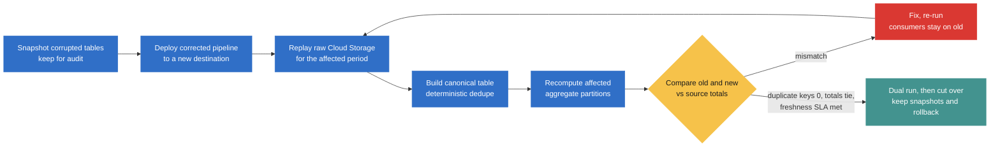

Compare against the source: distinct event IDs, row counts, amounts and quantities, null and schema violations, late-event distribution.

> **What could go wrong.** "Producers can't change: Option B is blocked, and sink-side idempotency becomes **permanent architecture**, so plan and fund it that way. Near duplicates with no reliable business key: deduplication becomes probabilistic and can delete valid events, so I'd quarantine rather than drop. Ordering keys on a hot entity: throttled partition, so order per entity, never globally. Lateness too long: state and cost balloon. Lateness too short: legitimate late events leak out and need frequent reconciliation. Backfill overlapping streaming: both paths must use the same keys and the same MERGE. Business definitions that change retroactively: versioned data contract plus immutable raw data to recompute from.
>
> **How I'd measure it.**"

| Measure | Target |
|---|---|
| Duplicate canonical `event_id` | 0 |
| Older version replacing newer | 0 |
| Source-to-canonical reconciliation | Within the agreed tolerance |
| Aggregate accuracy | Matches control totals |
| Replay determinism | Same input gives the same canonical output |
| Lateness p50, p95, p99, p99.9; watermark lag; Pub/Sub backlog | Tracked and alerted |
| Freshness SLA | Set from measured lateness, for example 99% within one hour |
| Manual corrections and incidents | Trending down |

**90-second version to memorise.** Notation: `//` short pause, `///` long pause.

> "I treat this as a correctness incident before a performance problem. // First I stop publishing the corrupted aggregates but keep every event landing in immutable Cloud Storage. /// Then I establish whether it's a **count** problem or a **state** problem: double-counting needs event uniqueness, older data overwriting newer needs version-aware updates. // And whether duplicates are exact or near.
>
> I trace bad records through producer, Pub/Sub, Dataflow and BigQuery on event ID, business key, version, event time and ingestion time, and I look at the full lateness distribution, not the average. ///
>
> Containment is BigQuery staging and a partition-scoped MERGE on event ID and version, // but that's only the first layer. // Long term, producers reuse a stable event ID on retries, // and Dataflow handles event time, watermarks, allowed lateness and bounded state, // with very-late records going to an auditable path instead of being dropped. ///
>
> Aggregates come from the canonical table, never from message deliveries. // I repair history by replaying raw data and recomputing only the affected partitions. ///
>
> My target isn't a vague exactly-once claim. // It's an **effectively-once business outcome**: duplicate keys at zero, old versions never replacing new, reconcilable aggregates, // and a freshness SLA based on measured lateness."

**Key elements:** Contain first; the **count vs state** distinction; **exact vs near** duplicates; event ID for uniqueness and version for state; idempotency as a property of the write path; **event time vs processing time** with a lateness policy derived from the measured distribution; bounded state plus an idempotent sink; aggregates from the canonical table; recommendation as a sequence with an honest blocker; "effectively-once" instead of a universal exactly-once claim; reconciliation as the measure.

**Pass signal:** You say **"at-least-once ingestion with idempotent writes"** unprompted, separate count from state, and treat idempotency as a *key property* rather than a feature.
**Fail signal:** "Use BigQuery partitioning and clustering" as the answer, since partitioning does not fix duplicate writes. Or claiming end-to-end exactly-once.

**RESOLVED — the honest bridge:** *"In my own production builds I used Kafka's exactly-once semantics and Flink checkpointing. On GCP the equivalents are Pub/Sub exactly-once delivery (a pull-subscription setting that prevents redelivery after ack) plus ordering keys, Dataflow's exactly-once state processing with dedup on a producer-assigned ID, and an idempotent BigQuery sink (Storage Write API offsets or `MERGE`). I have built those in lab exercises — the Pub/Sub dead-letter path, the ordering-key throughput planning, and the Dataflow watermark and late-data path — not yet at production scale on GCP."* **Say the last clause only if it is literally true on the day: run the labs end to end before the interview, or drop the sentence.** The labs are `GCP_DATA_ENGINEERING_COURSE/chapters/17-pubsub.md` (Lab 4 verifies the at-least-once dedup contract end to end; Lab 5 is the DLQ reason-code contract; Lab 6 is ordering-key throughput planning) and `chapters/22-apache-beam-and-dataflow.md` (Exercise 4 is the watermark and late-data path).

---

### Q7. "How do you design a data platform for a customer who has 2,000 pipelines across five lines of business, a regulatory data-residency requirement, and an 8-month deadline?"

**Framework:** Reduce the problem → Inventory and classify → Options (A, B, C) → Recommend waves + a stabilisation lane → Platform vs domain split → Residency as a boundary → 8-month plan → Define "done" → Measure

**The line to memorise:** "**Don't migrate 2,000 pipelines. Classify them, retire what shouldn't exist, build a golden path, and migrate business domains in waves.**"

**Opening move:** "I would not start by designing the GCP architecture. First I'd **reduce the problem**."

**Flow 1. The whole answer on one page**

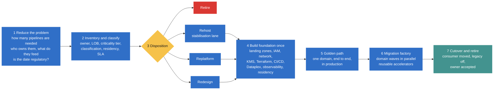

> **Reduce.** "With 2,000 pipelines across five lines of business I first want to know how many are genuinely required, who owns each, which business product it supports, how critical it is, and which can be retired. Then the **residency** requirement, precisely: which jurisdiction, does it apply to all data or only classes like PII and payment data, and does it cover backups, logs, metadata, encryption keys and disaster recovery? And whether eight months is a **regulatory date** or a board preference, because if the date cannot move, scope and strategy have to bend around it. **The question that decides the schedule is who has authority to retire a pipeline.**"

**1. Inventory before migration.** The inventory is the first deliverable, not a discovery exercise, because you cannot sequence 2,000 pipelines you have not classified.

```
Pipeline
├── Business owner          ├── Criticality: Tier 0 / 1 / 2
├── LOB / domain            ├── Batch / streaming / CDC
├── Source                  ├── Data classification
├── Target and consumers    ├── Residency boundary
├── SLA                     ├── Current technology
└── Migration pattern  →  Retire | Rehost | Replatform | Redesign
```

Classifying first stops you spending eight months faithfully migrating things nobody uses.

**Flow 2. The three options, and why waves win**

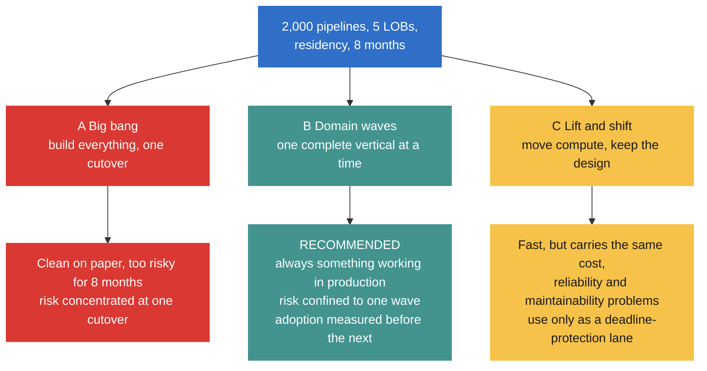

> **Options and recommendation.** "A, big bang: theoretically clean, too risky, and it will not land in eight months. B, **domain-aligned waves**: each wave is a complete production vertical from source through processing into BigQuery to a named business consumer, proven before the next starts. C, lift and shift: fast, but it imports today's cost and reliability problems into GCP. I recommend **B**, because it makes the operating model, not the pipeline, the unit of delivery. And I'd run **C as an explicit stabilisation lane** for workloads we cannot realistically redesign before the deadline: move them with minimal change, modernise later. That protects the date without pretending the mess is solved."

**Flow 3. Platform control plane versus domain-owned data products (the federated model)**

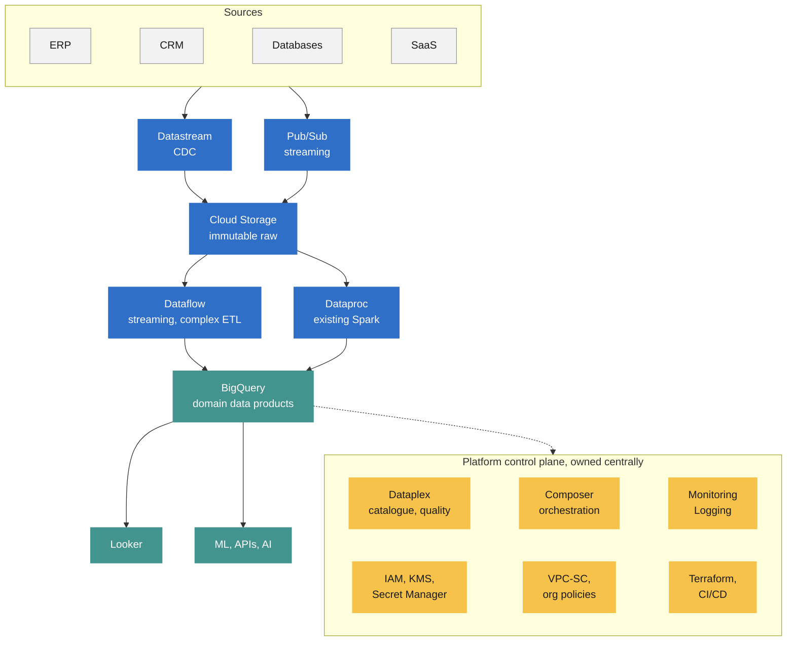

| Central platform team owns | Domains own |
|---|---|
| IAM patterns, networking, encryption | Business definitions |
| Terraform modules, CI/CD templates | Transformation logic |
| Observability, residency controls, guardrails | Data quality and SLAs |
| Reference architectures | The data products and their consumers |

"I wouldn't let each line of business design its own GCP platform. The platform team builds the foundation once, and domains build on the golden path."

**Flow 4. Residency is an architectural boundary, not a BigQuery setting**

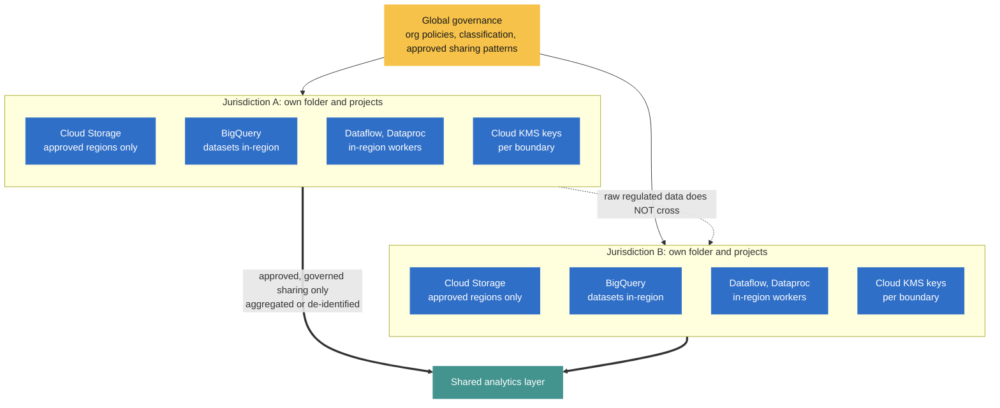

Enforced with: separate folders and projects per jurisdiction; resource-location **organisation policies** so drift is blocked, not just detected; IAM; **VPC Service Controls**; Cloud KMS keys per boundary (CMEK where required); private connectivity; dataset and bucket locations; audit logs; classification through policy tags. **I would not let one logical dataset span jurisdictions, because every query then becomes a residency question.** And I'd explicitly **test backups, DR, logs, metadata and key location**, since residency does not end at the primary BigQuery dataset.

**Flow 5. The 8-month plan: discovery and foundation in parallel, not in series**

```mermaid
flowchart LR
    subgraph M1["Month 0 to 1: discover and build, in parallel"]
        direction TB
        M1a["Inventory 2,000 pipelines<br/>classify: retire, rehost,<br/>replatform, redesign"]
        M1b["Foundation: landing zones, IAM,<br/>network, residency controls, KMS,<br/>Terraform, CI/CD, monitoring, Dataplex"]
    end
    subgraph M2["Month 2: golden path"]
        direction TB
        M2a["One representative domain,<br/>source to consumer to<br/>production support"]
    end
    subgraph M3["Months 3 to 6: migration factory"]
        direction TB
        M3a["Wave 1: critical domain"]
        M3b["Wave 2: finance"]
        M3c["Wave 3: customer"]
        M3d["Wave 4: supply chain<br/>reusable accelerators:<br/>Terraform modules, Dataflow templates,<br/>Composer DAG templates, DQ templates,<br/>validation framework"]
    end
    subgraph M4["Months 7 to 8: cutover and retire"]
        direction TB
        M4a["Consumers moved, reconciled,<br/>SLA met, owner accepted,<br/>legacy off, cost removed"]
    end
    M1 --> M2 --> M3 --> M4
    classDef blue fill:#306FC7,stroke:#306FC7,color:#fff
    classDef yellow fill:#F6C24A,stroke:#F6C24A,color:#1a1a1a
    classDef green fill:#43938F,stroke:#43938F,color:#fff
    class M1a,M1b,M3a,M3b,M3c,M3d blue
    class M2a yellow
    class M4a green
```

| Phase | What happens | Why |
|---|---|---|
| Month 0 to 1 | Inventory and classification run **alongside** the foundation build | Two months of discovery before any engineering burns a quarter of the schedule |
| Month 2 | **Golden path**: one domain, end to end through quality, security, Looker, monitoring and production support | It becomes the reference implementation every later wave copies |
| Months 3 to 6 | **Migration factory**: parallel waves with reusable accelerators | You are not hand-building 2,000 migrations; you are running a factory |
| Months 7 to 8 | Cutover and retirement | The project is not finished when pipelines run in GCP |

**Flow 6. The definition of "done" (the strongest leadership signal in this answer)**


"'Two thousand pipelines exist in GCP' is not done. **Consumer moved, legacy off** is done."

> **What I'd measure.** "Not percentage of pipelines migrated as the executive KPI. A pipeline can be migrated and still be unused."

| Group | Measures |
|---|---|
| Migration | Migrated, validated, cut over, **retired** |
| Business | Domains live, named consumers adopted, time to first value, critical data products migrated |
| Operations | Incidents, MTTR, freshness and SLA attainment, deployment frequency, data-quality failures |
| Economics | Cost per pipeline, cost per TB, BigQuery consumption, legacy infrastructure retired |
| Regulatory | **Residency violations = zero** |

> **What could go wrong.** "The likeliest failure is not technical: a wave is complete by pipeline count but nobody uses the outputs, so the platform changes nothing about a decision. Second, ownership sits with teams that have no incentive to retire anything, so the count never falls. So I make **retirement a funded deliverable in each wave**, with the business owner named, and I track adopters and retired pipelines as first-class KPIs. Third, the stabilisation lane quietly becomes permanent, so every lane-C workload gets a modernise-by date and an owner."

**Spoken answer (about 2 minutes).** Notation: `//` short pause, `///` long pause, **bold** = stress.

> "I wouldn't treat 2,000 pipelines as 2,000 migration tasks. // I'd treat them as a **portfolio that needs classifying first**. ///
>
> I'd identify the business owner, consumer, criticality, residency class and disposition of every pipeline: // retire, rehost, replatform or redesign. // And I'd clarify the residency rule and whether eight months is a regulatory date. ///
>
> I wouldn't recommend a big bang. // I'd use **domain-aligned waves**, where each wave is a complete production vertical, // source through Dataflow or Dataproc into BigQuery to a named business consumer. // And I'd build the common foundation **once**: IAM, networking, Terraform, CI/CD, Dataplex, observability and residency controls, // so domains build on a golden path instead of inventing their own platform. ///
>
> Residency is a **structural boundary**. // Separate projects and locations per jurisdiction, // organisation policies that block drift, // VPC Service Controls and IAM around sensitive data, // keys managed in Cloud KMS, // and data crossing only through approved patterns. ///
>
> I'd keep a **stabilisation lane** for workloads that can't be redesigned before the deadline, // moved with minimal change and modernised later. ///
>
> And migration isn't complete when a pipeline runs in GCP. // It's complete when the **consumer has moved, reconciliation passes, the SLA is met, and the legacy pipeline is switched off**. // So my executive dashboard shows adoption and retirement, not just migration count."

**Likely follow-ups**

| Probe | 20-second answer |
|---|---|
| "Who decides what gets retired?" | "That is the question that sets the schedule. I get a named business owner per pipeline and a decision rule: no consumer in 90 days and no regulatory duty means retire, with a sign-off, not a quiet deletion." |
| "How do five LOBs agree on one platform?" | "Federated: the platform team owns guardrails and the golden path, domains own definitions, quality and SLAs. Standards are the paved road, not a gate." |
| "Why not Dataflow for everything?" | "Rewriting working Spark because Dataflow is newer is a cost with no business outcome. Existing Spark goes to Dataproc, streaming and new pipelines go to Dataflow, and I choose per workload on measured need." |
| "What if the deadline is regulatory and the scope doesn't fit?" | "Then scope bends, not the date. Tier 0 and regulated data go first, the stabilisation lane takes the rest, and I put the trade-off in front of the sponsor with the named risk owner." |
| "How do you stop quality regressing across 2,000 migrations?" | "A migration validation framework that every wave uses: row counts, aggregates, key checks, freshness and consumer KPIs, with dual run for Tier 0 and 1 before cutover." |
| "How do you prove residency?" | "Org policies block non-approved locations, audit logs show where data sits, and I test backups, DR, logs, metadata and key location, not just the primary dataset." |

**Key elements:** The 2,000-pipeline problem is solved by **classification and wave sequencing, not by platform choice**; retirement is a funded deliverable; the domain vertical slice is the unit of delivery; central control plane with domain-owned products; residency is a *structural* constraint, not a config toggle; discovery and foundation run in parallel; "done" means consumer moved and legacy off; adoption tracked as a KPI.

**Pass signal:** You talk about **retiring** pipelines and **operating-model adoption** before the interviewer raises them, and you define done as consumer moved and legacy off.
**Fail signal:** A BigQuery/Dataflow component list with no sequencing logic and no mention of who owns the change.

---

### Q8. "A pipeline fails 40% of the time and the team is firefighting. What do you do in the first week?"

**Framework:** Stabilise → Diagnose → Fix the class → Prevent recurrence

**The frame to say first:** "A 40% failure rate tells me the team needs **stability before transformation**. My first week is Stabilise, Diagnose, Fix the class, Prevent recurrence."

**The line to memorise:** "**Don't fix 100 pipeline failures. Find the three failure patterns responsible for 70 of them and engineer those failures out of the platform.**"

**Flow 1. The week on one page**

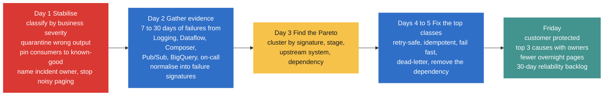

> **First, protect the customer and the data.** "I classify failures by **business severity**, not by which alert is loudest.
> - Wrong or incomplete data reaching customers, finance or operational systems: **stop or quarantine the output now.**
> - Pipeline failure with no corruption: recover by business priority.
> - Noisy failures with limited impact: behind the higher-priority incidents.
>
> **Second, find the failure classes.** Forty percent does not mean hundreds of independent problems. I take the last 7 to 30 days and cluster failures by error signature, pipeline stage, upstream system and dependency. I want to know whether most of the volume comes from three things: say upstream schema changes, Dataflow resource failures and Composer retry and dependency problems. Once I know that, I stop fixing pipelines and start fixing the **common failure mechanism**.
>
> **Third, make failures visible.** Cloud Monitoring, Cloud Logging, Dataflow and Composer metrics, one operational view: failure class, business impact, owner, start time, retries, dependency, recurrences.
>
> **Then fix the class permanently, and don't do the one thing that looks like action.** I would not announce a new orchestration platform or rebuild the architecture in week one. The team is overloaded, and a new technology adds failure surface before we understand the existing one."

**Flow 2. Diagnosing stage by stage on Google Cloud**

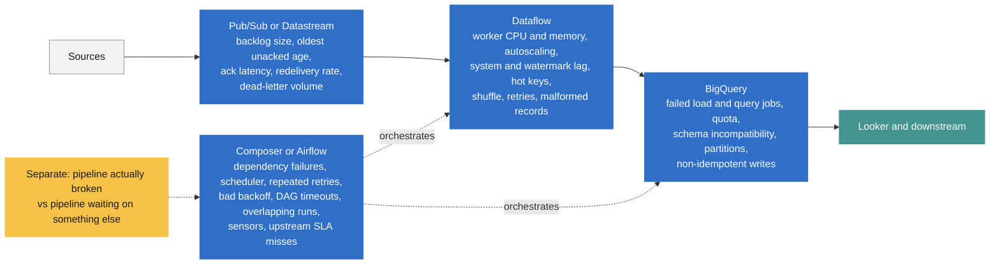

| Signal | What it points at | The question to ask, not the reflex |
|---|---|---|
| Pub/Sub backlog up **and** oldest unacked age up | Dataflow consuming slowly | Worker or resource problem, hot key, or an external dependency? Adding workers can hide the symptom |
| The same out-of-memory error across 200 pipelines | A weakness in the standard pattern | "Why does our standard Dataflow pattern allow this class of failure?" Fix sizing, skew, hot keys, oversized side inputs or batching once, not 200 tickets |
| Composer task retrying five times | Bad retry policy on a non-transient error | Is it broken, or waiting on an upstream? Retries are not a fix |

**Flow 3. The classic cascade, and the structural fix**

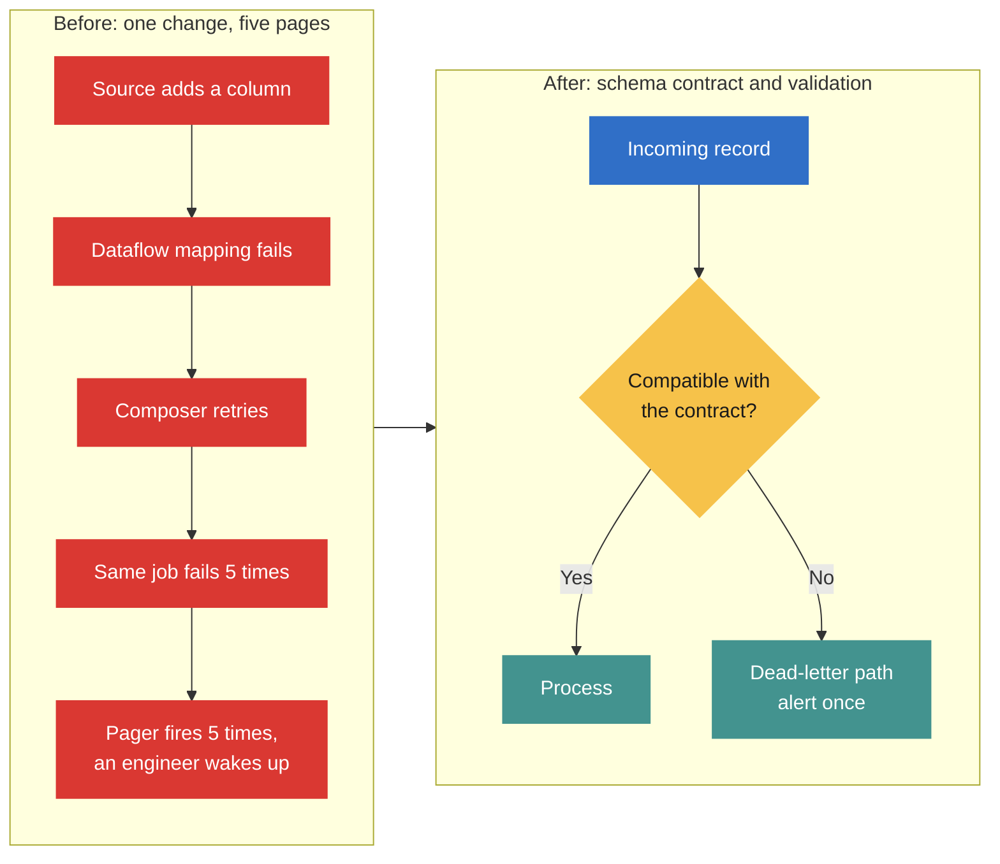

"The answer is not 'give Composer more retries.' One malformed record should not kill a billion-record pipeline."

**Flow 4. "Fix the class": five patterns**

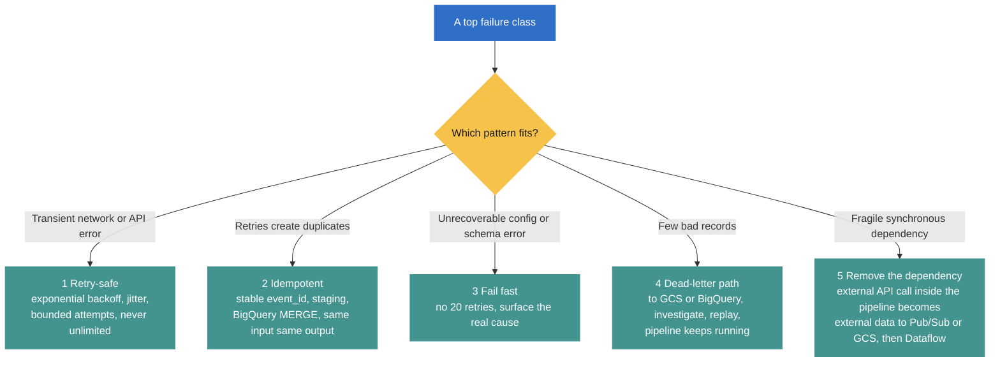

**Day-by-day**

| Day | Do | Output |
|---|---|---|
| 1 Stabilise | Identify business-critical pipelines. Quarantine incorrect output. Pin consumers to known-good data. Establish incident ownership. Stop duplicate and noisy paging. | Customer protected |
| 2 Evidence | Pull 7 to 30 days from Cloud Logging, Dataflow, Composer, Pub/Sub, BigQuery and the on-call record. Normalise failure signatures. | One dataset of failures |
| 3 Pareto | Cluster and rank. The shape is what matters: an illustrative split might be schema changes, transient source failures, memory and hot keys, bad retry behaviour, everything else. **The real numbers come from your incident data**, not from this example. | Three classes cover most of the volume |
| 4 to 5 Fix | Schema problems: contract, validation, DLQ. Transient: bounded backoff with jitter. Duplicate writes: idempotency and MERGE. OOM: skew, hot keys, worker config. Alert storms: deduplicate and route by business severity. | Top classes engineered out, owners and dates named |

Friday is not the end of the programme. It means the team has stopped blindly firefighting and has a 30-day reliability backlog.

**What I put on the wall**

| Metric | Why |
|---|---|
| Failure rate **by root cause** | Shows what to eliminate |
| Data-correctness incidents | The real business risk |
| MTTD and MTTR | Detection and recovery speed |
| Repeat-incident rate | Are we fixing root causes? |
| Pub/Sub backlog age, Dataflow system and watermark lag | Early-warning health |
| SLA attainment | Customer impact |
| **Pages reaching an engineer overnight** | The most human reliability metric, and the strongest leadership one |

> "A platform can have hundreds of automatically recovered technical failures and still be healthy. How many times did we wake an engineer up this week?"

**Spoken answer (about 90 seconds).** Notation: `//` short pause, `///` long pause.

> "With a 40% failure rate I would not introduce a new platform in week one. // I'd stabilise what we have. ///
>
> Day one, I classify incidents by **business impact**. // Wrong data reaching a customer is stopped immediately. // A failed pipeline with safe data is lower priority. // And noisy alerts with no material impact don't get to dictate the team's priorities. ///
>
> Then I analyse the previous 7 to 30 days of failures across Cloud Logging, Dataflow, Pub/Sub, Composer and BigQuery, and group them by root-cause signature. // I'm looking for the **Pareto**. // If most failures come from schema changes, transient source failures and Dataflow memory pressure, // I fix those three engineering patterns rather than repairing pipelines one by one. ///
>
> Depending on the cause, I make pipelines retry-safe with bounded backoff, idempotent through deterministic keys and MERGE, fail-fast on non-recoverable errors, or route malformed records to a dead-letter path instead of crashing the pipeline. ///
>
> By Friday I want three things: // the customer protected, // the top root causes understood with named owners, // and measurably less firefighting. // My most human metric is how many pages reached an engineer overnight. ///
>
> I don't judge success by how fast my team fights fires. // I judge it by how many fires we've designed out of the system."

**Connecting it to your own history, honestly.** Your **current resume does not carry an incident-reduction percentage.** Do not say "reduced incidents by 60%" unless you can state the baseline count, the definition of an incident, the window and what else changed. Say the mechanism instead, and the number only if you have it:

> "I've dealt with this before. Rather than treating each incident separately, we categorised the recurring failures, found the few common causes behind most of the operational load, and changed the engineering patterns around those causes. The lesson: reliability doesn't improve because engineers become faster firefighters. It improves when you remove the reasons they need to fight fires."

If asked "how, exactly?", answer with your **real** top root causes and the mechanism you implemented. If you do not have them to hand, say so and describe the method. The structure is drafted; the facts are yours to supply (see `ROUND_1_RRK_GAP_CLOSURE.md` §6).

**Key elements:** Triage by business severity; root-cause *classing* not instance-fixing; data correctness first; stage-by-stage GCP diagnosis; five fix-the-class patterns; dead-letter path; explicit refusal of a platform change in week one; a metric that reflects the pain (pages reaching a human overnight).

**Pass signal:** You find the class before the instance and you refuse to add a platform in week one.
**Fail signal:** "I would introduce Airflow or Databricks and add monitoring": it changes surface area while the team is overloaded. Or quoting a reduction percentage with no baseline.

---

### Q9. "Your team ships a data product that silently produces wrong numbers. How do you handle it — technically and organisationally?"

**Framework:** Contain → Communicate → Find why detection failed → Recover → Make recurrence structurally harder

**The frame to say first:** "I treat silently wrong data as **more serious than a failed pipeline**. A failed pipeline is visible. Wrong data can look healthy while customers make decisions from it."

**The line to memorise:** "**A green pipeline does not mean green data.**"

**Flow 1. The whole answer on one page**

```mermaid
flowchart LR
    C["1 Contain<br/>quarantine bad output<br/>serve last certified snapshot<br/>keep raw landing"]
    M["2 Communicate<br/>before the RCA is finished<br/>what, since when, can I trust it,<br/>what to use, next update"]
    W["3 Why was it silent?<br/>source, transformation,<br/>semantic, detection"]
    R["4 Recover<br/>rebuild from immutable raw,<br/>full reconciliation,<br/>not spot checks"]
    G["5 Gate and own<br/>quality gates block publication<br/>named owners for correctness"]
    T["6 Restore trust<br/>blameless postmortem,<br/>publish what changed"]
    C --> M --> W --> R --> G --> T
    classDef red fill:#DA3832,stroke:#DA3832,color:#fff
    classDef blue fill:#306FC7,stroke:#306FC7,color:#fff
    classDef yellow fill:#F6C24A,stroke:#F6C24A,color:#1a1a1a
    classDef green fill:#43938F,stroke:#43938F,color:#fff
    class C red
    class M,R,G blue
    class W yellow
    class T green
```

**1. Contain immediately.** "First I stop the wrong numbers spreading." I would **not** necessarily shut ingestion down, because I want the raw data and the evidence.

**Flow 2. Containment: keep the raw, block the output, serve the last good**

```mermaid
flowchart LR
    SRC["Source"] --> PL["Pipeline"]
    PL --> RAW["Cloud Storage raw<br/>keeps landing, evidence preserved"]
    PL -->|"affected output"| QU["Blocked and quarantined<br/>affected BigQuery table or view"]
    GOOD["Last known-good<br/>certified snapshot"] --> LK["Looker and consumers<br/>affected content marked<br/>stale or unavailable"]
    QU -.->|"not served"| LK
    classDef blue fill:#306FC7,stroke:#306FC7,color:#fff
    classDef red fill:#DA3832,stroke:#DA3832,color:#fff
    classDef green fill:#43938F,stroke:#43938F,color:#fff
    classDef yellow fill:#F6C24A,stroke:#F6C24A,color:#1a1a1a
    class SRC,PL blue
    class RAW yellow
    class QU red
    class GOOD,LK green
```

In practice: stop publishing the affected table or view, point consumers at the last known-good snapshot where appropriate, mark affected Looker content or data products stale, preserve raw events in Cloud Storage, and record the exact affected partitions and time range. **Fresh-but-wrong is worse than stale-but-known-good.**

**2. Communicate before the investigation is finished.** Do not wait six hours to know everything.

> "We identified a correctness issue affecting sales aggregates from 09:00 onward. The affected output has been quarantined and the last verified dataset remains available. We're validating whether any decisions or reports consumed the incorrect values. Next update in 60 minutes."

What the consumer needs: **what is affected, since when, can I trust it, what should I use instead, when is the next update.** What not to say: "Dataflow is broken." They do not care about the component.

**3. The critical question: why was it silent?**

Dataflow job success, BigQuery load success, Composer DAG success, Looker refresh success, and revenue is wrong by 18%. That is the real engineering problem: **job success is not data correctness.**

**Flow 3. Four places the defect can live, and how each hides behind green**

```mermaid
flowchart TD
    Q["Revenue is wrong by 18%<br/>every job is green"] --> A["A Source correctness"]
    Q --> B["B Transformation correctness"]
    Q --> SM["C Semantic correctness"]
    Q --> DT["D Detection failure"]
    A --> A1["Producer changed schema, units, timezone,<br/>currency, null semantics or key<br/>Example: price was THB, now satang,<br/>revenue 100x wrong, everything succeeds"]
    B --> B1["Bad join, many-to-many explosion,<br/>bad filter, duplicates, timezone boundary,<br/>late events, precision, wrong grain<br/>Example: 1 order joins 4 promotions,<br/>revenue 4x"]
    SM --> S1["Two teams define Net Sales differently<br/>engineering is right, the data-product<br/>contract failed"]
    DT --> D1["What test should have failed<br/>before the customer saw this?"]
    classDef red fill:#DA3832,stroke:#DA3832,color:#fff
    classDef blue fill:#306FC7,stroke:#306FC7,color:#fff
    classDef yellow fill:#F6C24A,stroke:#F6C24A,color:#1a1a1a
    classDef green fill:#43938F,stroke:#43938F,color:#fff
    class Q red
    class A,B,SM blue
    class DT yellow
    class A1,B1,S1,D1 green
```

The question that matters most is the last one: **"What test should have failed before the customer saw this?"** Infrastructure monitoring will never catch a unit change or a join that multiplies rows.

**4. Recover through reconciliation, not spot checking.** "We checked ten rows" is not acceptable. Identify the last verified checkpoint and rebuild the affected partitions from the immutable source.

**Flow 4. Recovery and publication**

```mermaid
flowchart LR
    RAW["Cloud Storage raw<br/>immutable"] --> FX["Corrected Dataflow<br/>or SQL logic"]
    FX --> ST["BigQuery staging"]
    ST --> RC{"Automated<br/>reconciliation<br/>vs source"}
    RC -->|"fails"| FX
    RC -->|"passes"| CE["Certified table"]
    CE --> LK["Looker"]
    classDef blue fill:#306FC7,stroke:#306FC7,color:#fff
    classDef yellow fill:#F6C24A,stroke:#F6C24A,color:#1a1a1a
    classDef green fill:#43938F,stroke:#43938F,color:#fff
    class RAW,FX,ST blue
    class RC yellow
    class CE,LK green
```

| Compare | Source vs target |
|---|---|
| Row count | equal |
| Order count and distinct orders | equal |
| Sum of quantity | equal |
| Sum of revenue | equal |

For financial metrics I expect **exact** reconciliation where the business semantics allow it, not an arbitrary percentage tolerance.

**5. Data-quality gates at every critical boundary.** Failing a gate blocks publication.

| Gate | Example |
|---|---|
| Schema | Expected column disappears: fail. Type changes: fail. Unexpected breaking schema: quarantine |
| Completeness | Row count against expected volume and historical behaviour |
| Uniqueness | `GROUP BY order_id HAVING COUNT(*) > 1` returns zero rows |
| Nulls | Explicit contract on `order_id`, `customer_id`, `transaction_timestamp`, `amount`, `currency` |
| Referential integrity | `order.customer_id` must exist in `customer.customer_id` |
| Business assertions | Revenue at least zero; discount no more than gross; shipped orders no more than total; inventory within physical limits |

```sql
SELECT order_id, COUNT(*) AS n
FROM dataset.orders
WHERE order_date = @publish_date
GROUP BY order_id
HAVING COUNT(*) > 1;      -- expected: zero rows
```

"Technical tests alone are not enough. The business assertions are where a mature platform gets much stronger."

**Flow 5. Where the gates sit on Google Cloud**

```mermaid
flowchart LR
    PR["Producer<br/>data contract"] --> PS["Pub/Sub or Datastream"]
    PS --> DF["Dataflow<br/>validate and route"]
    DF -->|"good"| ST["BigQuery staging"]
    DF -->|"bad"| DLQ["Dead-letter path"]
    ST --> RC["Reconciliation<br/>and assertions"]
    RC -->|"pass"| CE["Certified BigQuery"]
    RC -->|"fail"| BLK["Publication blocked<br/>alert owner"]
    CE --> LK["Looker<br/>certified semantic definitions"]
    CO["Composer: validate, transform,<br/>reconcile, publish"] -.-> RC
    classDef blue fill:#306FC7,stroke:#306FC7,color:#fff
    classDef red fill:#DA3832,stroke:#DA3832,color:#fff
    classDef green fill:#43938F,stroke:#43938F,color:#fff
    classDef yellow fill:#F6C24A,stroke:#F6C24A,color:#1a1a1a
    class PR,PS,DF,ST,RC blue
    class DLQ,BLK red
    class CE,LK green
    class CO yellow
```

| Service | Role |
|---|---|
| Cloud Storage | Immutable raw data for recovery and reprocessing |
| Dataflow | Validation, transformation, routing of invalid records |
| BigQuery | Reconciliation queries, assertions, certified datasets |
| Dataplex | Governance, metadata, data-quality rules |
| Cloud Monitoring and Logging | Freshness, quality and SLA alerts |
| Looker | Certified semantic definitions, consumer-facing metrics |
| Composer | Sequence validation, transformation, reconciliation, publication |

**6. The organisational fix is equally important.** Ownership is explicit:

| Role | Owns |
|---|---|
| Business owner | What the number **means** |
| Producer owner | The source contract |
| Data product owner | Correctness and SLA |
| Platform team | Reliable execution |
| Consumer | A clear defect and feedback channel |

That prevents "my Dataflow job was green, so it's not my problem." **The team owns the correctness of the product, not merely whether the job ran.**

**7. Run a blameless postmortem.** Not "who wrote the bad SQL?" but "how was one person's mistake able to reach production without the system detecting it?" Human error can be the trigger. It should not be the final root cause.

```mermaid
flowchart LR
    P1["What happened?"] --> P2["Why were the<br/>numbers wrong?"]
    P2 --> P3["Why did automated<br/>controls miss it?"]
    P3 --> P4["Why did consumers<br/>detect it first?"]
    P4 --> P5["What control prevents<br/>the whole class?"]
    P5 --> P6["Owner and date"]
    classDef blue fill:#306FC7,stroke:#306FC7,color:#fff
    classDef green fill:#43938F,stroke:#43938F,color:#fff
    class P1,P2,P3,P4,P5 blue
    class P6 green
```

**8. Restore trust.** Say specifically what happened, not "fixed now":

> "Sales data between 09:00 Tuesday and 14:00 Wednesday was affected by duplicate joins from an upstream change. We reprocessed that period from the raw source, reconciled order counts and financial totals against the source system, and republished the corrected dataset. We've added a cardinality and revenue reconciliation gate so this failure class now blocks publication."

**What I measure**

| Measure | Target |
|---|---|
| Incorrect records reaching consumers | 0 |
| Critical reconciliation failures caught **before** publication | Tracked |
| Data-quality rule coverage on Tier-1 products | Rising |
| Time to detect, time to correct | Falling |
| Repeat incidents of the same class | 0 |
| Source-contract violations, consumer-reported defects | Falling |
| **Share of correctness problems found by us before consumers** | Toward 100% for critical products |

**Spoken answer (about 90 seconds).** Notation: `//` short pause, `///` long pause.

> "I treat silently wrong numbers as more serious than a failed pipeline, // because a failed pipeline tells you it's broken. // A green pipeline can quietly damage business decisions. ///
>
> First I **contain** it. // I stop publication of the affected BigQuery product, // preserve the raw data, // and fall back to the last certified snapshot. ///
>
> Second I **communicate** immediately. // I don't wait for the root cause. // Consumers need to know what is affected, since when, whether to use the numbers, and when they'll hear from us again. ///
>
> Then I look for both the **data defect** and, more importantly, the **detection defect**. // If Dataflow, Composer and BigQuery all reported success while the business number was wrong, // our definition of success is incomplete. // I'd check the source contract, the transformation, join cardinality, duplication and the business definition. // Then I reprocess from a known-good source and reconcile fully, not spot-check. ///
>
> Permanently: data contracts and automated tests for schema, volume, uniqueness, nulls, referential integrity and critical business metrics, // with a failed check **blocking publication**. // Every critical data product gets a named business owner and technical owner, // and the team owns correctness, not just job execution. ///
>
> And I publish exactly what happened, what was affected, how it was corrected and what control we added. ///
>
> Pipeline success tells me the code ran. // Reconciliation and business assertions tell me the data is right."

**Likely follow-ups**

| Probe | 20-second answer |
|---|---|
| "How would you have known before the customer?" | "A reconciliation gate on row counts and key business totals before publication, plus freshness and volume anomaly alerts. The share of defects found by us first is the metric I track." |
| "Why not shut the whole pipeline down?" | "I want the raw data and the evidence. I block the affected output and serve the last certified snapshot, so consumers have something trustworthy." |
| "What if the business definition itself is disputed?" | "That is a data-product contract failure, not a bug. The business owner decides what the number means, it is written once in the semantic layer, and the pipeline is tested against that." |
| "Who is accountable?" | "The data product owner for correctness and SLA. The platform team for reliable execution. Neither can say the job was green." |
| "Have you seen this?" | Answer from your own history only. If you do not have a specific case you can stand behind, give the method and say so. |

**Key elements:** Contain honestly and tell people at once; ask how it went **undetected**, because success is not correctness; four layers (source, transformation, semantic, detection); reconciliation not spot checks; gates that block publication; named ownership of correctness; blameless postmortem; trust restored with specifics.

**Pass signal:** You say **"job success is not data correctness"** unprompted and make the detection failure, not the bug, the root cause.
**Fail signal:** "I'd fix the bug and re-run it." Or hiding the incident while the fix is built.

---

### Q10. "Where do you draw the line between BigQuery, Dataproc and Bigtable?"

**Framework:** Workload shape first, with the deciding question stated up front

**The frame to say first:** "I don't choose on data volume. I choose on **workload shape, access pattern, latency requirement, and who consumes the result**."

**The line to memorise:** "**BigQuery to analyse, Dataproc to compute, Bigtable to serve by key.**"

**Flow 1. The decision**

```mermaid
flowchart TD
    Q{"What shape is the workload<br/>and what does the consumer need?"}
    Q -->|"SQL, large scans, joins, aggregations,<br/>dashboards, ad-hoc, analytical ML"| BQ["BigQuery<br/>the default for analytics<br/>managed, no Spark operations burden"]
    Q -->|"Spark-shaped: existing PySpark or Scala,<br/>specialised libraries, iterative work,<br/>rewrite has poor return"| DP["Dataproc<br/>you operate clusters and on-call"]
    Q -->|"Application needs a value by known key,<br/>very high request rate,<br/>predictable low latency"| BT["Bigtable<br/>a serving database, not an analytics engine"]
    BQ --> A1["Tell me about millions or billions of rows"]
    DP --> A2["Process these millions or billions of rows"]
    BT --> A3["Here is my key, give me the answer fast"]
    classDef red fill:#DA3832,stroke:#DA3832,color:#fff
    classDef blue fill:#306FC7,stroke:#306FC7,color:#fff
    classDef yellow fill:#F6C24A,stroke:#F6C24A,color:#1a1a1a
    classDef green fill:#43938F,stroke:#43938F,color:#fff
    class Q yellow
    class BQ,DP,BT blue
    class A1,A2,A3 green
```

> "BigQuery is my default for analytics: users need SQL, large scans, joins, aggregations, dashboards or ad-hoc analysis, and it avoids creating a Spark operations problem for no reason. Dataproc is for Spark-shaped computation: existing PySpark or Scala, specialised libraries, iterative processing, or a migration where rewriting mature Spark logic adds little business value. Bigtable is different, it is a **serving database**: very high-throughput, low-latency lookups by a known key. I would not pick it for arbitrary joins or BI queries."

**Flow 2. One domain, three workloads (retail example)**

```mermaid
flowchart LR
    subgraph W1["Tell me what happened"]
        direction TB
        U1["Business user: sales by store, category<br/>and customer segment, last 12 months"] --> E1["BigQuery<br/>scan, join, aggregate, Looker"]
    end
    subgraph W2["Process this"]
        direction TB
        U2["Hundreds of mature PySpark pipelines<br/>joining transactions, customers,<br/>products, promotions"] --> E2["Dataproc<br/>keep proven Spark logic, no forced rewrite"]
    end
    subgraph W3["Give me this now"]
        direction TB
        U3["Application: customer_id = 827234<br/>latest features, state, device history"] --> E3["Bigtable<br/>keyed read, predictable latency"]
    end
    classDef red fill:#DA3832,stroke:#DA3832,color:#fff
    classDef blue fill:#306FC7,stroke:#306FC7,color:#fff
    classDef yellow fill:#F6C24A,stroke:#F6C24A,color:#1a1a1a
    classDef green fill:#43938F,stroke:#43938F,color:#fff
    class U1,U2,U3 blue
    class E1,E2,E3 green
```

If a rewrite creates no value, the pattern is: Cloud Storage, then Dataproc computes, then BigQuery serves the analytical consumer. **Dataproc does the computation; BigQuery serves the analyst.** That also makes it a low-risk migration step, because proven Spark engineering is preserved while the rest of the platform modernises.

**Flow 3. They coexist: one platform, three engines**

```mermaid
flowchart LR
    IN["Pub/Sub, Cloud Storage"] --> PR["Processing layer<br/>Dataflow and Dataproc"]
    PR --> BQ["BigQuery<br/>analytics"]
    PR --> BT["Bigtable<br/>online serving"]
    BQ --> LK["Looker<br/>analysts and dashboards"]
    BT --> AP["Applications and APIs<br/>precomputed features by customer_id"]
    classDef red fill:#DA3832,stroke:#DA3832,color:#fff
    classDef blue fill:#306FC7,stroke:#306FC7,color:#fff
    classDef yellow fill:#F6C24A,stroke:#F6C24A,color:#1a1a1a
    classDef green fill:#43938F,stroke:#43938F,color:#fff
    class IN,PR blue
    class BQ,BT yellow
    class LK,AP green
```

For example, Dataproc computes a large Spark feature set. The output goes to BigQuery so analysts can study customer behaviour, **and** to Bigtable so an online application retrieves a customer's precomputed features by `customer_id`. Same domain, different access patterns.

**When I move off BigQuery**

| Stay with BigQuery | Move toward Bigtable | Move toward Dataproc |
|---|---|---|
| TB to PB analytics | A known access key | An existing Spark estate |
| SQL and joins | Very high request volume | PySpark or Scala, Spark-ecosystem dependencies |
| Seconds-level interactive | Predictable low operational latency | Specialised distributed transformations |
| BI and analysts | Application serving | **A rewrite with poor return** |

The decision needs an **economic or measurable reason**, not a preference.

**Flow 4. The four traps**

```mermaid
flowchart TD
    T["Traps to call out"] --> T1["1 BigQuery as an operational database<br/>5,000 requests a second of<br/>SELECT ... WHERE customer_id = ?"]
    T --> T2["2 Bigtable for analytics<br/>joins, GROUP BY and arbitrary filters<br/>on a row-key model"]
    T --> T3["3 Spark because it is big data<br/>50 TB does not mean Spark,<br/>data size alone decides nothing"]
    T --> T4["4 Rewriting working Spark to look modern<br/>migration cost, no business value"]
    T1 --> F1["Serve by key from Bigtable<br/>or another serving store"]
    T2 --> F2["Analyse in BigQuery,<br/>design Bigtable rows for known access"]
    T3 --> F3["If it is mostly SQL transforms,<br/>BigQuery is simpler to operate"]
    T4 --> F4["Modernisation is not measured by<br/>how many technologies you remove"]
    classDef red fill:#DA3832,stroke:#DA3832,color:#fff
    classDef blue fill:#306FC7,stroke:#306FC7,color:#fff
    classDef yellow fill:#F6C24A,stroke:#F6C24A,color:#1a1a1a
    classDef green fill:#43938F,stroke:#43938F,color:#fff
    class T red
    class T1,T2,T3,T4 yellow
    class F1,F2,F3,F4 green
```

**My default stance, stated so it is hard to challenge**

> "For a **new analytical workload**, BigQuery is my default. I introduce **Dataproc** when the workload or an existing Spark investment gives me a measurable reason. I introduce **Bigtable** when the consumer changes from analytical querying to low-latency keyed serving."

Note the refinement from "start serverless and move to Dataproc when a constraint forces it": Bigtable and Dataproc are not simply the next step after BigQuery. They are **different workload shapes**.

**Spoken answer (about 60 seconds).** Notation: `//` short pause, `///` long pause.

> "I draw the line on **workload shape**, not data size. ///
>
> **BigQuery** is my default for analytics: // large scans, SQL, joins, aggregations, BI and ad-hoc analysis. ///
>
> **Dataproc** is for genuinely Spark-shaped computation: // complex PySpark or Scala, specialised libraries, // or a mature Spark estate where rewriting doesn't create enough value. ///
>
> **Bigtable** is a serving decision. // If an application needs high-throughput, predictable low-latency access by a known key, // that's when I'd consider it. ///
>
> They don't necessarily compete. // Dataproc might compute customer features, // BigQuery holds them for analytics, // and Bigtable serves the latest features to an online application. ///
>
> The two anti-patterns I watch for: // running Spark just because the data is big, // and using BigQuery as an operational serving database just because the data already lives there. ///
>
> BigQuery to analyse, Dataproc to compute, Bigtable to serve by key."

**Likely follow-ups**

| Probe | 20-second answer |
|---|---|
| "Why not BigQuery for serving, if it can answer the query?" | "Capable of answering the SQL is not the same as right for a high-rate, low-latency application. You get unpredictable latency and cost. Precompute and serve by key." |
| "When is Spark worth operating?" | "When there is mature Spark code and skills, Spark-specific libraries, or iterative work that does not fit SQL, and the rewrite return is poor. I'd use serverless Dataproc where it fits so there is less cluster to run." |
| "How do you design for Bigtable?" | "Around the access pattern. The row key is the design: it must spread load and serve the known read. Hot-spotting on a sequential key is the classic mistake." |
| "Dataflow or Dataproc?" | "See Q11: continuous, event-driven, stateful work goes to Dataflow, batch and iterative Spark goes to Dataproc." |
| "What would you tell a customer who wants one engine for everything?" | "Standardising for simplicity moves the problem: you now have a tuning and capacity problem of a different shape. Pick per workload and unify the contract and orchestration." |

**Key elements:** Workload shape, access pattern, latency and consumer decide, not volume; BigQuery as the analytics default; Dataproc only with a measurable reason; Bigtable as a serving store; the three coexisting in one platform; the four traps.

**Pass signal:** You state the deciding question first and treat Bigtable and Dataproc as different workload shapes, not as "the next step after BigQuery".
**Fail signal:** "Use BigQuery for everything" or "Spark because we have big data".

---

### Q11. "When would you use Dataflow over Dataproc, and what would make you choose Spark anyway?"

**Framework:** Trade-off first, then the conditions that force the other choice

**The frame to say first:** "My default for event-driven, stateful processing on GCP is Dataflow, but I would not rewrite a good Spark workload just to standardise on Dataflow." I do not frame it as streaming versus batch, because both can cover more than that. I look at **workload semantics and existing engineering investment**, and before either I challenge the requirement: *does this actually need streaming?*

It is a **trade-off, not a ranking**. Dataflow is the managed, streaming-first choice. Spark wins when there is a real reason to keep Spark. I decide per workload, and I check whether the workload is really streaming before I choose."

**The line to memorise:** "**Dataflow for continuous, event-driven, stateful work. Spark for batch, iterative or existing Spark. And check it is really streaming first.**"

**Flow 0. Three questions, in this order**

```mermaid
flowchart TD
    Q1{"1 Does it really need streaming?<br/>What freshness does the business need?"}
    Q1 -->|"Seconds or a few minutes,<br/>event-time semantics needed"| DF["Dataflow<br/>my default for event-driven, stateful work"]
    Q1 -->|"15 minutes, hourly, daily"| Q2{"2 Is it genuinely Spark-shaped,<br/>or already Spark?"}
    Q2 -->|"Yes: large complex batch, iterative,<br/>custom PySpark or Scala, Spark ML,<br/>existing Spark estate"| DP["Dataproc, or serverless Spark"]
    Q2 -->|"No"| Q3{"3 Can SQL solve it simply?"}
    Q3 -->|"Yes, data already in BigQuery"| BQ["BigQuery with Dataform<br/>often the simplest operationally"]
    Q3 -->|"No"| DP
    classDef red fill:#DA3832,stroke:#DA3832,color:#fff
    classDef blue fill:#306FC7,stroke:#306FC7,color:#fff
    classDef yellow fill:#F6C24A,stroke:#F6C24A,color:#1a1a1a
    classDef green fill:#43938F,stroke:#43938F,color:#fff
    class Q1,Q2,Q3 yellow
    class DF,DP,BQ green
```

**Three questions to remember.** (1) Does it really need streaming? If yes, Dataflow. (2) Is it genuinely Spark-shaped or already Spark? If yes, Dataproc. (3) Can SQL solve it simply? If yes, BigQuery with Dataform.

**Simplest distinction.** Dataflow is for **events**: clickstream, payment events, IoT, inventory changes, fraud signals, real-time orders. Dataproc is for **Spark**: an existing Spark migration, large batch transformation, complex feature engineering, Spark ML, graph or iterative work, custom Spark libraries.

**Flow 1. The detailed decision**

```mermaid
flowchart TD
    Q{"Is the work continuous,<br/>event-driven and stateful?"}
    Q -->|"Yes"| F{"Is it really streaming?<br/>Does the business need seconds,<br/>or is 15 minutes enough?"}
    Q -->|"No: batch or iterative"| S{"Why Spark?"}
    F -->|"Seconds matter"| DF["Dataflow<br/>event time, windows, lateness,<br/>exactly-once state, no cluster to run"]
    F -->|"15 minutes is fine"| SQ["Scheduled BigQuery or a Dataproc batch<br/>simpler and cheaper than true streaming"]
    S -->|"Graph, large feature engineering,<br/>ML on the Spark ecosystem"| DP["Dataproc<br/>or Serverless for Apache Spark"]
    S -->|"Existing Spark code and team skills,<br/>rewrite has poor return"| DP
    S -->|"Mostly SQL transformations"| BQ["BigQuery"]
    DF --> TT["Two tracks, one contract<br/>Composer or Dataform orchestration,<br/>Dataplex catalogue, shared data contract"]
    DP --> TT
    classDef red fill:#DA3832,stroke:#DA3832,color:#fff
    classDef blue fill:#306FC7,stroke:#306FC7,color:#fff
    classDef yellow fill:#F6C24A,stroke:#F6C24A,color:#1a1a1a
    classDef green fill:#43938F,stroke:#43938F,color:#fff
    class Q,F,S yellow
    class DF,DP,SQ,BQ blue
    class TT green
```

> "Dataflow is the streaming-first, serverless, managed choice. It gives me exactly-once state processing, windowing with explicit lateness semantics, and no cluster to operate. For an enterprise team that doesn't want a platform on call, that is a real advantage. I reach for it when the work is **continuous, event-driven and stateful**.
>
> **Spark still wins** when the work is genuinely batch and iterative: graph algorithms, large feature engineering that doesn't fit a SQL model, ML training that wants the Spark ecosystem. It also wins when there is **existing Spark investment and team fluency**. Rewriting a working Spark estate to Dataflow costs real money and real time, and 'we standardised on Dataflow' is not a justification."

**Flow 2. What each one is, side by side**

```mermaid
flowchart LR
    subgraph DFB["Dataflow (Apache Beam)"]
        direction TB
        D1["Fully managed, no cluster"]
        D2["Streaming and batch, one model"]
        D3["Event time, watermarks, allowed lateness,<br/>triggers, keyed state and timers"]
        D4["Autoscaling, Streaming Engine"]
        D1 --- D2 --- D3 --- D4
    end
    subgraph DPB["Dataproc (Spark, Hadoop ecosystem)"]
        direction TB
        P1["Clusters you size and operate,<br/>or serverless Spark batches"]
        P2["Spark ecosystem and libraries,<br/>MLlib, GraphX, existing PySpark and Scala"]
        P3["Iterative and in-memory batch work"]
        P4["Ephemeral clusters keep cost honest"]
        P1 --- P2 --- P3 --- P4
    end
    classDef red fill:#DA3832,stroke:#DA3832,color:#fff
    classDef blue fill:#306FC7,stroke:#306FC7,color:#fff
    classDef yellow fill:#F6C24A,stroke:#F6C24A,color:#1a1a1a
    classDef green fill:#43938F,stroke:#43938F,color:#fff
    class D1,D2,D3,D4 blue
    class P1,P2,P3,P4 yellow
```

| Factor | Dataflow | Dataproc |
|---|---|---|
| Operations | None to run: the service manages workers | You size, tune and patrol clusters, unless you use the serverless Spark option |
| Streaming correctness | Built in: event time, lateness, state, timers | Possible with Spark Structured Streaming, but you build and run more of it |
| Existing code | Needs a rewrite into Beam | Runs existing Spark as is |
| Skills | Beam is a new skill for most teams | Spark skills are common and portable |
| Fit | Continuous, event-driven, stateful | Batch, iterative, library-heavy, ML on Spark |


**Why event time is the real reason to choose Dataflow, not "it is serverless"**

```mermaid
flowchart LR
    EV["Order happens<br/>event_time = 10:01"] --> AR["Arrives late<br/>arrival_time = 10:17"]
    AR --> WRONG["Processing-time window<br/>counts it in 10:17, wrong"]
    AR --> RIGHT["Event-time window<br/>counts it in 10:01, right"]
    RIGHT --> MECH["Beam model: event time, processing time,<br/>windows, watermarks, triggers,<br/>allowed lateness, keyed state"]
    classDef red fill:#DA3832,stroke:#DA3832,color:#fff
    classDef blue fill:#306FC7,stroke:#306FC7,color:#fff
    classDef yellow fill:#F6C24A,stroke:#F6C24A,color:#1a1a1a
    classDef green fill:#43938F,stroke:#43938F,color:#fff
    class EV,AR blue
    class WRONG red
    class RIGHT,MECH green
```

The business semantics say the order belongs to 10:01. A model built for event time, watermarks, lateness and keyed state is the actual reason to pick Dataflow for this class of work.

**When I still choose Spark.** Suppose the customer has 600 PySpark pipelines, eight years of development, custom Scala libraries, experienced Spark engineers and known reliability. I would not say "rewrite everything in Beam because we are moving to Google Cloud." I would ask **what business problem the rewrite solves**. If the answer is weak, existing Spark on Dataproc feeding BigQuery is the correct migration. That is not avoiding modernisation, it is avoiding a low-value rewrite.

**Flow 3. The check that saves money: is it really streaming?**

```mermaid
flowchart LR
    R["Business freshness requirement"] --> A{"Seconds?"}
    A -->|"Yes: fraud, live inventory,<br/>alerting"| ST["True streaming<br/>Dataflow"]
    A -->|"No: 5 to 15 minutes"| MB["Micro-batch in disguise<br/>scheduled BigQuery or Dataproc"]
    MB --> W["Say so to the customer:<br/>simpler, cheaper, easier to operate"]
    classDef red fill:#DA3832,stroke:#DA3832,color:#fff
    classDef blue fill:#306FC7,stroke:#306FC7,color:#fff
    classDef yellow fill:#F6C24A,stroke:#F6C24A,color:#1a1a1a
    classDef green fill:#43938F,stroke:#43938F,color:#fff
    class R blue
    class A yellow
    class ST,MB blue
    class W green
```

Ask the customer: "**What decision gets worse if the data is 15 minutes old?**" Fraud detection: seconds matter, so streaming. An executive sales report: 15 to 60 minutes is probably fine, so not true streaming. A 24-hour business SLA is not a real-time architecture.

"A lot of 'streaming' pipelines are micro-batch in disguise, running every five minutes. If the freshness requirement is fifteen minutes and not seconds, a scheduled job is simpler and cheaper, and I would rather tell the customer that than over-engineer."

**Flow 4. What I would actually do in a migration: two tracks, one contract**

```mermaid
flowchart LR
    subgraph T1["Track 1: streaming and continuous"]
        direction TB
        A1["Event-driven, stateful workloads"] --> A2["Dataflow"]
    end
    subgraph T2["Track 2: batch Spark"]
        direction TB
        B1["Mature batch Spark estate"] --> B2["Dataproc, or serverless Spark"]
    end
    T1 --> LH["One lakehouse contract<br/>shared schemas and quality rules"]
    T2 --> LH
    LH --> OR["Composer or Dataform orchestration<br/>Dataplex catalogue and quality"]
    OR --> BQ["BigQuery serving layer"]
    classDef red fill:#DA3832,stroke:#DA3832,color:#fff
    classDef blue fill:#306FC7,stroke:#306FC7,color:#fff
    classDef yellow fill:#F6C24A,stroke:#F6C24A,color:#1a1a1a
    classDef green fill:#43938F,stroke:#43938F,color:#fff
    class A1,A2,B1,B2 blue
    class LH yellow
    class OR,BQ green
```

"Streaming and continuous work moves to Dataflow, batch Spark moves to Dataproc, and both sit under **one lakehouse contract and one orchestration layer**: Composer or Dataform for orchestration, Dataplex for the catalogue. That gives a consistent developer contract without forcing a single runtime."

**Standardise the contract and controls, not the compute engine.** Both tracks follow the same naming, IAM, data contracts, quality rules, observability, CI/CD, lineage and SLAs, while each workload uses the engine that fits it.

**On cost.** Serverless means less infrastructure management, not automatically lower cost. I measure compute cost per TB or per event, worker utilisation, shuffle and state cost, idle capacity, autoscaling behaviour, engineering and on-call effort, migration effort and **SLA achieved per dollar**. Sometimes Dataproc wins because existing Spark moves with few changes. Sometimes Dataflow wins because it removes a large operations burden. **Total cost includes engineers, not just the cloud invoice.** I do not quote a percentage without a baseline.

**What I would check before deciding**

| Question | Why it matters |
|---|---|
| Is the freshness need seconds or minutes? | Decides streaming versus scheduled batch |
| How much working Spark exists, and who maintains it? | The rewrite cost and the skills risk |
| Does it need event-time correctness, late data, keyed state? | Dataflow's strongest ground |
| Who is on call? | Dataflow removes the cluster, Dataproc leaves it with the team |
| Does the work need Spark-specific libraries or ML on Spark? | Pulls it to Dataproc |
| Is it mostly SQL? | Then neither: BigQuery may be simplest |

**Spoken answer (about 75 seconds).** Notation: `//` short pause, `///` long pause.

> "I don't frame Dataflow versus Dataproc as simply streaming versus batch, // because both can cover more than that. // I look at the workload semantics and the existing engineering investment. ///
>
> **Dataflow** is my default for continuous, event-driven processing where I need event time, windows, watermarks, late-data handling and stateful processing, // particularly when I don't want the customer operating Spark infrastructure. ///
>
> **Spark on Dataproc** wins when the workload is genuinely Spark-shaped: // large complex batch, iterative processing, custom PySpark or Scala libraries, Spark ML, // or an existing Spark estate where rewriting creates little business value. ///
>
> In an enterprise migration I'd usually run **two tracks**: // event-driven workloads toward Dataflow, appropriate Spark workloads to Dataproc, // both landing in BigQuery under common governance, quality and orchestration standards. ///
>
> But first I'd ask one question: **what freshness does the business actually need?** // If someone says 'real time' but fifteen minutes is acceptable, // I may use BigQuery with Dataform or batch Spark instead. // I don't want to pay the complexity tax of streaming without a business reason. ///
>
> So I standardise the **data contract and operating model**, not the runtime."

**Likely follow-ups**

| Probe | 20-second answer |
|---|---|
| "Is Dataflow only for streaming?" | "No, Beam handles batch and streaming with one model. I reach for it when the work is continuous or stateful, or when I want no cluster to manage. Batch Spark with strong existing code stays on Spark." |
| "Can Spark do streaming?" | "Yes, Structured Streaming. The question is who builds and runs the correctness and the cluster. Dataflow gives event-time, lateness and state with less to operate." |
| "What does Dataflow not give you for free?" | "Exactly-once inside the pipeline does not make the sink idempotent or remove duplicates a producer published. I still make the write idempotent. See Q6." |
| "Is Dataflow cheaper because it is serverless?" | "Serverless means less to operate, not automatically cheaper. I compare cost per TB or event, utilisation, shuffle and state, idle capacity and on-call effort on a representative workload. Total cost includes engineers." |
| "What if the team only knows Spark?" | "Skills are a real cost. Keep Spark where it earns its place, adopt Dataflow where its guarantees matter, and invest in a small Beam core team instead of retraining everyone." |

**Key elements:** A trade-off, not a ranking; Dataflow's managed streaming strengths; the genuine reasons for Spark (iterative work, ecosystem, existing code and skills); the "is it really streaming" check; two tracks under one contract.

**Pass signal:** You volunteer the "micro-batch in disguise" check and refuse a single-runtime standard.
**Fail signal:** "Dataflow is better, rewrite everything", or "Spark because it's big data".

---

### Q12. "A client's data platform costs $4M a year. Where do you look first for savings — and how do you make savings that stick?"

**Framework:** **B-O-S-G** — Bill → Optimise → Stop waste → Govern. Find the cost driver, fix in order, make it stick.

**Opening line:** "With a $4M platform I don't start optimising queries. **I start with the bill.**"

**Flow 0 — the whole answer**

```mermaid
flowchart TD
    B["BILL<br/>by service, environment, domain,<br/>team, data product, workload"]
    O["OPTIMISE<br/>waste, efficiency,<br/>pricing model, SLA"]
    S["STOP WASTE<br/>idle compute, unused schedules,<br/>retire low-value products"]
    G["GOVERN<br/>owner, budget, SLA, FinOps view,<br/>guardrails, QBR"]
    K["Saving still there in 12 months"]
    B --> O --> S --> G --> K
    classDef red fill:#DA3832,stroke:#DA3832,color:#fff
    classDef blue fill:#306FC7,stroke:#306FC7,color:#fff
    classDef yellow fill:#F6C24A,stroke:#F6C24A,color:#1a1a1a
    classDef green fill:#43938F,stroke:#43938F,color:#fff
    class B red
    class O,S blue
    class G yellow
    class K green
```

**Flow 1 — find where the money is (concentration test)**

```mermaid
flowchart TD
    T["Total bill"]
    T --> SV["By service<br/>BigQuery, Dataproc, Dataflow, storage, other"]
    SV --> DM["By LOB / domain"]
    DM --> TM["By team"]
    TM --> DP["By data product"]
    DP --> WL["By pipeline, query, job"]
    WL --> OW["Business owner + SLA"]
    OW --> Q{"Is the spend<br/>concentrated?"}
    Q -->|"yes: a small set of workloads<br/>drives most of it"| BL["Engineering backlog<br/>start with those workloads"]
    Q -->|"no: flat and wide"| PL["Platform defaults and guardrails<br/>matter more than hunting"]
    classDef red fill:#DA3832,stroke:#DA3832,color:#fff
    classDef blue fill:#306FC7,stroke:#306FC7,color:#fff
    classDef yellow fill:#F6C24A,stroke:#F6C24A,color:#1a1a1a
    classDef green fill:#43938F,stroke:#43938F,color:#fff
    class T red
    class SV,DM,TM,DP,WL,OW blue
    class Q yellow
    class BL,PL green
```

> The target statement is "these 25 workloads drive a material part of annual cost" (a statement you can only make from the real bill). That is a backlog, not a generic cost-reduction programme.

**Flow 2 — the levers in order**

```mermaid
flowchart LR
    L1["1 BigQuery<br/>bytes, partitions, clusters,<br/>repeats, unused schedules"]
    L2["2 Idle or needless compute<br/>5-minute job, daily reader"]
    L3["3 Dataproc<br/>idle clusters, skew, sizing"]
    L4["4 Dataflow<br/>utilisation, state, hot keys,<br/>24x7 for a daily report"]
    L5["5 Storage<br/>lifecycle or Autoclass,<br/>with retrieval cost"]
    L6["6 Pricing model<br/>on-demand vs capacity,<br/>modelled on history"]
    L7["7 Dev vs prod<br/>sample data for iteration"]
    L8["8 Retire<br/>is the product worth its cost?"]
    L1 --> L2 --> L3 --> L4 --> L5 --> L6 --> L7 --> L8
    classDef red fill:#DA3832,stroke:#DA3832,color:#fff
    classDef blue fill:#306FC7,stroke:#306FC7,color:#fff
    classDef yellow fill:#F6C24A,stroke:#F6C24A,color:#1a1a1a
    classDef green fill:#43938F,stroke:#43938F,color:#fff
    class L1,L2,L3,L4,L5,L6,L7 blue
    class L8 red
```

| Lever | What I inspect | The trap |
|---|---|---|
| **BigQuery** | Bytes processed, slot use, job history, repeated queries, full scans, partition pruning, clustering, `SELECT *`, scheduled queries nobody reads, BI patterns, dev on prod-size tables | Making SQL pretty. The goal is **fewer bytes processed per useful business query**. `WHERE DATE(transaction_timestamp) = ...` on an unpartitioned table scans everything; design for the dominant pattern (`PARTITION BY transaction_date`, `CLUSTER BY store_id, customer_id`) and select only the columns needed |
| **Needless schedule** | Freshness a pipeline delivers vs freshness anyone reads | Tuning a job that should not run every 5 minutes. Ask "what business decision needs five-minute freshness?" If nobody can say, move to 30 minutes, hourly or daily. That removes compute instead of speeding it up |
| **Dataproc** | Persistent clusters, utilisation, executor sizing, autoscaling, idle periods, shuffle, skew, joins, caching, rereads | Four hours of Spark on 24 hours of cluster. Prefer ephemeral or job-scoped compute or autoscaling. Do **not** resize an important job and break its SLA to turn a FinOps dashboard green |
| **Dataflow** | Worker utilisation, autoscaling, shuffle and state, hot keys, state retention, windows, low-volume always-on streams | Streaming for a report read once a day. Challenge the requirement; that workload may belong in batch |
| **Storage** | Access profile by prefix: Standard / Nearline / Coldline / Archive; lifecycle or Autoclass | Moving everything cold. Count retrieval fees, minimum storage duration, regulatory retention, backups and replay frequency. If Spark or Dataflow replays it often, archiving only moves the cost |
| **Pricing model** | Stable vs bursty BigQuery workloads on real history | Assuming one model is cheaper. Model both from actual usage. Bursty may suit on-demand; stable may suit capacity. Use `maximum_bytes_billed` to stop accidental huge ad hoc scans |
| **Dev vs prod** | Developers testing SQL on full production-scale tables, 30 times | Give engineers a representative sample or dev dataset so they iterate without burning production compute |
| **Retire** | Cost, active users, owner, last important use | Tuning a product nobody uses |

**Flow 3 — tune or retire?**

```mermaid
flowchart TD
    P["Data product<br/>illustration: high annual cost,<br/>4 active users, owner unclear,<br/>last important use 9 months ago"]
    P --> Q1{"Named business owner<br/>and a decision it supports?"}
    Q1 -->|"no"| R1["Retire candidate<br/>notify consumers, agree a window,<br/>archive, switch off"]
    Q1 -->|"yes"| Q2{"Value justifies cost?"}
    Q2 -->|"yes"| T1["Tune it<br/>levers 1 to 7"]
    Q2 -->|"no"| R2["Renegotiate SLA or scope,<br/>or retire"]
    R1 --> D["Definition of done:<br/>consumer moved or confirmed gone,<br/>legacy off, cost line removed"]
    R2 --> D
    classDef red fill:#DA3832,stroke:#DA3832,color:#fff
    classDef blue fill:#306FC7,stroke:#306FC7,color:#fff
    classDef yellow fill:#F6C24A,stroke:#F6C24A,color:#1a1a1a
    classDef green fill:#43938F,stroke:#43938F,color:#fff
    class P red
    class Q1,Q2 yellow
    class R1,R2,D green
    class T1 blue
```

> Sometimes the best optimisation is **delete**, not tune. This is the same discipline as the 2,000-pipeline migration in Q7: retirement is an engineering deliverable. (The $-figure in the diagram is an illustration, not a claim about any client.)

**Flow 4 — make it stick (the half most candidates skip)**

```mermaid
flowchart TD
    X0["Without controls<br/>optimise once, then drift back up"]
    A["A Ownership<br/>technical owner, business owner,<br/>budget, SLA, cost, adoption"]
    Bx["B FinOps view<br/>cost per LOB, product, pipeline,<br/>per TB or event, per active user,<br/>bytes and slots, MoM variance"]
    C["C Guardrails<br/>Terraform modules, pipeline templates,<br/>CI/CD cost checks, labels,<br/>quotas, budget alerts, defaults"]
    Dx["D QBR governance<br/>cost, SLA, adoption,<br/>reliability, value on one page"]
    OK["Cost is part of product ownership,<br/>not a once-a-year finance complaint"]
    X0 --> A --> Bx --> C --> Dx --> OK
    classDef red fill:#DA3832,stroke:#DA3832,color:#fff
    classDef blue fill:#306FC7,stroke:#306FC7,color:#fff
    classDef yellow fill:#F6C24A,stroke:#F6C24A,color:#1a1a1a
    classDef green fill:#43938F,stroke:#43938F,color:#fff
    class X0 red
    class A,Bx,C blue
    class Dx yellow
    class OK green
```

**The mistake to name: cost removal vs cost displacement**

```mermaid
flowchart LR
    M1["Change a 15-minute SLA<br/>to 24 hours"]
    M2["Cloud cost down"]
    M3["Store managers see<br/>yesterday's inventory"]
    M4["Operational pain and business loss up"]
    M5["That is displacement,<br/>not a saving"]
    M1 --> M2 --> M3 --> M4 --> M5
    classDef red fill:#DA3832,stroke:#DA3832,color:#fff
    classDef blue fill:#306FC7,stroke:#306FC7,color:#fff
    classDef yellow fill:#F6C24A,stroke:#F6C24A,color:#1a1a1a
    classDef green fill:#43938F,stroke:#43938F,color:#fff
    class M1,M2 blue
    class M3,M4 yellow
    class M5 red
```

Want **lower cost per unit of business value**, not merely a smaller cloud bill. Put value next to cost: a product costing a lot with major commercial value may be fine; a cheap one nobody uses may not be.

**Spoken answer (about 90 seconds).** `//` short pause, `///` long pause, `⏹` stop.

> "With a $4M platform, I **start with the bill**, not with assumptions. /// I attribute spend by service, domain, team and workload, because I'm looking for **concentration**. // A small number of workloads usually drive most of the cost. ///
>
> Then I attack **structural waste** first. // In BigQuery: bytes scanned, partitioning, clustering, repeated queries, unused scheduled workloads. // In Dataproc: idle clusters, skew, persistent capacity. // In Dataflow: utilisation, state, and especially streaming pipelines whose business SLA doesn't need streaming. // Then storage lifecycle, and whether stable workloads are on the right pricing model. ///
>
> Before I optimise anything expensive I ask one question: **does this data product still earn its cost?** // Retirement is often better than tuning. ///
>
> Then I make it **permanent**. // Every data product has a named owner, a cost and an SLA. // Cost sits on the same QBR page as adoption and reliability. // And the common fixes become **platform defaults and CI guardrails**, not one-time cleanup scripts. ///
>
> And I don't call it a saving if I've just degraded an SLA the business depends on. // I want **lower cost per unit of value**, not a smaller bill. ⏹
>
> Anyone can reduce a cloud bill for a quarter. // The harder job is changing the **ownership model** so the saving is still there a year later."

**Follow-up probes**

| Probe | Answer |
|---|---|
| "Which lever gives the biggest saving?" | "It depends on the bill, which is why I start there. Usually it is a SLA that's tighter than anyone needs, or a product nobody uses. Tuning comes after." |
| "How do you know a saving is real?" | "Same workload, same window, before and after, with what else changed written down. If I can't give the baseline I don't quote the number." |
| "Your most cost-efficient change?" | Name a real one with the mechanism and measurement, no percentage unless it is on the resume or you can defend its baseline. |
| "On-demand or capacity for BigQuery?" | "Model both from job history. Bursty and unpredictable may suit on-demand; stable and predictable may suit capacity. Don't assume." |
| "The team resists losing their budget saving?" | "The team that benefits keeps the benefit. If the saving lands on someone who doesn't own that budget, I've built a perverse incentive." |

**Key elements:** Bill-first; concentration test; ordered levers; **retire before tune**; the governance that makes savings stick (ownership, FinOps view, guardrails, QBR); cost removal vs cost displacement.

**Pass signal:** The "make it stick" half and the "is this product worth existing?" question. Most candidates give a list of tips.
**Fail signal:** A list of tips. A saving that degrades an SLA with no acknowledgment. A percentage with no baseline.

**RESOLVED against your current resume.** Your resume carries **no** cost-reduction percentage at any employer. The "−40% AWS/Databricks cost" and "−60% DBT/Spark runtime" figures came from a stale facts file and are not on the document the interviewer holds. See `ROUND_1_RRK_GAP_CLOSURE.md` §4.

What that means for this answer:
- You may describe the **mechanism** of cost work at Makro (partitioning and clustering, data contracts, cost attribution per job and team, FinOps ownership, Databricks cluster policies) without a headline percentage.
- If you quote a percentage, it must have a **baseline, window and what else changed**. State it as "roughly" and offer the baseline unprompted.
- Do **not** attach any figure from a role that is not on the resume to Makro.

---

### Q13. "How do you handle data residency and regulatory requirements across Singapore, Thailand and Vietnam?"

**Framework:** Classify → Boundary → Controls → Cross-border paths → Evidence → Operating discipline

**Opening line:** "I treat data residency as an **architecture constraint, not a compliance checkbox.**"

For each country, three questions: **What data do we have? Where is it allowed to live? Under what conditions can it cross the boundary?** Then make the safe behaviour the default behaviour.

**Flow 0 — the whole answer**

```mermaid
flowchart TD
    C1["1 Classify the data<br/>personal, sensitive, financial, restricted"]
    C2["2 Make boundaries structural<br/>project and folder per jurisdiction,<br/>org policy blocks drift"]
    C3["3 Enforce technically<br/>IAM, VPC-SC, CMEK,<br/>policy tags, masking"]
    C4["4 Cross-border only by<br/>an approved path<br/>purpose, legal basis, owner"]
    C5["5 Evidence<br/>requirement to control<br/>to artefact"]
    C6["6 Operate it<br/>review, test, audit logs"]
    C1 --> C2 --> C3 --> C4 --> C5 --> C6
    classDef red fill:#DA3832,stroke:#DA3832,color:#fff
    classDef blue fill:#306FC7,stroke:#306FC7,color:#fff
    classDef yellow fill:#F6C24A,stroke:#F6C24A,color:#1a1a1a
    classDef green fill:#43938F,stroke:#43938F,color:#fff
    class C1 red
    class C2,C3,C4,C5 blue
    class C6 green
```

**Flow 1 — classification drives the rules**

```mermaid
flowchart TD
    D["Data classification<br/>Public / Internal / Confidential /<br/>Personal / Sensitive Personal /<br/>Financial / Restricted"]
    D --> J["Jurisdiction"]
    J --> R["Allowed regions"]
    R --> PR["Allowed processing"]
    PR --> I["Allowed identities"]
    I --> X["Cross-border rules"]
    X --> RT["Retention and deletion"]
    classDef red fill:#DA3832,stroke:#DA3832,color:#fff
    classDef blue fill:#306FC7,stroke:#306FC7,color:#fff
    classDef yellow fill:#F6C24A,stroke:#F6C24A,color:#1a1a1a
    classDef green fill:#43938F,stroke:#43938F,color:#fff
    class D red
    class J,R,PR,I,X blue
    class RT green
```

Classification comes **before** encryption: you cannot mask what you have not identified. Classifications become **policy tags in Dataplex**, which drive BigQuery column-level security and dynamic masking, so protection follows the label instead of a developer remembering.

**Flow 2 — make country boundaries structural**

```mermaid
flowchart TD
    G["GLOBAL GOVERNANCE<br/>policies, standards,<br/>control evidence"]
    G --> SG
    G --> TH
    G --> VN
    subgraph SG["Singapore boundary"]
        SG1["Projects and folders"]
        SG2["BigQuery, GCS, Dataflow,<br/>Pub/Sub, KMS"]
        SG1 --> SG2
    end
    subgraph TH["Thailand boundary"]
        TH1["Projects and folders"]
        TH2["BigQuery, GCS, Dataflow,<br/>Pub/Sub, KMS"]
        TH1 --> TH2
    end
    subgraph VN["Vietnam boundary"]
        VN1["Projects and folders"]
        VN2["BigQuery, GCS, Dataflow,<br/>Pub/Sub, KMS"]
        VN1 --> VN2
    end
    classDef red fill:#DA3832,stroke:#DA3832,color:#fff
    classDef blue fill:#306FC7,stroke:#306FC7,color:#fff
    classDef yellow fill:#F6C24A,stroke:#F6C24A,color:#1a1a1a
    classDef green fill:#43938F,stroke:#43938F,color:#fff
    class G red
    class SG1,SG2,TH1,TH2,VN1,VN2 blue
```

Do **not** build `asia_customer_master` holding unrestricted regulated data from three countries and figure out residency later. Use `sg_customer`, `th_customer`, `vn_customer` with explicit ownership and boundaries. One logical dataset spanning jurisdictions makes every query a residency question.

**Flow 3 — enforce it technically**

```mermaid
flowchart LR
    ORG["Organisation"]
    ORG --> POL["Org policy<br/>resource location,<br/>service-account key limits"]
    ORG --> IAMX["IAM<br/>who can access"]
    ORG --> VPC["VPC Service Controls<br/>where data may move"]
    ORG --> KMS["Cloud KMS / CMEK<br/>per-jurisdiction key hierarchy"]
    ORG --> LOG["Audit logs<br/>and Terraform policy"]
    POL --> OUT["Mis-placed resource is<br/>blocked, not detected later"]
    IAMX --> OUT
    VPC --> OUT
    KMS --> OUT
    LOG --> OUT
    classDef red fill:#DA3832,stroke:#DA3832,color:#fff
    classDef blue fill:#306FC7,stroke:#306FC7,color:#fff
    classDef yellow fill:#F6C24A,stroke:#F6C24A,color:#1a1a1a
    classDef green fill:#43938F,stroke:#43938F,color:#fff
    class ORG red
    class POL,IAMX,VPC,KMS,LOG blue
    class OUT green
```

> **IAM answers "who can access this?" VPC Service Controls helps answer "where is this data allowed to move?"** You need both.

**Flow 4 — column and row protection inside BigQuery**

```mermaid
flowchart TD
    T["customer table<br/>customer_id, name, email, mobile,<br/>passport_number, purchase_amount, store_id"]
    T --> PT["Policy tags from Dataplex<br/>on sensitive columns"]
    PT --> CL["Column-level security<br/>and dynamic masking"]
    T --> RL["Row-level security<br/>and authorized views"]
    CL --> AN["Analyst view<br/>customer_segment, purchase_amount, store_id"]
    RL --> AN
    AN --> NO["Not exposed by default:<br/>passport_number, mobile, full name"]
    classDef red fill:#DA3832,stroke:#DA3832,color:#fff
    classDef blue fill:#306FC7,stroke:#306FC7,color:#fff
    classDef yellow fill:#F6C24A,stroke:#F6C24A,color:#1a1a1a
    classDef green fill:#43938F,stroke:#43938F,color:#fff
    class T red
    class PT,CL,RL blue
    class AN green
    class NO yellow
```

Give people the data the job needs, not the whole table.

**Flow 5 — a cross-border flow needs an explicit path**

```mermaid
flowchart TD
    A["Thailand restricted data<br/>wants to reach Singapore"]
    A --> Q{"Is cross-border transfer<br/>permitted for this data?"}
    Q -->|"no"| L["Stays local"]
    Q -->|"yes"| B["Legal basis or safeguard<br/>approved by Legal / DPO"]
    B --> C["Approved attributes only"]
    C --> D["Approved transfer path<br/>and destination boundary"]
    D --> E["Audit evidence<br/>source, destination, purpose, owner,<br/>retention, encryption, approval"]
    NO["Not this: a pipeline moves it<br/>because networking allows it"]
    classDef red fill:#DA3832,stroke:#DA3832,color:#fff
    classDef blue fill:#306FC7,stroke:#306FC7,color:#fff
    classDef yellow fill:#F6C24A,stroke:#F6C24A,color:#1a1a1a
    classDef green fill:#43938F,stroke:#43938F,color:#fff
    class A red
    class Q yellow
    class L,E green
    class B,C,D blue
    class NO red
```

**Country notes: principles stated confidently, exact law validated with counsel**

| Country | What to say | What not to say |
|---|---|---|
| **Singapore** | PDPA has a **Transfer Limitation Obligation**: personal data sent abroad must get protection comparable to the PDPA. So the design asks "what leaves, why, to whom, under which approved mechanism?" MAS TRM and outsourcing expectations apply to financial institutions | "PDPA means everything stays in Singapore." That is too simple |
| **Thailand** | PDPA treats overseas transfer as something to design explicitly: the destination should have adequate protection, subject to statutory exceptions and permitted mechanisms. Thai customer PII sits in a TH-controlled boundary; only approved flows leave | Reciting section numbers you haven't checked |
| **Vietnam** | The personal-data and data-localisation framework has been changing (a newer personal-data-protection law and implementing rules are reported to be replacing the Decree 13 transfer procedure). So: "I keep a distinctly controlled Vietnam boundary until Legal or the DPO has approved the specific transfer, and I validate against the **current** requirements with local counsel" | Quoting "Decree 13" or a transfer-impact-assessment rule as current law. Do not improvise a legal conclusion in an architecture meeting |

> **Currency check before the interview:** I could not verify the 2026 Vietnamese position from this session. Confirm it yourself, or keep the answer at the principle ("the strictest regime sets the design baseline; counsel confirms the legal reading").

**CMEK is not residency.** Encryption-key control and data residency are related but different controls. Residency depends on where data and processing artefacts are stored and processed, and the service's location commitments, not on where you manage a key. Say "CMEK gives customer-controlled keys and controlled destruction; it supports a residency story, it does not prove one." That distinction lands well with a strong cloud interviewer.

**Flow 6 — evidence is part of the architecture**

```mermaid
flowchart LR
    RQ["Requirement<br/>restricted data stays<br/>inside the approved boundary"]
    CT["Control<br/>resource-location policy,<br/>architecture"]
    IM["Implementation<br/>Terraform + org policy"]
    EV["Evidence<br/>policy config, deployment record,<br/>audit logs"]
    RQ --> CT --> IM --> EV
    classDef red fill:#DA3832,stroke:#DA3832,color:#fff
    classDef blue fill:#306FC7,stroke:#306FC7,color:#fff
    classDef yellow fill:#F6C24A,stroke:#F6C24A,color:#1a1a1a
    classDef green fill:#43938F,stroke:#43938F,color:#fff
    class RQ red
    class CT,IM blue
    class EV green
```

| Requirement | Control | Owner | Evidence |
|---|---|---|---|
| Data location | Location architecture, org policy | Platform | Config evidence |
| Access | IAM, groups | Security | IAM policy, audit logs |
| Exfiltration | VPC Service Controls | Security | Perimeter config and logs |
| Encryption | KMS / CMEK | Security | Key-policy evidence |
| PII protection | Classification, policy tags, BigQuery controls | Data owner | Policy evidence |
| Cross-border transfer | Approved flow | DPO / Legal | Approval and audit trail |

The regulator doesn't want "we're pretty sure nobody can move it". They want evidence the control exists **and operates**.

**Spoken answer (about 90 seconds).** `//` short pause, `///` long pause, `⏹` stop.

> "I treat residency as an **architecture constraint**, not something Compliance adds later. ///
>
> First I **classify** the data. // I need to know what's personal, sensitive, financial or unrestricted, because the controls follow the classification. ///
>
> Second, I make **jurisdiction boundaries structural**. // Where the requirements call for it, that means separate project and data boundaries per country, controlled resource locations, IAM, VPC Service Controls and appropriate key management. ///
>
> Third, **cross-border movement is explicit**. // No pipeline moves regulated data just because networking allows it. // Every flow has a purpose, an approved mechanism, an owner, a destination and an audit trail. ///
>
> Singapore isn't a blanket 'everything stays here' rule. // Its Transfer Limitation Obligation requires comparable protection when data goes abroad. // Thailand also has explicit requirements for overseas transfer. // For Vietnam, the framework has been changing, so I'd validate the specific transfer against the **current** law with local counsel rather than quote an old rule. ///
>
> And **evidence is part of the deliverable**. // Every requirement maps to a control, and every control to an artefact: configuration, logs, classification records, approvals. // I've worked to that discipline on MAS-regulated AML work across 15-plus countries. ///
>
> If residency exists only in a PowerPoint policy, somebody will eventually violate it. // So I make the safe path the **technically enforced** path. ⏹"

**One line to remember:** "Classify the data, make residency a physical architecture boundary, make cross-border flows explicit, and design the evidence at the same time as the control."

**The honest limitation:** no architecture makes a residency question disappear. If the business model genuinely requires data to move, say so early and design the controls and the legal basis around it, rather than discovering it in month seven.

**Follow-up probes**

| Probe | Answer |
|---|---|
| "Does CMEK give you residency?" | "No. It gives customer-controlled keys and controlled destruction. Residency depends on where data and processing are located; I treat them as related, separate controls." |
| "Does Singapore require data to stay in Singapore?" | "Not as a blanket rule. The Transfer Limitation Obligation requires comparable protection abroad, so I design approved transfer paths." |
| "A pipeline needs Thai data in Singapore for a regional dashboard?" | "Can the dashboard use aggregated or de-identified attributes? If it needs personal data, it goes through the approved-flow path with Legal/DPO sign-off and evidence. Not through a convenient pipeline." |
| "How do you prove it to a regulator?" | "Requirement to control to artefact: org-policy config, IAM and VPC-SC settings, audit logs, classification records, approval trail." |
| "Where does the strictest regime come in?" | "It sets the design baseline, and counsel confirms the legal reading per country." |
| "Your own evidence?" | Point to a physical artefact you built (see TODO). |

**Key elements:** Boundary as structure; classification-driven protection; **explicit approved cross-boundary paths**; evidence mapped to named requirements; CMEK is not residency; honesty about when the constraint conflicts with the business; legal specifics validated with counsel.

**Pass signal:** Residency is a design input that constrains topology, not a checkbox.
**Fail signal:** "We keep that data in Singapore" with no controls, no evidence, no view on cross-border flow. Or reciting a legal rule that is out of date.

[TODO: your SCB AML work across 15+ countries and your PDPA/GDPR work at Makro are the real evidence here — pull the specific artefact you produced (control map, evidence pack, classification taxonomy) so you can point to a physical thing you built.]

---

### Q14. "How do you test a data pipeline? What do you actually assert?"

**Framework:** **C-Q-R-I-R** — Contract → Quality → Reconcile → Idempotent → Restartable. Layers: unit → contract → data quality → integration → reconciliation → recovery.

**Opening line:** "I test a data pipeline in layers, because **a green job doesn't prove correct data**."

**Flow 0 — the layers**

```mermaid
flowchart LR
    U["1 Unit<br/>business logic and edges"]
    C["2 Contract<br/>producer to consumer"]
    Q["3 Data quality<br/>counts, keys, nulls, ranges,<br/>freshness, distribution"]
    I["4 Integration<br/>full GCP path"]
    R["5 Reconcile<br/>vs independent control"]
    ID["6 Idempotent<br/>same input twice"]
    RS["7 Restartable<br/>kill mid-run"]
    U --> C --> Q --> I --> R --> ID --> RS
    classDef red fill:#DA3832,stroke:#DA3832,color:#fff
    classDef blue fill:#306FC7,stroke:#306FC7,color:#fff
    classDef yellow fill:#F6C24A,stroke:#F6C24A,color:#1a1a1a
    classDef green fill:#43938F,stroke:#43938F,color:#fff
    class U,C,Q,I blue
    class R,ID,RS green
```

The last three catch many of the failures that only appear in production.

**Flow 1 — where the tests run in the lifecycle**

```mermaid
flowchart TD
    PR["Developer PR"]
    PR --> T1["Unit tests"]
    T1 --> T2["Contract and schema tests"]
    T2 --> T3["Integration environment"]
    T3 --> T4["Replay, idempotency,<br/>restart tests"]
    T4 --> DP["Deploy"]
    DP --> T5["Runtime quality assertions"]
    T5 --> T6["Reconciliation"]
    T6 --> G{"Quality gate<br/>passed?"}
    G -->|"yes"| PUB["Publish certified data"]
    G -->|"no, Tier-1"| STOP["Do not publish<br/>alert owner, keep last good"]
    classDef red fill:#DA3832,stroke:#DA3832,color:#fff
    classDef blue fill:#306FC7,stroke:#306FC7,color:#fff
    classDef yellow fill:#F6C24A,stroke:#F6C24A,color:#1a1a1a
    classDef green fill:#43938F,stroke:#43938F,color:#fff
    class PR,T1,T2,T3,T4,DP,T5,T6 blue
    class G yellow
    class PUB green
    class STOP red
```

For Tier-1 products, failed quality means **do not publish**, not "send a warning and publish anyway".

**Layer 1 and 2: unit and contract**

- **Unit.** Assert the business rule explicitly: order 1,000, discount 100, tax 63, so `net_amount = 963`. Then go beyond the happy path: zero amount, negative or refund, null discount, boundary values, currency precision, timezone boundaries, very large transaction, country-specific tax. In Beam, keep transforms separable so the logic tests without running a pipeline.
- **Contract.** The producer changes `amount` from NUMERIC to STRING and adds `status`. The deployment pipeline must decide:

```mermaid
flowchart TD
    CH["Producer schema change"]
    CH --> Q1{"Change type"}
    Q1 -->|"new optional field"| OK1["Potentially compatible: pass"]
    Q1 -->|"required field removed"| F1["Fail"]
    Q1 -->|"NUMERIC to STRING"| F2["Fail unless explicitly supported"]
    Q1 -->|"new enum value"| R1["Compatibility rule must say if legal"]
    F1 --> BLOCK["Blocked before deploy,<br/>not found by Dataflow at 02:00"]
    F2 --> BLOCK
    classDef red fill:#DA3832,stroke:#DA3832,color:#fff
    classDef blue fill:#306FC7,stroke:#306FC7,color:#fff
    classDef yellow fill:#F6C24A,stroke:#F6C24A,color:#1a1a1a
    classDef green fill:#43938F,stroke:#43938F,color:#fff
    class CH red
    class Q1 yellow
    class OK1 green
    class F1,F2,BLOCK red
    class R1 blue
```

**Layer 3: data-quality assertions, with a tolerance that is a business decision**

| Check | Example assertion | Note |
|---|---|---|
| **Completeness** | source 10,000,000 rows vs target 9,999,985. Is 15 missing acceptable? | Financial settlement: probably zero tolerance. Telemetry: a small documented tolerance may be fine. **The tolerance is set by the product contract, not an arbitrary engineering number** |
| **Uniqueness** | `SELECT order_id, COUNT(*) FROM orders GROUP BY order_id HAVING COUNT(*) > 1;` expect 0 rows | On the declared business key |
| **Nullability** | `order_id`, `transaction_ts`, `amount` null rate = 0%; optional attributes under an agreed threshold | Critical vs optional fields differ |
| **Referential integrity** | `orders.customer_id` must exist in `customers.customer_id`; measure orphan rate | Strict models: orphan rate = 0% |
| **Business ranges** | `quantity > 0`, `discount <= gross_amount`, currency in approved list, `order_timestamp <= current_timestamp` | Catches logically impossible records a schema test cannot |
| **Freshness** | Latest event time within the product's SLA | Ties to Q9 |

**Distribution tests: catch the silent problem (Q9)**

```mermaid
flowchart LR
    Y["Yesterday<br/>average transaction 1,200 THB"]
    T["Today<br/>average transaction 12 THB"]
    V["Every record is valid,<br/>the job is green"]
    D["Distribution check<br/>volume, distinct customers, revenue,<br/>average order value, null %,<br/>category mix, min/max, p50/p95/p99"]
    A["Alert or block publication<br/>when deviation exceeds agreed rules"]
    Y --> T --> V --> D --> A
    classDef red fill:#DA3832,stroke:#DA3832,color:#fff
    classDef blue fill:#306FC7,stroke:#306FC7,color:#fff
    classDef yellow fill:#F6C24A,stroke:#F6C24A,color:#1a1a1a
    classDef green fill:#43938F,stroke:#43938F,color:#fff
    class Y blue
    class T,V red
    class D yellow
    class A green
```

**Layer 5: reconciliation (one of the highest-value tests)**

```mermaid
flowchart TD
    SRC["POS source<br/>orders and sales totals"]
    CAN["BigQuery canonical<br/>orders and sales totals"]
    CMP["Compare control totals<br/>COUNT(*), COUNT(DISTINCT business_key),<br/>SUM(amount), SUM(quantity)"]
    DIM["Broken down by control dimensions<br/>date, store, country, payment type"]
    RES{"Equal within<br/>agreed tolerance?"}
    SRC --> CMP
    CAN --> CMP
    CMP --> DIM --> RES
    RES -->|"yes"| P["Publish"]
    RES -->|"no"| H["Hold, investigate by dimension"]
    classDef red fill:#DA3832,stroke:#DA3832,color:#fff
    classDef blue fill:#306FC7,stroke:#306FC7,color:#fff
    classDef yellow fill:#F6C24A,stroke:#F6C24A,color:#1a1a1a
    classDef green fill:#43938F,stroke:#43938F,color:#fff
    class SRC,CAN blue
    class CMP,DIM yellow
    class RES yellow
    class P green
    class H red
```

Reconciling by dimension stops two errors cancelling each other out in a global total. The control total is computed **independently** of the pipeline under test. (Totals shown in the paste, such as "8.72B THB", are illustrative.)

**Layers 6 and 7: idempotency and restartability**

```mermaid
flowchart TD
    subgraph IDEM["Idempotency test"]
        I1["Input X"] --> I2["Run 1: order 123 = 1,000 THB"]
        I1 --> I3["Run 2, same input"]
        I3 --> I4{"Output the same?"}
        I4 -->|"yes"| I5["Pass"]
        I4 -->|"no: 2,000 THB"| I6["Fail"]
    end
    subgraph RESTART["Restartability test"]
        R1["100M records"] --> R2["47M processed"]
        R2 --> R3["Kill worker or job"]
        R3 --> R4["Restart"]
        R4 --> R5["Assert: 100M final, 0 duplicates,<br/>0 missing, same aggregates"]
    end
    classDef red fill:#DA3832,stroke:#DA3832,color:#fff
    classDef blue fill:#306FC7,stroke:#306FC7,color:#fff
    classDef yellow fill:#F6C24A,stroke:#F6C24A,color:#1a1a1a
    classDef green fill:#43938F,stroke:#43938F,color:#fff
    class I1,I2,I3,R1,R2 blue
    class I4 yellow
    class I5,R5 green
    class I6,R3 red
    class R4 blue
```

> On GCP, idempotency comes from stable business or event keys, a staging table and an idempotent `MERGE` (with the source deduplicated first, see Q6). Restartability is proved by actually killing the run, not by reading the code. A pipeline isn't reliable because it works start to finish; it's reliable because it **recovers correctly when it doesn't**.

**Late and out-of-order test (Dataflow)**

```mermaid
flowchart LR
    E1["Event A<br/>event 10:05, arrives 10:05"]
    E2["Event B<br/>event 10:03, arrives 10:17"]
    E3["Event C<br/>event 09:30, arrives 13:00"]
    P["Pipeline<br/>event-time windows, watermark,<br/>allowed lateness"]
    A1["Assert: A and B in the correct<br/>event-time window"]
    A2["Assert: B corrects the aggregate<br/>within allowed lateness"]
    A3["Assert: C beyond the window<br/>follows the reconciliation or DLQ path"]
    E1 --> P
    E2 --> P
    E3 --> P
    P --> A1
    P --> A2
    P --> A3
    classDef red fill:#DA3832,stroke:#DA3832,color:#fff
    classDef blue fill:#306FC7,stroke:#306FC7,color:#fff
    classDef yellow fill:#F6C24A,stroke:#F6C24A,color:#1a1a1a
    classDef green fill:#43938F,stroke:#43938F,color:#fff
    class E1,E2,E3 blue
    class P yellow
    class A1,A2,A3 green
```

**End-to-end integration and test data**

```mermaid
flowchart LR
    S["Synthetic source"] --> PS["Pub/Sub"] --> DF["Dataflow"] --> ST["BigQuery staging"] --> QG["Quality gate"] --> CE["BigQuery certified"] --> LK["Looker or consumer"]
    classDef red fill:#DA3832,stroke:#DA3832,color:#fff
    classDef blue fill:#306FC7,stroke:#306FC7,color:#fff
    classDef yellow fill:#F6C24A,stroke:#F6C24A,color:#1a1a1a
    classDef green fill:#43938F,stroke:#43938F,color:#fff
    class S,PS,DF,ST blue
    class QG yellow
    class CE,LK green
```

The end-to-end test checks IAM, schema, serialisation, orchestration, write semantics, partitioning, quality gates and the consumer contract, not only transformation logic.

**Test data.** Don't casually copy customer production PII into test. Use **synthetic data with realistic shape**, for example roughly: most normal orders, some refunds, some late events, a few duplicates, a little malformed data, a few extreme values and boundary cases. The proportions should approximate the real workload and deliberately cover the failure modes; they aren't universal numbers. Where production characteristics are essential, use protected, masked subsets under the client's security and privacy controls, with access logged.

**Spoken answer (about 90 seconds).** `//` short pause, `///` long pause, `⏹` stop.

> "I test pipelines in layers, but I test the **contract and the data outcome**, not just the code. ///
>
> First, **unit tests** for transformation and business rules, including edge cases. //
> Second, **contract tests** at every producer-consumer boundary. // If a required field disappears or a type changes incompatibly, I want that to fail **before production**. //
> Third, **runtime data-quality assertions**: row counts, uniqueness, null rates, referential integrity, valid ranges, freshness and distribution shifts. // For critical products these are **publication gates**, not warnings. //
> Then **integration tests** across the whole path: Pub/Sub, Dataflow, BigQuery. ///
>
> But the three I consider most important are **reconciliation, idempotency and restartability**. // I reconcile against an **independent control total**. // I run the same input twice and check the output doesn't change. // And I **kill the pipeline halfway**, restart it, and verify no duplicates, nothing missing, same business totals. ///
>
> For streaming, I also inject **late, duplicated and out-of-order events** and check the watermark and correction behaviour. ///
>
> My definition of success isn't 'Dataflow finished'. // It's that the **correct data** was produced, it **agrees with an independent control**, and it **stays correct under retries and failures**. ⏹"

**Strongest line:** "I don't just test whether the pipeline runs. I test whether it produces the right answer twice, and whether it still produces the right answer after I break it halfway through."

**Follow-up probes**

| Probe | Answer |
|---|---|
| "Who decides the tolerance?" | "The data product owner, written into the contract. Zero for settlement; a documented tolerance for telemetry. Engineering proposes, the business decides." |
| "How do you test idempotency on BigQuery?" | "Run the load twice with the same input into a staging table, `MERGE` on the business key with the source deduped, and assert row count and sums are unchanged." |
| "How do you simulate a failure in Dataflow?" | "Cancel or drain the job mid-run, or inject a poison record, restart from the same input, and assert the same outputs. The point is to prove the recovery path, not to read it." |
| "Your reconciliation total comes from the same pipeline?" | "No. It must be independent: a source system count, or a separately computed query. Same-pipeline totals can't catch the pipeline's own bug." |
| "Do you test in production?" | "Runtime quality assertions and reconciliation run on every production load. Destructive restart tests run in the integration environment." |
| "A quality check fails at 3 a.m.?" | "Tier-1: block publication, keep last good data, alert the owner with the failed assertion. Not publish-and-warn." |
| "Is 100% test coverage the goal?" | "No. Coverage of failure modes: bad inputs, schema change, duplicates, lateness, restarts. Line coverage tells you little about data correctness." |

**Key elements:** Layers with the **contract** layer most people omit; gates that **fail** rather than warn; tolerance is a business decision; **reconciliation, idempotency, restartability**; late and out-of-order tests for streaming; synthetic data with realistic shape.

**Pass signal:** You mention restartability and idempotency tests; these are rare and match the brief's "restartability" language.
**Fail signal:** "We unit test the transformations and monitor in production."

---

### Q15. "Reviewing code: [DATA PROCESSING SNIPPET]"

**Framework:** **C-I-S-D-S-M** — Correctness → Idempotency and restart → Scale → Data semantics → Security → Maintainability.

**Opening line:** "I review data-processing code in six passes. I start with correctness, because **clean, fast code that produces the wrong data is still a failed pipeline**." Say the order out loud; don't start at line 1.

**Flow 0 — the six passes**

```mermaid
flowchart TD
    N0["1 Correctness<br/>claim, key, contracts, nulls,<br/>boundaries, timezones, precision"]
    N1["2 Idempotency and restart<br/>run twice, fail half-way"]
    N2["3 Scale<br/>100x input, memory, N+1, skew"]
    N3["4 Data semantics<br/>late, duplicates, ordering,<br/>which state wins"]
    N4["5 Security and write path<br/>validation, PII, privilege, region"]
    N5["6 Maintainability<br/>can the next engineer change it safely?"]
    N0 --> N1 --> N2 --> N3 --> N4 --> N5
    classDef red fill:#DA3832,stroke:#DA3832,color:#fff
    classDef blue fill:#306FC7,stroke:#306FC7,color:#fff
    classDef yellow fill:#F6C24A,stroke:#F6C24A,color:#1a1a1a
    classDef green fill:#43938F,stroke:#43938F,color:#fff
    class N0 red
    class N1,N2,N3,N4 blue
    class N5 green
```

**Flow 1 — finding to consequence to fix (how to phrase each comment)**

```mermaid
flowchart LR
    F["Finding<br/>what the code does"]
    C["Consequence<br/>what is lost or corrupted"]
    X["Why it is hidden<br/>looks healthy"]
    Y["Fix<br/>smallest safe change"]
    Z["Test<br/>that would have caught it"]
    F --> C --> X --> Y --> Z
    classDef red fill:#DA3832,stroke:#DA3832,color:#fff
    classDef blue fill:#306FC7,stroke:#306FC7,color:#fff
    classDef yellow fill:#F6C24A,stroke:#F6C24A,color:#1a1a1a
    classDef green fill:#43938F,stroke:#43938F,color:#fff
    class F blue
    class C,X red
    class Y,Z green
```

**Pass 1 — Correctness (lead here)**

Ask: what does the code claim to compute, what is the business key, what are the input and output contracts, and what happens for nulls, empty input, invalid input, boundary dates, time zones, decimal precision and division by zero? Can errors be swallowed and treated as bad data?

**Lead finding — F3 in the drill:**

```python
some_datetime > some_date
```

In Python 3, comparing a `datetime.datetime` with a `datetime.date` raises `TypeError`. If it sits in

```python
try:
    ...
except Exception:
    output_dead_letter(...)
```

then **every valid record** is classified as invalid.

```mermaid
flowchart TD
    R["Valid record arrives"]
    R --> CMP["datetime > date"]
    CMP --> ERR["TypeError, every time"]
    ERR --> EX["except Exception catches it"]
    EX --> DL["Record goes to dead-letter"]
    DL --> OK["Job finishes green"]
    OK --> LOSS["Whole load lost,<br/>nothing failed"]
    classDef red fill:#DA3832,stroke:#DA3832,color:#fff
    classDef blue fill:#306FC7,stroke:#306FC7,color:#fff
    classDef yellow fill:#F6C24A,stroke:#F6C24A,color:#1a1a1a
    classDef green fill:#43938F,stroke:#43938F,color:#fff
    class R blue
    class CMP,ERR,EX yellow
    class DL,OK,LOSS red
```

The review comment is not "the types are different". It is:

> "This comparison can fail for every record, and the broad exception handler turns a deterministic coding defect into an apparently healthy dead-letter flow. We could lose an entire load without the pipeline failing."

Fix by normalising explicitly, depending on whether the rule is date-based or timestamp-based:

```python
event_date = event_datetime.date()
if event_date > cutoff_date:
    ...
# or compare timezone-aware datetimes
if event_datetime > cutoff_datetime:
    ...
```

**Pass 2 — Idempotency and restartability**

Ask: "What happens if this job runs twice, or fails after writing half the data?" `WRITE_APPEND` with no stable event ID, business key, checkpoint or dedupe means a rerun can duplicate every row already written. That is not a config detail; the pipeline has **no safe recovery model**.

```mermaid
flowchart LR
    I["Input"] --> V["Validate and enrich"] --> ST["BigQuery staging table"] --> M["MERGE on deterministic<br/>business key"] --> CA["Canonical table"]
    classDef red fill:#DA3832,stroke:#DA3832,color:#fff
    classDef blue fill:#306FC7,stroke:#306FC7,color:#fff
    classDef yellow fill:#F6C24A,stroke:#F6C24A,color:#1a1a1a
    classDef green fill:#43938F,stroke:#43938F,color:#fff
    class I,V blue
    class ST yellow
    class M,CA green
```

```sql
MERGE `project.dataset.target` AS target
USING (
  SELECT * EXCEPT(rn) FROM (
    SELECT s.*, ROW_NUMBER() OVER (PARTITION BY event_id ORDER BY event_version DESC) AS rn
    FROM `project.dataset.staging` s
    WHERE event_date = @run_date
  ) WHERE rn = 1
) AS source
ON target.event_id = source.event_id
AND target.event_date = source.event_date
AND target.event_date = @run_date
WHEN MATCHED AND source.event_version > target.event_version THEN
  UPDATE SET payload = source.payload, event_version = source.event_version, updated_at = source.updated_at
WHEN NOT MATCHED THEN
  INSERT ROW;
```

> The paste's `MERGE` omitted the source dedupe. BigQuery errors if more than one source row matches a target row, so dedupe the source first and filter the partition on both sides (same pattern as Q6).

Verify: is the business key truly unique, are writes partition-scoped, what happens after a partial write, can a backfill overlap the live pipeline, does replay give the same canonical output? The test: run input X once, checksum Y; run it again, checksum must still be Y.

**Pass 3 — Dead-letter behaviour**

A dead-letter path is useful only if it is **persisted, monitored and replayable**. Tagging or logging rejected records without writing them to a durable sink is silent data loss.

```mermaid
flowchart TD
    SRC["Pub/Sub or Cloud Storage"]
    SRC --> VAL{"Valid?"}
    VAL -->|"yes"| GOOD["BigQuery staging"]
    VAL -->|"no"| DLT["Dead-letter Pub/Sub topic"]
    DLT --> DLS["Cloud Storage or BigQuery quarantine"]
    DLS --> AL["Alert on rate, owner assigned"]
    AL --> RP["Replay after fix"]
    classDef red fill:#DA3832,stroke:#DA3832,color:#fff
    classDef blue fill:#306FC7,stroke:#306FC7,color:#fff
    classDef yellow fill:#F6C24A,stroke:#F6C24A,color:#1a1a1a
    classDef green fill:#43938F,stroke:#43938F,color:#fff
    class SRC blue
    class VAL yellow
    class GOOD,RP green
    class DLT,DLS,AL red
```

Each dead-letter record carries: `original_payload_reference`, `event_id`, `source_system`, `error_code`, `error_message`, `pipeline_version`, `failed_stage`, `event_time`, `processing_time`. Do **not** log raw PII, credentials, tokens or full customer payloads, and protect the quarantine like the original data.

> "The dead-letter branch exists logically but not operationally. Because rejected records are not persisted, failures look handled while the data is permanently lost."

**Pass 4 — Scale**

Ask: "What changes when input grows 100 times?" Look for: whole dataset in driver memory, per-row network or database calls, N+1 queries, repeated parsing, global `GROUP BY` or sort, unbounded streaming state, hot keys, one small file per record, full-table `MERGE`, side inputs too large for memory, joins on skewed or non-unique keys.

```mermaid
flowchart TD
    O["orders: 1 row per order_id"]
    PR["promotions: 4 rows per order_id"]
    J["orders.join(promotions, order_id)"]
    O --> J
    PR --> J
    J --> F4["4 rows per order"]
    F4 --> RV["Revenue summed afterwards<br/>is 4 times too large"]
    RV --> FX["Assert right-side uniqueness<br/>or pick the intended row"]
    classDef red fill:#DA3832,stroke:#DA3832,color:#fff
    classDef blue fill:#306FC7,stroke:#306FC7,color:#fff
    classDef yellow fill:#F6C24A,stroke:#F6C24A,color:#1a1a1a
    classDef green fill:#43938F,stroke:#43938F,color:#fff
    class O,PR blue
    class J yellow
    class F4,RV red
    class FX green
```

```sql
QUALIFY ROW_NUMBER() OVER (PARTITION BY order_id ORDER BY effective_at DESC) = 1
```

> "The risk is not the join syntax. It is that correctness depends on right-side uniqueness, and the code neither verifies nor enforces that contract."

**Pass 5 — Data semantics**

`df.dropDuplicates(["customer_id"])` with several rows per customer keeps an arbitrary one, so the result can be nondeterministic. Define which state wins:

```python
window = Window.partitionBy("customer_id").orderBy(
    F.col("event_version").desc(), F.col("event_time").desc(), F.col("ingestion_time").desc())
latest = (df.withColumn("row_number", F.row_number().over(window))
            .filter(F.col("row_number") == 1).drop("row_number"))
```

Also check late-event and duplicate-event behaviour, event time vs processing time, source ordering guarantees, schema evolution, update and version semantics, delete and tombstone handling.

> "`dropDuplicates` removes duplicate rows, but it does not define which business state wins. We need a deterministic rule from version or event time."

**Pass 6 — Security and write-path controls**

Before anything reaches BigQuery, Cloud Storage or Bigtable: is untrusted input validated, are table or object names built from user input, can malformed data bypass validation, are secrets in code, are service accounts over-privileged, can logs expose personal or payment data, is the destination in an approved region, is the dead-letter data protected like the original?

Keep **input errors and system errors apart**:

```mermaid
flowchart TD
    EXC["except Exception: dead_letter(record)"]
    EXC --> A["invalid customer record"]
    EXC --> B["coding bug"]
    EXC --> C["BigQuery permission failure"]
    EXC --> D["network outage"]
    EXC --> E["out of memory"]
    A --> SAME["All get the same outcome:<br/>operational meaning destroyed"]
    B --> SAME
    C --> SAME
    D --> SAME
    E --> SAME
    classDef red fill:#DA3832,stroke:#DA3832,color:#fff
    classDef blue fill:#306FC7,stroke:#306FC7,color:#fff
    classDef yellow fill:#F6C24A,stroke:#F6C24A,color:#1a1a1a
    classDef green fill:#43938F,stroke:#43938F,color:#fff
    class EXC yellow
    class A blue
    class B,C,D,E,SAME red
```

```python
try:
    validated = validate(record)
except ValidationError:
    dead_letter(record, error_code="VALIDATION_ERROR")
else:
    write(validated)
```

Infrastructure failures should normally **fail or retry the pipeline**, not mark valid business data as malformed.

**Pass 7 (last) — Maintainability**

Clear input and output contracts, isolated transformation functions, externalised config, named constants, structured error types, testable business logic, metrics, documented retry and dedupe semantics. Don't spend interview time on formatting unless it hides a defect.

**How to present findings: rank by consequence**

| Severity | Findings |
|---|---|
| **Critical** | `datetime` vs `date` fails for every record; broad `except` hides it and misroutes valid records; dead-letter records not durably persisted (silent loss); append-only writes make reruns non-idempotent |
| **High** | Deduplication has no deterministic winner; join correctness depends on unverified key uniqueness; partial failure has no restart or checkpoint strategy; schema changes arrive without compatibility validation |
| **Medium** | Possible full-table scans or unrestricted `MERGE`; per-record or external calls that won't scale; logs may expose raw payloads or sensitive data; config and business rules coupled to pipeline code |

This ordering shows you can tell a style issue from a defect that can lose or corrupt all the data.

**Spoken answer (about 90 seconds).** `//` short pause, `///` long pause, `⏹` stop.

> "I wouldn't begin at line one. // I'd review in **six passes**: correctness, idempotency and restart, scale, data semantics, security, maintainability. ///
>
> My first finding would be the comparison of a Python **datetime with a date**. // That raises a TypeError for **every record**. // Because the code catches `Exception` broadly, the job keeps running and every valid record lands in dead-letter. // That's **more dangerous than a crash, because it looks handled**. ///
>
> Next, the write path. // It uses **append** with no deterministic key. // If the job retries after a partial failure, it duplicates every row. // I'd stage the data and use an **idempotent MERGE** on a stable event or business key. ///
>
> Third, the dead-letter branch is tagged and logged but **not persisted**. // That's silent data loss. // I'd write rejects to a protected Pub/Sub dead-letter topic, Cloud Storage or a BigQuery quarantine table, with an error code and a replay process. ///
>
> Then scale and semantics: **join fan-out** on non-unique keys, unbounded state, per-record calls, full-table scans, late events, and deduplication with no deterministic winner. ///
>
> My concern isn't whether each line is valid. // It's whether the pipeline stays **correct when input is duplicated, reordered, malformed, or replayed after a failure**. ⏹"

**The sentence that signals seniority:** *"This line may be correct under the happy-path assumption. The design problem is that the assumption isn't enforced. I'd make the contract explicit and make the write safe when that assumption fails."* (Variant: "The line is probably correct. The risk is that it's correct only if upstream guarantees exactly-once delivery, and nothing in this code enforces that, so I'd make the write idempotent and explicit about which guarantee it relies on.")

**Follow-up probes**

| Probe | Answer |
|---|---|
| "Why start with correctness, not scale?" | "Fast code that produces the wrong data is a failed pipeline. Scale is a cost problem; wrong data is a trust problem." |
| "What would you block the PR on?" | "The critical rows: whole-load failure hidden by a broad except, silent dead-letter loss, non-idempotent writes. Style comments don't block." |
| "How do you prove the fix?" | "A test that feeds a normal record and asserts it is **not** dead-lettered; a replay test with a checksum; a kill-and-restart test (Q14)." |
| "Is dead-lettering always right?" | "Only for input errors. System errors should fail or retry; otherwise valid data is mislabelled bad." |
| "Unfamiliar snippet, no time?" | "Order of passes is the plan. Find the one thing that can lose or corrupt all data, say it first, then the next two." |

**Key elements:** Six-pass order said aloud; **semantic** bugs (join fan-out, `dropDuplicates` without ordering, `MERGE` without a safe match) over style; findings ranked by consequence; finding, consequence, fix, test.

**Pass signal:** You find the defect that looks like a healthy pipeline, and you rank by data-loss risk.
**Fail signal:** A list of style nits, or a line-by-line read-through with no priority.

**RESOLVED — see `ROUND_1_RRK_CODE_REVIEW_DRILL.md`**, which contains the six-pass review order and **16 verified findings** in the target file.

**Two corrections to the original note:** (1) `dataflow_batch_pipeline.py` is **not** in the course project — it is at `INTERVIEW_PREP/ROUND_2_TECHNICAL/code/dataflow_batch_pipeline.py`. `pipeline_logic.py` *is* in the course project (`GCP_DATA_ENGINEERING_COURSE/project/core/`). (2) **Lead with F3** — `datetime > date` raises `TypeError` on *every* record, and the broad `except Exception` swallows it, so every valid record is dead-lettered. It is the deepest finding and it shows you read past the happy path. Then **F5** (`WRITE_APPEND` with no dedupe key — re-running duplicates every row) and **F7** (the dead-letter path is tagged and logged but **never persisted** — a silent data-loss path).

Also run three timed rehearsals: two on this file, one on an **unfamiliar** snippet. Reading code you wrote is a different skill from reading code you have never seen.

---

## 🤝 Part C — Consulting, Executive Influence & Stakeholder Management

### Q16. "You're 8 weeks into a transformation programme and it's off track. What do you do in the first 72 hours?"

**Framework:** **F-C-C-D** — Facts → Cause → Critical path → Decision. (Stabilise → Diagnose → Re-plan → Communicate.)

**Opening line:** "My first 72 hours are about **getting to the truth, stabilising the programme, and making the first decision.** I would not start with a big replanning workshop."

**Flow 0 — the 72 hours**

```mermaid
flowchart LR
    H1["Hours 0-12<br/>FACTS<br/>promised vs actually exists"]
    H2["Hours 12-36<br/>CAUSE<br/>targeted conversations,<br/>look for disagreement"]
    H3["Hours 36-60<br/>CRITICAL PATH<br/>the short chain that controls the date"]
    H4["Hours 60-72<br/>DECISION<br/>one-page brief,<br/>sponsor decision by a date"]
    H1 --> H2 --> H3 --> H4
    classDef red fill:#DA3832,stroke:#DA3832,color:#fff
    classDef blue fill:#306FC7,stroke:#306FC7,color:#fff
    classDef yellow fill:#F6C24A,stroke:#F6C24A,color:#1a1a1a
    classDef green fill:#43938F,stroke:#43938F,color:#fff
    class H1,H2,H3 blue
    class H4 green
```

**Flow 1 — hours 0 to 12: promised vs actual, with evidence**

Compare what the plan said would exist at week eight with what exists. Evidence, not traffic-light status. (Illustrative GCP migration; numbers are made up.)

| Week-8 plan said | Reality | Gap type |
|---|---|---|
| GCP landing zone complete | Done | none |
| IAM and networking complete | IAM 80% | Decision or approval |
| BigQuery foundation complete | Done | none |
| Golden pipeline complete | Not in production | Technical or scope |
| 50 pipelines migrated | 18 of 50 | Planning (velocity) |
| First business domain live | 0 | **Adoption** |

Look at: committed scope vs scope today, critical path, backlog and burn-up, architecture decisions waiting, RAID log, dependency age, defect volume, GCP environment readiness, pipelines **production-ready** vs "done", pipelines actually **retired**, business adoption, spend vs plan. And talk to the engineers, architects and delivery leads doing the work.

**Flow 2 — which problem do I actually have? (five buckets)**

```mermaid
flowchart TD
    OFF["Programme off track"]
    OFF --> Q1{"Scope grew?"}
    Q1 -->|"yes"| S["SCOPE failure<br/>500 pipelines became<br/>+40 dashboards, ML platform,<br/>streaming, GenAI"]
    Q1 -->|"no"| Q2{"Velocity assumption wrong?"}
    Q2 -->|"yes"| PL["PLANNING failure<br/>planned 10 per week,<br/>actual 3 per week"]
    Q2 -->|"no"| Q3{"Decisions unowned<br/>or waiting?"}
    Q3 -->|"yes"| DE["DECISION failure<br/>BigQuery or Dataproc?<br/>TH or SG location?<br/>who approves PII movement?"]
    Q3 -->|"no"| Q4{"Hard technical blocker?"}
    Q4 -->|"yes"| TE["TECHNICAL blocker<br/>e.g. CDC not enableable<br/>on the source"]
    Q4 -->|"no"| AD["ADOPTION failure<br/>tech migrated,<br/>business has not moved"]
    classDef red fill:#DA3832,stroke:#DA3832,color:#fff
    classDef blue fill:#306FC7,stroke:#306FC7,color:#fff
    classDef yellow fill:#F6C24A,stroke:#F6C24A,color:#1a1a1a
    classDef green fill:#43938F,stroke:#43938F,color:#fff
    class OFF red
    class Q1,Q2,Q3,Q4 yellow
    class S,PL,DE,TE,AD blue
```

| Bucket | Tell-tale | Response |
|---|---|---|
| **Scope** | Original scope plus several new streams | Not an engineering productivity problem. Control scope and reprioritise |
| **Planning** | Plan velocity far above actual because each pipeline needs source changes, reconciliation, security approval, UAT, cutover | Don't ask people to "work harder against false mathematics". Re-baseline on measured velocity |
| **Decision** | Engineers waiting weeks on questions nobody owns | Governance bottleneck disguised as engineering delay. Assign a decision owner and a deadline |
| **Technical** | A specific blocker (e.g. no CDC on the legacy Oracle source for Datastream) | Bring options and a recommendation, not a problem (see below) |
| **Adoption** | 18 of 50 pipelines migrated, old platform 450 users, new platform 8 | "We've migrated technology but not the business." Needs a different recovery plan: consumer moves and legacy retirement |

**Turn a technical blocker into a decision, not a worry**

```mermaid
flowchart TD
    PB["Problem<br/>CDC unavailable on legacy source"]
    PB --> OA["Option A<br/>change source configuration"]
    PB --> OB["Option B<br/>temporary batch extraction"]
    PB --> OC["Option C<br/>alternative ingestion pattern"]
    OA --> RC["Recommendation<br/>B now, A permanently"]
    OB --> RC
    OC --> RC
    RC --> DR["Decision needed from a named person<br/>by a named day and time"]
    classDef red fill:#DA3832,stroke:#DA3832,color:#fff
    classDef blue fill:#306FC7,stroke:#306FC7,color:#fff
    classDef yellow fill:#F6C24A,stroke:#F6C24A,color:#1a1a1a
    classDef green fill:#43938F,stroke:#43938F,color:#fff
    class PB red
    class OA,OB,OC blue
    class RC yellow
    class DR green
```

**Flow 3 — hours 12 to 36: targeted conversations, and where accounts disagree**

```mermaid
flowchart TD
    CV["Small, individual conversations<br/>no 30-person crisis workshop"]
    CV --> P1["Sponsor"]
    CV --> P2["Programme or delivery lead"]
    CV --> P3["Lead architect"]
    CV --> P4["Data engineering lead"]
    CV --> P5["Security or regulatory owner"]
    CV --> P6["Critical business or product owner"]
    P1 --> QS["Same questions to each"]
    P2 --> QS
    P3 --> QS
    P4 --> QS
    P5 --> QS
    P6 --> QS
    QS --> DI["Compare answers:<br/>where they disagree is the finding"]
    classDef red fill:#DA3832,stroke:#DA3832,color:#fff
    classDef blue fill:#306FC7,stroke:#306FC7,color:#fff
    classDef yellow fill:#F6C24A,stroke:#F6C24A,color:#1a1a1a
    classDef green fill:#43938F,stroke:#43938F,color:#fff
    class CV red
    class P1,P2,P3,P4,P5,P6 blue
    class QS yellow
    class DI green
```

The five questions: "What do you think is causing the delay?" / "What's the single decision you're waiting for?" / "If nothing changes, what date do you honestly think we'll hit?" / "What would you stop doing?" / "What are we calling complete that isn't actually usable?"

Disagreement example: Sponsor says "engineering capacity"; engineering says "waiting for source access"; security says "nobody submitted the approval"; programme says "security approval is complete". **That is a programme problem, found in 36 hours.**

**Flow 4 — hours 36 to 60: rebuild the critical path**

```mermaid
flowchart LR
    C1["Security approval"] --> C2["Datastream connectivity"] --> C3["Golden ingestion pattern"] --> C4["BigQuery reconciliation"] --> C5["Business UAT"] --> C6["Consumer migration"] --> C7["Legacy retirement"]
    classDef red fill:#DA3832,stroke:#DA3832,color:#fff
    classDef blue fill:#306FC7,stroke:#306FC7,color:#fff
    classDef yellow fill:#F6C24A,stroke:#F6C24A,color:#1a1a1a
    classDef green fill:#43938F,stroke:#43938F,color:#fff
    class C1,C2,C3,C4,C5,C6 blue
    class C7 green
```

Stop thinking about 500 activities. Identify the small chain that controls the date; anything off that path is temporarily secondary. Then ask: "If we fix these five things, does the programme move?" If yes, that's the recovery focus.

**Flow 5 — hours 60 to 72: the hard choice (the honest options)**

```mermaid
flowchart TD
    D["Choose the recovery option"]
    D --> A["A Keep scope, move date<br/>e.g. plus 8 weeks"]
    D --> B["B Keep date, reduce scope<br/>regulatory and Tier-1 domains first,<br/>lower-value domains to Phase 2"]
    D --> C["C Add capacity<br/>only if the critical path<br/>is genuinely parallel"]
    D --> E["D Change technical approach<br/>critical Spark: rehost on Dataproc,<br/>modernise later;<br/>new streaming: Dataflow"]
    C --> W["Warning: 20 more engineers do not help<br/>if all wait on one security decision"]
    classDef red fill:#DA3832,stroke:#DA3832,color:#fff
    classDef blue fill:#306FC7,stroke:#306FC7,color:#fff
    classDef yellow fill:#F6C24A,stroke:#F6C24A,color:#1a1a1a
    classDef green fill:#43938F,stroke:#43938F,color:#fff
    class D red
    class A,B,E green
    class C yellow
    class W red
```

**The 72-hour deliverable: a one-page recovery brief (sponsor-ready)**

| Section | Content (illustrative figures, not a real programme) |
|---|---|
| **Current position** | Milestone attainment 62%; critical-path delay 4 weeks; pipelines in production 18 of 50; business domains live 0 of 2 |
| **Root causes** | Security decision latency; source-access dependencies; too much simultaneous pipeline redesign |
| **What changes now** | Named security decision owner with a 48-hour SLA; golden ingestion pattern finished before more migration; rehost suitable Spark on Dataproc instead of rewriting everything |
| **What stops** | Non-critical GenAI work; optional dashboard migration; new architecture experiments |
| **Decision required** | "To retain the regulatory date, approve moving the low-priority domains to Phase 2 by Thursday." That is an executive conversation |

**A GCP example (hypothetical; say "imagine", not "I did")**

```mermaid
flowchart LR
    SRC["Sources"] --> IN["Datastream or Pub/Sub"] --> GC["GCS"] --> PR["Dataflow or Dataproc"] --> BQ["BigQuery"] --> LK["Looker"]
    FD["Finding: team rewriting mature Spark into Beam;<br/>source access and security approval<br/>take two weeks each"]
    FD --> RT["Route change:<br/>mature Spark to Dataproc first,<br/>Dataflow only for event-driven work,<br/>standard destination in BigQuery,<br/>decision SLAs on access and security"]
    RT --> OUT["Less transformation scope,<br/>same business outcome,<br/>standard not lowered"]
    classDef red fill:#DA3832,stroke:#DA3832,color:#fff
    classDef blue fill:#306FC7,stroke:#306FC7,color:#fff
    classDef yellow fill:#F6C24A,stroke:#F6C24A,color:#1a1a1a
    classDef green fill:#43938F,stroke:#43938F,color:#fff
    class SRC,IN,GC,PR,BQ,LK blue
    class FD red
    class RT yellow
    class OUT green
```

> "I haven't lowered the standard. I've changed the route to get there." This is the Q11 stance (standardise the contract, not the runtime) and the Q7 stance (rehost lane) applied to a recovery.

**Spoken answer (about 90 seconds).** `//` short pause, `///` long pause, `⏹` stop.

> "I don't try to **fix** an eight-week programme in 72 hours. // I use the 72 hours to establish the **truth** and make the **first hard decision**. ///
>
> In the first 12 hours I compare **promised outcomes with actual outcomes**: the plan, the RAID log, the decision log, delivery metrics and production evidence. // And I talk to the engineers and architects directly, not only the steering-committee status. // I'm working out whether this is **scope, an unrealistic plan, a decision bottleneck, a technical blocker, or adoption**. ///
>
> Between hours 12 and 36 I speak to the sponsor, delivery owner, architect, engineering lead and the key business owner. // Same questions to each, and I look for **where their explanations disagree**, because that's usually where the real problem is. ///
>
> Then I rebuild the **critical path**. // In a GCP transformation that might be security approval, source connectivity, Datastream into Dataflow, BigQuery reconciliation, UAT, consumer cutover. // I put the effort on whatever really controls the date. ///
>
> By 72 hours I produce a **one-page recovery position**: what's wrong, the three things we're changing, what we're stopping, and the decision I need from the sponsor, by when. ///
>
> And I put **scope and date on the table** explicitly. // I'd rather deliver a smaller programme that creates real value than defend a beautiful plan that won't land. ⏹"

**Strongest closing line:** "A troubled programme doesn't need more activity in the first 72 hours. It needs clarity about what is actually blocking value, and one decision that changes the trajectory."

**Follow-up probes**

| Probe | Answer |
|---|---|
| "The sponsor says everything is green?" | "I'd ask for the evidence behind each green: what is in production, what is retired, who uses it. Status and evidence are different things." |
| "What if the cause is the team's performance?" | "I check the plan and decisions first; most delay is system, not people. If it is capability, I'd say so privately and fix it with support or reassignment, not in the programme meeting." |
| "Would you add people?" | "Only if the critical path is parallelisable. Otherwise it adds coordination cost to a decision bottleneck." |
| "How do you tell the sponsor bad news?" | "As a decision, not a confession: here is what changed, here are the options, here is my recommendation, I need your decision by Thursday." |
| "Scope or date?" | "Put both on the table. Usually the honest answer is a smaller first release that lands, with the rest in Phase 2." |
| "How do you stop the team from losing trust?" | "Don't relitigate the whole plan in 72 hours. Change three things, stop a few, and show the team the reasoning." |
| "What does 'done' mean after recovery?" | "Consumer moved and legacy off, not 'pipeline deployed'." |

**Key elements:** 72 hours is for **diagnosis and the first decision**, not fixing; five distinct root causes (scope, plan, decisions, technical, **adoption**); promised vs actual evidence; targeted conversations and disagreement as a signal; critical path; scope-or-date choice; one-page brief with a dated sponsor decision.

**Pass signal:** You diagnose before acting, separate programme failure from technical failure, and name adoption as a failure mode.
**Fail signal:** "I would call a meeting and re-plan" with no diagnostic structure.

---

### Q17. "Your executive sponsor wants a solution. You think it's wrong. What do you do?"

**Framework:** **O-E-R-C** — Outcome → Evidence → Recommend → Commit. One exception: legal, regulatory or material security risk → escalate appropriately.

**Opening line:** "First, I separate the **outcome** from the **proposed solution**." Make it less about disagreeing with an executive and more about protecting the executive's actual outcome.

**Flow 0 — the whole answer**

```mermaid
flowchart TD
    O["OUTCOME<br/>what is the sponsor protecting?<br/>date, regulation, budget, promise"]
    E["EVIDENCE<br/>show what happens on this path,<br/>not 'I disagree'"]
    R["RECOMMEND<br/>options, consequences, one<br/>recommendation, what I need from you"]
    D{"Sponsor decides"}
    C["COMMIT<br/>document risk, set checkpoints,<br/>execute well"]
    X["ESCALATE<br/>legal, regulatory, material<br/>security or data-residency risk"]
    O --> E --> R --> D
    D -->|"still their path,<br/>lawful and safe"| C
    D -->|"crosses a legal or<br/>security line"| X
    classDef red fill:#DA3832,stroke:#DA3832,color:#fff
    classDef blue fill:#306FC7,stroke:#306FC7,color:#fff
    classDef yellow fill:#F6C24A,stroke:#F6C24A,color:#1a1a1a
    classDef green fill:#43938F,stroke:#43938F,color:#fff
    class O,E,R blue
    class D yellow
    class C green
    class X red
```

**Flow 1 — find what is non-negotiable**

```mermaid
flowchart LR
    S["Sponsor says<br/>'I want this architecture'<br/>or 'migrate everything in 6 months'"]
    Q["Ask: what are you protecting?"]
    S --> Q
    Q --> A1["The date"]
    Q --> A2["A regulatory commitment"]
    Q --> A3["The budget"]
    Q --> A4["A customer promise"]
    Q --> A5["The business outcome"]
    A1 --> N["Name the non-negotiable"]
    A2 --> N
    A3 --> N
    A4 --> N
    A5 --> N
    N --> CH["Now I can challenge the solution<br/>without challenging the sponsor"]
    classDef red fill:#DA3832,stroke:#DA3832,color:#fff
    classDef blue fill:#306FC7,stroke:#306FC7,color:#fff
    classDef yellow fill:#F6C24A,stroke:#F6C24A,color:#1a1a1a
    classDef green fill:#43938F,stroke:#43938F,color:#fff
    class S red
    class Q yellow
    class A1,A2,A3,A4,A5 blue
    class N,CH green
```

Say it as: "I wouldn't say 'I disagree with that architecture.' I'd say **'let me show you what happens if we take that path.'**"

**Flow 2 — worked GCP example: "rewrite all Spark into Dataflow, one standard platform"**

Hypothetical to illustrate the method. Assume 600 existing Spark pipelines, an 8-month deadline, an experienced PySpark team, plus some new streaming requirements.

| Option | Benefit | Risk |
|---|---|---|
| **A: Rewrite everything to Dataflow** | One processing framework; managed, serverless operations; strong Beam event-time model | Large rewrite and regression-testing effort; the 8-month date at risk; mature Spark logic rewritten with no new business value |
| **B: Keep everything on Spark / Dataproc** | Fastest migration of existing work; uses current skills | Misses the chance to improve genuinely streaming workloads; keeps more Spark operations on us |
| **C: Two tracks (recommended)** | Existing batch moves fast; event-driven work gets Dataflow; the standard is kept where it matters | Two engines to operate, which needs the shared controls below |

```mermaid
flowchart TD
    SP["Sponsor goal: standardisation and lower operating overhead<br/>(I agree with the goal, I challenge the method)"]
    SP --> T1["Track 1: existing batch Spark<br/>Dataproc then BigQuery"]
    SP --> T2["Track 2: new and event-driven<br/>Pub/Sub then Dataflow then BigQuery"]
    T1 --> ST["Standardise across both:<br/>IAM, Terraform, CI/CD, data contracts,<br/>Dataplex governance, monitoring,<br/>BigQuery serving"]
    T2 --> ST
    ST --> RS["Operating model the sponsor wants,<br/>date not put at risk"]
    classDef red fill:#DA3832,stroke:#DA3832,color:#fff
    classDef blue fill:#306FC7,stroke:#306FC7,color:#fff
    classDef yellow fill:#F6C24A,stroke:#F6C24A,color:#1a1a1a
    classDef green fill:#43938F,stroke:#43938F,color:#fff
    class SP red
    class T1,T2 blue
    class ST yellow
    class RS green
```

> **The conversation:** "I agree with your goal of standardisation. Where I'd challenge the current solution is making **runtime** standardisation the objective. We can standardise security, governance, observability, CI/CD and data contracts while keeping Dataproc for existing Spark-shaped workloads and Dataflow for event-driven processing. That gives you the operating model you want without putting the eight-month date at unnecessary risk."

This is the Q11 principle applied to a sponsor: standardise the contract and operating model, not the runtime.

**Flow 3 — when the sponsor's concern is cost: turn an architecture argument into an economic decision**

Sponsor: "Move everything to BigQuery. We don't need Dataproc anymore." First ask: "Is eliminating Dataproc the objective, or is reducing platform cost the objective?"

```mermaid
flowchart TD
    Q["Objective: remove Dataproc, or reduce cost?"]
    Q --> EV["Bring evidence"]
    EV --> E1["Current Dataproc cost"]
    EV --> E2["Current BigQuery cost"]
    EV --> E3["Migration and rewrite cost"]
    EV --> E4["Expected BigQuery processing cost"]
    EV --> E5["Engineering effort"]
    EV --> E6["SLA impact and operational support"]
    E1 --> TC["3-year total cost of ownership"]
    E2 --> TC
    E3 --> TC
    E4 --> TC
    E5 --> TC
    E6 --> TC
    TC --> DEC["Maybe eliminating Dataproc is right.<br/>Maybe it is not.<br/>The point is: make it an economic decision"]
    classDef red fill:#DA3832,stroke:#DA3832,color:#fff
    classDef blue fill:#306FC7,stroke:#306FC7,color:#fff
    classDef yellow fill:#F6C24A,stroke:#F6C24A,color:#1a1a1a
    classDef green fill:#43938F,stroke:#43938F,color:#fff
    class Q yellow
    class EV,E1,E2,E3,E4,E5,E6 blue
    class TC green
    class DEC green
```

**Flow 4 — what if the sponsor still says no?**

I have shown a benchmark, a migration estimate, cost, technical risk and customer impact, and the sponsor says "No. We're standardising on Dataflow. Do it." Provided it isn't illegal, unsafe or in need of a separate governance escalation: **I execute.**

> "Understood. My recommendation remains the two-track model because I believe it better protects the deadline. If we're choosing the Dataflow-only approach, I'll document the assumptions and risks and make the implementation successful."

```mermaid
flowchart TD
    DC["Decision recorded<br/>standardise processing on Dataflow"]
    DC --> OW["Decision owner: executive sponsor"]
    DC --> RK["Risk: Spark rewrite may affect schedule"]
    DC --> MT["Mitigation: Tier-1 pipelines first,<br/>parallel regression testing,<br/>weekly migration-velocity checkpoint"]
    DC --> TR["Trigger: if velocity falls below<br/>the agreed threshold,<br/>revisit the Dataproc option"]
    TR --> NO["Not 'I told you so'.<br/>Observable conditions to revisit"]
    classDef red fill:#DA3832,stroke:#DA3832,color:#fff
    classDef blue fill:#306FC7,stroke:#306FC7,color:#fff
    classDef yellow fill:#F6C24A,stroke:#F6C24A,color:#1a1a1a
    classDef green fill:#43938F,stroke:#43938F,color:#fff
    class DC red
    class OW,RK blue
    class MT,TR yellow
    class NO green
```

**Flow 5 — give the sponsor an escape hatch (a senior move)**

Don't make an executive publicly say "I was wrong." Define checkpoints up front so evidence can change the decision without anyone losing face.

```mermaid
flowchart LR
    G["Go: Dataflow rewrite<br/>for the first 30 pipelines"]
    CK{"Checkpoint<br/>8 pipelines per week?<br/>inside the agreed regression threshold?"}
    G --> CK
    CK -->|"yes"| CO["Continue"]
    CK -->|"no"| RO["Reopen the Dataproc option<br/>on agreed evidence"]
    classDef red fill:#DA3832,stroke:#DA3832,color:#fff
    classDef blue fill:#306FC7,stroke:#306FC7,color:#fff
    classDef yellow fill:#F6C24A,stroke:#F6C24A,color:#1a1a1a
    classDef green fill:#43938F,stroke:#43938F,color:#fff
    class G blue
    class CK yellow
    class CO green
    class RO red
```

(The 30 pipelines and 8 per week are example thresholds for illustration. Real ones come from measured velocity.)

**Flow 6 — where "disagree and commit" stops**

```mermaid
flowchart TD
    DS["Sponsor decision I disagree with"]
    DS --> Q{"Is it a preference,<br/>or a legal, regulatory or<br/>material security issue?"}
    Q -->|"architecture, sequencing,<br/>tooling preference"| CM["Disagree and commit:<br/>document and execute well"]
    Q -->|"regulatory violation,<br/>material security exposure,<br/>prohibited residency movement,<br/>misleading financial reporting,<br/>unacceptable customer or data risk"| ES["Escalate through the proper<br/>risk and governance path.<br/>Do not quietly implement it<br/>after noting disagreement"]
    classDef red fill:#DA3832,stroke:#DA3832,color:#fff
    classDef blue fill:#306FC7,stroke:#306FC7,color:#fff
    classDef yellow fill:#F6C24A,stroke:#F6C24A,color:#1a1a1a
    classDef green fill:#43938F,stroke:#43938F,color:#fff
    class DS red
    class Q yellow
    class CM green
    class ES red
```

Example: regulated Thai personal data to be moved across a jurisdiction boundary without the required controls. That is no longer an architecture preference; it is a compliance and risk decision for the responsible authority (see Q13).

**Spoken answer (about 90 seconds).** `//` short pause, `///` long pause, `⏹` stop.

> "The first thing I do is separate the sponsor's **outcome** from their **preferred solution**. ///
>
> Usually the executive isn't attached to Dataflow or BigQuery or Dataproc. // They're protecting a **deadline, a cost ceiling, a regulatory commitment, a customer promise**. // Once I know the non-negotiable, I bring **evidence, not opinion**. ///
>
> For example, if the sponsor wants 600 Spark pipelines rewritten into Dataflow for one GCP standard, // I might **agree with standardisation but challenge where we standardise**. // I'd show the migration effort, the regression risk and the delivery impact, and recommend existing Spark on Dataproc, Dataflow for genuinely event-driven work, // and one standard for **IAM, Terraform, governance, CI/CD, observability and BigQuery serving**. ///
>
> I give options, consequences, a clear recommendation, and **what I need from them**. ///
>
> If they see the evidence and still choose their path, I **document the assumptions and risks and execute it well**. // My job is to make the risk visible, not to win. // And I agree **measurable checkpoints**, so we can revisit it on evidence, not personalities. ///
>
> The exception is a **legal, regulatory or material security issue**. // There I don't disagree and commit; I use the proper risk and governance escalation. ///
>
> Good leadership isn't getting the executive to agree with me. // It's making sure they can decide with the **clearest possible view of the consequences**. ⏹"

**Strongest line:** "My job is to challenge clearly before the decision and commit fully after the decision. I don't need to win the argument, but I do need to make the consequences visible."

**Follow-up probes**

| Probe | Answer |
|---|---|
| "What if the sponsor won't listen?" | "Then I haven't found their outcome yet. I ask again what they're protecting, bring one number they can't argue with, and agree a checkpoint. If they still decide, I document and execute." |
| "Have you ever been wrong in one of these?" | Use the Q34 wrong story (sequencing, not technology). Keep it literally true. |
| "When would you refuse?" | "Legal, regulatory, material security or prohibited residency movement. Then it is a risk decision for the right authority, not mine to quietly implement." |
| "How do you avoid it becoming personal?" | "Challenge the solution, never the sponsor. Evidence first, options second, recommendation third, and a request for what I need from them." |
| "How do you show you're still committed after losing?" | "I make the chosen path succeed and I set checkpoints, so the decision is revisited on data, not on who was right." |
| "Disagree in a meeting or privately?" | "Privately first, with evidence, so the sponsor isn't surprised in front of peers. Then in the room, as options." |

**Key elements:** Outcome vs preference; name the non-negotiable; evidence not opinion; options with a recommendation and what you need from the sponsor; document risk and execute; checkpoints as an escape hatch; **the boundary where disagree-and-commit stops**.

**Pass signal:** "I document the risk and execute well", plus the exception for legal, regulatory and security issues, plus checkpoints so the decision can change without anyone losing face.
**Fail signal:** Talking about convincing them to see it your way with no acceptance of their authority. Or "disagree and commit" applied to a compliance breach.

---

### Q18. "How do you align three stakeholders who each want different things from the same data platform?"

**Framework:** Map interests → Find the overlap → Make trade-offs explicit → Decide the mechanism

**Flow**

```mermaid
flowchart LR
    N0["Interests, not positions<br/>CFO: predictable cost<br/>CDO: strategic, respected<br/>Business unit: unblocked, now"]
    N1["Find the real overlap<br/>predictable cost of a new product,<br/>self-serve"]
    N2["Make the trade-off explicit<br/>tiered service: self-serve, curated,<br/>monthly cost view"]
    N3["Mechanism over alignment<br/>decision rights, governance forum,<br/>metrics each is accountable for"]
    N0 --> N1
    N1 --> N2
    N2 --> N3
    classDef red fill:#DA3832,stroke:#DA3832,color:#fff
    classDef blue fill:#306FC7,stroke:#306FC7,color:#fff
    classDef yellow fill:#F6C24A,stroke:#F6C24A,color:#1a1a1a
    classDef green fill:#43938F,stroke:#43938F,color:#fff
    class N0,N1,N2 blue
    class N3 green
```


> "I start by separating **interests from positions**, because people defend positions but interests are negotiable. The CFO wants cost predictability and will fight anything that looks like open-ended spend. The Chief Data Officer wants the platform to be genuinely strategic and will fight anything that makes the data team a service desk. The business unit wants their data *now* and will fight anything that doesn't serve them. Those are positions. Underneath: the CFO wants to be able to forecast and be accountable; the CDO wants the team respected and resourced; the business unit wants to be unblocked and to be the customer.
>
> **Then I look for the overlap that is genuinely available.** Usually there is one, and it's real: all three benefit from a platform where the cost of serving a new data product is predictable, and where the business unit can self-serve. If I can show that a well-governed platform *reduces* the CDO's support burden while giving the business unit speed, then the CDO and the business unit aren't actually in conflict — they're both better off with a different mechanism.
>
> **Then I make the trade-off explicit and recommend.** For example: I'd recommend a **tiered service model** — a self-serve path with published SLAs and cost transparency for the business unit, a curated path for the CDO's high-criticality products with stronger controls, and a monthly cost view that gives the CFO a forecast. One platform, three deliberately different entry points.
>
> **Then the mechanism matters more than the alignment.** Alignment that depends on everyone being in the same room decays the moment that room empties. So I convert agreement into: a decision-rights record (who decides what), a governance forum with a stated cadence and a real escalation path, and explicit metrics that each of them is accountable for. I also make sure the business unit's voice is structurally in the room — because the platform exists for them, and a platform designed without the consumer's constraint becomes a platform nobody adopts.
>
> **And my honest caveat:** if the interests genuinely cannot be reconciled, I don't force false consensus. I take the trade-off to the decision owner, make the cost of each path explicit, and let them decide — with the consequence written down."

**Key elements:** Interests vs positions; finding the *real* overlap; a concrete mechanism (tiered service); **alignment → decision rights + governance + metrics**; consumer structurally represented; honest handling of genuine conflict.

**Pass signal:** You convert alignment into durable structure — decision rights and metrics, not just a meeting.
**Fail signal:** "I'd run a workshop and get consensus" — that's the answer that has no mechanism in it.

---

### Q19. "How do you scope and estimate a large data transformation, and what do you do when it comes in over?"

**Framework:** Decompose → Estimate with ranges → State assumptions → Manage the variance

**Flow**

```mermaid
flowchart TD
    A["Scope by data product and domain,<br/>not by task"] --> B["Estimate in ranges<br/>Assess, Design, Migrate, Operate<br/>assumptions written down"]
    B --> C["Customer team availability<br/>is a commercial precondition"]
    C --> O{"Coming in over?"}
    O -->|"No"| W["Change control with impact assessment,<br/>weekly variance review"]
    O -->|"Yes"| R1["1 Re-baseline openly"]
    R1 --> R2["2 Back to outcomes, offer to de-scope<br/>to protect value and date"]
    R2 --> R3["3 Find the cost driver honestly"]
    R3 --> R4["4 Absorb my own estimate error,<br/>not the customer"]
    R4 --> W
    classDef red fill:#DA3832,stroke:#DA3832,color:#fff
    classDef blue fill:#306FC7,stroke:#306FC7,color:#fff
    classDef yellow fill:#F6C24A,stroke:#F6C24A,color:#1a1a1a
    classDef green fill:#43938F,stroke:#43938F,color:#fff
    class A,B,C,R1,R2,R3,R4 blue
    class O yellow
    class W green
```


> "**Scope by deliverable, not by task.** A data transformation is usually estimated as effort — and effort estimates on 2,000 pipelines are fiction. I estimate by **data product and data domain**: how many domains, how many source systems in each, how many consumers, how critical each product is. That gives a structure I can reason about.
>
> **Then estimate in ranges with explicit assumptions, and separate the known from the unknown.** I'd break the estimate into: *assess* (inventory, profiling, discovery — real effort, but bounded), *design* (target architecture, migration mapping — depends on assessment output), *migrate* (the variable part, driven by pipeline complexity), and *operate* (the part most proposals forget — and often larger than people think). Each with a range, and each assumption written down: what we assume about data quality, source stability, and customer team availability.
>
> **The assumption that kills data programmes is customer team availability.** If the customer can't give me two engineers for six weeks, the migration slips and my estimate was fiction. So I make that an explicit commercial precondition in the proposal, not a footnote.
>
> **On coming in over**, I use a fixed set of moves, in order: **re-baseline openly** — say what changed, why, and what the new number is; **go back to the outcomes** and ask which scope actually drives the value the sponsor committed to, and offer to *de-scope* to protect the outcome and the date; **find the cost driver** — is it pipeline complexity, churn, an unresolved dependency, or my underestimating? Be honest about which; **then take the hit where it's cheapest** — my own estimate error is mine to absorb in the proposal, not the customer's.
>
> **And what I build in from the start:** change control with an impact assessment on any scope change, a weekly variance review against the re-baseline, and explicit management of the two biggest unknowns — source data quality and customer-side staffing — so they're visible early rather than discovered late. In my experience a data programme doesn't fail on technology; it fails on the *estimate of the discovery phase* and on *customer dependency* that was never contracted."

**Key elements:** Scope by domain/product not task; four-phase estimate with ranges and written assumptions; **customer staffing as a commercial precondition**; the ordered over-run moves; taking your own estimate error; change control.

**Pass signal:** You name the two most common causes of data-programme overrun — discovery underestimate and uncontracted customer dependency.
**Fail signal:** A single confident number.

---

### Q20. "How do you explain a technical trade-off to a CFO who has 3 minutes?"

**Framework:** Lead with the money → Name the choice → Give the decision

**Flow**

```mermaid
flowchart TD
    N0["Lead with the money or risk<br/>in their language"]
    N1["Name the choice<br/>A costs X more, ready in six weeks<br/>B is Y cheaper, two-year lock-in"]
    N2["Recommend one option<br/>with the number that justifies it"]
    N3["Say what the recommendation<br/>does not solve"]
    N4["End with the decision and its owner<br/>architecture goes in the appendix"]
    N0 --> N1
    N1 --> N2
    N2 --> N3
    N3 --> N4
    classDef red fill:#DA3832,stroke:#DA3832,color:#fff
    classDef blue fill:#306FC7,stroke:#306FC7,color:#fff
    classDef yellow fill:#F6C24A,stroke:#F6C24A,color:#1a1a1a
    classDef green fill:#43938F,stroke:#43938F,color:#fff
    class N0,N1,N2,N3 blue
    class N4 green
```


> "**Three minutes means no architecture diagrams and no product names unless they're essential.** I'd open with the business consequence in their language, give the choice, and ask for the decision.
>
> "Here's the shape: *Option A costs $X more per year but gets us to market in six weeks and removes this dependency. Option B is $Y cheaper but we're committed for two more years and I can't guarantee the compliance milestone.* My recommendation is A, because the $X difference is less than the cost of the delay, and here's the number for that."
>
> **Three rules.** *One:* lead with the financial or risk consequence, not the technical cause — "this choice affects the October regulatory date" before "this affects our ingestion architecture." *Two:* give a **clear recommendation, not a survey** — a CFO needs someone to have done the analysis. *Three:* **end with the decision and its owner**, because the most common failure of a three-minute update is that everyone leaves with different assumptions and no one owns the next step.
>
> **What I leave out deliberately:** the architecture detail, the technology names, the reasons I considered options we're not recommending. Those belong in the appendix, and I'll offer them if they want to go deeper. The CFO's decision doesn't change because I told them why I rejected a third option.
>
> **And I don't hide the downside of my recommendation.** If I recommend the more expensive option, I say plainly what I'm not solving with it. A CFO can make a trade-off; they can't make one if I've only shown one side."

**Key elements:** Business consequence first; clear recommendation; decision + owner; what you deliberately omit and why; no hiding the downside.

**Pass signal:** You say "end with the decision and its owner."
**Fail signal:** Explaining the architecture in detail, or offering three options and no recommendation.

---

## 👥 Part D — Practice, Commercial & People Leadership

### Q21. "You inherit a professional services practice. What do you do in the first 90 days?"

**Framework:** Diagnose the business → Fix the economics → Build the machine → Then scale

**Flow**

```mermaid
flowchart LR
    subgraph P1["Days 1 to 30: understand the economics"]
        direction TB
        A1["Utilisation by person, margin by engagement,<br/>pipeline mix, why utilisation sits where it does,<br/>where margin leaks"]
    end
    subgraph P2["Days 30 to 60: fix before growing"]
        direction TB
        A2["Real acceptance criteria and change control,<br/>deliberate staffing mix,<br/>over-delivery treated as a signal"]
    end
    subgraph P3["Days 60 to 90: build the machine"]
        direction TB
        A3["Hiring and enablement, then assets,<br/>then the partner ecosystem"]
    end
    NO["Deliberately not in 90 days:<br/>new service offering, team restructure"]
    P1 --> P2 --> P3
    P3 -.-> NO
    classDef red fill:#DA3832,stroke:#DA3832,color:#fff
    classDef blue fill:#306FC7,stroke:#306FC7,color:#fff
    classDef yellow fill:#F6C24A,stroke:#F6C24A,color:#1a1a1a
    classDef green fill:#43938F,stroke:#43938F,color:#fff
    class A1,A2,A3 blue
    class NO red
```


> "**First 30 days — understand the economics.** A practice is not healthy because people are busy. It's healthy because the *right* work is billable, delivered well, and leaves behind something reusable. So in month one I want the real numbers: billable utilisation by person, delivery margin by engagement, revenue and pipeline mix, and — most importantly — **why** utilisation sits where it does. A practice at 60% utilisation is either understaffed, badly staffed, or losing to better-paid work elsewhere, and those need three different fixes. I also want to know where margin actually leaks: scoping, staffing mix, or over-delivery.
>
> **Days 30–60 — fix the economics before growing volume.** You cannot scale a broken model; you scale the failure. So: make sure scopes have real acceptance criteria and change control, make sure staffing mix is deliberate rather than whoever's free, and make sure **over-delivery is visible and treated as a commercial signal** — a team consistently under-delivering scope is telling you the estimate was wrong or the team was under-resourced, and one of those is fixable and neither should be absorbed silently as goodwill. I also want to look hard at whether work is being sold that the practice cannot deliver profitably.
>
> **Days 60–90 — build the machine, then the assets.** Hiring and enablement, because a practice scales through people and their capability. Then the asset layer — because that's the only thing that makes delivery *repeatable* rather than repeatedly heroic. And the partner ecosystem, because in this market a significant share of delivery capacity is partner capacity and you have to be able to scale into it.
>
> **What I deliberately don't do in the first 90 days.** I don't launch a new service offering — you can't launch something you don't yet understand. I don't restructure the team before I understand the utilisation data. And I don't chase the biggest logo; a marquee logo at negative margin teaches the organisation the wrong lesson.
>
> **By day 90 I want three things:** a practice model I can defend — where the money comes from, what margin it should earn, and what has to be true to earn it; a clear view of the capability gaps against what we're trying to sell; and a first set of reusable assets with the engagement model to deploy them."

**Key elements:** Diagnosis before action; **utilisation has three different root causes needing three fixes**; margin leak analysis; over-delivery as a commercial signal not goodwill; assets and partners for scalability; explicit "what I won't do yet."

**Pass signal:** You distinguish understaffed / badly staffed / competing-for-better-work — that's a practitioner's decomposition.
**Fail signal:** "I'd hire more people and pursue bigger logos."

**RESOLVED — full answer in `ROUND_1_RRK_GAP_CLOSURE.md` §3.** The structure to say:

*"I'll be straight with you: **I have not owned a consulting practice P&L.** What I've owned is the platform, the team and a real budget inside a business — $3M a year at Makro, with genuine trade-offs I had to make. Let me answer the management question, because the mechanism transfers."*

Then give the three-cause decomposition of low utilisation (**understaffed / badly staffed / losing to better-paid work** — three different fixes), the margin-leak analysis (scoping, staffing mix, over-delivery), and the "what I deliberately would not do in the first 90 days" list (no new service offering before understanding the business; no restructuring before having the utilisation data; no chasing the biggest logo — a marquee logo at negative margin teaches the organisation the wrong lesson).

Close with the honest gap: *"The mechanics I'd need to learn are partner rate cards, bench cost, and how your model calculates utilisation. What I'd bring is the judgement underneath it — looking at a number and knowing whether it's telling the truth about the business."*

**Never borrow the $2.1M→$12.3M ARR or 34% margin numbers from the corpus — they are not yours.**

---

### Q22. "How do you run utilisation, delivery margin and capacity planning? Which matters most and why?"

**Framework:** Name the hierarchy → Define each → Explain the coupling → Have a view

**Flow**

```mermaid
flowchart TD
    M["1 Delivery margin<br/>does the business model work?"] --> CO["2 Client outcomes"]
    CO --> UT["3 Utilisation<br/>the enabling constraint, not the goal"]
    UT <-->|"pull against each other:<br/>manage the mix"| M
    CAP["Capacity planning, three inputs<br/>pipeline conversion,<br/>ramp time of a new consultant,<br/>productivity curve"] --> UT
    OD["Watch over-delivery:<br/>estimate wrong, under-resourced,<br/>or ambiguous scope"] --> M
    classDef red fill:#DA3832,stroke:#DA3832,color:#fff
    classDef blue fill:#306FC7,stroke:#306FC7,color:#fff
    classDef yellow fill:#F6C24A,stroke:#F6C24A,color:#1a1a1a
    classDef green fill:#43938F,stroke:#43938F,color:#fff
    class M green
    class CO,UT,CAP blue
    class OD yellow
```


> "**Utilisation is the operational heartbeat, but it is not the goal — and that's the important part.** Utilisation tells you whether your people are billable; it doesn't tell you whether the practice is profitable or whether the client is happy. A practice at 90% utilisation delivering late and over budget is in worse shape than one at 65% utilisation with healthy margins and happy clients, because it has no capacity to absorb a bad quarter, no room to upskill, and a team that's burning out.
>
> **So my hierarchy is: delivery margin first, client outcomes second, utilisation as the enabling constraint.** Margin is the number that actually tells you whether the business model works.
>
> **The coupling is where it gets interesting.** Utilisation and margin pull against each other: to raise utilisation you sell more, but if you fill the team with low-margin work, margin falls and you may go *backwards*. That's why you need to manage **mix**, not just utilisation — the right target is utilisation at a *given mix*, and I track the two together: utilisation, margin, and the mix shift underneath.
>
> **Capacity planning is then a three-input problem:** pipeline conversion, the average ramp time for a new consultant, and the **productivity curve** — how long until a new hire is net-contributing. That third input is the one people get wrong. A hire made in month 1 with a 6-month ramp is a cost for most of the first half-year; if you hire ahead of the ramp, utilisation looks great and margin collapses.
>
> **Over-delivery is the signal I watch most carefully**, because it's the honest measure of estimating quality. If a team consistently delivers 115% of scope for free, one of three things is true: the estimate was wrong, the team was under-resourced, or the scope was ambiguous and the team over-built to be safe. All three are fixable, and all three are being paid for by margin. I'd rather see it in the margin line than discover it at year end.
>
> **What I do with all of this:** I don't run the practice on utilisation alone. I keep a small set of numbers — utilisation, margin, and quality/outcome measures — and I look at them together. If utilisation is up and margin is down, I have a mix problem. If utilisation is up and margin is up but outcomes are down, I have a quality problem, and that's the one that destroys a practice over two years rather than two quarters."

**Key elements:** The hierarchy and a *reason*; margin as the number that matters; utilisation–margin coupling through **mix**; capacity as pipeline + ramp + productivity curve; over-delivery as an estimating-quality signal; the "high utilisation, bad outcomes" trap.

**Pass signal:** You say utilisation is a *constraint*, not the goal, and explain the mix coupling.
**Fail signal:** "Utilisation is the most important metric" — which is exactly the naive answer.

---

### Q23. "Pre-sales: an account team brings you a $3M data transformation opportunity. Walk me through how you'd approach it."

**Framework:** Qualify → Shape → Size → Position → Hand over cleanly

**Flow**

```mermaid
flowchart TD
    N0["Qualify<br/>migration, consolidation, new product,<br/>or regulatory? cost of doing nothing?"]
    N1["Forcing function and constraints<br/>deadline, regulated data,<br/>what is painful to replace"]
    N2["Shape<br/>credible first phase: assess and plan,<br/>not a big fixed scope"]
    N3["Position Google Cloud honestly<br/>including where it is not the answer"]
    N4["Hand over cleanly<br/>same document, assumptions register"]
    N0 --> N1
    N1 --> N2
    N2 --> N3
    N3 --> N4
    classDef red fill:#DA3832,stroke:#DA3832,color:#fff
    classDef blue fill:#306FC7,stroke:#306FC7,color:#fff
    classDef yellow fill:#F6C24A,stroke:#F6C24A,color:#1a1a1a
    classDef green fill:#43938F,stroke:#43938F,color:#fff
    class N0,N1,N2,N3 blue
    class N4 green
```


> "**Qualify before I commit senior people.** First I'd understand what the client actually wants to change: is this a **migration** off a platform that's not working, a **consolidation** of several platforms, a **new** data product, or a **regulatory** requirement? Those four have different shapes, different margins and very different competitor positions. And I'd ask what happens if they do nothing — if there's no cost to inaction, the deal usually isn't real, no matter how big the number.
>
> **Then I'd find the forcing function and the constraint set:** what's the deadline and what causes it; what must stay; which data is regulated and therefore residency-bound; what does the client already own, and what would be genuinely painful to replace — because that determines migration sequence and is the single biggest determinant of cost.
>
> **Then I'd shape the engagement.** My aim in a first conversation is to leave with a credible first-phase scope — something like an **assess-and-plan phase** that produces the inventory, the migration mapping, and the costed options. In data transformation, the discovery phase is genuinely valuable in its own right and de-risks everything after it, and it lets both sides test the relationship. I resist proposing a big fixed scope in a first meeting, because I'd be estimating things nobody has looked at yet — and a bad estimate in phase one poisons the whole relationship.
>
> **Then I'd position the platform honestly.** My job is to make Google Cloud the right answer, which sometimes means saying clearly where it isn't. I'd build the case on the specific things the client has told me matter: serverless analytics that removes the cluster-management burden their team doesn't want; a managed streaming stack with exactly-once and state; governance and residency controls built in rather than bolted on; and a migration path that lets them run the old and new in parallel during cutover — because *reversible cutover is a risk argument, not a technical detail*, and for a regulated client that's often the decisive point. And I'd compare on **their** criteria, not mine.
>
> **Competitively, I'd position honestly.** Against Snowflake: typically a stronger story where the requirement is managed streaming and ML platform integration in one, and a weaker one where the client wants maximum warehouse-only flexibility or very predictable consumption pricing. Against Databricks: they're usually stronger on Spark-native data engineering and ML, and typically weaker on the fully-managed, lowest-operational-burden story and on business-facing BI; both now offer serverless compute, so I would not lead with that gap. Against AWS: Google is usually stronger on BigQuery's serverless analytics, Dataflow's streaming semantics and Looker as a business-facing layer, and AWS is usually stronger on breadth of services, footprint and existing commitment. Against Microsoft: strong if they're a Microsoft shop and want Fabric and one contract, weaker if they want open, multi-cloud and a differentiated analytics and AI platform.
>
> I'd say all of that plainly to the account team, including where I'd rather not compete.
>
> **Then the handover.** A pre-sales engagement that isn't followed by a delivery plan the client believes is a broken promise. So I'd hand over with the assessed baseline, the risk register, and a delivery approach the client recognises — and I'd be explicit about which assumptions we still need to validate.
>
> **And the commercial discipline:** I wouldn't let a $3M opportunity be scoped without someone who'll deliver it weighing in early. Delivery feasibility is a pre-sales input, not a post-sale surprise."

**Key elements:** Qualify by problem *type*; cost of inaction; discovery as a legitimate phase one; **reversible cutover as a risk argument**; honest competitor positioning *including where you're weaker*; delivery feasibility as a pre-sales input.

**Pass signal:** You say where Google Cloud is weaker against Snowflake and Databricks — that's the credibility marker.
**Fail signal:** A feature checklist; or positioning that never loses.

---

### Q24. "You led a senior consultant through an engagement that was behind schedule and over budget. What did you do?"

**Framework:** Own it → Diagnose honestly → Act on the controllable → Coach the person → Prevent recurrence

**Flow**

```mermaid
flowchart TD
    N0["Own it in front of the team"]
    N1["Diagnose honestly<br/>data quality, outside dependency,<br/>informal scope growth, my estimate"]
    N2["Act on what I control<br/>re-plan, be explicit with the client:<br/>deliverable, date or scope"]
    N3["Coach the person<br/>the gap, the missed signals,<br/>a specific action, what I change"]
    N4["Fix the system<br/>instrumentation and review cadence"]
    N0 --> N1
    N1 --> N2
    N2 --> N3
    N3 --> N4
    classDef red fill:#DA3832,stroke:#DA3832,color:#fff
    classDef blue fill:#306FC7,stroke:#306FC7,color:#fff
    classDef yellow fill:#F6C24A,stroke:#F6C24A,color:#1a1a1a
    classDef green fill:#43938F,stroke:#43938F,color:#fff
    class N0 red
    class N1,N2,N3 blue
    class N4 green
```


> "**First: I take responsibility in front of the team.** The engagement failing is my failure as the lead — not the consultant's. If I start by asking the consultant what they did wrong, I've taught the team that bad news is punished, and the next time I won't hear about a slipping schedule until it's a crisis.
>
> **Then I diagnose honestly, and I separate what was controllable from what wasn't.** Schedule and budget on a data engagement usually come down to: source data quality that wasn't assessed properly in discovery; a dependency on a client team or vendor outside my control; a scope that grew informally without change control; or a genuine estimation error by me. Those need completely different responses, and pretending they're the same is how engagements get managed badly.
>
> **Then I act on what I control.** Re-plan against the real constraints, and be explicit with the client about what changes: the deliverable, the date, or the scope. If I need to take a hit on margin, I take it — but I take it knowingly and I document why, rather than degrading the work to protect the number.
>
> **On coaching the consultant specifically** — and this is the part I care about most — the conversation is not "you slipped." It's "here's the gap, here's what the signals were that we didn't act on earlier, here's what you're going to do differently, and here's what I am changing so you have what you need to succeed." I own my part of it, I give them a development action that is specific, and I follow up. If the same thing happens again, that's a performance conversation, and I have the evidence trail to have it because I've been documenting since the first time.
>
> **And the systemic part:** I ask what allowed this to happen — what signal was visible and ignored? If the answer is "we had the data and didn't look," then the fix is instrumentation and a review cadence, not a conversation. I want to make sure the same failure mode is caught earlier next time, at the team level, not just at the person level."

**Key elements:** You take responsibility first (and what that teaches the team); controllable vs uncontrollable split; margin taken knowingly; coaching that owns your share and gives a specific action; instrumentation as the real fix.

**Pass signal:** "If I start by asking what they did wrong, I've taught the team that bad news is punished."
**Fail signal:** A story where the consultant was the problem.

[TODO: **Do not use the corpus story** ("a Select partner missed 3 milestones on an $800K engagement") — that is not your history. Use a real engagement from Makro or Lazada where a delivery slipped. Be ready to name what *you* did, what you coached, and what system change followed.]

---

### Q25. "How do you develop a strong performer, and how do you handle an underperformer?"

**Framework:** Different conversations for different problems

**Flow**

```mermaid
flowchart TD
    Q["Two different people, two different conversations"] --> S["Strong performer"]
    Q --> U["Underperformer: diagnose first"]
    S --> S1["Give a bigger, ambiguous problem<br/>plus visibility and a voice"]
    S1 --> S2["Protect from noise and burnout"]
    U --> K{"What kind of gap?"}
    K -->|"Capability"| K1["Training and a supported plan"]
    K -->|"Clarity or blocked"| K2["My job: better definition,<br/>fewer handoffs"]
    K -->|"Sustained, with capability and clarity"| K3["Performance conversation:<br/>clear feedback, timeframe, consequences"]
    K3 --> F["Fairness: clean, respectful<br/>exit if it does not change"]
    classDef red fill:#DA3832,stroke:#DA3832,color:#fff
    classDef blue fill:#306FC7,stroke:#306FC7,color:#fff
    classDef yellow fill:#F6C24A,stroke:#F6C24A,color:#1a1a1a
    classDef green fill:#43938F,stroke:#43938F,color:#fff
    class Q,K yellow
    class S,S1,S2,U,K1,K2,K3 blue
    class F green
```


> "**A strong performer doesn't need managing — they need a bigger problem.** My job is to find out what they're actually capable of and then put them somewhere that demands it. With a senior engineer, that usually means giving them the ambiguous, cross-cutting problem: the migration no one wants, the platform piece with no owner, the client situation with no precedent. I also give them **visibility and a voice** — exposure to the sponsor, a seat at the design review, ownership of a decision that's actually consequential. The people who grow are the ones whose work is seen by someone whose opinion matters to them.
>
> **And I protect them from the wrong kind of visibility.** A strong performer who's permanently on the critical path is now doing three jobs and burning out. I give them hard problems and then remove the noise.
>
> **For an underperformer, the diagnosis comes first, because the causes need completely different responses.** Is it a **capability** gap — they don't know how? Then it's training and a specific, supported plan. Is it a **clarity** gap — they don't know what's expected or they're blocked on someone else? Then the fix is my job: better definition, fewer handoffs, less ambiguity. Is it a **sustained** gap — they have the capability and the clarity and still aren't delivering? Then it's a performance conversation and it has consequences.
>
> **I've been deliberately direct in that last case.** I don't let it drift, because unfairness to the team is worse than a hard conversation. I give the feedback clearly, I give a specific timeframe, I state what happens if it doesn't change, and I support them through it. Most of the time the gap is capability or clarity and the person recovers — I've been surprised by that regularly. When it doesn't, the outcome should be a clean, respectful exit.
>
> **And there's a fairness obligation in all of this.** Before I judge individual performance, I check whether the system was fair — was the person given a real brief, real support, and real feedback? The most common root cause of a poor performance rating I've seen is that the manager failed to manage, and then blamed the person. I want to make sure I don't do that."

**Key elements:** Strong performers get bigger problems + visibility + protection from noise; **three distinct diagnoses** for underperformance with different responses; directness with a timeframe and consequence; the fairness check before judging performance.

**Pass signal:** The capability / clarity / sustained triage — that's the differentiator. Most candidates only know the third case.
**Fail signal:** "I'd have a feedback conversation and set goals" with no diagnosis.

[TODO: anchor in the Makro team scale 8→30. Be ready to name one person you developed into a bigger role and one performance case you handled — with the diagnosis, what you did, and the outcome. If you can't recall a formal underperformance case, use a "near-miss" example where you caught a capability vs clarity gap — and say so honestly.]

---

### Q26. "How do you build a diverse team, and what have you actually done about it?"

**Framework:** Process, not intent → Your own actions → Evidence, with an honest account

**Flow**

```mermaid
flowchart TD
    N0["Process, not intent"]
    N1["Broaden sourcing channels and<br/>vary the panel"]
    N2["Standardise assessment<br/>structured rubric, same questions"]
    N3["Check drop-off points<br/>where candidates are lost"]
    N4["Honest account of what moved<br/>and what did not"]
    N5["Dissent has a channel<br/>written risk before design decisions"]
    N0 --> N1
    N1 --> N2
    N2 --> N3
    N3 --> N4
    N4 --> N5
    classDef red fill:#DA3832,stroke:#DA3832,color:#fff
    classDef blue fill:#306FC7,stroke:#306FC7,color:#fff
    classDef yellow fill:#F6C24A,stroke:#F6C24A,color:#1a1a1a
    classDef green fill:#43938F,stroke:#43938F,color:#fff
    class N0,N1,N2,N3,N4 blue
    class N5 green
```


> "**Diversity outcomes come from process, not intent**, and the process is unglamorous: where the requisition goes, how the loop is structured, who is in it, and whether the pipeline is narrow at the top.
>
> **Concretely, what I do:** broaden the sourcing channels rather than posting the same role on the same boards; make sure the panel reflects the team and isn't always the same three people; and critically, **standardise the assessment** — a structured rubric and the same questions for everyone, so the decision isn't a function of who was in the room or who happened to speak first. I also check the drop-off points: where do we lose candidates? If it's at a particular stage, that's a process problem with a specific fix.
>
> **On the reality:** I'll be straight that I've made progress but I haven't solved it, and I don't want to overclaim. [Real example goes here — what you did, what moved, and what didn't.]
>
> **One thing I'd add:** in an inclusive team the more common failure is not overt exclusion, it's that the loudest voice defines the technical direction and the careful engineer's risk doesn't get heard. I handle that by requiring written risk assessment before design decisions and by making sure dissent has a channel that isn't just the meeting."

**Key elements:** Process over intent; sourcing, panel, structured assessment, drop-off analysis; **an honest, specific example with what moved and what didn't**; the subtler inclusion failure mode.

**Pass signal:** You cite a metric that moved, and you name what didn't work.
**Fail signal:** Values-only answer, or claiming more than you can evidence.

[TODO: real example required — a hiring process you changed, a diverse slate you built, a metric that moved. If your Makro hiring (8→30) included a deliberate sourcing or panel change, that's your example. Do not claim a number you can't source.]

---

### Q27. "How do you stay technically credible while leading a team?"

**Framework:** Hands-on selectively → Stay current deliberately → Credibility through quality of judgement

**Flow**

```mermaid
flowchart LR
    N0["Credibility is the quality<br/>of my judgement and my review"]
    N1["Stay current on the Google Cloud stack<br/>by building and running it"]
    N2["Protect the time deliberately<br/>currency decays silently"]
    N3["Be honest in the room<br/>so the team can tell me I am wrong"]
    N0 --> N1
    N1 --> N2
    N2 --> N3
    classDef red fill:#DA3832,stroke:#DA3832,color:#fff
    classDef blue fill:#306FC7,stroke:#306FC7,color:#fff
    classDef yellow fill:#F6C24A,stroke:#F6C24A,color:#1a1a1a
    classDef green fill:#43938F,stroke:#43938F,color:#fff
    class N0,N1,N2 blue
    class N3 green
```


> "**My credibility comes from the quality of my judgement and my ability to review, not from doing all the work.** If I'm not the person writing the production code, I need to be the person whose review is worth their time — who can spot a correctness problem, a scaling problem, or a design that will hurt us in six months. So I keep a real practice of reading code and design docs, and I make sure my review is substantive. An architect who reviews in detail and is right is more credible than one who claims to still be hands-on.
>
> **On staying current — for a Google Cloud role this is not optional.** The stack moves fast and I need to be genuinely current on BigQuery, Dataflow, Dataproc, Pub/Sub, Vertex AI and Looker, not just have read about them. My approach has been hands-on with the platform rather than reading about it: building the actual pipelines, running the actual queries, and being the one who can answer "how does this behave at 10×?" from experience. I'm also completing an **M.S. in Data Science at Northwestern** (in progress, September 2025 to January 2027) — that's the AI/ML half of staying current, and I've deliberately taken the **AWS Solutions Architect Associate** and **Delta Lake** certifications alongside the AI ones.
>
> **And I protect time for it deliberately.** If leading a team fills every week, technical currency decays silently and it only shows up when you need it most. So I treat it as a commitment, not a leftover.
>
> **What I tell the team:** I don't need to be the best engineer in the room — the room is full of people better than I am in specific areas. But I need to be the person who can tell whether a design is sound, and who is honest about not knowing. That builds a team that can tell me I'm wrong, which matters more than it sounds."

**Key elements:** Credibility via *review quality*, not hands-on volume; deliberate current practice; **explicit stack gap acknowledgement and plan**; the M.S. Data Science and certifications as evidence; protected time.

**Pass signal:** You name a specific gap in your GCP hands-on depth and a concrete plan to close it — the recruiter explicitly says leaders here are expected to get hands-on with Google Cloud early.
**Fail signal:** "I stay current by reading blogs."

**RESOLVED — full 60-day plan in `ROUND_1_RRK_GAP_CLOSURE.md` §2.** The structure to say:

*"My production depth is Spark, Kafka, Flink and Databricks — that's where I've run platforms at 10B+ daily rows. My Google Cloud hands-on has been architect-level: I've designed and costed BigQuery and Dataflow solutions, and I've built this end-to-end course project — ingest, validation, dead-letter, BigQuery partitioning, IAM policy modelling, cost modelling — with a passing test suite, which I rebuilt this month because two of its tests were failing."*

Then the dated plan: **Days 1–15** deploy the project live on GCP (Pub/Sub → Dataflow → BigQuery, real GCS source, real DLQ topic) + Skills Boost; **Days 16–30** depth (BigQuery partitioning/clustering/slots, Dataflow templates + exactly-once + windowing, Pub/Sub ordering keys + exactly-once + DLQ, Dataproc and one migrated Spark job); **Days 31–45** governance (keyless service accounts, org policies, VPC-SC perimeter, Sensitive Data Protection, CMEK, residency via org policy); **Days 46–60** production patterns (Dataplex catalogue + policy tags + quality rules, Looker semantic layer + RLS, Vertex AI / BigQuery ML, then write it up).

Name the **Professional Data Engineer** and **Professional Cloud Architect** certifications — the recruiter's brief says *"certification included."*

Close on the credibility principle: *"I'm not the best engineer in the room. But I need to be the person who can tell whether a design is sound, and who is honest about not knowing. My credibility comes from the quality of my review, not the volume of my hands-on work."*
."* Honesty plus a concrete plan beats bluffing, and this question is likely to be probed precisely because it's true.]

---

### Q28. "How do you run a pre-sales-to-delivery handover so nothing falls between the two?"

**Framework:** One plan, one owner, explicit handoff artefacts

**Flow**

```mermaid
flowchart LR
    N0["One two-page delivery approach<br/>at proposal, then the delivery team's<br/>first artefact, co-authored"]
    N1["Assumptions as a register<br/>each with an action and a date"]
    N2["Standing joint review of the pipeline<br/>catch over-promising early"]
    N3["Measure the gap<br/>proposed vs delivered on scope,<br/>timeline, broken assumptions"]
    N0 --> N1
    N1 --> N2
    N2 --> N3
    classDef red fill:#DA3832,stroke:#DA3832,color:#fff
    classDef blue fill:#306FC7,stroke:#306FC7,color:#fff
    classDef yellow fill:#F6C24A,stroke:#F6C24A,color:#1a1a1a
    classDef green fill:#43938F,stroke:#43938F,color:#fff
    class N0,N1,N2 blue
    class N3 green
```


> "**The failure mode is two plans.** Pre-sales sells one thing and delivery builds another, and nobody notices until month three.
>
> **My mechanism:** the **same two-page delivery approach** goes to the client at proposal and lives as the delivery team's first artefact. One document, one owner, version-controlled, and the delivery lead co-authors it — so the person who has to build it is a party to what was promised.
>
> **Then I track assumptions as a register, not a paragraph.** Every estimate carries assumptions about data quality, source stability and client-side staffing, and each one has a validation action and a date. Where an assumption is still open at delivery start, it's a risk with an owner — not a footnote.
>
> **And there's a standing review** — not a big event, a recurring one — where pre-sales and delivery look at the pipeline together, so a pattern of over-promising gets corrected before it becomes a delivery problem rather than after.
>
> **The metric I use:** the gap between what was proposed and what was delivered, measured on scope, timeline and the assumptions that broke. If a proposal loses money at delivery, that's a sales problem, a delivery problem, and a practice problem — and it's usually traceable to an assumption that was written down and never checked."

**Key elements:** One shared document, co-authored, version-controlled; **assumption register with validation dates**; recurring review; a metric on proposal-vs-delivery gap.

**Pass signal:** The assumption register with dates and owners.
**Fail signal:** "We have a good handover meeting."

---

### Q29. "How do you build repeatable capability in a practice — assets, enablement, partners?"

**Framework:** Assets → Enablement → Partners → In that order, with a discipline

**Flow**

```mermaid
flowchart LR
    A["Asset<br/>working artefact, usable by a new<br/>team in weeks, no author needed"] --> E["Enablement<br/>certification path so capability<br/>is verified"]
    E --> P["Partners<br/>tiers, scorecard, escalation,<br/>same quality gates as our own"]
    P --> R["Track reuse<br/>engagements per asset,<br/>time saved"]
    R -->|"low reuse: not good enough<br/>or not marketed"| A
    CA["Caution: invest in proportion<br/>to confirmed demand"] -.-> A
    classDef red fill:#DA3832,stroke:#DA3832,color:#fff
    classDef blue fill:#306FC7,stroke:#306FC7,color:#fff
    classDef yellow fill:#F6C24A,stroke:#F6C24A,color:#1a1a1a
    classDef green fill:#43938F,stroke:#43938F,color:#fff
    class A,E,P blue
    class R green
    class CA yellow
```


> "**Every engagement should leave behind an asset.** Not a document — a working artefact: a migration factory, a cost-sizing model, a reference architecture with a validated deployment path, a test harness, a set of control mappings. The test is whether a new team can use it on a new client and get most of the value in weeks rather than months. If it requires the author to explain it, it isn't an asset.
>
> **Enablement is what turns assets into scale.** You build the asset, then you enable partners and your own people to use it, with a certification path so that capability is verified rather than assumed. An asset nobody else can use is a personal productivity hack.
>
> **Partners are a capacity and capability multiplier, but only if they're managed.** A partner model needs tiers with clear expectations, enablement that gets them to competence, a scorecard with a regular review, and an escalation path. Partner-delivered work needs the *same* quality gates as our own — never a lower bar, because that is exactly where quality leaks.
>
> **And the discipline that makes it real:** I track **reuse** — how many engagements used each asset and what it saved. If an asset isn't being reused, it's either not good enough or not being marketed. That number is the honest test of whether you're building a practice or writing documents.
>
> **One caution:** over-investing in assets before you have repeat engagements produces a library nobody uses. So I'd sequence it to what the market is actually asking for, and I'd keep the investment proportional to confirmed demand."

**Key elements:** Asset definition and the test ("a new team uses it without the author"); enablement and certification; **same quality gates for partners**; reuse as the honest metric; sequence to demand.

**Pass signal:** You measure reuse and saved value — that's the difference between a practice and a document library.
**Fail signal:** "We create templates and reusable frameworks" with no test.

---

### Q30. "Your engagement is over-delivering and losing margin. What do you do?"

**Framework:** Diagnose the source → Distinguish generosity from estimate failure → Reset

**Flow**

```mermaid
flowchart TD
    Q{"Over-delivery or a bad estimate?"} --> V{"Does it vary<br/>across engagements?"}
    V -->|"Consistent, say 130% everywhere"| E1["My estimating is systematically wrong<br/>and I own it"]
    V -->|"Varies"| E2["Scope is ambiguous on those<br/>engagements: fix how scope is defined"]
    E1 --> O1["1 Tighten scope and acceptance criteria"]
    E2 --> O1
    O1 --> O2["2 Change control: extra requests carry a cost"]
    O2 --> O3["3 Check staffing is not absorbing an under-scoped deal"]
    O3 --> O4["4 Address team behaviour directly"]
    O4 --> G["If goodwill is deliberate:<br/>make it an explicit decision with a named account"]
    classDef red fill:#DA3832,stroke:#DA3832,color:#fff
    classDef blue fill:#306FC7,stroke:#306FC7,color:#fff
    classDef yellow fill:#F6C24A,stroke:#F6C24A,color:#1a1a1a
    classDef green fill:#43938F,stroke:#43938F,color:#fff
    class Q,V yellow
    class E1,E2,O1,O2,O3,O4 blue
    class G green
```


> "**First, establish whether this is over-delivery or a bad estimate.** If they're delivering 130% of scope, that's either a genuinely generous team building trust — which has real value, because it earns you the next engagement — or the estimate was wrong and they're covering it, which is a problem that repeats on every engagement with the same assumptions.
>
> **The tell is whether it varies.** A consistent 130% across engagements means my estimating is systematically wrong and I own that. A 130% on some and 95% on others means the scope itself is ambiguous on those particular ones, and the fix is in how scope gets defined.
>
> **Then I act in a specific order.** *First*, tighten the scope definition and acceptance criteria in the contract — ambiguity is the most common source. *Second*, introduce change control so additional requests become a conversation with a cost attached, not a favour. *Third*, make sure staffing isn't absorbing an under-scoped deal. *Fourth*, and this is the delicate one — I address team behaviour directly, because an over-delivering culture is sustainable only for so long, and it hides the estimating problem rather than solving it.
>
> **And the commercial honesty:** if the over-delivery is deliberate and I've decided the goodwill is worth it, I make that an explicit decision with a named account — not an accident. Because the alternative is that every margin conversation in the practice becomes "are you going to give it away again?", and that's a corrosive way to run a team.
>
> **What I protect:** client outcome and team trust. Neither over-delivery nor margin protection is worth damaging either of those."

**Key elements:** Over-delivery vs bad estimate, and the "does it vary" test; four ordered moves; goodwill as an explicit decision; protecting client outcome and team trust.

**Pass signal:** The "does it vary" diagnostic — it distinguishes systematic estimating failure from ambiguous scope.
**Fail signal:** "I'd tell the team to stop over-delivering" with no diagnosis.

---

## 🧠 Part E — GCA / Hypothetical Reasoning Under Ambiguity

### Q31. "You're given a vague brief: 'help us do something with data.' What do you do in the first meeting?"

**Framework:** Understand → Prepare → Options → Recommend → Support (applied to a blank page)

**Flow**

```mermaid
flowchart TD
    N0["Find the specific request<br/>hidden in the vague brief<br/>what changed, who asked, what if not"]
    N1["Find the decision it serves<br/>cost, growth, risk or regulatory"]
    N2["Get the data and constraints<br/>metrics, today, pain, budget,<br/>deadline, who works with me"]
    N3["Do not propose a solution yet"]
    N4["End with shared understanding and a<br/>short assessment as the next step<br/>state assumptions if answers are missing"]
    N0 --> N1
    N1 --> N2
    N2 --> N3
    N3 --> N4
    classDef red fill:#DA3832,stroke:#DA3832,color:#fff
    classDef blue fill:#306FC7,stroke:#306FC7,color:#fff
    classDef yellow fill:#F6C24A,stroke:#F6C24A,color:#1a1a1a
    classDef green fill:#43938F,stroke:#43938F,color:#fff
    class N0,N1,N2,N3 blue
    class N4 green
```


> "**I'd start by trying to fail the brief usefully.** A vague brief usually hides a specific request — a funding decision, an internal argument, a stakeholder who needs to win, a risk someone wants to retire. So in the first meeting I'd ask questions designed to surface that: *what's changed recently that made this a priority now? who asked for it? what happens if we don't do it? who will be unhappy if we do?*
>
> **Then I'd try to get to a decision this work exists to serve.** "Is this about cost, growth, risk, or a regulatory commitment?" Those lead to very different work.
>
> **Then I want the data.** Not a lot of it — what metrics, what would better look like, what are they doing today, what's the pain, and what have they already tried. I'd also want to know the constraints: budget, deadline, what must not change, who will actually do the work with me.
>
> **Then, and importantly, I don't want to propose a solution in that meeting.** I want to end with a shared understanding and a proposed next step — usually a short assessment that produces something useful on its own and lets us both test the fit.
>
> **The assumption discipline matters here.** If the client won't give me answers, I state what I'm assuming, say how it changes the recommendation if I'm wrong, and move on. I'm not going to stall a programme waiting for perfect information, but I'm not going to make a big recommendation on a guess and call it diligence either."

**Key elements:** Surfacing the hidden purpose; the four motive categories; explicitly *not* proposing in the first meeting; stated assumptions with sensitivity.

**Pass signal:** You identify that a vague brief usually serves someone's decision.
**Fail signal:** You launch into solutioning, or you refuse to move without complete information.

---

### Q32. "How do you decide when to escalate to your manager or a sponsor? What do you escalate?"

**Framework:** Escalate the decision, not the status → Threshold → Format

**Flow**

```mermaid
flowchart TD
    Q{"Is this a decision, or just status?"} -->|"Status"| NO["Do not escalate it"]
    Q -->|"Decision"| T{"Is it mine to make?"}
    T -->|"Yes"| DEC["Decide it. Escalating everything<br/>trains people to ignore you"]
    T -->|"No: beyond my authority,<br/>commitment changes, stakeholder deadlock,<br/>compliance, or I am hiding a number"| ESC["Escalate with a decision-ready brief"]
    ESC --> B["Situation, options with consequences,<br/>my recommendation, what I need by when"]
    classDef red fill:#DA3832,stroke:#DA3832,color:#fff
    classDef blue fill:#306FC7,stroke:#306FC7,color:#fff
    classDef yellow fill:#F6C24A,stroke:#F6C24A,color:#1a1a1a
    classDef green fill:#43938F,stroke:#43938F,color:#fff
    class Q,T yellow
    class NO,DEC blue
    class ESC red
    class B green
```


> "**I escalate decisions, not status.** Telling someone a thing is going badly without asking them to decide something is a status update, and it transfers anxiety instead of authority.
>
> **My rule:** I escalate when the decision is no longer mine, when the consequence exceeds my authority, or when I've already tried the thing I can control.
>
> **Concretely, I escalate:** a scope, date or cost commitment that changes; a decision between two stakeholders I can't resolve; anything with a compliance or legal dimension; and any time I'm hiding a number. That last one is an absolute — the moment I'd be embarrassed for the sponsor to see a figure, that's the moment to escalate.
>
> **How I escalate:** I state the situation, the options with their consequences, my recommendation, and what I need by when. Same structure I'd use with a client. I don't escalate an open question — I escalate a decision.
>
> **And what I don't escalate:** things I should just decide. Escalating everything trains people to ignore you, and it tells your team you aren't the one making calls — which is the opposite of what a consulting lead needs to be.
>
> **One more thing.** I give the sponsor options, not just a problem. If I escalate, I've already thought it through, because the value of escalating is the speed of the decision, and that only holds if I hand over a decision-ready brief."

**Key elements:** Decisions not status; the "would I be embarrassed" test; the what-I-don't-escalate point; decision-ready brief.

**Pass signal:** The "don't escalate things you should just decide" — that's leadership, and it's what people leave out.
**Fail signal:** Escalating everything.

---

### Q33. "What would you do in your first 30 days in this role?"

**Framework:** Listen → Help → Small win → Trusted data → Hands-on GCP → Day-30 outcome (a 90-day plan)

**Spoken version (about 90 seconds).** Notation: `//` short pause, `///` long pause, **bold** = stress.

> "My first 30 days are about listening, learning and building credibility. // I wouldn't come in trying to reorganise anything.
>
> **First, understand the business and the team.** // I'd meet the senior people and learn what each of them is really good at, // where the capability gaps are, // which customer engagements are healthy and which are at risk, // and what the numbers say about pipeline, utilisation, margin and delivery.
>
> **Second, get into real work quickly.** // In the first week I'd want to join a customer conversation, review an architecture, or help on an at-risk delivery. // I want the team to see I'm there to help solve problems, // not just to inspect them.
>
> **Third, find one quick win.** // Not a reorganisation. // Something meaningful we can deliver inside the first quarter: // delivery predictability, utilisation visibility, an operational problem, or how we work with the Google account teams.
>
> **Fourth, establish trusted data.** // One view of pipeline, utilisation, margin, project health, customer satisfaction and delivery risk. /// If leadership is arguing about whether the numbers are right, // nobody can make a good decision on them.
>
> **Fifth, get hands-on with Google Cloud myself.** // Time with the architects and engineers on how we actually use BigQuery, Cloud Storage, Pub/Sub, Dataflow, Dataproc, Composer, Vertex AI and the security and governance stack, // and I'd start the certification path and make it visible.
>
> **By day 30 I want three things:** // a clear picture of where the practice is today, // agreement on the two or three biggest problems, // and a practical 90-day plan. /// The first 30 days aren't about showing everyone what I know. // They're about understanding the business well enough, and earning enough trust, // to make the right decisions afterwards."

**The flow to remember**

```
Listen → Help → Small win → Trusted data → Hands-on GCP → Day 30: picture + top 3 problems + 90-day plan
```

```mermaid
flowchart LR
    subgraph W1["Week 1"]
        direction TB
        A["Listen and map<br/>people, strengths, gaps<br/>engagements: healthy or at risk<br/>pipeline, utilisation, margin"]
        B["Help on real work<br/>join a customer call<br/>review an architecture<br/>support an at-risk delivery"]
    end
    subgraph W2["Weeks 2 to 3"]
        direction TB
        C["Pick one quick win<br/>deliverable inside the quarter<br/>not a reorganisation"]
        D["Establish trusted data<br/>one view: pipeline, utilisation,<br/>margin, project health, CSAT, risk"]
    end
    subgraph W3["Throughout"]
        direction TB
        E["Hands-on GCP<br/>BigQuery, GCS, Pub/Sub, Dataflow,<br/>Dataproc, Composer, Vertex AI,<br/>IAM / VPC-SC / CMEK<br/>certification path started"]
    end
    F{"Day 30 outcome"}
    G["Clear picture of the practice today"]
    H["Agreement on the 2 to 3 biggest problems"]
    I["Practical 90-day plan"]
    A --> B --> C --> D --> F
    E --> F
    F --> G
    F --> H
    F --> I
    classDef blue fill:#306FC7,stroke:#306FC7,color:#fff
    classDef green fill:#43938F,stroke:#43938F,color:#fff
    classDef yellow fill:#F6C24A,stroke:#F6C24A,color:#1a1a1a
    class A,B,C,D blue
    class E yellow
    class F yellow
    class G,H,I green
```

**Key elements:** Listen first, change nothing early; earn credibility by being useful, not by inspecting; one visible, achievable win; establish trusted data; hands-on GCP time, which directly answers the recruiter's note; and a concrete day-30 outcome so the answer ends on a deliverable rather than a mood.

**Likely follow-ups**

| Probe | 15-second answer |
|---|---|
| "What would the quick win actually be?" | "I'd choose it after week one, but the shape is: something the team already knows is broken, visible to leadership, done inside the quarter. Utilisation visibility or delivery predictability are the usual candidates." |
| "Why trusted data before anything else?" | "Because every harder call in months two and three, on people, pricing or engagements, depends on numbers people accept. If the first argument is about the data, I've lost the decision." |
| "Which certification, and when?" | "Professional Data Engineer first, inside the first quarter, because it matches what the practice sells. Then Professional Cloud Architect." |
| "What would you *not* do in 30 days?" | "Reorganise, change pricing, or make people decisions. Nothing irreversible before I have the picture and the trust." |

**Pass signal:** The "establish trusted data first" and "get hands-on with GCP early" items, and a day-30 outcome that is a plan, not a restructure.
**Fail signal:** A 30-day plan that's all restructuring, or one with no deliverable at the end.

---

### Q34. "Tell me about a time you disagreed with a decision. How did you handle it?"

**Framework:** One where you were right → one where you were wrong → the same method both times → what changed permanently

**Ground rule.** Tell each story on the platform it actually happened on, then **translate** the components to Google Cloud out loud ("on Google Cloud this layer is Dataproc"). Your GCP work is lab-scale (Q27 says so), so never say "I used Pub/Sub into Dataflow" as history. The interviewer still hears GCP fluency, and every sentence survives a follow-up. The spoken, personalised version with employer detail is in the private coach folder: `portfolio/interview/meta/coach/GOOGLE_RRK_Q34_DISAGREEMENT_ANSWER.md`.

**Structure of the spoken answer (about 2 minutes)**

> "I'll give you one where I was right, // and one where I was wrong, // because the first only tests whether you can win an argument.
>
> **Where I was right.** The proposal on the table was to keep scaling the existing batch platform to absorb growing volume. // My concern: that treats the symptom. // More compute makes today's jobs faster, but storage and compute stay coupled, the batch window keeps growing, recovery stays slow, and cost grows in a straight line with volume. /// So instead of an architecture debate I proposed a **benchmark**: representative workloads on both designs, measuring runtime, failure rate, recovery time, throughput and cost per workload. // The decoupled lakehouse design won on every one, and the conversation stopped being my architecture against somebody else's. // We had evidence. // [Close on a result that is on your resume: month-end close **5 days to 2 hours**. Do **not** close on a cost percentage; none is on the resume.]
>
> **Where I was wrong.** Later I pushed too hard toward the target architecture. // Technically right, but I underestimated how much new technology the team had to absorb at once while keeping production running. // A **sequencing** mistake, not a technology mistake. /// I changed one large migration into gated waves: foundation first, low-risk workloads second, critical datasets dual-run and reconciled before any consumer moved, cutover only against criteria agreed in advance.
>
> **What changed permanently.** I no longer ask only 'what is the best architecture?' // I ask 'what is the best architecture **this team** can safely adopt, operate and scale?' // And either way the method is the same: bring evidence, hear the counter-argument, write the risk down, make the decision, don't make it personal."

**Diagram 1. The disagreement: scale the legacy platform, or benchmark and decide**

```mermaid
flowchart LR
    P["Problem on the table<br/>data volume growing,<br/>batch window slipping"]
    subgraph A["Proposal A: scale the existing batch platform"]
        direction TB
        A1["Add more compute"] --> A2["Today's jobs run faster"]
        A2 --> A3["Storage and compute still coupled<br/>recovery still slow<br/>cost grows with volume"]
    end
    subgraph B["What I proposed: benchmark, then decide"]
        direction TB
        B1["Pick representative workloads<br/>(month-end close among them)"] --> B2["Run on both designs"]
        B2 --> B3["Measure runtime, failure rate,<br/>recovery time, throughput, cost"]
    end
    P --> A
    P --> B
    A3 --> D{"Decision on evidence,<br/>not opinion"}
    B3 --> D
    D --> O["Decoupled lakehouse chosen<br/>month-end close: 5 days to 2 hours"]
    classDef red fill:#DA3832,stroke:#DA3832,color:#fff
    classDef blue fill:#306FC7,stroke:#306FC7,color:#fff
    classDef green fill:#43938F,stroke:#43938F,color:#fff
    classDef yellow fill:#F6C24A,stroke:#F6C24A,color:#1a1a1a
    class A1,A2,A3 red
    class B1,B2,B3 blue
    class D yellow
    class O green
```

**Diagram 2. The reference architecture, translated to Google Cloud.** Memorise this one. Every follow-up is answered by pointing at a box.

```mermaid
flowchart LR
    subgraph S["Sources"]
        direction TB
        S1["Operational databases<br/>(ERP, POS, WMS)"]
        S2["Application events"]
        S3["Batch files, partner feeds"]
    end
    subgraph I["Ingest"]
        direction TB
        I1["Datastream<br/>CDC, append-only change log"]
        I2["Pub/Sub<br/>events, at-least-once"]
        I3["Storage Transfer Service<br/>scheduled file moves"]
    end
    L["Cloud Storage<br/>raw landing zone, immutable"]
    subgraph T["Transform"]
        direction TB
        T1["Dataproc<br/>existing Spark, no rewrite"]
        T2["Dataflow (Beam)<br/>streaming, event time, watermarks"]
    end
    W["BigQuery<br/>curated and serving layers<br/>partition + cluster"]
    BI["Looker / BI<br/>executive dashboards"]
    S1 --> I1 --> L
    S2 --> I2 --> T2
    S3 --> I3 --> L
    L --> T1 --> W
    L --> T2 --> W
    W --> BI
    subgraph X["Cross-cutting, every wave"]
        direction LR
        X1["Composer<br/>DAGs, retries, backfills"]
        X2["Dataplex, Data Catalog<br/>metadata, quality, lineage"]
        X3["IAM, KMS, Secret Manager<br/>access, encryption, credentials"]
        X4["Cloud Monitoring, Logging<br/>freshness SLAs, errors, cost"]
        X5["Terraform, Cloud Build<br/>IaC and CI/CD"]
    end
    classDef blue fill:#306FC7,stroke:#306FC7,color:#fff
    classDef green fill:#43938F,stroke:#43938F,color:#fff
    classDef yellow fill:#F6C24A,stroke:#F6C24A,color:#1a1a1a
    classDef grey fill:#f2f2f2,stroke:#999999,color:#1a1a1a
    class S1,S2,S3 grey
    class I1,I2,I3,L,T1,T2 blue
    class W,BI green
    class X1,X2,X3,X4,X5 yellow
```

```
Sources → Datastream / Pub/Sub / Transfer → Cloud Storage → Dataproc / Dataflow → BigQuery → BI
            supporting every wave: Composer · Dataplex · IAM/KMS · Monitoring/Logging · Terraform
```

| GCP box | Why it is there (the one sentence to say) |
|---|---|
| Pub/Sub | Decouples producers from consumers; at-least-once, so consumers must be idempotent |
| Datastream | CDC without load on the source; append-only, so the merge happens downstream |
| Cloud Storage first | Replayable raw copy, cheap, shared by more than one engine; the warehouse is never the only copy |
| Dataproc | Keeps working Spark code working; a rewrite is a cost, not a goal |
| Dataflow | Streaming and new pipelines: event time, watermarks, allowed lateness, autoscaling, no cluster |
| BigQuery | Storage and compute scale independently; partition and cluster by access pattern |
| Composer | Dependencies, retries, backfills by logical date |
| Dataplex / policy tags | Discovery, quality rules, lineage, column-level access |
| IAM, CMEK, VPC-SC | Least privilege, customer-managed keys, no exfiltration path |
| Monitoring + Logging | Reliability measured, not anecdotal: freshness, failure rate, cost per job |
| Terraform + Cloud Build | Repeatable environments; every wave is a reviewed change |

**Diagram 3. The wrong story and the fix: from one big migration to gated waves**

```mermaid
flowchart TD
    BB["What I did first: one large migration<br/>new platform, new tools, new skills, all at once<br/>while production kept running"]
    BB -->|"team overloaded, operational risk"| RE["Reset: move in waves,<br/>each with an exit gate"]
    RE --> W1
    subgraph W1["Wave 1: Foundation"]
        direction LR
        W1a["Landing storage, warehouse, IAM, network,<br/>keys, IaC, logging and monitoring"]
    end
    W1 --> W2
    subgraph W2["Wave 2: Low-risk workloads"]
        direction LR
        W2a["Non-critical pipelines first<br/>keep Spark on Dataproc where a rewrite adds no value"]
    end
    W2 --> W3
    subgraph W3["Wave 3: Critical workloads, dual run"]
        direction LR
        W3a["Old pipeline"] --> R{"Reconcile<br/>row counts, aggregates, financial totals,<br/>null rates, duplicates, freshness, KPIs"}
        W3b["New pipeline"] --> R
    end
    R -->|"mismatch"| FIX["Fix and re-run<br/>consumers stay on the old pipeline"]
    FIX --> W3b
    R -->|"match for N consecutive cycles"| G{"Cutover gate"}
    G -->|"reconciliation passes, SLA met, monitoring live, rollback tested"| CUT["Wave 4: Cutover<br/>switch consumers, retire legacy"]
    G -->|"any criterion fails"| FIX
    classDef red fill:#DA3832,stroke:#DA3832,color:#fff
    classDef blue fill:#306FC7,stroke:#306FC7,color:#fff
    classDef green fill:#43938F,stroke:#43938F,color:#fff
    classDef yellow fill:#F6C24A,stroke:#F6C24A,color:#1a1a1a
    class BB,FIX red
    class RE,W1a,W2a,W3a,W3b blue
    class R,G yellow
    class CUT green
```

**What the benchmark measured (pick three rows in the room, not all five)**

| Dimension | Measure | How to say it |
|---|---|---|
| Performance | Pipeline runtime, query latency, freshness at the consumer | "Freshness at the dashboard, not job completion, is the number the business feels" |
| Reliability | Failure rate, recovery time, SLA misses, MTTR | "Recovery time mattered more than failure rate" |
| Scale | TB per hour, peak throughput, concurrent workloads | "We ran the peak day, not the average day" |
| Cost | Cost per TB processed, compute per job, storage, support effort | "Cost per workload, same window, both designs. A percentage only with the baseline and what was excluded" |
| Operations | Manual interventions per week, deployment lead time | "Count the human hours, not just the machine hours" |

**Cutover criteria, agreed before Wave 3 starts:** reconciliation passes for N consecutive cycles; freshness SLA met on the new path; monitoring and alerting live and tested; rollback exercised, not just written. Then switch consumers, run legacy dark for one more cycle, retire it.

**Follow-ups they will ask**

| Probe | 20-second answer |
|---|---|
| "Why Dataproc **and** Dataflow? Pick one." | "Different jobs. Dataproc keeps working Spark code working, so migration risk stays low. Dataflow is for streaming and new pipelines where event time and autoscaling matter. Rewriting Spark to Beam because Dataflow is newer is a cost with no business outcome." |
| "Why land in Cloud Storage before BigQuery?" | "Replay: a wrong transform is re-run from raw without going back to the source. Cost: raw stays cheap and the warehouse holds what people query. Decoupling: more than one engine reads the same raw data." |
| "How did you validate the migration?" | "Dual run and reconcile before any consumer moved: row counts, aggregates, financial totals, null rates, duplicates, freshness, and the KPIs as executives see them. Cutover criteria written before Wave 3; legacy ran dark one more cycle." |
| "How did you calculate the cost improvement?" | "Cost per workload, same window, both designs, exclusions written down. I don't have a cost percentage on my resume and I'd rather give you the method than a number without a baseline." |
| "Who told you the big-bang approach was too much?" | "The team did, and that is part of the lesson. I had the evidence for the architecture and had not weighted the evidence about the team." |
| "Would you make the same call on Google Cloud?" | "Same method, same waves. The foundation wave is shorter because BigQuery, Dataflow and Pub/Sub are serverless: fewer clusters to stand up and fewer to retire." |

**Key elements:** One where you were right **and one where you were wrong**; the second is the differentiator, and the recruiter's brief explicitly asks for "times you learned something new from a setback". Evidence over opinion. The method stays the same either way. No personalisation, no blame.

**Pass signal:** A genuinely self-critical example where you name your own error and what you changed afterwards, and an architecture you can defend box by box.
**Fail signal:** Only the success story; a "disagreement" that was really "someone else was wrong and I fixed it"; or a GCP claim stated as history.

[TODO: the "wrong" story must be literally true. Write down its one concrete casualty (the dataset, the week, the consumer) in the private file. If that memory is not there, use the fallback in `ROUND_1_RRK_GAP_CLOSURE.md` §5. Never close on a cost percentage.]

---

### Q35. "What questions do you have for us?"

**Framework:** Ask what you need to decide whether to do this job — 2–3 real questions, not ceremonial ones

**Flow**

```mermaid
flowchart LR
    N0["The practice, not the product<br/>what the role owns, biggest constraint"]
    N1["The team<br/>strongest people, gaps, retention"]
    N2["How the role is judged<br/>success at 12 months"]
    N3["Make it two-way<br/>share my read of the first challenge,<br/>ask if it is the right one"]
    N0 --> N1
    N1 --> N2
    N2 --> N3
    classDef red fill:#DA3832,stroke:#DA3832,color:#fff
    classDef blue fill:#306FC7,stroke:#306FC7,color:#fff
    classDef yellow fill:#F6C24A,stroke:#F6C24A,color:#1a1a1a
    classDef green fill:#43938F,stroke:#43938F,color:#fff
    class N0,N1,N2 blue
    class N3 green
```


> "**I'd ask about the practice, not the product.** I want to know what this role actually owns — whether the lead owns a P&L or owns delivery and quality, because that shapes what I'd do in the first year. And I'd want to know what the biggest constraint on the practice is right now: is it building pipeline, is it delivery capacity, is it the seniority mix on the team, or is it something nobody has fixed? I'd rather know what the hard part is, because that's the part I'd be hired to do.
>
> **Then I'd ask about the team.** Where are the strongest people and what are they working on, and where are the gaps? What's the retention picture, and where have people left?
>
> **And one about how the role is judged.** What does success look like at 12 months — what's the practice expected to have, and how is it measured? I want to be clear on that, because the differences in how it's measured reveal what the organisation actually values.
>
> **Then I'd make it two-way.** I'd share what I think the first challenge is, and ask them whether that's the right challenge — because if my read is wrong, that's useful information for me and useful for them."

**Key elements:** Ask about *your* work, not the company's website; one question that reveals what the role actually is; one that shows you want the hard truth; make it two-way.

**Pass signal:** A question that would only make sense if you were preparing for this specific job.
**Fail signal:** Questions answerable from the website, or none at all.

---

## 🔴 Red Flags to Avoid

| ❌ Don't | ✅ Do instead |
|---|---|
| Present the corpus's aspirational numbers ($12.3M ARR, $2.5M/120TB migration, 500TB FSI programme) as your history | Use only your resume facts: Makro, Lazada, SCB, DBS, PayPal, Apple/Exilant |
| Say "$8B revenue impact" as your impact | Correct the framing yourself: "I own the platform supporting a group with $8B+ revenue" |
| Claim a consulting practice P&L | Say plainly you ran a data org with a $3M budget and name the trade-offs; ask what you'd need to learn |
| Bluff hands-on GCP depth | Be honest: production depth is Spark/Kafka/Flink/Databricks; GCP is architect-level; here's the 60-day plan |
| Answer a hypothetical with a solution immediately | Ask clarifying questions, state assumptions, then proceed |
| Present options without a recommendation | Weigh honestly, then be prescriptive — "it depends" is a starting point |
| Say "we" without claiming your specific part | Name what *you* did, your decision, your artefact |
| Name-drop products without reasons | Tie every product to a workload shape, constraint or risk |
| Quote any cost, incident or delivery percentage that is not on your current resume | Give the mechanism and the measurement method; say the number only with its baseline |
| Let a "20M+ insights/day" soft metric stand unexamined | Define what an insight is, or drop the metric |
| Leave a TODO unresolved | Resolve every `[TODO]` before the interview — interviewers probe exactly there |

---

## ✅ Pre-Interview Checklist

- [ ] **Resolve every `[TODO]` in this document** — each one is a known probe point.
- [ ] **Re-read Part C and D aloud, timed** — these are where the level is judged, and they're the hardest to sound natural in.
- [ ] **Practise the code review (Q15) three times, timed**, against `pipeline_logic.py`, `dataflow_batch_pipeline.py`, and one unfamiliar snippet.
- [ ] **Rehearse Q33 and Q34 from the flow diagrams** — Q34's "I was wrong" story must be literally true with one concrete casualty written in the private file; it must sound self-critical, not rehearsed humility.
- [ ] **Prepare the Q23 competitor one-pager** — Snowflake, Databricks, AWS, Microsoft, including where Google is weaker.
- [ ] **Know your numbers cold, in two tiers.**
  - **On the resume the interviewer holds (say freely):** $8B business, 3 countries, org 8→30 across four squads (Finance, Supply Chain, O2O, Platform), $3M budget, 10B+ rows/day, month-end close 5d→2h, 50+ executive dashboards, 200+ stores and 5 DCs near real-time inventory, 1,000+ vendors forecasting; Lazada 100M+ daily events, 20M+ insights/day, 600+ governed tables, 10x growth, double promotion; SCB AML 15+ countries, MAS.
  - **Not on the resume (say only with baseline and measurement ready):** 500+ daily jobs, 99.99% uptime, incidents −60%, delivery −40%, any cost or runtime percentage. If you cannot state what was measured and over what window, do not say the number.
- [ ] **Re-read the recruiter's brief** — the six "what great looks like" themes are the rubric, not decoration.
- [ ] **Have one number ready for each metric you can't defend** — know the baseline, the measurement, and who else could have caused it.
- [ ] **Know the GCP stack cold**: BigQuery, Dataflow, Dataproc, Pub/Sub, Dataplex, Looker, Vertex AI, Composer, VPC-SC, CMEK, policy tags.
- [ ] **Set a 60-day GCP hands-on plan you can say out loud** (Q27) — include certifications, ideally a real project.
- [ ] **Mock: 60 minutes, one recorder, no notes.** The format of the interview is a conversation, and the format of your rehearsal should match.

---

*Prepared against the Round 1 RRK brief from the recruiter. Companion docs: `../HOW_TO_PASS.md`, `../../INTERVIEW_PREP/MASTER_QUESTION_BANK.md`, `../../GCP_DATA_ENGINEERING_COURSE/`.*
*Personal facts sourced from `portfolio/interview/meta/coach/resume-facts.md` (extracted from `Prem_Resume_2026.pdf`, 2026-09-26). All other numbers in the wider corpus are illustrative models, not biography.*

=== END CONTENT ===
