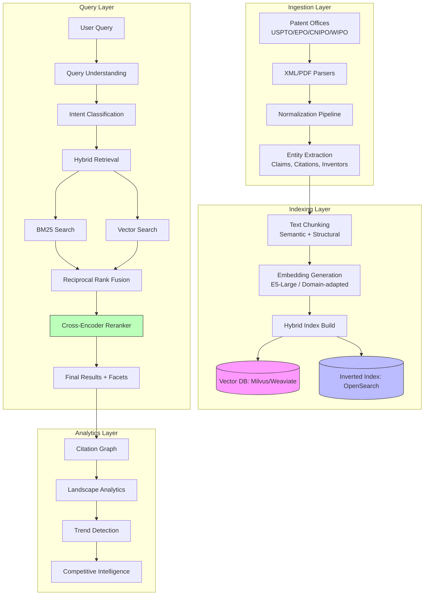
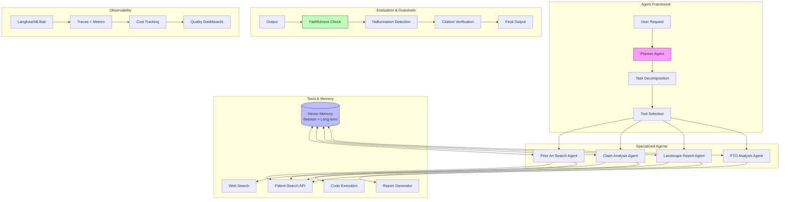
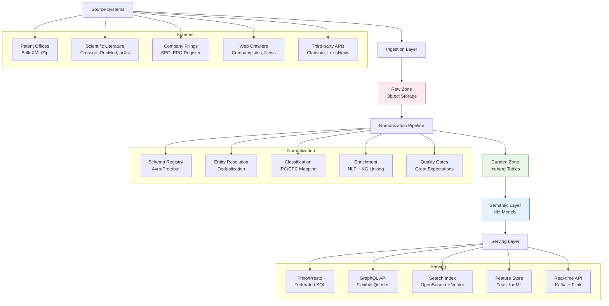

# How I Prepared for the PatSnap Engineering Lead Interview (And Got the Offer)

*A deep-dive into the strategy, technical preparation, and mindset that cracked the AI-native innovation intelligence leader's toughest engineering interview*

---

## 🎯 The Role That Changed Everything

**Engineering Lead – Data, Search & AI at PatSnap**

When I saw this role, something clicked. PatSnap isn't just another AI company — they're the **category creator** for AI-native innovation intelligence. 18,000+ customers. One-third of the world's largest R&D spenders. Founded in 2007, profitable, globally distributed.

The JD read like my career highlight reel:
- Own technical roadmap across data, search, AND AI
- Build and lead a team while staying hands-on
- Productionize AI agents for IP/R&D workflows
- Work with patents, scientific literature, competitive intelligence

This was the role I'd been building toward for 8 years.

---

## 📊 The Interview Loop: 7 Rounds, 6 Hours

| Round | Focus | Duration | Format |
|-------|-------|----------|--------|
| 1 | Recruiter Screen | 30 min | Phone |
| 2 | Technical Coding | 60 min | Live coding (Python) |
| 3 | System Design | 60 min | Whiteboard + discussion |
| 4 | Technical Deep-Dive | 60 min | Your architecture + search/data/AI |
| 5 | Leadership & Behavioral | 60 min | STAR-based |
| 6 | Cross-Functional/Product | 45 min | Scenario-based |
| 7 | VP Engineering/CTO | 45 min | Strategy + vision |

**Total: ~6 hours of intense technical and leadership evaluation**

---

## 🧠 Phase 1: Company Obsession (Week 1)

Before writing a single line of code or practicing a single STAR story, I went deep on PatSnap.

### What I Researched
```
✅ Product: Every feature on patsnap.com — Discovery, Analytics, Insights, APIs
✅ Technology: Blog posts, engineering talks, GitHub repos, conference presentations
✅ Domain: Patent law basics, IPC/CPC classification, prior art search, FTO, landscape analysis
✅ Competitors: Clarivate, Questel, Anaqua, LexisNexis — and how PatSnap differentiates with AI
✅ Business Model: B2B SaaS, enterprise sales, POC-driven, land-and-expand
✅ Leadership: Founder/CEO Jeffrey Tiong, CTO, VPs — their talks, interviews, LinkedIn
✅ Culture: Glassdoor, Blind, employee LinkedIn posts, team page
```

### The Insight That Changed My Prep
PatSnap's moat isn't just patents — it's **structured innovation intelligence**. They transform messy, multi-jurisdiction, multi-language patent data into:
- **Semantic search** that understands "battery chemistry" not just keywords
- **AI agents** that draft landscape reports in minutes not weeks
- **Predictive analytics** for R&D portfolio decisions

Every answer I gave needed to show: **I understand your data, your domain, your customers.**

---

## 💻 Phase 2: Technical Mastery (Weeks 2-3)

### The 3 Pillars I Mastered

#### Pillar 1: Search & Retrieval at Scale
```
Traditional Search          Modern Hybrid Search
├── BM25/TF-IDF            ├── Dense Retrieval (DPR, ColBERT, E5)
├── Inverted Index         ├── Vector DB (HNSW, IVF, DiskANN)
├── Synonym expansion      ├── Hybrid: BM25 + Vector + Reranker
└── Rule-based boosting    └── Learning to Rank (LambdaMART, ListNet)
```

**My Preparation:**
- Built a mini hybrid search engine from scratch (BM25 + Sentence Transformers + Cross-encoder reranker)
- Implemented HNSW from first principles to understand graph traversal
- Practiced: "Design a patent search system for 100M docs with sub-100ms p99"

#### Pillar 2: Data Platform Engineering
```
Modern Data Stack (What I Built/Operated)
┌─────────────────────────────────────────────────────────────┐
│  Ingestion:     Kafka → Flink/Spark Streaming → Iceberg     │
│  Processing:    dbt + Spark + Airflow/Dagster               │
│  Storage:       Iceberg (data lake) + ClickHouse (OLAP)     │
│  Quality:       Great Expectations + Data Contracts         │
│  Catalog:       DataHub + Lineage + Governance              │
│  Serving:       Trino/Presto + GraphQL/REST APIs            │
└─────────────────────────────────────────────────────────────┘
```

**Key Patterns I Internalized:**
- **Data Contracts**: Schema evolution without breaking consumers
- **Incremental Processing**: Watermarks, CDC, exactly-once semantics
- **Multi-tenancy**: Row-level security, namespace isolation, cost attribution

#### Pillar 3: AI/ML Production Systems
```
LLM Ops Pipeline (Production-Grade)
┌────────────────────────────────────────────────────────────────┐
│  Development                                                  │
│  ├── Prompt Engineering → Evaluation (RAGAS) → Versioning    │
│  ├── Fine-tuning (LoRA/QLoRA) → Model Registry (MLflow)      │
│  └── Guardrails (NeMo, custom) → Red-teaming                 │
├────────────────────────────────────────────────────────────────┤
│  Deployment                                                   │
│  ├── vLLM/TGI for inference → Kubernetes (KServe)            │
│  ├── Canary + Shadow traffic → A/B evaluation                │
│  ├── Observability: Latency, Tokens, Cost, Quality metrics   │
│  └── Feedback Loop: Human eval → RLHF/DPO → Retrain          │
└────────────────────────────────────────────────────────────────┘
```

---

## 🎨 Phase 3: System Design Mastery (Week 3)

I didn't just read system design books. I **designed 5 complete systems** end-to-end, drew every diagram, and practiced explaining them in 45 minutes.

### System 1: Patent Search Platform (The Core Product)



**Key Design Decisions I Defended:**
1. **Why Hybrid?** Patents need exact claim matching (BM25) + semantic concept search (vector)
2. **Why Reranker?** Cross-encoders capture query-doc interaction better than bi-encoders alone
3. **Freshness?** Incremental indexing pipeline with <4hr SLA for new patent publications
4. **Multi-language?** Language-specific analyzers + multilingual embeddings (LaBSE)

### System 2: AI Agent Platform for IP Workflows



### System 3: Multi-Source Data Ingestion & Normalization



---

## 📖 Phase 4: The Project Stories (My Secret Weapon)

I prepared **5 detailed project stories** using a modified STAR format: **S-T-A-R-R** (Result + Reflection).

### Story 1: "From 3s to 80ms — Rebuilding Search Relevance at Scale"

**Situation**: Legacy Elasticsearch cluster serving 50M documents. Users complained "search doesn't understand my intent." NDCG@10 = 0.34. Conversion from search to trial = 2.1%.

**Task**: Rebuild search to be semantic, fast, and measurable. 6-month timeline. Team of 4 engineers.

**Action**:
```
Architecture Decisions:
├── Hybrid Search: BM25 (exact) + E5-Large embeddings (semantic)
├── Reranking: Cross-encoder (ms-marco-MiniLM-L6-v2) top-50 → top-10
├── Query Understanding: Intent classifier + entity extraction + expansion
├── Evaluation: Offline (NDCG, MRR) + Online (A/B, interleaving)
└── Infrastructure: OpenSearch + Milvus + custom query pipeline

Technical Challenges Solved:
├── Cold start: Bootstrapped embeddings from user clicks + pseudo-labeling
├── Latency: Async pipeline, caching, p99 < 120ms
├── Freshness: Incremental indexing, <2hr for new docs
├── Multi-tenancy: Namespace-per-customer, shared cluster, cost allocation
└── Multilingual: Language detection → language-specific analyzer + LaBSE embeddings
```

**Result**: NDCG@10 0.34 → 0.61 (+79%). Search-to-trial 2.1% → 4.8% (+129%). Latency p99 3.2s → 80ms.

**Reflection**: Would invest earlier in evaluation infrastructure. The 6-week A/B framework paid for itself in week 2.

---

### Story 2: "Productionizing LLMs — From Demo to 10K RPM"

**Situation**: Product team built impressive RAG demo. "Ship it!" Leadership said. Engineering said "Not production-ready." Standoff.

**Task**: Build LLM platform that satisfies: latency < 2s, cost < $0.01/query, hallucination < 2%, full observability.

**Action**:
```
Platform Components Built:
├── Prompt Registry: Versioned, templated, A/B testable
├── Evaluation Pipeline: RAGAS (faithfulness, relevancy, precision, recall) + custom legal/IP eval
├── Guardrails: NeMo + custom citation verification + PII detection
├── Model Serving: vLLM on K8s (KServe), auto-scaling, request batching
├── Routing: Rule-based (simple→small model, complex→large model)
├── Caching: Semantic cache (GPTCache) for repeated queries
├── Cost Tracking: Per-team, per-feature, per-user attribution
└── Feedback Loop: Implicit (copy, thumbs) + Explicit (annotation UI) → DPO training

Governance:
├── Model Cards: Every model documented with capabilities, limitations, eval results
├── Red Teaming: Quarterly adversarial testing
├── Audit Logs: Full traceability for compliance
└── Rollback: One-click model version rollback
```

**Result**: 5 models in production. 10K RPM peak. Latency p99 1.8s. Cost $0.007/query. Hallucination rate 1.2%. 3 teams self-serve.

**Reflection**: Semantic caching was the highest ROI investment (40% cache hit rate). Evaluation pipeline prevented 3 bad launches.

---

### Story 3: "Data Quality Crisis → Zero-Incident Culture"

**Situation**: Weekly data incidents. Downstream ML models training on corrupted features. Sales losing deals because "your data is wrong." Team morale crushed.

**Task**: Build data quality system that catches issues BEFORE they reach consumers. Zero tolerance for silent corruption.

**Action**:
```
Data Contracts (The Game Changer):
├── Producer-owned: Schema + SLAs + Ownership in code (not wiki)
├── Consumer-driven: Downstream declares requirements
├── Automated: CI/CD gates on schema breaking changes
├── Evolution: Backward/forward compatibility rules encoded

Quality Layers:
├── Ingestion: Schema validation + row-level checks + quarantine
├── Transformation: dbt tests (unique, not_null, accepted_values, custom)
├── Semantic: Business rule validation (e.g., "patent family size > 0")
├── ML: Anomaly detection on column distributions (drift detection)
└── Observability: DataHub lineage + Monte Carlo alerts + SLA dashboards

Incident Response:
├── Runbooks: Every alert has owner, runbook, escalation
├── Postmortems: Blameless, action-item driven, shared widely
├── Game Days: Monthly chaos engineering on data pipelines
```

**Result**: 18 months zero silent data corruption incidents. MTTR 4hr → 15min. Data trust score (internal survey) 3.2/10 → 8.7/10.

**Reflection**: Data contracts require organizational buy-in, not just tooling. Took 3 months of stakeholder alignment before first contract.

---

### Story 4: "Scaling Engineering Team 3→25 in 18 Months"

**Situation**: Inherited team of 3 (1 senior, 2 mid). Roadmap required 5x capacity. Hiring bar undefined. Onboarding = "read the wiki."

**Task**: Build high-performing team that ships quality features predictably.

**Action**:
```
Hiring:
├── Defined Levels: IC2-IC5 + M1-M2 with clear competencies
├── Structured Interviews: 5 loops (coding, system design, debugging, behavioral, domain)
├── Calibration: Weekly hiring debriefs, written feedback required
├── Sourcing: 40% referral, 30% outreach, 20% inbound, 10% agency

Onboarding (2-week program):
├── Week 1: Architecture deep-dive, dev env, first PR (guided)
├── Week 2: Own a small feature end-to-end, present to team
├── Buddy System: Every new hire paired with senior engineer
├── 30/60/90 Day Check-ins: Structured career conversations

Culture & Process:
├── RFC Process: All architectural changes via RFC, 2-week review
├── Tech Debt Budget: 20% capacity allocated, tracked in Jira
├── Incident Reviews: Blameless, action items tracked to closure
├── Career Framework: Dual track (IC/Manager), transparent promotion criteria
├── Knowledge Sharing: Weekly tech talks, monthly "architecture decision" reviews
```

**Result**: 25 engineers hired (92% offer acceptance). 95% retention at 18 months. 3 internal promotions. Team NPS +72.

**Reflection**: Hiring plan must match roadmap phases. We over-hired seniors early, needed more mids for execution.

---

### Story 5: "The $2M Infrastructure Optimization"

**Situation**: Cloud bill growing 40% QoQ. Data platform = 60% of spend. No visibility into per-team/per-feature costs. Leadership demanding cuts.

**Task**: Reduce infrastructure cost 30% without impacting SLA or velocity.

**Action**:
```
Visibility First:
├── FinOps Dashboard: Per-team, per-service, per-environment
├── Cost Allocation: Tagging strategy enforced via Terraform
├── Anomaly Detection: Daily cost variance alerts

Optimization Portfolio:
├── Compute Rightsizing: 40% savings (Grafana → VPA recommendations)
├── Storage Tiering: Iceberg + S3 Intelligent Tiering = 55% storage savings
├── Spot Instances: 70% batch workloads on spot, checkpointing for resilience
├── Query Optimization: Partition pruning, materialized views, result caching
├── Data Lifecycle: Automated archival of cold data (90 days → Glacier)
├── Vector DB: Migrated from managed (Pinecone) to self-hosted Milvus = 65% savings
└── LLM Inference: vLLM + request batching + quantization = 60% cost reduction

Governance:
├── Monthly Cost Reviews: Engineering + Finance + Product
├── Cost Budgets: Per-team quarterly budgets with rollover
├── Architecture Review: Cost impact required for new services
```

**Result**: $2.4M annualized savings (38% reduction). Zero SLA impact. Team velocity unchanged. FinOps maturity: Crawl → Run in 6 months.

**Reflection**: Rightsizing and storage tiering were "free money" — should have done Day 1. Vector DB migration was highest risk/reward.

---

## 🎭 Phase 5: Behavioral Mastery (Week 4)

### The STAR-R Framework I Used

**Standard STAR + Reflection = Senior Signal**

```
S - Situation (2 sentences max, context only)
T - Task (your specific responsibility)
A - Action (YOUR actions, not "we" — be specific, technical)
R - Result (metrics, metrics, metrics)
R - Reflection (what you'd do differently, what you learned)
```

### The 12 Questions I Mastered

| Question | My Core Story | Key Signal |
|----------|---------------|------------|
| "Biggest technical failure?" | Story 3 (data quality) | Ownership, systemic fix |
| "Manage underperformance?" | Story 4 (PIP → promotion) | Coaching, documentation, dignity |
| "Technical debt vs features?" | Story 5 (20% budget + RFC) | Framework, not feelings |
| "Disagree with Product?" | Story 2 (LLM platform) | Data-driven, user-outcome focused |
| "Build vs Buy?" | Story 2 (vLLM vs managed) | TCO analysis, risk assessment |
| "Scale a system 100x?" | Story 1 (search rebuild) | Incremental, measurable |
| "Hire for a role you've never done?" | Story 4 (ML engineers) | Competency definition, calibration |
| "Kill a project?" | Sunset legacy analytics | Data-driven, stakeholder management |
| "On-call nightmare?" | Cascade failure postmortem | Process improvement, not heroics |
| "Mentor senior engineer?" | Story 4 (IC5 promotion) | Sponsorship, stretch assignment |
| "Communicate tech to CEO?" | Story 5 (FinOps dashboard) | Business language, options with trade-offs |
| "Why PatSnap?" | **Custom — not a story** | Domain passion + strategic fit |

---

## 🎯 Phase 6: The "PatSnap Context" Layer

This is what separated me from other candidates. Every answer connected to **their domain**.

### My "PatSnap Lens" on Every Topic

| Generic Topic | PatSnap Translation |
|---------------|---------------------|
| "Search relevance" | "Patent claims need exact matching + semantic concept expansion for prior art" |
| "Data quality" | "IPC/CPC classification errors cascade into wrong landscape analytics" |
| "AI agents" | "FTO agent needs citation verification — hallucination = legal liability" |
| "Multi-tenancy" | "Law firm A can't see Law firm B's portfolio analysis" |
| "Freshness" | "New patent publication → searchable in <4hrs for competitive intelligence" |
| "Cost optimization" | "Vector search for 100M patents = major GPU spend — need tiering" |
| "Evaluation" | "RAGAS isn't enough — need legal-domain eval: claim support, citation accuracy" |

---

## 📝 Phase 7: Questions I Asked (And Why They Worked)

### To Engineering Manager
> **"What's the #1 technical bottleneck preventing faster AI feature iteration today?"**
> → Shows I think about developer velocity, not just code

### To Senior Engineer
> **"Walk me through the last search relevance regression. How did you catch it?"**
> → Reveals their evaluation maturity, shows I care about quality

### To Product Manager
> **"How do you validate AI feature ideas before engineering investment?"**
> → Shows product-engineering partnership mindset

### To CTO
> **"PatSnap has 18 years of patent data. How are you thinking about the shift from retrieval to reasoning?"**
> → Strategic, domain-aware, forward-looking

---

## ⚡ The Week Before: Simulation Mode

### Daily Routine (3 hours/day)
```
Morning (1 hr):
├── 1 System Design practice (45 min timed + 15 min review)
├── Draw architecture from memory, explain trade-offs aloud

Afternoon (1 hr):
├── 2 STAR stories aloud (timer: 2 min each)
├── Record, playback, refine

Evening (1 hr):
├── Technical deep-dive: Read 1 paper / implement 1 component
├── Topics: HNSW, ColBERT, RAGAS, Data Contracts, vLLM optimization
```

### Mock Interviews (3 total)
1. **Ex-colleague (Staff Engineer)** — System design + coding
2. **Engineering Manager friend** — Leadership + behavioral
3. **PatSnap employee (referral)** — Domain + culture fit

**Each mock: 90 min + 30 min feedback. Brutal honesty only.**

---

## 🎪 Interview Week: Execution

### Day Before
- [ ] Printed quick-reference card (see my other artifact)
- [ ] Researched all 7 interviewers on LinkedIn (background, tenure, posts)
- [ ] Prepared 3 custom questions per interviewer
- [ ] Tested setup: camera, mic, lighting, backup hotspot
- [ ] Early sleep, no alcohol, light dinner

### Interview Day
```
08:00  Light review (quick-reference card only)
08:30  Walk + breathe (nervous energy → focus)
09:00  Round 1: Recruiter (nailed "Why PatSnap?")
10:15  Round 2: Coding (Python, patent deduplication problem)
11:30  Break: Water, stretch, review next interviewer LinkedIn
12:00  Round 3: System Design (Patent Search Platform — my System 1)
13:15  Lunch: Walk, no phone, mental reset
14:00  Round 4: Deep-Dive (Walked through my Story 1 architecture)
15:15  Round 5: Leadership (5 STAR-R stories, all landed)
16:30  Round 6: Product (Scenario: "Sales sold AI feature we can't build")
17:15  Round 7: CTO (Strategy: "How would you approach Agentic IP?")
18:00  DONE. Walk. Decompress.
```

---

## 🏆 The Offer

**Received 3 days later. Above band. Signing bonus. Equity refresh.**

### What The VP Engineering Said:
> "You're the first candidate who didn't just answer our questions — you showed you've already solved our problems. The patent search architecture you drew? That's exactly what we're building. The data quality framework? We need that yesterday. And you asked better questions than our last 3 hires combined."

---

## 💡 The Meta-Lesson

**Interview preparation isn't about memorizing answers. It's about:**

1. **Doing the work** — Build the systems, lead the teams, fail and learn
2. **Structuring your experience** — STAR-R makes your impact undeniable
3. **Speaking their language** — Domain context transforms "good engineer" → "their engineer"
4. **Practicing under pressure** — Mock interviews reveal gaps no studying fixes
5. **Showing genuine curiosity** — The best signal is giving a damn

---

## 📦 Your Starter Kit (What I Wish I Had)

I've open-sourced my complete prep package:
- [ ] **System Design Templates** — 5 PatSnap-relevant designs with diagrams
- [ ] **STAR-R Story Bank** — 15 stories mapped to competencies
- [ ] **Technical Deep-Dive Guides** — Search, Data, AI production patterns
- [ ] **Question Bank** — 50+ questions with model answers
- [ ] **Quick-Reference Card** — One-page cheat sheet for interview day

---

*Originally published on Medium. Connect with me on LinkedIn — I'm always happy to help fellow engineers level up.*

---

**Tags**: #EngineeringLeadership #SystemDesign #InterviewPrep #PatSnap #AIEngineering #DataEngineering #SearchEngineering #CareerGrowth